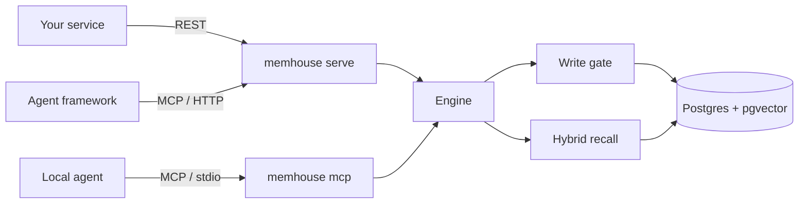
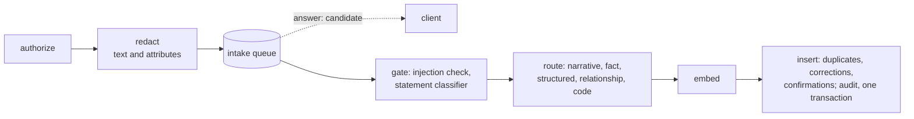
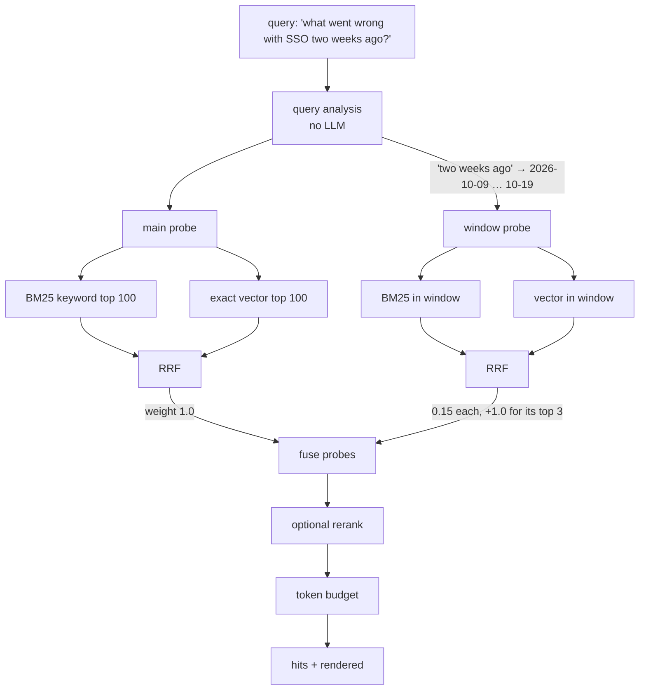

<!-- SPDX-License-Identifier: CC-BY-4.0 -->
# API reference (v1)

MemHouse has three ways in, and all of them call the same engine:

| Transport | Start it with | Who uses it |
|---|---|---|
| REST (JSON over HTTP) | `memhouse serve` | your own code, back-office systems, the Memory Browser |
| MCP over HTTP (`POST /mcp`) | `memhouse serve` | remote agents and agent frameworks |
| MCP over stdio | `memhouse mcp` (the agent launches it) | local agents: Claude Code, Cursor, VS Code, … |



This is **API v1**, version `1.4.0` (1.1 added principals, agent tokens, review and labels; 1.2
added recall explanations and `/metrics`; 1.3 added policies; 1.4 the write pipeline: `wait`,
`include_candidates`, exact recall, `degraded` and the `unavailable` code). The machine-readable contract is the OpenAPI 3.1 document at
`GET /v1/openapi.json`, also kept in the repository as [`api/openapi.json`](../api/openapi.json)
and printed by `memhouse openapi`. It is generated from the request and response types, so it
can't drift from the code. What may change, and how changes are announced, is in the
[API stability policy](api-stability.md).

Every example on this page was run against a real server. Only the ids and timings differ from
run to run.

## Contents

- [Conventions](#conventions): authentication, actor, idempotency keys, subjects, scopes, times, errors
- [The four operations](#the-four-operations): [remember](#post-v1remember-propose-a-memory), [recall](#post-v1recall-retrieve-memories-for-a-context) and [its explanation](#get-v1recallsidexplanation-why-a-recall-returned-what-it-did), [revise](#post-v1revise-supersede-a-memory), [forget](#post-v1forget-delete-memories)
- [Conversations](#conversations): ingest
- [Reading records](#reading-records): get, list
- [Labels and review](#labels-and-review): relabel, commit or reject a candidate
- [Identity](#identity): who am I, agent tokens
- [Policies](#policies): validate, propose, diff, approve, roll back
- [Operations](#operations): subjects, stats, audit, enrichment status, health
- [MCP](#mcp)
- [Deprecated routes and tool names](#deprecated-routes-and-tool-names)
- [Client examples](#client-examples): Python, TypeScript
- [Errors](#errors)

## Conventions

**Base URL.** `http://127.0.0.1:7077` by default. Set it with `[server] bind` or `MEMHOUSE_BIND`.

**Authentication (GOV-01).** Every `/v1/*` route and `/mcp` needs a credential, sent as
`Authorization: Bearer <credential>` or `x-api-key: <credential>`:

| Credential | Looks like | Comes from | Acts as |
|---|---|---|---|
| a principal's API key | `mh_<id>_<secret>` | `memhouse key create <principal>` | that agent, user or admin |
| an agent token | `mht.<claims>.<signature>` | `POST /v1/tokens`, at most an hour | an agent, for a verified user, with narrower permissions |
| a bootstrap key | from `[server] api_keys` | `memhouse init`; `memhouse key` prints it | `admin:bootstrap`, for setting up principals |

```bash
KEY=$(memhouse key)            # the bootstrap key
curl -s localhost:7077/v1/whoami -H "authorization: Bearer $KEY"
# {"principal":"admin:bootstrap","kind":"admin","tenant":"default","scopes":[…],"via":"bootstrap",…}
```

There is no unauthenticated mode. `/health`, `/v1/openapi.json` and `/` (the Memory Browser page,
which asks for a key) are the only open routes. A refused credential gets `401` with the reason
(`unknown key`, `revoked key`, `expired token`, …), and the attempt is audited as `auth.failed`.

**Authorization (GOV-02).** Every operation is decided before it runs: the credential must carry
the permission (`memory:read` for recall, get and list; `memory:write` for remember, revise and
ingest; `memory:forget`; `memory:erase` for forgetting a subject, source, someone else's records
or the tenant; `memory:label`; `memory:review`; `token:issue`; `ops:read`; `audit:read`). The
subject must match the principal's subjects, and the kinds and labels must be allowed. A refusal
is `403 forbidden` with the rule that refused it, audited as `access.denied`. A record the caller
may not see answers `404`. See [governance.md](governance.md#access-control) for the full rules.

**Who wrote it.** The audit actor and the record's `provenance.agent` are the authenticated
principal. `provenance.user` is the verified user. The `x-memhouse-actor` header and the bodies'
`actor` field are ignored since 1.1. An admin, or an agent trusted to act for users (`act_as`),
may name the user with `x-memhouse-user`; a user's key always acts for that user, and a token for
its own user. A body naming another `user` is refused.

**Idempotency keys (CORE-06).** Every write (`remember`, `revise`, `forget`, `ingest`) takes an
`Idempotency-Key` header or a `request_key` field (1 to 255 characters). Send both only if they
are equal. A repeat with the same key and the same body returns the first response and changes
nothing: no second record, no second audit event. The same key with a different body is a `409
conflict`. Keys are kept per tenant, with the subject they are about, so erasing a subject also
removes its keys. Recall and the reads are naturally idempotent and take no key.

```bash
curl -s localhost:7077/v1/remember -H "authorization: Bearer $KEY" -H "content-type: application/json" \
  -H "Idempotency-Key: crm-sync-8812" -d '{"subject":"customer:acme","content":"Acme is on the Enterprise plan; renewal due 2027-03-01"}'
# {"id":"01a19ad2-9a38-70b6-a1d9-3703432b8a32","status":"committed","deduplicated":false}
# the same call again: the same response, nothing stored
# the same key with other content:
# {"error":"request key 'crm-sync-8812' was already used for a different request","code":"conflict"}
```

Without a key, writes are still deduplicated by content (an identical or near-identical memory
returns the existing id), but a revise or a forget repeated after a timeout is not.

**Subjects and tenants.** A *subject* is whose memory it is, for example `user:alice`,
`customer:42`, `account:acme` or `repo:api`. Recall never crosses subjects. If a call names no
subject, the configured `default_subject` is used. A *tenant* is the top-level partition. It
always comes from the credential's principal. A body may repeat it, but a body naming another
tenant is refused.

**Scopes.** A record can carry a `scope`: `{org, team, agent, user, session}`, any of them. Every
read is filtered by the caller's own scope, which the server injects. A user sees records scoped
to them and records that set no user, never another user's. An agent sees its own agent-scoped
records. A caller without a team or org sees no team- or org-scoped records. Admins see
everything. A request may narrow its scope (a `session`), but it can't point it at someone else:
`{"user": "user:bob"}` from Ana is a `403`. Precedence in ranking (user over team over org) comes
in G11.

**Times.** ISO-8601 / RFC 3339 in UTC, for example `2026-10-14T15:00:00Z`. MCP tools also
accept a plain date (`2026-10-14`).

**Compatibility.** Clients must ignore response fields and enum values they don't know: minor
versions add them (see the [stability policy](api-stability.md)). Unknown request fields are
ignored.

**Memory kinds.**

| Kind | Use it for | Example |
|---|---|---|
| `working` | short-lived task context; expires (`[memory] working_ttl_secs`, 24 h) | "Drafting the reply to ticket 8812" |
| `episodic` | conversation rounds (written by ingest) | "user: Our SSO broke… / assistant: Upload the new certificate…" |
| `semantic` | durable facts | "Acme is on the Enterprise plan" |
| `preference` | likes, dislikes, ways of working | "Prefers email over phone calls" |
| `procedural` | how-to knowledge, conventions | "Run `make test-int` before merging" |
| `commitment` | promises and follow-ups, with a due date | "Send the SSO fix by Friday 2026-10-16" |
| `document` | reference text | a policy excerpt |

**The Memory object.** It is returned by get, list and recall.

```json
{
  "id": "01a19ad2-9a38-70b6-a1d9-3703432b8a32",
  "tenant": "default",
  "subject": "customer:acme",
  "kind": "semantic",
  "status": "committed",
  "content": "Acme is on the Enterprise plan; renewal due 2027-03-01",
  "occurred_at": "2026-11-02T05:54:15.736955Z",
  "valid_from": "2026-11-02T05:54:15.736955Z",
  "labels": [],
  "tags": ["plan"],
  "source": "support-bot",
  "confidence": 1.0,
  "metadata": {},
  "created_at": "2026-11-02T05:54:15.736955Z",
  "scope": {"team": "support"},
  "provenance": {"agent": "support-bot", "user": "user:ana", "policy_version": "gov-6efbc1d9b265", "request_key": "crm-sync-8812"}
}
```

| Field | Meaning |
|---|---|
| `status` | `committed` (recallable), `superseded` (replaced by a newer version, kept for audit and as-of recall), `quarantined` (looked like prompt injection; never recalled), `candidate` (waiting for its gate), `rejected`, `expired` (past `expires_at`). See the [lifecycle](schema.md#lifecycle-core-02). |
| `occurred_at` | When the thing happened (event time). Date-aware recall uses it. |
| `valid_from` / `valid_to` | When the memory is true. After `valid_to` it drops out of recall. A superseded version's `valid_to` is when its successor started. |
| `supersedes` | The id of the version this one replaced. |
| `source` | Where it came from: the actor by default, `mcp`, or `enrich:<model>` for extracted facts |
| `metadata` | Free-form JSON. Enrichment facts carry `derived: true`, `source_ids`, `extractor` and `prompt_version`. |
| `expires_at` | After this the memory is not recalled (working memory always has one). |
| `scope` | `{org, team, agent, user, session}`, see [Scopes](#conventions). |
| `provenance` | `agent` (writer), `user` (acting user), `policy_version` (the policy that admitted it), `request_key`, and for extracted facts `extractor` and `extractor_config`. |

Fields that are empty or unset are left out of the JSON.

---

## The four operations

`remember`, `recall`, `revise` and `forget` are the core of the API (CORE-01). They have the same
names, inputs and outputs over REST and MCP.

### `POST /v1/remember`: propose a memory

Body (`RememberRequest`):

| Field | Type | Required | Notes |
|---|---|---|---|
| `content` | string | yes | Write it so it stands alone (who, what, when). At most `max_content_chars` (20,000) characters. |
| `subject` | string | | defaults to `default_subject` |
| `kind` | kind | | defaults to `semantic` |
| `tags` | string[] | | used as recall filters |
| `occurred_at` | time | | event time; defaults to now |
| `valid_to` | time | | when it stops being true, e.g. an expiry or due date |
| `expires_at` | time | | when it stops being recalled; `working` memory defaults to now + `[memory] working_ttl_secs` |
| `labels` | string[] | | sensitivity labels; `[governance] denied_labels` keeps them out of recall |
| `scope` | object | | `{org, team, agent, user, session}` |
| `user` | string | | the user the agent acts for (provenance) |
| `request_key` | string | | idempotency key, or the `Idempotency-Key` header |
| `structured` | `{record_type, attrs}` | | the queryable form of a record (an order, a ticket); same id as the text |
| `code_refs` | `{path, blob_hash}[]` | | files the memory is about, for staleness checks |
| `source` | string | | defaults to the actor |
| `metadata` | object | | stored as given |
| `supersedes` | uuid | | replace this memory; prefer [`revise`](#post-v1revise-supersede-a-memory) |
| `wait` | bool | | wait for the write gate (at most `[intake] wait_timeout_ms`, 10 s) and answer with its decision; default `false` |
| `tenant`, `actor` | string | | |

```bash
curl -s localhost:7077/v1/remember -H "authorization: Bearer $KEY" -H "content-type: application/json" \
  -H "x-memhouse-actor: support-bot" -d '{
  "subject": "customer:acme",
  "content": "Acme is on the Enterprise plan; renewal due 2027-03-01",
  "kind": "semantic",
  "tags": ["plan"],
  "scope": {"team": "support"},
  "user": "user:ana"
}'
```

```json
{"id":"01a19ad2-9a38-70b6-a1d9-3703432b8a32","status":"candidate","deduplicated":false}
```

The response comes back as soon as the write is **durably queued** (API 1.4, G10), with the
record's `id` and `status: candidate` (CORE-02). The text is already redacted at that point:
nothing unredacted is ever written, not even to the queue. The write gate then runs, usually
within milliseconds, and the record becomes `committed` (recallable), stays `candidate` (a plan
or speculation, see below), or becomes `quarantined` or `rejected`. Read its state with
[`GET /v1/memories/{id}`](#get-v1memoriesid-one-memory-and-its-state), which answers for a
queued id too, or send `"wait": true` to get the decision in the response:

```json
{"id":"01a19ad2-9a38-70b6-a1d9-3703432b8a32","status":"committed","deduplicated":false,
 "statement":"fact","route":"fact"}
```

The write pipeline runs these stages in order (TR-IN-04):



The gate reads each statement as one of `fact`, `event`, `correction`, `plan`, `speculation`,
`preference` or `instruction` (QUAL-02), and that decides the record's state:

| Situation | With `wait`, the response is |
|---|---|
| A fact, event, preference or instruction | `{"status":"committed","statement":"fact",…}` |
| A plan or speculation ("plans to", "might", "I think") | `{"status":"candidate","statement":"plan","note":"held as a candidate: reads as plan …"}`: hidden from recall (PR-7) until a completed event confirms it (it then becomes `committed`) or it passes its `valid_to`, else `[intake] plan_ttl_days` (90), and expires. Recall returns it only with `include_candidates`. Store a to-do you want recalled as `kind: commitment`. |
| A correction ("no longer", "actually", "now lives in") | `{"status":"committed","statement":"correction","superseded":"<old id>"}` when a record of the same kind is close enough (cosine ≥ `[intake] correction_threshold`, 0.8, sharing a content word): it is superseded, kept for audit and as-of recall (QUAL-01) |
| Card number in the text | `"redactions":["card"]`, and the stored text reads `Card on file is [REDACTED:card], …` (already in the immediate answer) |
| Prompt injection | `{"status":"quarantined","note":"quarantined: looks like an instruction to the agent (override)"}` |
| Same text sent again | `{"id":"<existing id>","status":"committed","deduplicated":true,"note":"identical memory already stored"}`, answered at once, nothing queued |
| Near-duplicate (cosine ≥ 0.97, same kind) | the existing id, with `deduplicated: true`; the new id is kept as `rejected` with `metadata.duplicate_of` |
| A JSON object with a `record_type` as `content` | stored as a [structured record](#exact-structured-recall) (`route: structured`); its text becomes `order: order_id=A-1001, status=shipped` |

A write the intake queue can't take (the database is down) is refused with `503 unavailable` and
`Retry-After: 1`; nothing is stored, so retrying (with the same `request_key`) is safe.

### `POST /v1/recall`: retrieve memories for a context

| Field | Type | Default | Notes |
|---|---|---|---|
| `query` | string | required | natural language |
| `subject`, `tenant` | string | configured | |
| `k` | int | 10 | number of hits returned (at most 200) |
| `kinds` | kind[] | all | e.g. `["semantic","commitment"]` |
| `tags` | string[] | any | records with at least one of them |
| `scope` | object | none | see [Scopes](#conventions) |
| `as_of` | time | now | "what did we know then": filters validity and event time, and finds versions superseded since |
| `token_budget` | int | none | stop adding hits once about this many tokens are returned (the first hit is always kept) |
| `render` | bool | false | also return the hits as a text block for a prompt (`rendered`) |
| `reference_time` | time | `as_of`, else now | the "now" used to read "two weeks ago" in the query; filters nothing |
| `mode` | `hybrid` \| `dense` \| `keyword` | `hybrid` | |
| `rerank` | bool | config | cross-encoder rerank (+~0.9 s on CPU) |
| `analyze` | bool | config | date-aware query analysis on or off; it also finds record identifiers for the exact probe |
| `include_candidates` | bool | false | also return candidates (held plans and speculation, proposals waiting for review), each with `status: candidate` (PR-7) |
| `exact` | `{record_type?, attrs}` | none | an exact query over structured records, answered first (see below) |

```bash
curl -s localhost:7077/v1/recall -H "authorization: Bearer $KEY" -H "content-type: application/json" -d '{
  "subject": "customer:acme",
  "query": "what went wrong with SSO two weeks ago and which plan are they on?",
  "k": 2,
  "reference_time": "2026-10-28T12:00:00Z",
  "render": true
}'
```

Response, with the second hit shortened:

```json
{
  "hits": [
    {
      "memory": {
        "id": "01a19ad2-9a86-70cf-b2eb-87fa77ba0cb7", "tenant": "default", "subject": "customer:acme",
        "kind": "episodic", "status": "committed",
        "content": "user: Our SSO login broke after we rotated the Okta certificate yesterday.\nassistant: Upload the new certificate under Settings > SSO; I will follow up on Friday.",
        "session_id": "call-2026-10-14", "turn_ref": "0,1",
        "occurred_at": "2026-10-14T15:00:00Z", "valid_from": "2026-10-14T15:00:00Z",
        "labels": [], "tags": [], "source": "support-bot", "confidence": 1.0,
        "metadata": {"message_refs": ["0", "1"], "round": 0},
        "created_at": "2026-11-02T05:54:15.812217Z",
        "provenance": {"agent": "support-bot", "policy_version": "gov-6efbc1d9b265"}
      },
      "score": 0.0352459, "keyword_rank": 1, "vector_rank": 1, "similarity": 0.6844323
    },
    {
      "memory": {"id": "01a19ad2-9f18-76ff-aab9-e9c1b27a5f0d", "kind": "semantic",
                 "content": "Acme moved to the Enterprise Plus plan on 2026-10-20; renewal due 2027-03-01",
                 "supersedes": "01a19ad2-9a38-70b6-a1d9-3703432b8a32", "...": "..."},
      "score": 0.016129032, "keyword_rank": 2, "vector_rank": 2, "similarity": 0.5260695
    }
  ],
  "took_ms": 44.35, "embed_ms": 23.76, "search_ms": 20.58, "rerank_ms": 0.0,
  "candidates": 2, "reranked": false,
  "plan": {
    "windows": [{"start": "2026-10-09T14:24:01Z", "end": "2026-10-19T09:35:59Z",
                 "phrase": "two weeks ago", "meaning": "about 2026-10-14 (Wed)"}],
    "subqueries": []
  },
  "rendered": "2 memories of customer:acme (most relevant first):\n- [01a19ad2-9a86-70cf-b2eb-87fa77ba0cb7] (episodic, 2026-10-14) user: Our SSO login broke after we rotated the Okta certificate yesterday.\n  assistant: Upload the new certificate under Settings > SSO; I will follow up on Friday.\n- [01a19ad2-9f18-76ff-aab9-e9c1b27a5f0d] (semantic, 2026-11-02 #plan) Acme moved to the Enterprise Plus plan on 2026-10-20; renewal due 2027-03-01"
}
```

Every response has a `recall_id`: the key of its [explanation](#get-v1recallsidexplanation-why-a-recall-returned-what-it-did).

The response is model-neutral (INT-04). `hits` is structured JSON with each record's id and
provenance. `rendered` is the same hits as plain text, one line per memory with its id, kind,
date and tags, to paste into any model's prompt as it is. MCP tools return both.

How to read a hit:

| Field | Meaning |
|---|---|
| `score` | the fused score (weighted reciprocal rank fusion); compare it only within one response |
| `keyword_rank`, `vector_rank` | the hit's rank in each retriever; a missing rank means that retriever didn't find it |
| `similarity` | cosine similarity of the best vector |
| `rerank_score` | present when reranking ran |
| `plan.windows` | time phrases the query analysis found, and the window each was read as |
| `plan.exact` | record identifiers in the query ("A-1001", "#4521") looked up exactly |
| `exact` | the hit is a structured record matched exactly (HYB-02), not by similarity; exact hits come first |
| `degraded` | set when retrieval failed or overran `[memory] recall_timeout_ms` (450 ms, so the answer comes within 500 ms): `hits` is then empty and not a real answer (PERF-07). Carry on without memory; don't retry in a loop. |

#### Exact structured recall

Structured records (a `structured` form, or JSON content with a `record_type`) also live as rows
in the structured table (HYB-02). Recall planning (HYB-03) mixes keyword, vector and exact
retrieval: identifiers in the question are looked up in the subject's structured attributes, and
`exact` asks for a match directly:

```bash
curl -s localhost:7077/v1/recall -H "authorization: Bearer $KEY" -H "content-type: application/json" -d '{
  "subject": "customer:acme", "query": "order status",
  "exact": {"record_type": "order", "attrs": {"order_id": "A-1001"}}
}'
```

Exact matches obey the same filters as the rest of recall (status, labels, validity, scope), and
come first with `"exact": true`.



**Recipes**

```bash
# Only open promises for a customer
-d '{"subject":"customer:acme","query":"what did we promise?","kinds":["commitment"]}'

# What did we believe on 1 October? (returns the version of each fact that was current then)
-d '{"subject":"customer:acme","query":"which plan is Acme on?","as_of":"2026-10-01T00:00:00Z"}'

# Only what Ana's agent may see: her records and the unscoped ones
-d '{"subject":"customer:acme","query":"renewal","scope":{"user":"ana"}}'

# Fit the context window of a small model, ready to paste
-d '{"subject":"user:alice","query":"travel preferences","k":30,"token_budget":800,"render":true}'

# Exact identifiers (order numbers, error codes): keyword only
-d '{"subject":"customer:acme","query":"ERR_SAML_2041","mode":"keyword"}'
```

### `GET /v1/recalls/{id}/explanation`: why a recall returned what it did

The explanation of a recall (GOV-04), by its `recall_id`. It holds:

- the recall's parameters, principal, verified user, policy version, denied labels and scope;
- the time per stage, and the database round trips (1);
- each returned record with its ranking signals;
- every other record of the subject that matched the query, with the reason it was left out:

| `reason` | |
|---|---|
| `status` | quarantined, candidate, rejected, expired, or superseded |
| `access` | scoped to another user, agent, team or org |
| `label` | a label denied to the caller (`detail`: which) |
| `validity` | not valid at the recall's time (`detail`: `valid_to`, `expires_at` or `occurred_at` and the time) |
| `filter` | outside the request's kinds or tags |
| `budget` | cut by `token_budget` |
| `rank` | below the `k` returned |

```json
{"recall": {"recall_id": "01a19b40-…", "principal": "agent:support-bot", "user": "user:ana",
            "policy_version": "gov-6efbc1d9b265", "query": "renewal pricing", "k": 4, "token_budget": 150,
            "denied_labels": ["hr"], "scope": {"agent": "agent:support-bot", "user": "user:ana", "…": "…"},
            "returned": [{"id": "01a19b40-…", "rank": 1, "score": 0.0328, "keyword_rank": 1, "vector_rank": 1,
                          "similarity": 0.81, "tokens": 112}],
            "stages": {"embed_ms": 21.4, "search_ms": 3.9, "rerank_ms": 0.0, "total_ms": 25.8, "statements": 1, "probes": 1}},
 "excluded": [{"id": "01a19b40-…", "reason": "validity", "detail": "valid_to 2026-11-01T08:00:00+00:00 is not after 2026-11-02T08:00:00+00:00"},
              {"id": "01a19b40-…", "reason": "budget", "detail": "~110 tokens over the 150-token budget (112 used)"}],
 "hidden": {"label": 3, "access": 1, "status": 1},
 "replayed_at": "2026-11-02T08:00:05Z"}
```

Who may read it: the principal that recalled, or one with `audit:read`. Anyone else gets `404`.
Records excluded for status, access or labels are listed by id only to `audit:read` principals;
the caller sees them counted in `hidden`. Budget and rank cuts are as recorded at the recall. The
other reasons are recomputed when you read the explanation (`replayed_at`), from the stored query
against the subject's records as they are then. Explanations are kept for `[telemetry]
explanation_retention_days` (30 by default), and erased with their subject or tenant.

### `POST /v1/revise`: supersede a memory

A new version of a memory that replaces the current one (CORE-04). The current version becomes
`superseded`. It stays for audit, and as-of recall still finds it for the time it was true. The
new version records `supersedes`.

| Field | Type | Required | Notes |
|---|---|---|---|
| `id` | uuid | yes | the current (`committed`) version |
| `content` | string | yes | the corrected memory |
| `kind`, `tags`, `labels`, `scope`, `metadata`, `valid_to`, `expires_at`, `structured`, `code_refs` | | | taken from the current version when left out |
| `occurred_at` | time | | defaults to now |
| `user`, `source`, `request_key`, `wait`, `tenant`, `actor` | | | as for `remember`; without `wait` the answer is the new version as a `candidate`, and `superseded` is set once the gate has run |

```bash
curl -s localhost:7077/v1/revise -H "authorization: Bearer $KEY" -H "content-type: application/json" \
  -d '{"id":"01a19ad2-9a38-70b6-a1d9-3703432b8a32","content":"Acme moved to the Enterprise Plus plan on 2026-10-20; renewal due 2027-03-01","wait":true}'
```

```json
{"id":"01a19ad2-9f18-76ff-aab9-e9c1b27a5f0d","status":"committed","deduplicated":false,
 "superseded":"01a19ad2-9a38-70b6-a1d9-3703432b8a32"}
```

Revising a version that is no longer current is a conflict, so two agents correcting the same
fact can't silently fork it:

```json
{"error":"memory 01a19ad2-9a38-70b6-a1d9-3703432b8a32 is superseded; only the current, committed version can be revised","code":"conflict"}
```

If the gate quarantines the new text, the old version stays current and the response has no
`superseded`.

```mermaid
sequenceDiagram
    participant C as Client
    participant M as MemHouse
    C->>M: POST /v1/revise {id: A, content: "Enterprise Plus…"}
    M->>M: A must be committed (else 409)
    M->>M: write gate on the new text
    M->>M: insert B (supersedes = A, A's tags, labels, scope…)
    M->>M: A.status = superseded, A.valid_to = B.valid_from
    M->>M: audit "memory.supersede"
    M-->>C: {id: B, superseded: A}
    Note over M: recall returns B only;<br/>recall with as_of before B returns A.
```

### `POST /v1/forget`: delete memories

Permanent deletion (CORE-05) by exactly one of:

| Field | Deletes | Audit event |
|---|---|---|
| `id` | one record, the facts derived from it, its vectors, structured form and code references | `memory.delete` |
| `subject` | everything held about the subject: records in every state, cached vectors, links, request keys, enrichment jobs and cached extractions (right to erasure) | `subject.erase` |
| `user` | in every subject, records the user wrote through an agent (`provenance.user`) or that are scoped to the user (`scope.user`) | `memory.forget` |
| `agent` | in every subject, records the agent wrote (`provenance.agent`) or that are scoped to it (`scope.agent`) | `memory.forget` |
| `source` | in every subject, records with this `source` label (an import, a connector) | `memory.forget` |
| `all: true` + `confirm: "<tenant>"` | the whole tenant | `tenant.erase` |

Each record is deleted with its full cascade and gets a deletion-ledger row. Each call writes one
audit event. Options: `dry_run: true` counts what would go and deletes nothing; `request_key` (or
`Idempotency-Key`) makes a repeat return the first result instead of `404`; `tenant`, `actor`.

```bash
curl -s localhost:7077/v1/forget -H "authorization: Bearer $KEY" -H "content-type: application/json" \
  -d '{"user":"user:ana","dry_run":true}'
# {"scope":"user","value":"user:ana","deleted":1,"dry_run":true}
curl -s localhost:7077/v1/forget -H "authorization: Bearer $KEY" -H "content-type: application/json" \
  -d '{"subject":"customer:acme"}'
# {"scope":"subject","value":"customer:acme","deleted":3,"dry_run":false}
curl -s localhost:7077/v1/forget ... -d '{"id":"01a19ad2-9a38-70b6-a1d9-3703432b8a32"}'
# {"scope":"record","value":"01a19ad2-…","deleted":1,"dry_run":false}
```

`deleted` counts the records that matched. Facts derived from them go too, and are counted only
if they match themselves (an extracted fact inherits its round's user and scope, so a `user`
forget counts them). A revision written by someone else is not the user's record: forget it by
`id` or with its subject. The governance check `forget_scopes` runs every mode on seeded data and
checks that nothing that matched remains in any representation. See
[governance.md](governance.md#deletion-and-the-right-to-erasure).

---

## Conversations

### `POST /v1/ingest`: store a conversation as episodic memory

Messages are grouped into *rounds*: a user message plus the replies to it. Each round becomes one
`episodic` memory with two vectors, one for the whole round and one for the user's words alone.
Assistant text is cut to `[memory] assistant_chars` (1,200) for indexing.

| Field | Type | Notes |
|---|---|---|
| `messages` | `{role, content, timestamp?, id?}[]` | required; roles are `user`, `assistant`, or any name for multi-party chats |
| `subject`, `tenant` | string | |
| `session_id` | string | groups rounds; also the enrichment unit |
| `session_time` | time | the time of messages that have no `timestamp` of their own |
| `per_message` | bool | one record per message instead of per round (for group chats without a `user` role) |
| `scope`, `user`, `request_key`, `wait` | | as for `remember` |
| `source`, `actor` | string | |

```bash
curl -s localhost:7077/v1/ingest -H "authorization: Bearer $KEY" -H "content-type: application/json" -d '{
  "subject": "customer:acme",
  "session_id": "call-2026-10-14",
  "session_time": "2026-10-14T15:00:00Z",
  "messages": [
    {"role": "user", "content": "Our SSO login broke after we rotated the Okta certificate yesterday."},
    {"role": "assistant", "content": "Upload the new certificate under Settings > SSO; I will follow up on Friday."}
  ]
}'
```

```json
{"stored":1,"quarantined":0,"deduplicated":0,"ids":["01a19ad2-9a86-70cf-b2eb-87fa77ba0cb7"],"queued":true}
```

`queued: true` means the rounds are in the intake queue: their ids read as `candidate` until the
pipeline stores them, and `quarantined` is counted only with `"wait": true`. Rounds are a record
of what was said, so they are screened for injection but not classified. Ingesting the same
session again stores nothing new (`deduplicated` counts the rounds skipped).
When [enrichment](operations.md#enrichment-workers) is on, ingest also queues one background job
for the session and returns without waiting for it.

---

## Reading records

### `GET /v1/memories/{id}`: one memory and its state

Returns a Memory in any state, including superseded and quarantined, or `404 not_found`. An id
still in the intake queue reads as `candidate` (CORE-02).

```bash
curl -s localhost:7077/v1/memories/01a19ad2-9a38-70b6-a1d9-3703432b8a32 -H "authorization: Bearer $KEY"
```

### `GET /v1/subjects/{subject}/memories`: list, newest first

| Query | Default | |
|---|---|---|
| `kinds` | all | comma-separated, e.g. `semantic,commitment` |
| `include_inactive` | false | also superseded, quarantined, rejected and expired records |
| `limit` | 50 | 1–1000 |
| `cursor` | | `next_cursor` of the previous page |

```bash
curl -s "localhost:7077/v1/subjects/customer:acme/memories?limit=2&include_inactive=true" -H "authorization: Bearer $KEY"
```

```json
{"items":[{"id":"01a19ad2-9f18-…","kind":"semantic","...":"..."},{"id":"01a19ad2-9a86-…","kind":"episodic","...":"..."}],
 "next_cursor":"313739333539383835353831323231372e…"}
```

Pass `next_cursor` back as `cursor` until a page comes without one. Cursors are opaque. Paging is by
key, not offset, so records written meanwhile never make a later page repeat or skip an older
record. URL-encode subjects that contain `/`.

---

## Labels and review

### `POST /v1/labels`: set a memory's sensitivity labels

`{"id": "…", "labels": ["hr"]}` replaces the labels of the record. It creates no new version and
doesn't re-embed (ACC-04). Needs `memory:label`; a label denied to the caller can't be set.
Returns the Memory. Labels in `[governance] denied_labels`, `[access.denied_labels]` for the
caller's kind, or the caller's own `denied_labels` are filtered inside the recall statement, before
ranking (TR-RQ-03), so a recall still returns `k` hits.

### `POST /v1/review`: commit or reject a candidate

`{"id": "…", "action": "commit" | "reject", "reason": "…"}`. Writes by agents without a
commit grant enter as `candidate` (GOV-08). With `[access] admission = "auto"` (the default) the
engine commits them as soon as they pass the write gate. With `"review"` they wait for this call,
by a principal with `memory:review`. A revision whose predecessor is no longer current is
rejected instead of committed.

```json
{"id":"01a19b27-…","status":"committed"}
```

---

## Identity

### `GET /v1/whoami`

What the credential is: principal, kind, tenant, verified user, permissions, subjects, denied
labels, whether writes are proposals, and how it authenticated. Needs no permission.

```json
{"principal":"agent:support-bot","kind":"agent","tenant":"default","user":"user:ana",
 "scopes":["memory:read","memory:write","memory:forget"],"subjects":["customer:*"],
 "denied_labels":["hr"],"propose_only":true,"via":"token","expires_at":"2026-11-02T09:15:00Z"}
```

### `POST /v1/tokens`: a short-lived agent token (GOV-13)

| Field | Notes |
|---|---|
| `agent` | the agent principal; required unless the caller is that agent |
| `user` | the user it acts for: a user's token always acts for that user; admins and `act_as` agents may name one |
| `ttl_secs` | at most `[access] token_ttl_secs` (900 by default, never above 3600) |
| `scopes` | narrower permissions; at most what the caller has and the agent's kind allows, never `token:issue` |

```bash
# A user hands their agent a 15-minute token that acts for them.
curl -s localhost:7077/v1/tokens -H "authorization: Bearer $ANA_KEY" -H "content-type: application/json" \
  -d '{"agent":"agent:support-bot","ttl_secs":900}'
# {"token":"mht.eyJr…","expires_at":"2026-11-02T09:15:00Z","agent":"agent:support-bot","user":"user:ana",
#  "scopes":["memory:read","memory:write","memory:forget"]}
```

Revoking the key that issued a token, or disabling the agent, ends the token within 5 seconds.

---

## Policies

A tenant's behaviour policy: a structured spec, compiled under the tenant's governance, run only
once approved, versioned and rolled back. The spec format, the precedence rules and the CLI
equivalents are in [policy.md](policy.md).

| Operation | Permission | Returns |
|---|---|---|
| `GET /v1/policies` | `policy:read` | the running compiled policy, every spec version and the activations |
| `POST /v1/policies/validate` `{"spec": {…}}` | `policy:read` | `{valid, compiled?, violations}`; stores nothing |
| `POST /v1/policies/diff` `{"from"?, "to" \| "spec"}` | `policy:read` | the settings that differ, by dotted path |
| `POST /v1/policies` `{"spec": {…}, "note"?}` | `policy:propose` | the stored version, `proposed`; a spec that doesn't compile is a 400 listing every violation |
| `POST /v1/policies/{version}/approve` | `policy:approve` | the compiled policy now running; the caller is recorded as approver; 409 if already approved |
| `POST /v1/policies/rollback` `{"to"?}` | `policy:approve` | the compiled policy now running; 403 for a version that is not approved |

`from` and `to` take `default` or a version (`3` or `v3`); `from` defaults to the running policy.

## Operations

These routes are **preview**: they work, but may change in a minor release (paging and
per-principal filtering arrive with G06 and G20). See the [stability policy](api-stability.md).

### `GET /v1/subjects`

Up to 500 subjects with committed memories, with their counts:
`[{"subject":"customer:acme","memories":3},{"subject":"user:alice","memories":2}]`.

### `GET /v1/stats`

```json
{"memories":108,"committed":105,"quarantined":2,"superseded":1,"subjects":3,"audit_events":9,
 "by_kind":[["episodic",101],["semantic",3],["preference",1]]}
```

### `GET /v1/audit?limit=100`

Returns the newest events first, up to 1,000. See [governance.md](governance.md#audit-log) for
the action names and how to verify the chain.

```json
[{
  "id": 8, "at": "2026-11-01T15:21:55.235676Z", "actor": "rest", "action": "memory.supersede",
  "tenant": "default", "subject": "customer:acme", "memory_id": "01a197b3-f31d-…",
  "detail": {"embedder":"local:Xenova/bge-small-en-v1.5","kind":"semantic","redactions":[],
             "status":"committed","supersedes":"01a197b3-f251-…"},
  "prev_hash": "a12e76e3…", "hash": "00f46446…"
}]
```

### `GET /v1/enrich/status`

The background enrichment queue for the configured tenant: `{"pending":0,"running":0,"done":0,"failed":0}`.

### `GET /metrics`

Prometheus text format, for a key with `ops:read`: request and operation counts and latency,
recall latency per stage, statements per recall, writes by state, refused calls by reason,
enrichment queue depth, lag, tokens and spend. See
[operations.md](operations.md#traces-metrics-and-recall-explanations).

### `GET /health` and `GET /v1/openapi.json` (no auth)

```json
{"status":"ok","version":"2.0.0","api_version":"1.2.0"}
```

---

## MCP

`POST /mcp` takes JSON-RPC 2.0 messages, one at a time or in batches. `memhouse mcp` serves the
same protocol over stdio. The protocol version is `2025-06-18`; `2025-03-26` and `2024-11-05` are
also accepted. Notifications (messages without an `id`) get `202 Accepted` and no body.

| Method | Result |
|---|---|
| `initialize` | server info, plus `instructions` written for the active [template](configuration.md#templates) |
| `tools/list` | the six tools below, each with an `inputSchema` and an `outputSchema` |
| `tools/call` | a rendered text block as `content`, the REST response as `structuredContent`; errors come back as `isError: true` with the error code in the text |
| `ping`, `resources/list`, `resources/templates/list`, `prompts/list` | empty results |

| Tool | Arguments (a subset of the REST body) | Returns (`structuredContent`) |
|---|---|---|
| `recall` | `query`\*, `subject`, `k` (1–50), `kinds`, `tags`, `scope`, `as_of`, `token_budget` | `RecallResult` |
| `remember` | `content`\*, `kind`, `subject`, `tags`, `occurred_at`, `valid_to`, `expires_at`, `labels`, `scope`, `request_key` | `RememberResult` |
| `revise` | `id`\*, `content`\*, `kind`, `tags`, `valid_to`, `request_key` | `RememberResult` |
| `forget` | one of `id`, `subject`, `user`, `agent`, `source`; `dry_run`, `request_key` | `ForgetResult` |
| `ingest` | `messages`\*, `session_id`, `session_time`, `subject`, `request_key` | `IngestResult` |
| `list_memories` | `subject`, `kinds`, `limit` (1–100), `cursor` | `MemoryPage` |

\* required. The input schemas are generated from the REST request types, so a tool's argument
means exactly what the REST field means. Arguments a tool doesn't list are ignored, whatever the
model sends: an agent can't pick another tenant, and can't erase a whole tenant over MCP.

MCP is authenticated like REST: `/mcp` takes the same credentials, and `memhouse mcp` (stdio)
reads the agent's key or token from `MEMHOUSE_MCP_KEY`. `memhouse connect <agent>` creates the
agent's principal and key and writes it into the agent's config. Every tool call goes through the
same authorizer as the REST route.

```bash
curl -s localhost:7077/mcp -H "authorization: Bearer $KEY" -H "content-type: application/json" -d '{
  "jsonrpc": "2.0", "id": 1, "method": "tools/call",
  "params": {"name": "recall", "arguments": {"query": "SSO certificate", "subject": "customer:acme", "k": 1}}
}'
```

```json
{
  "jsonrpc": "2.0", "id": 1,
  "result": {
    "isError": false,
    "content": [{"type": "text", "text": "1 memory of customer:acme (most relevant first):\n- [01a19ad2-9a86-70cf-b2eb-87fa77ba0cb7] (episodic, 2026-10-14) user: Our SSO login broke after we rotated the Okta certificate yesterday.\n  assistant: Upload the new certificate under Settings > SSO; I will follow up on Friday."}],
    "structuredContent": {"hits": [{"memory": {"id": "01a19ad2-9a86-70cf-b2eb-87fa77ba0cb7", "kind": "episodic", "...": "..."},
                                    "score": 0.0328, "keyword_rank": 1, "vector_rank": 1, "similarity": 0.7062}],
                          "took_ms": 25.77, "embed_ms": 21.85, "search_ms": 3.91, "rerank_ms": 0.0, "candidates": 1, "reranked": false}
  }
}
```

Connecting agents (`memhouse connect claude-code`, `cursor`, …) is covered in the
[README](../README.md#use-it-from-an-agent-mcp). For a framework that speaks MCP over HTTP, give
it `http://<host>:7077/mcp` and the header `Authorization: Bearer <key>`. `memhouse connect http`
prints both.

---

## Deprecated routes and tool names

The routes and MCP tool names from before v1 still work exactly as before. Deprecated responses
carry three headers: `Deprecation: @1793577600` (RFC 9745, the deprecation date), `Sunset: Tue, 02
Nov 2027 00:00:00 GMT` (RFC 8594, the earliest removal) and `Link: <successor>;
rel="successor-version"`. They are removed no earlier than **2027-11-02**, twelve months after
v1 (QUAL-09).

| Deprecated | Use instead | Difference |
|---|---|---|
| `POST /v1/memories` | `POST /v1/remember` | none |
| `GET /v1/memories?subject=&kind=&limit=&offset=&all=` | `GET /v1/subjects/{subject}/memories?kinds=&include_inactive=&limit=&cursor=` | a page object with a cursor instead of a bare array with offsets |
| `PATCH /v1/memories/{id}` `{content}` | `POST /v1/revise` `{id, content, …}` | revise can also change kind, tags, labels, scope and validity |
| `DELETE /v1/memories/{id}` | `POST /v1/forget` `{id}` | returns a `ForgetResult` instead of `{deleted: <id>}` |
| `DELETE /v1/subjects/{subject}` | `POST /v1/forget` `{subject}` | returns a `ForgetResult` instead of `{subject, deleted}` |
| MCP `memory_recall` | `recall` | full `RecallResult` as `structuredContent` |
| MCP `memory_remember` | `remember` | |
| MCP `memory_update` | `revise` | |
| MCP `memory_forget` | `forget` | also by subject, user, agent, source |
| MCP `memory_log_conversation` | `ingest` | |
| MCP `memory_list` | `list_memories` | paged |

The old MCP names are always callable, but `tools/list` shows only the v1 tools. If an agent is
configured with the old names (a permission allowlist, say), set `[server] mcp_legacy_tools =
true` to list both until you've moved it. Two things did change on the old routes: a malformed
body or path is now `400 invalid_request` in JSON (it was a plain-text `422`), and `PATCH` of a
version that was already superseded is now `409 conflict` (it used to fork the history).

---

## Client examples

The SDKs (G18) will be generated from the OpenAPI document. Until then a thin wrapper is all you
need.

### Python (`httpx` or `requests`)

```python
import os, uuid, httpx

mh = httpx.Client(
    base_url=os.environ.get("MEMHOUSE_URL", "http://127.0.0.1:7077"),
    headers={"authorization": f"Bearer {os.environ['MEMHOUSE_API_KEY']}",
             "x-memhouse-actor": "support-bot"},
    timeout=10,
)

def call(path, body, key=None):
    # A key makes the call safe to retry after a timeout.
    r = mh.post(path, json=body, headers={"idempotency-key": key} if key else {})
    if r.is_error:
        raise RuntimeError(f"{r.status_code} {r.json()['code']}: {r.json()['error']}")
    return r.json()

def remember(subject, content, kind="semantic", **kw):
    return call("/v1/remember", {"subject": subject, "content": content, "kind": kind, **kw}, key=str(uuid.uuid4()))

def recall(subject, query, k=8, **kw):
    return call("/v1/recall", {"subject": subject, "query": query, "k": k, "render": True, **kw})

# A support turn: recall before answering, log the exchange afterwards.
customer = "customer:acme"
context = recall(customer, "SSO problems and promises we made")
prompt = "Known about this customer:\n" + context["rendered"]
# ... call your LLM with `prompt` ...
call("/v1/ingest", {"subject": customer, "session_id": "ticket-8812",
     "messages": [{"role": "user", "content": "Is SSO fixed?"},
                  {"role": "assistant", "content": "Yes, the new certificate is live."}]},
     key="ticket-8812-turn-4")
remember(customer, "Promised a call on 2026-11-05 to review SSO setup", kind="commitment",
         valid_to="2026-11-06T00:00:00Z", tags=["escalation"])
```

### TypeScript (`fetch`)

```ts
const base = process.env.MEMHOUSE_URL ?? "http://127.0.0.1:7077";
const headers = {
  authorization: `Bearer ${process.env.MEMHOUSE_API_KEY}`,
  "content-type": "application/json",
};

async function call<T>(path: string, body: unknown, key?: string): Promise<T> {
  const r = await fetch(base + path, {
    method: "POST",
    headers: key ? { ...headers, "idempotency-key": key } : headers,
    body: JSON.stringify(body),
  });
  const j = await r.json();
  if (!r.ok) throw new Error(`${r.status} ${j.code}: ${j.error}`);
  return j as T;
}

const r = await call<{ hits: { memory: { id: string; content: string } }[]; rendered: string }>("/v1/recall", {
  subject: "account:globex",
  query: "who signs off on the budget?",
  kinds: ["semantic"],
  render: true,
});
console.log(r.rendered);
```

---

## Errors

Every error is JSON with a stable `code` and a message for people:

```json
{"error":"forget needs exactly one of id, subject, user, agent, source or all","code":"invalid_request"}
```

| Status | `code` | When |
|---|---|---|
| 400 | `invalid_request` | a malformed body or path, a missing required field, an unknown kind, content over the size limit, a bad date or cursor, an unusable idempotency key |
| 401 | `unauthorized` | missing, unknown, wrong, expired or revoked key or token; a disabled principal |
| 403 | `forbidden` | the caller may not do this: a missing permission, another tenant, a subject, kind or label it may not use, another user or scope |
| 404 | `not_found` | the memory doesn't exist, or the route doesn't |
| 409 | `conflict` | an idempotency key reused for a different request; revising a version that is no longer current; a process still on the embedding model the database left (`memhouse reembed`) |
| 500 | `internal` | database or model failure; the message says which |
| 503 | `unavailable` | a write could not be queued (the database is down): nothing was stored; retry after `Retry-After` (1.4) |

Branch on `code`, never on the message: messages may be reworded in any release, codes only
change in a new major version. New codes may be added in a minor release, so treat an unknown code
like its HTTP status.
