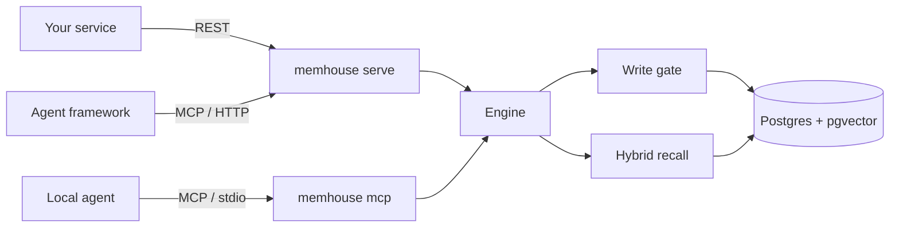
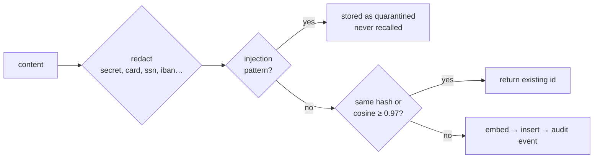
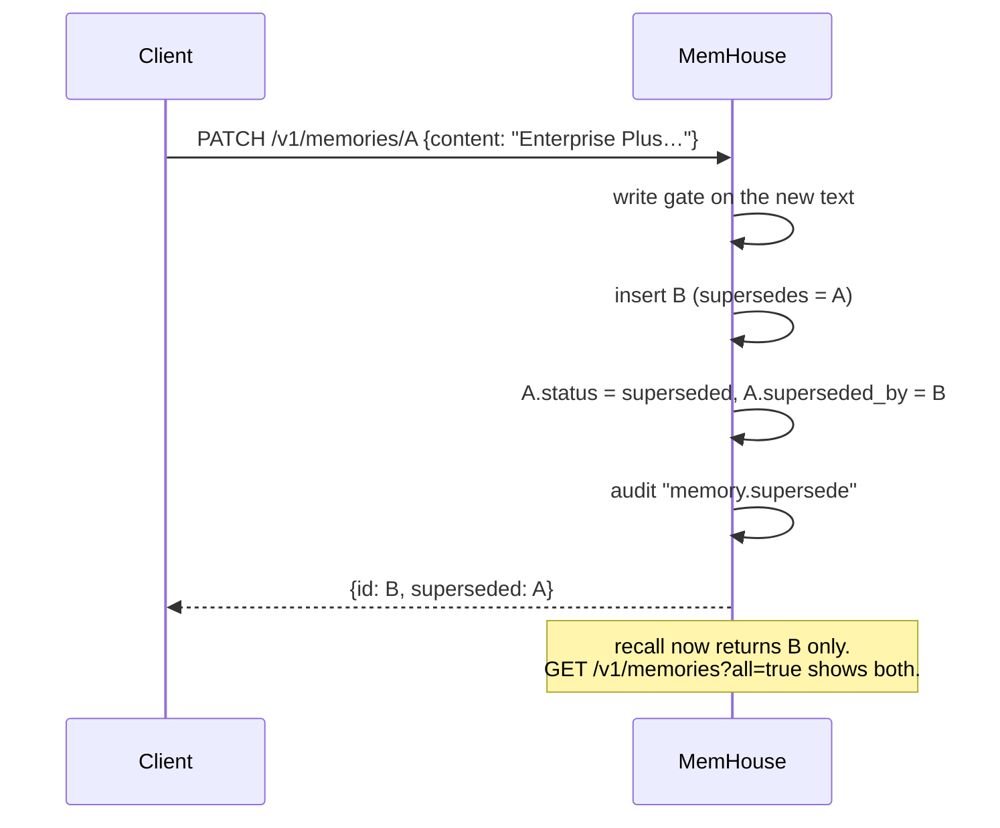
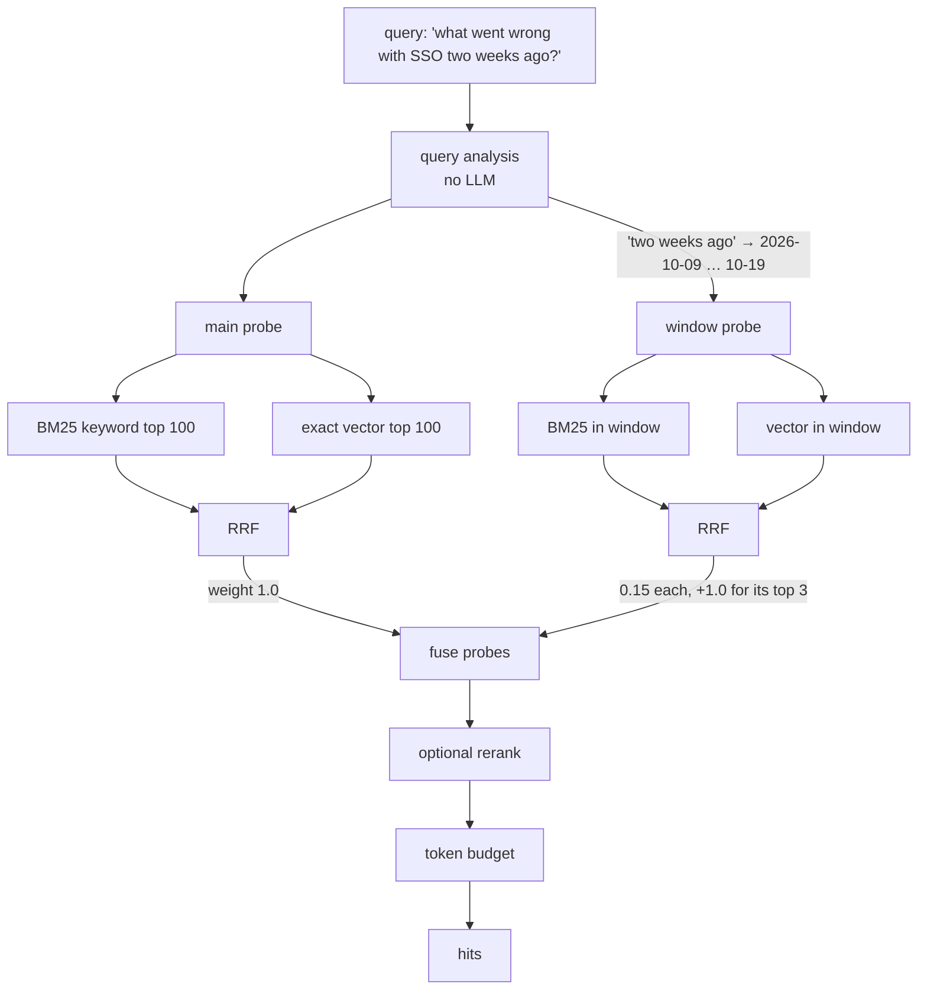

<!-- SPDX-License-Identifier: CC-BY-4.0 -->
# API reference

MemHouse has three ways in, and all of them call the same engine:

| Transport | Start it with | Who uses it |
|---|---|---|
| REST (JSON over HTTP) | `memhouse serve` | your own code, back-office systems, the Memory Browser |
| MCP over HTTP (`POST /mcp`) | `memhouse serve` | remote agents and agent frameworks |
| MCP over stdio | `memhouse mcp` (the agent launches it) | local agents: Claude Code, Cursor, VS Code, … |



Every example on this page was run against a real server. Only the ids and timings differ from
run to run.

## Contents

- [Conventions](#conventions)
- [Memories](#memories): remember, get, list, update, forget
- [Conversations](#conversations): ingest
- [Recall](#recall)
- [Subjects](#subjects): list, erase
- [Operations](#operations): stats, audit, enrichment status, health
- [MCP](#mcp)
- [Client examples](#client-examples): Python, TypeScript
- [Errors](#errors)

## Conventions

**Base URL.** `http://127.0.0.1:7077` by default. Set it with `[server] bind` or `MEMHOUSE_BIND`.

**Authentication.** Every `/v1/*` route and `/mcp` needs one of the keys in `[server] api_keys`.
`memhouse key` prints the key.

```bash
KEY=$(memhouse key)
curl -s localhost:7077/v1/stats -H "authorization: Bearer $KEY"
# or
curl -s localhost:7077/v1/stats -H "x-api-key: $KEY"
```

If no key is configured, the server refuses every request. There is no unauthenticated mode.
`/health` and `/` (the Memory Browser page, which asks for the key) are the only open routes.

**Actor.** Send `x-memhouse-actor: <name>`, up to 80 characters, to record who made the change
in the audit log. Without it the actor is `rest`. Request bodies that take an `actor` field use
that field first.

```bash
curl ... -H "x-memhouse-actor: zendesk-bot"
```

**Subjects and tenants.** A *subject* is whose memory it is, for example `user:alice`,
`customer:42`, `account:acme` or `repo:api`. Recall never crosses subjects. If a call names no
subject, the configured `default_subject` is used. A *tenant* is the top-level partition and
comes from `[memory] tenant`. The write and recall bodies accept `tenant`. List, get, stats and
audit always use the configured tenant.

**Times.** ISO-8601 / RFC 3339 in UTC, for example `2026-10-14T15:00:00Z`.

**Memory kinds.**

| Kind | Use it for | Example |
|---|---|---|
| `episodic` | conversation rounds (written by ingest) | "user: Our SSO broke… / assistant: Upload the new certificate…" |
| `semantic` | durable facts | "Acme is on the Enterprise plan" |
| `preference` | likes, dislikes, ways of working | "Prefers email over phone calls" |
| `procedural` | how-to knowledge, conventions | "Run `make test-int` before merging" |
| `commitment` | promises and follow-ups, with a due date | "Send the SSO fix by Friday 2026-10-16" |
| `document` | reference text | a policy excerpt |

**The Memory object.** It is returned by get, list and recall.

```json
{
  "id": "01a197b3-f332-7363-82e1-219723e7663e",
  "tenant": "default",
  "subject": "customer:docs-demo",
  "kind": "episodic",
  "status": "committed",
  "content": "user: Our SSO login broke after we rotated the Okta certificate yesterday.\nassistant: Upload the new certificate under Settings > SSO; I will follow up on Friday.",
  "session_id": "call-2026-10-14",
  "turn_ref": "0,1",
  "occurred_at": "2026-10-14T15:00:00Z",
  "valid_from": "2026-10-14T15:00:00Z",
  "labels": [],
  "tags": [],
  "source": "rest",
  "confidence": 1.0,
  "metadata": { "message_refs": ["0", "1"], "round": 0 },
  "created_at": "2026-11-01T15:21:55.247863Z"
}
```

| Field | Meaning |
|---|---|
| `status` | `committed` (recallable), `superseded` (replaced by a newer version and kept for audit), `quarantined` (looked like prompt injection; never recalled) |
| `occurred_at` | When the thing happened (event time). Date-aware recall uses it. |
| `valid_from` / `valid_to` | When the memory is true. After `valid_to` it drops out of recall. |
| `supersedes` | The id of the memory this one replaced. |
| `source` | Where it came from: the actor by default (`rest`, `cli`, your `x-memhouse-actor`), `mcp`, or `enrich:<model>` for extracted facts |
| `metadata` | Free-form JSON. Enrichment facts carry `derived: true`, `source_ids`, `extractor` and `prompt_version`. |

Fields that are empty or unset are left out of the JSON.

---

## Memories

### `POST /v1/memories`: remember one memory

Body (`RememberRequest`):

| Field | Type | Required | Notes |
|---|---|---|---|
| `content` | string | yes | Write it so it stands alone (who, what, when). At most `max_content_chars` (20,000) characters. |
| `subject` | string | | defaults to `default_subject` |
| `kind` | kind | | defaults to `semantic` |
| `tags` | string[] | | used as recall filters |
| `occurred_at` | time | | event time; defaults to now |
| `valid_to` | time | | when it stops being true, e.g. an expiry or due date |
| `supersedes` | uuid | | replace this memory, the same as `PATCH` |
| `source` | string | | defaults to the actor (`rest`, or your `x-memhouse-actor`) |
| `metadata` | object | | stored as given |
| `tenant`, `actor` | string | | |

```bash
curl -s localhost:7077/v1/memories -H "authorization: Bearer $KEY" -H "content-type: application/json" -d '{
  "subject": "customer:acme",
  "content": "Acme is on the Enterprise plan; renewal due 2027-03-01",
  "kind": "semantic",
  "tags": ["plan"]
}'
```

```json
{"id":"01a197b3-f251-77bd-98f7-d9a521ef6f88","status":"committed","deduplicated":false}
```

The write gate can change what gets stored. The response tells you what happened:

| Situation | Response |
|---|---|
| Card number in the text | `{"id":"…","status":"committed","deduplicated":false,"redactions":["card"]}`, and the stored text reads `Card on file is [REDACTED:card], …` |
| Prompt injection | `{"id":"…","status":"quarantined","deduplicated":false,"note":"quarantined: looks like an instruction to the agent (override)"}` |
| Same text sent again | `{"id":"<existing id>","status":"committed","deduplicated":true,"note":"identical memory already stored"}` |
| Near-duplicate (cosine ≥ 0.97, same kind) | the existing id, with `deduplicated: true` |



### `GET /v1/memories/{id}`: get one memory

```bash
curl -s localhost:7077/v1/memories/01a197b3-f251-77bd-98f7-d9a521ef6f88 -H "authorization: Bearer $KEY"
```

Returns a Memory, or `404 {"error":"memory … not found"}`.

### `GET /v1/memories`: list

| Query | Default | |
|---|---|---|
| `subject` | all subjects | |
| `kind` | all kinds | one kind |
| `limit` | 50 | 1–1000 |
| `offset` | 0 | for paging |
| `all` | false | `true` also returns superseded and quarantined records |

```bash
curl -s "localhost:7077/v1/memories?subject=customer:acme&kind=commitment&limit=20" -H "authorization: Bearer $KEY"
```

Returns `Memory[]`, newest first.

### `PATCH /v1/memories/{id}`: correct a memory (supersede)

The old version is kept with status `superseded` and is no longer recalled. The new version
records `supersedes`.

```bash
curl -s -X PATCH localhost:7077/v1/memories/01a197b3-f251-77bd-98f7-d9a521ef6f88 \
  -H "authorization: Bearer $KEY" -H "content-type: application/json" \
  -d '{"content":"Acme moved to the Enterprise Plus plan on 2026-10-20; renewal due 2027-03-01"}'
```

```json
{"id":"01a197b3-f31d-72e3-af59-5afb85876114","status":"committed","deduplicated":false,
 "superseded":"01a197b3-f251-77bd-98f7-d9a521ef6f88"}
```



### `DELETE /v1/memories/{id}`: forget one memory

This is a hard delete. It removes the record, its cached embeddings, any enrichment facts derived
from it, the enrichment jobs that read it and their cached LLM answers. The deletion is recorded
in the audit log and the deletion ledger.

```bash
curl -s -X DELETE localhost:7077/v1/memories/01a197b3-f275-7378-8769-48c15d107d74 -H "authorization: Bearer $KEY"
```

```json
{"deleted":"01a197b3-f275-7378-8769-48c15d107d74"}
```

---

## Conversations

### `POST /v1/ingest`: store a conversation as episodic memory

Messages are grouped into *rounds*: a user message plus the replies to it. Each round becomes one
`episodic` memory with two vectors, one for the whole round and one for the user's words alone.
Assistant text is cut to `[memory] assistant_chars` (1,200) for indexing.

| Field | Type | Notes |
|---|---|---|
| `messages` | `{role, content, timestamp?, id?}[]` | required; roles are `user`, `assistant`, or any name for multi-party chats |
| `subject`, `tenant` | string | |
| `session_id` | string | groups rounds; also the enrichment unit |
| `session_time` | time | the time of messages that have no `timestamp` of their own |
| `per_message` | bool | one record per message instead of per round (for group chats without a `user` role) |
| `source`, `actor` | string | |

```bash
curl -s localhost:7077/v1/ingest -H "authorization: Bearer $KEY" -H "content-type: application/json" -d '{
  "subject": "customer:acme",
  "session_id": "call-2026-10-14",
  "session_time": "2026-10-14T15:00:00Z",
  "messages": [
    {"role": "user", "content": "Our SSO login broke after we rotated the Okta certificate yesterday."},
    {"role": "assistant", "content": "Upload the new certificate under Settings > SSO; I will follow up on Friday."}
  ]
}'
```

```json
{"stored":1,"quarantined":0,"deduplicated":0,"ids":["01a197b3-f332-7363-82e1-219723e7663e"]}
```

Ingesting the same session again stores nothing new (`deduplicated` counts the rounds skipped).
When [enrichment](operations.md#enrichment-workers) is on, ingest also queues one background job
for the session and returns without waiting for it.

---

## Recall

### `POST /v1/recall`

| Field | Type | Default | Notes |
|---|---|---|---|
| `query` | string | required | natural language |
| `subject`, `tenant` | string | configured | |
| `k` | int | 10 | number of hits returned |
| `kinds` | kind[] | all | e.g. `["semantic","commitment"]` |
| `tags` | string[] | any | |
| `as_of` | time | now | "what did we know then": filters validity and event time |
| `reference_time` | time | `as_of`, else now | the "now" used to read "two weeks ago" in the query; filters nothing |
| `mode` | `hybrid` \| `dense` \| `keyword` | `hybrid` | |
| `rerank` | bool | config | cross-encoder rerank (+~0.9 s on CPU) |
| `analyze` | bool | config | date-aware query analysis on or off |
| `token_budget` | int | none | stop adding hits once about this many tokens are returned |

```bash
curl -s localhost:7077/v1/recall -H "authorization: Bearer $KEY" -H "content-type: application/json" -d '{
  "subject": "customer:acme",
  "query": "what went wrong with SSO two weeks ago?",
  "k": 3,
  "reference_time": "2026-10-28T12:00:00Z"
}'
```

Response, with hits shortened:

```json
{
  "hits": [
    {
      "memory": { "id": "01a197b3-f332-…", "kind": "episodic",
                  "content": "user: Our SSO login broke after we rotated the Okta certificate yesterday.\nassistant: …",
                  "occurred_at": "2026-10-14T15:00:00Z", "...": "..." },
      "score": 0.0352459,
      "keyword_rank": 1,
      "vector_rank": 1,
      "similarity": 0.7225965
    },
    { "memory": { "content": "Acme moved to the Enterprise Plus plan on 2026-10-20; …" },
      "score": 0.015873017, "vector_rank": 3, "similarity": 0.45682818 }
  ],
  "took_ms": 29.05,
  "embed_ms": 24.11,
  "search_ms": 4.94,
  "rerank_ms": 0.0,
  "candidates": 3,
  "reranked": false,
  "plan": {
    "windows": [
      { "start": "2026-10-09T14:24:01Z", "end": "2026-10-19T09:35:59Z",
        "phrase": "two weeks ago", "meaning": "about 2026-10-14 (Wed)" }
    ],
    "subqueries": []
  }
}
```

How to read a hit:

| Field | Meaning |
|---|---|
| `score` | the fused score (weighted reciprocal rank fusion); compare it only within one response |
| `keyword_rank`, `vector_rank` | the hit's rank in each retriever; a missing rank means that retriever didn't find it |
| `similarity` | cosine similarity of the best vector |
| `rerank_score` | present when reranking ran |
| `plan.windows` | time phrases the query analysis found, and the window each was read as |



**Recipes**

```bash
# Only open promises for a customer
-d '{"subject":"customer:acme","query":"what did we promise?","kinds":["commitment"]}'

# What did we believe on 1 October? (ignores memories written or valid only later)
-d '{"subject":"customer:acme","query":"which plan is Acme on?","as_of":"2026-10-01T00:00:00Z"}'

# Fit the context window of a small model
-d '{"subject":"user:alice","query":"travel preferences","k":30,"token_budget":800}'

# Exact identifiers (order numbers, error codes): keyword only
-d '{"subject":"customer:acme","query":"ERR_SAML_2041","mode":"keyword"}'
```

---

## Subjects

### `GET /v1/subjects`

Lists up to 500 subjects with their memory counts.

```json
[{"subject":"customer:acme","memories":3},{"subject":"user:alice","memories":2}]
```

### `DELETE /v1/subjects/{subject}`: erase everything about a subject

Use it for right-to-erasure requests. It deletes every record of the subject, every cached vector,
every enrichment job and every cached extraction, then writes `subject.erase` to the audit log and
the deletion ledger.

```bash
curl -s -X DELETE localhost:7077/v1/subjects/customer:acme -H "authorization: Bearer $KEY"
```

```json
{"deleted":4,"subject":"customer:acme"}
```

---

## Operations

### `GET /v1/stats`

```json
{"memories":108,"committed":105,"quarantined":2,"superseded":1,"subjects":3,"audit_events":9,
 "by_kind":[["episodic",101],["semantic",3],["preference",1]]}
```

### `GET /v1/audit?limit=100`

Returns the newest events first, up to 1,000. See [governance.md](governance.md#audit-log) for
the action names and how to verify the chain.

```json
[{
  "id": 8, "at": "2026-11-01T15:21:55.235676Z", "actor": "rest", "action": "memory.supersede",
  "tenant": "default", "subject": "customer:acme", "memory_id": "01a197b3-f31d-…",
  "detail": {"embedder":"local:Xenova/bge-small-en-v1.5","kind":"semantic","redactions":[],
             "status":"committed","supersedes":"01a197b3-f251-…"},
  "prev_hash": "a12e76e3…", "hash": "00f46446…"
}]
```

### `GET /v1/enrich/status`

Shows the background enrichment queue for the configured tenant.

```json
{"pending":0,"running":0,"done":0,"failed":0}
```

### `GET /health` (no auth)

```json
{"status":"ok","version":"0.1.0"}
```

---

## MCP

`POST /mcp` takes JSON-RPC 2.0 messages, one at a time or in batches. `memhouse mcp` serves the
same protocol over stdio. The protocol version is `2025-06-18`; `2025-03-26` and `2024-11-05` are
also accepted. Notifications (messages without an `id`) get `202 Accepted` and no body.

| Method | Result |
|---|---|
| `initialize` | server info, plus `instructions` written for the active [template](configuration.md#templates) |
| `tools/list` | the six tools below |
| `tools/call` | text content plus `structuredContent`; tool errors come back as `isError: true` |
| `ping`, `resources/list`, `resources/templates/list`, `prompts/list` | empty results |

| Tool | Arguments | Notes |
|---|---|---|
| `memory_recall` | `query`\*, `subject`, `k` (1–50), `kinds`, `tags`, `as_of` | read-only |
| `memory_remember` | `content`\*, `kind`, `subject`, `tags`, `occurred_at`, `valid_to` | the same write gate as REST |
| `memory_update` | `id`\*, `content`\* | supersedes |
| `memory_forget` | `id`\* | destructive |
| `memory_log_conversation` | `messages`\*, `session_id`, `subject` | ingest |
| `memory_list` | `subject`, `kinds`, `limit` (1–100) | read-only |

\* required. Dates accept `2026-10-14` as well as full date-times.

```bash
curl -s localhost:7077/mcp -H "authorization: Bearer $KEY" -H "content-type: application/json" -d '{
  "jsonrpc": "2.0", "id": 1, "method": "tools/call",
  "params": {"name": "memory_recall",
             "arguments": {"query": "SSO certificate", "subject": "customer:acme", "k": 2}}
}'
```

```json
{
  "jsonrpc": "2.0", "id": 1,
  "result": {
    "isError": false,
    "content": [{"type": "text", "text": "2 memories (most relevant first):\n- [01a197b3-f332-…] (episodic, 2026-10-14) user: Our SSO login broke …\n- [01a197b3-f275-…] (semantic, 2026-11-01) Card on file is [REDACTED:card], contact via ticket only"}],
    "structuredContent": {"memories": [
      {"id": "01a197b3-f332-…", "kind": "episodic", "occurred_at": "2026-10-14T15:00:00Z",
       "score": 0.0328, "tags": [], "content": "user: Our SSO login broke …"}
    ]}
  }
}
```

Connecting agents (`memhouse connect claude-code`, `cursor`, …) is covered in the
[README](../README.md#use-it-from-an-agent-mcp). For a framework that speaks MCP over HTTP, give
it `http://<host>:7077/mcp` and the header `Authorization: Bearer <key>`. `memhouse connect http`
prints both.

---

## Client examples

There is no SDK package yet. The API is small enough that a thin wrapper is all you need.

### Python (`httpx` or `requests`)

```python
import os, httpx

mh = httpx.Client(
    base_url=os.environ.get("MEMHOUSE_URL", "http://127.0.0.1:7077"),
    headers={"authorization": f"Bearer {os.environ['MEMHOUSE_API_KEY']}",
             "x-memhouse-actor": "support-bot"},
    timeout=10,
)

def remember(subject, content, kind="semantic", **kw):
    r = mh.post("/v1/memories", json={"subject": subject, "content": content, "kind": kind, **kw})
    r.raise_for_status()
    return r.json()

def recall(subject, query, k=8, **kw):
    r = mh.post("/v1/recall", json={"subject": subject, "query": query, "k": k, **kw})
    r.raise_for_status()
    return [h["memory"] for h in r.json()["hits"]]

# A support turn: recall before answering, log the exchange afterwards.
ticket_customer = "customer:acme"
context = recall(ticket_customer, "SSO problems and promises we made")
prompt = "Known about this customer:\n" + "\n".join(
    f"- ({m['kind']}, {m.get('occurred_at', '')[:10]}) {m['content']}" for m in context)
# ... call your LLM with `prompt` ...
mh.post("/v1/ingest", json={"subject": ticket_customer, "session_id": "ticket-8812",
        "messages": [{"role": "user", "content": "Is SSO fixed?"},
                     {"role": "assistant", "content": "Yes, the new certificate is live."}]})
remember(ticket_customer, "Promised a call on 2026-11-05 to review SSO setup", kind="commitment",
         valid_to="2026-11-06T00:00:00Z", tags=["escalation"])
```

### TypeScript (`fetch`)

```ts
const base = process.env.MEMHOUSE_URL ?? "http://127.0.0.1:7077";
const headers = {
  authorization: `Bearer ${process.env.MEMHOUSE_API_KEY}`,
  "content-type": "application/json",
};

async function call<T>(method: string, path: string, body?: unknown): Promise<T> {
  const r = await fetch(base + path, { method, headers, body: body && JSON.stringify(body) });
  const j = await r.json();
  if (!r.ok) throw new Error(`${r.status}: ${j.error}`);
  return j as T;
}

const hits = await call<{ hits: { memory: { content: string } }[] }>("POST", "/v1/recall", {
  subject: "account:globex",
  query: "who signs off on the budget?",
  kinds: ["semantic"],
});
console.log(hits.hits.map((h) => h.memory.content));
```

---

## Errors

Errors are JSON: `{"error": "<message>"}`.

| Status | When |
|---|---|
| 400 | bad input: a missing required field, an unknown kind, content over the size limit, a bad date |
| 401 | missing or wrong API key, or no keys configured |
| 404 | memory id not found |
| 422 | the body isn't the expected JSON shape (from axum's JSON extractor) |
| 500 | database or model failure; the message says which |

Writes are idempotent by content: retrying a `remember` or `ingest` after a timeout won't create
duplicates.
