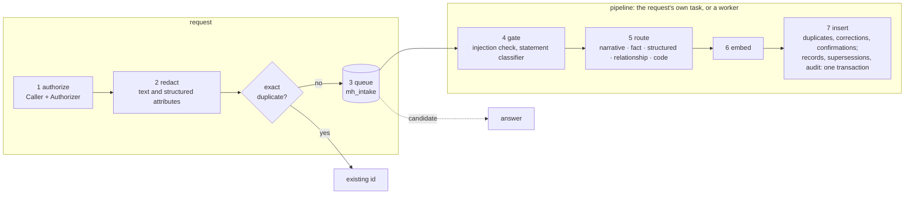

<!-- SPDX-License-Identifier: CC-BY-4.0 -->
# Architecture (local profile)

This is the first implemented slice of the design. It covers the
Standard-profile shape (one binary, customer's Postgres) running locally. Everything is built so
that the Scale profile can replace adapters, not rewrite the engine (TR-CORE-01).

## Components

| Component | Where | Notes |
|---|---|---|
| Engine | `memhouse-core::Engine` | One implementation of write gate, routing, ranking, supersession, deletion and audit events. Every transport (REST, MCP stdio, MCP HTTP, CLI, benchmark) calls it. |
| Store adapter | `memhouse-store-postgres` | Implements the `Store` trait. Sharded Postgres and an embedded store can be added behind the same trait. |
| Model adapters | `memhouse-models` | `Embedder` / `Reranker` traits: local ONNX (offline), any OpenAI-compatible endpoint. |
| Gateway | `memhouse-server` | axum REST and MCP-over-HTTP, bearer-key auth, Memory Browser page. |
| MCP stdio | `memhouse-server::mcp` | JSON-RPC 2.0, protocol 2025-06-18 (also accepts 2025-03-26 and 2024-11-05). |
| Validation tool | `memhouse-bench` | Public datasets, governance gates, statistics, reports. |

## Data model

One table, `mh_memory`, holds every kind of memory. Key columns:

- `tenant`, `subject`: the partition. Every query filters on both, so recall never leaves the subject.
- `kind`, `status` (`candidate`, `committed`, `superseded`, `quarantined`, `rejected`, `expired`), `content` (already redacted).
- `tsv`: a generated `tsvector` for full-text search, with a GIN index.
- `embedding vector(D)`: exact per-subject scoring. There is deliberately no ANN index on subject data (SCALE-03), so top-k is exact.
- `occurred_at` (event time), `valid_from` / `valid_to` (validity window), `supersedes` / `superseded_by`.
- `labels`, `tags`, `source`, `confidence`, `metadata`, `content_hash` (for dedup).

Supporting tables:

- `mh_embed_cache`: content-addressed embedding cache. Re-ingesting text costs nothing; deleting a memory deletes its cached vector.
- `mh_audit`: append-only, hash-chained. Each event stores `prev_hash` and `hash = sha256(prev ‖ fields)`; `memhouse audit --verify` recomputes the chain.
- `mh_deletion_ledger`: what was deleted and when, to re-apply after a restore (TR-WF-03).
- `mh_meta`: schema version, embedding dimension, embedder id. A dimension mismatch is refused at start-up.
- `mh_intake`: the write pipeline's queue (schema v6): redacted proposals until the insert stage, then only their ids and outcome until pruned.
- `mh_structured`: the queryable rows of structured records, answered by exact query (HYB-02).

## Recall: one statement for all probes

0. **Query analysis** (`query.rs`, no LLM): time expressions are resolved against `reference_time` (or `as_of`, or now) into generous windows. If there are any, a second probe runs the same query restricted to them. All probes go to Postgres as one statement (their searches under `UNION ALL`), so a recall is exactly one round trip (PERF-02, checked from the trace by `recall_round_trip`).
1. **Filter:** tenant, subject, `status = committed` (and `candidate` with `include_candidates`), kinds and tags, denied labels, validity at `as_of` (or now), event time ≤ `as_of`, and for the window probe, event time inside a window.
2. **Keyword candidates:** BM25 (k1 = 1.2, b = 0.75) computed in SQL from the stored `tsvector`: term frequencies from lexeme positions, document frequencies from the matched rows.
3. **Vector candidates:** exact cosine distance with pgvector, the better of the round vector and the user-only vector.
4. **Fusion:** weighted reciprocal rank fusion (`k = 60`) inside each statement, then across probes (window probe: 0.15 for every in-window hit, +1.0 for its top 3). Only the top `k` fused ids are then fetched, each by primary key and still filtered on tenant and subject, so no step of the statement reads another subject's rows.
5. **Exact probe** (HYB-03): when the request has `exact`, or the query names a record identifier ("order A-1001"), structured records are matched exactly on their attributes (one more statement) and put first, marked `exact`.
6. **Engine side (optional):** cross-encoder reranking of the top candidates blended with the fused rank, a recency bonus, and token-budget packing.

The query embedding and the SQL statement are the whole hot path. On a laptop, p50 recall is a few milliseconds plus query embedding. The recall's explanation record (`mh_recall`) is written off that path, after the response.

## Write path

Every write (`remember`, `revise`, `ingest`, and the facts enrichment extracts) goes through one
staged pipeline (G10, TR-IN-04), in this order:

1. **Authorize** (the caller layer): a denial is audited and nothing is queued.
2. **Redact** (`PiiDetector`, rules today): the text and every string attribute of a structured
   form. The queue only ever holds redacted text; the `intake_candidates` check looks for PII
   canaries in it.
3. **Queue** (`IntakeQueue`; Postgres: the `mh_intake` table, ADR 0004): the redacted proposal is
   inserted, and the write is answered `candidate` once that commits (durable acknowledgement,
   TR-LT-05). A queue that can't take it refuses the write as retryable (`503 unavailable`).
   Workers claim proposals with `FOR UPDATE SKIP LOCKED`, one subject at a time and in the order
   they were queued, so a correction lands after what it corrects. A claim is a lease
   (`lease_secs`): a crashed worker's proposals are claimed again when it expires. Finished
   proposals drop their content at once and are pruned after `keep_done_secs`, so the pending
   index stays small.
4. **Gate**: the injection screen (matches are `quarantined`), then the statement classifier
   (`Classifier`: deterministic rules, or a small chat model behind the same interface) reads each
   statement as a fact, event, correction, plan, speculation, preference or instruction
   (QUAL-02). Plans and speculation are held as `candidate`, invisible to default recall (PR-7),
   with an expiry (`valid_to`, else `plan_ttl_days`). A proposal from an agent under review
   admission stays `candidate` for its reviewer. Conversation rounds are screened, not
   classified.
5. **Route** (HYB-01): structured records (a `structured` form, or JSON content with a
   `record_type`) also get a row in `mh_structured`; code is tagged `code`; the route is kept in
   `metadata.route`.
6. **Embed** through the content-addressed cache (rounds also get their user-only vector).
7. **Insert** (`Store::apply_intake`): against what is stored, a near-duplicate (cosine ≥ 0.97,
   same kind, not for structured records) is `rejected` with `metadata.duplicate_of`; an explicit
   revision supersedes its predecessor or is rejected if that is no longer current; a correction
   supersedes the closest record of its kind (cosine ≥ `correction_threshold`, a shared content
   word, not newer than itself; enrichment facts only supersede enrichment facts); a completed
   event commits the unexpired held plans in its scope it fulfils (`metadata.confirmed_by`;
   speculation and candidates waiting for a reviewer are never confirmed this way). Then one transaction locks
   the proposal, writes the records and structured rows, the supersessions and confirmations, the
   enrichment job of an ingested session, the proposal's completion and the audit events. The
   record ids are the proposal's idempotency key, so a proposal takes effect exactly once
   (TR-IN-03) even when two workers hold it; an erasure deletes queued proposals in the same
   transaction as the subject's records, waiting for an insert in progress, so no write
   acknowledged before the erasure began lands after it. A write that overlaps the erasure is
   ordered before it (erased) or after it (kept), depending on when it commits.

A proposal that keeps failing is retried with backoff and, after `max_attempts`, set aside as
`dead` with its records stored as `quarantined` (`intake_failed`) for a reviewer, so it never
blocks its subject (TR-IN-07). Each attempt runs under the tenant's policy in force at that
moment: a write queued under an older policy is redacted again with the current categories,
and one of a kind the policy no longer allows is rejected before any model sees it, without a
vector. Stages 4 to 7 run in the request's own task right after the
answer (a write is recallable in tens of milliseconds, PERF-04), or before it with `wait: true`;
the `JobRunner` workers (`[intake] workers`) pick up anything left. The `intake_restart`,
`intake_poison` and `intake_freshness` checks cover these paths.

`ingest` groups messages into rounds (a user message plus the replies to it; assistant text
trimmed to `assistant_chars`), or one record per message for multi-party chats, deduplicates them
by hash against the subject's stored rounds, and queues them as one proposal; each round gets
both vectors (`embedding_alt`, cache key in `alt_hash` so deletion purges it too).

**Recall degrades, never errs, on a failed dependency** (PERF-07): retrieval that fails or takes
longer than `recall_timeout_ms` (450 ms) answers, within 500 ms, an empty result with `degraded` set; a refused
caller still gets `403` and no data.

## Enrichment: asynchronous LLM fact extraction (optional)

With `[enrich] enabled = true`, the insert stage of an ingested session also writes one row to
`mh_enrich_job`, in the same transaction; nothing on the write or read path waits for an LLM.
Enrichment is a later stage of the write pipeline, run by the same `JobRunner`.

1. **Workers** (`[enrich] workers`, default 8, in `memhouse serve` and `memhouse bench`) claim
   jobs with `FOR UPDATE SKIP LOCKED` and a 5-minute lease, so several processes can share the
   queue and a crashed worker's job is picked up again. A subject's sessions are enriched one at
   a time, in order, so a fact that corrects an earlier one finds it stored. Failures back off (2^attempt seconds) and
   are marked `failed` after `max_attempts`.
2. **Extraction:** the session's committed rounds go to a small chat model (default
   `qwen/qwen3.7-flash` on OpenRouter, about $0.00007 per session; any OpenAI-compatible endpoint
   works, including a local Ollama). User text is sent in full and assistant replies are cut to
   `assistant_chars` (300). Sessions with less than `min_user_chars` of user text are skipped
   without a call. The model returns short, self-contained facts (events, facts, preferences,
   plans) with relative dates resolved to absolute ones and the rounds they came from.
3. **Cache:** answers are stored in `mh_llm_cache` under
   sha256(prompt version, model, endpoint, prompt), so a repeated session is never paid for twice.
4. **Same stages as every write:** each fact is redacted, deduplicated per session, then goes
   through the gate (injection screen; the classifier, with the extractor's own reading as a
   hint: extracted plans are held as candidates, corrections supersede the extracted fact they
   correct), routing, embedding and the insert stage, as a `semantic`, `preference` or `commitment` memory with
   `metadata.derived = true`, `source_ids` (the rounds it came from), `observed_at` (the session
   date) and `occurred_at` (the event date). Its `session_id` and `turn_ref` are the source
   rounds', so retrieval metrics and citations still point at the conversation.
5. **Recall** finds facts and rounds in the same hybrid search. Facts become searchable when
   their job finishes (p50 a few seconds); until then recall serves the raw rounds.

Deletion covers the derived path: forgetting a round deletes facts whose `source_ids` contain it,
their cached vectors, the jobs that read it and their cached extraction; erasing a subject
removes its jobs and cached extractions too. Two governance checks (`enrich_async_gate`,
`enrich_deletion`) verify this with a deterministic stub model. `max_cost_usd` stops LLM calls
once a process has spent that much; `GET /v1/enrich/status` shows the queue.

## Governance defaults

| Control | Default |
|---|---|
| Redaction | secrets/API keys, payment cards (Luhn-checked), SSNs, IBANs. Optional: email, phone, IP. |
| Injection screening | on; matches are stored as `quarantined` and never recalled. |
| Audit | every write, update, delete, subject erase and import; reads optional (`audit_reads`). |
| Retention | configurable episodic retention (`episodic_retention_days`), applied hourly by `memhouse serve` or on demand with `memhouse retention`; it cascades to derived facts, jobs and caches like a deletion. |
| Auth | REST and HTTP MCP need a bearer key (generated by `up`/`init`). There is no unauthenticated mode. stdio MCP runs as the local user. |

## Not built yet (from the plan)

- Relationship-based authorizer and access-policy decision register (ACC, D-01..D-07)
- Plain-language policy compiler
- Plugin system for context providers (HubSpot, Salesforce, Shopify, Zendesk)
- Embedded store for the Lite profile
- Sharded Scale profile and Temporal workflows

The adapter traits are where these attach.
