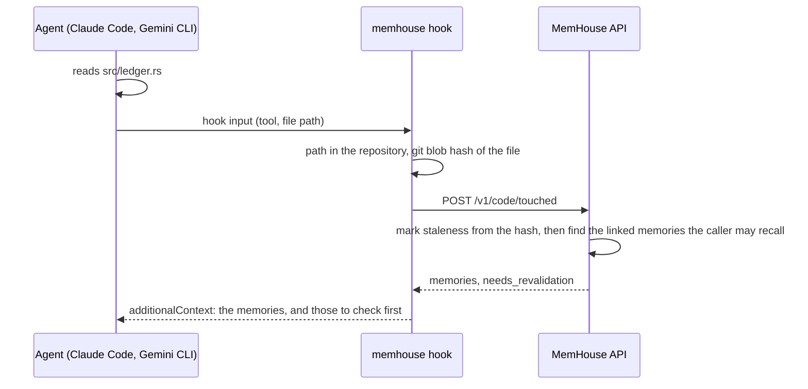

<!-- SPDX-License-Identifier: CC-BY-4.0 -->
# The coding template

Memory for a coding agent: what a repository's developers and agents have learned about it
(conventions, architecture decisions, pitfalls, build and test quirks, corrections), linked to
the files it is about, shown to the agent when it opens those files, and held back when a file
has changed since.

## Contents

- [What it does](#what-it-does)
- [Set it up](#set-it-up)
- [Memories linked to files](#memories-linked-to-files)
- [Staleness](#staleness)
- [Revalidation](#revalidation)
- [The hooks](#the-hooks): [Claude Code](#claude-code), [Gemini CLI](#gemini-cli), [git](#git-post-commit), [other harnesses](#other-harnesses)
- [Procedures and corrections](#procedures-and-corrections)
- [What is checked](#what-is-checked)
- [Limits](#limits)

## What it does

| | |
|---|---|
| Subject | the repository: `repo:<name>`, where the name is the directory of the repository's main checkout (every worktree of a repository shares it) |
| Principals | developers (users) and agents; each connected agent has its own principal and key, and its writes are proposals |
| What is remembered | conventions, architecture decisions, known pitfalls, build and test quirks as `semantic` memory; rules for how to work as `procedural` memory; corrections replace what they correct |
| Linked to code | a memory names the files it is about, each with the file's content hash (`code_refs`) |
| File-touched recall | when the agent reads or edits a file, a hook asks MemHouse for the memories linked to it and puts them in the agent's context (TPL-05) |
| Git-aware staleness | when a file changes, the memories written about its earlier content are left out of recall until someone checks them (TPL-04) |
| Procedures from corrections | a rule the user had to repeat becomes a procedure ([below](#procedures-and-corrections), MEM-02) |



## Set it up

```bash
memhouse up --template coding            # or: memhouse up --lite --template coding
memhouse connect claude-code --hooks     # MCP server + file hooks; or: gemini --hooks
cd your-repository
memhouse hook install-git --agent claude-code     # optional: report every commit
```

`connect <agent> --hooks` does three things: it connects the agent over MCP as before (its own
principal `agent:<name>` and key), writes the key to a file only you can read
(`$MEMHOUSE_HOME/hook-keys/<agent>.key`, mode 600), and merges the two file hooks into the
harness's settings file. Hooks you already have there are kept; running it again replaces only
its own entries, and a backup of the file is left beside it. `--project` writes the project's
file instead of yours (`.claude/settings.local.json`, `.gemini/settings.json`), and `--print`
shows what would be written.

The MCP `instructions` of the coding template tell the agent the rest: link memories to files,
call `file_memories` and `revalidate`, mark corrections.

## Memories linked to files

```bash
# From the command line: the hash is computed for you, and the subject is the file's repository.
memhouse remember "Money amounts in the ledger are integer cents, never floats." --file src/ledger.rs

# Over the API, or the MCP tool `remember`:
curl -s $MH/v1/remember -H "authorization: Bearer $KEY" -H 'content-type: application/json' -d '{
  "subject": "repo:shop", "content": "Money amounts in the ledger are integer cents, never floats.",
  "tags": ["convention"],
  "code_refs": [{"path": "src/ledger.rs", "blob_hash": "'$(git hash-object src/ledger.rs)'"}]}'
```

A path is relative to the repository root, with `/` separators. The hash is the **git blob
hash** of the file's content, what `git hash-object <file>` prints. MemHouse computes it in
process (`blob <length>\0` plus the bytes, SHA-1, or SHA-256 in a repository created with
`--object-format=sha256`), so the hooks need no git binary and work on files that are not
committed yet. The server never reads your files: it compares the hashes it is given.

## Staleness

A reference goes stale when its file is reported with a hash other than the stored one, or as
deleted. A memory with a stale reference is **left out of default recall**, in every profile,
inside the recall statement (so it never takes a place among the `k` results). It is still
there: `GET /v1/memories/{id}` shows it with `stale_since`, a recall with `include_stale`
returns it, a recall's explanation lists it with the reason `stale`, and file-touched recall
lists it under `needs_revalidation`.

| What is reported | What happens to the references to that file |
|---|---|
| the file with another hash | stale since then; the hash seen is kept (`seen_hash`) |
| the file with the stored hash | not stale (a stale one is cleared: the file is back to what the memory was written about) |
| the file deleted | stale, with no hash seen |
| the file renamed, same content | moved to the new path, not stale |
| the file renamed, other content | moved to the new path, and stale |

Who reports: the **file hooks**, each time the agent reads or edits a file, and the
**post-commit hook**, for every file of a commit, opened or not. Anything else can call the
same two routes ([`POST /v1/code/touched`](api.md#post-v1codetouched-memories-linked-to-files-an-agent-opened-or-edited),
[`POST /v1/code/changed`](api.md#post-v1codechanged-files-changed-deleted-or-renamed)): a CI
job after a merge, an editor plugin.

Every memory that goes stale, stops being stale or follows a rename gets an audit event
(`memory.stale`, `memory.fresh`, `memory.code_moved`) with the actor and what was reported.

## Revalidation

A stale memory is not wrong, it is unchecked. The agent (or you) reads the memory against the
file as it is now and does one of three things:

| The memory | Do | Result |
|---|---|---|
| still holds | `revalidate` (MCP), `POST /v1/code/revalidate` | its references take the file's current hash; it is recalled again |
| needs changing | `revise` | a new version supersedes it; the new version is linked to the file as it was last seen |
| is obsolete | `forget` | gone |

```bash
curl -s $MH/v1/code/revalidate -H "authorization: Bearer $KEY" -H 'content-type: application/json' \
  -d '{"id": "01a2…"}'
# {"id":"01a2…","code_refs":[{"path":"src/ledger.rs","blob_hash":"9f2c5c1e…"}],"stale":false}
```

Without `code_refs`, each stale reference takes the hash its file was last seen with. A memory
about a **deleted** file has nothing to be checked against: revalidation answers `400`, and the
memory is revised with the file it is about now, or forgotten. Revalidation needs
`memory:write` and sight of the memory, and is audited as `memory.revalidate` with the old and
new hash.

## The hooks

```text
memhouse hook file-opened  [--format claude-code|gemini|text|json] [--subject S] [--path FILE]…
memhouse hook file-edited  (the same options)
memhouse hook post-commit  [--repo DIR] [--from REV] [--to REV] [--subject S]
memhouse hook install-git  [--repo DIR] [--agent NAME | --key-file FILE] [--print]

Reaching MemHouse (all three hooks):
  --url URL        a running server (or MEMHOUSE_URL); without it the installation named by
                   --config is opened in this process
  --key-file FILE  the agent's API key (or MEMHOUSE_HOOK_KEY); a hook never uses another key
  --timeout-ms N   give up after this long (default 10,000)
```

The file hooks read the harness's hook input (one JSON object) on stdin, take the file from
`tool_input.file_path`, find its repository by walking up to the nearest `.git`, hash the file,
call `POST /v1/code/touched` and print the answer in the harness's form. `post-commit` asks git
for the commit's changed, deleted and renamed files (`git diff --raw -M` against the first
parent) and calls `POST /v1/code/changed`.

Two properties are checked on every change (`hooks_only_call_api`):

- **They only call the API.** A hook holds no rule of its own: which memories its key may see,
  and whether its key may record staleness, is decided by the server that answers it. A hook
  with a read-only key gets the comparison in its answer and records nothing.
- **They fail open.** Whatever goes wrong (no key, MemHouse not running, a refused key, a
  timeout, input it does not understand), a hook prints nothing for the agent, writes one line
  to stderr and exits 0. It never blocks a read, an edit or a commit. Both installed hooks run
  *after* the tool, where a hook could not stop it anyway.

### Claude Code

Format: Claude Code hooks as documented at <https://code.claude.com/docs/en/hooks>, read on
27 November 2026 (the page carries no version or date of its own).

`memhouse connect claude-code --hooks` merges this into `~/.claude/settings.json`
(`--project`: `.claude/settings.local.json`):

```json
{
  "hooks": {
    "PostToolUse": [
      { "matcher": "Read",
        "hooks": [{ "type": "command", "timeout": 15,
                    "command": "/path/to/memhouse --config /path/to/config.toml hook file-opened --format claude-code --key-file /path/to/hook-keys/claude-code.key" }] },
      { "matcher": "Edit|Write|MultiEdit|NotebookEdit",
        "hooks": [{ "type": "command", "timeout": 15,
                    "command": "/path/to/memhouse --config /path/to/config.toml hook file-edited --format claude-code --key-file /path/to/hook-keys/claude-code.key" }] }
    ]
  }
}
```

Input the hook reads (`PostToolUse`): `hook_event_name`, `cwd`, `tool_name` and
`tool_input.file_path`. Output, when there is something to say, on stdout:

```json
{"hookSpecificOutput": {"hookEventName": "PostToolUse",
  "additionalContext": "Memories about src/ledger.rs (repo:shop):\n- [01a2…] (semantic, 2026-11-20) Money amounts in the ledger are integer cents, never floats."}}
```

Claude Code adds `additionalContext` to the model's context next to the tool result. With
nothing to say the hook prints nothing. The text is kept under 8,000 characters (Claude Code
moves more than 10,000 to a file); when memories are left out, the last line says to call
`file_memories` for all of them.

### Gemini CLI

Format: Gemini CLI hooks as documented at <https://geminicli.com/docs/hooks/> and its
reference page (pages dated 10 and 13 April 2026), read on 27 November 2026. Those pages carry
a notice that Gemini CLI was replaced by another client for some account tiers in June 2026;
the hooks were not run against that client.

`memhouse connect gemini --hooks` merges this into `~/.gemini/settings.json` (`--project`:
`.gemini/settings.json`), beside the MCP server entry:

```json
{
  "hooks": {
    "AfterTool": [
      { "matcher": "read_file",
        "hooks": [{ "name": "memhouse-file-opened", "type": "command", "timeout": 15000,
                    "command": "/path/to/memhouse --config /path/to/config.toml hook file-opened --format gemini --key-file /path/to/hook-keys/gemini.key" }] },
      { "matcher": "write_file|replace",
        "hooks": [{ "name": "memhouse-file-edited", "type": "command", "timeout": 15000,
                    "command": "/path/to/memhouse --config /path/to/config.toml hook file-edited --format gemini --key-file /path/to/hook-keys/gemini.key" }] }
    ]
  }
}
```

Input the hook reads (`AfterTool`): `hook_event_name`, `cwd`, `tool_name` and
`tool_input.file_path` (a path relative to `cwd` is resolved). Output: the same object as for
Claude Code with `"hookEventName": "AfterTool"`; Gemini CLI appends `additionalContext` to the
tool's result. Its stdout must hold one JSON object and nothing else, so with nothing to say
the hook prints `{}`. Timeouts are in milliseconds there, in seconds for Claude Code. Gemini
CLI runs hooks with a cleaned environment, which is why the installed command names the
configuration and the key file instead of relying on environment variables (the installed
command was run with an empty environment against an installation in a non-default home). It
asks you to trust a project's hooks the first time they run.

### Git: post-commit

`memhouse hook install-git` writes `.git/hooks/post-commit` (or where `core.hooksPath` points):

```sh
#!/bin/sh
# memhouse post-commit hook (written by `memhouse hook install-git`).
# Reports the commit's files to MemHouse; it never fails the commit.
/path/to/memhouse --config /path/to/config.toml hook post-commit --key-file /path/to/hook-keys/claude-code.key || true
```

A `post-commit` hook that is already there and is not MemHouse's is never overwritten: the
command prints the line to add to it. After a commit the hook says how many memories now need
revalidation, if any. For changes that arrive without a commit of yours (a pull, a checkout),
run it with a range: `memhouse hook post-commit --from ORIG_HEAD --to HEAD` in a `post-merge`
hook.

### Other harnesses

Any harness that can run a command when a file is read or edited can use the hooks:
`--path FILE` gives the file without hook input, `--format text` prints the plain block and
`--format json` the API's response. A harness without such hooks still has the MCP tool
`file_memories`, which the template's instructions tell the agent to call.

## Procedures and corrections

When the user corrects how the agent works ("no, use pnpm here"), the agent stores the rule as
`procedural` memory marked as a correction (`"metadata": {"correction": true}`). One correction
is held as a candidate; when the same correction has been given three times
(`[intake] procedural_corrections`), it becomes a procedure without anyone reviewing it. A
reviewer can confirm it sooner, and a developer's own write is committed at once.
[memory-types.md](memory-types.md#procedural-memory) has the rules and their bounds.

A procedure is recalled only for a task it matches. File-touched recall passes the files of
the task, so a procedure linked to a file comes up when the agent works on that file whatever
it is asking about; with `--query` (or `query` in the API) procedures that match the task in
words are added.

## What is checked

| Requirement | Check | Measured (27 November 2026) |
|---|---|---|
| TPL-04: 200 cases of a file changed, renamed or deleted; every memory about it flagged by the next recall, no other | `code_staleness` | 320 of 320 affected flagged and left out; 0 of 480 unaffected flagged; Postgres and SQLite |
| TPL-05: 100 file-touched cases on open and edit; every linked, non-stale memory returned | `file_touched_recall` | 620 of 620 returned, 100 of 100 cases exact; Postgres and SQLite |
| TPL-04: stale until revalidated or superseded, on every read path | `stale_until_revalidated` | all scenarios |
| TPL-05 under access control | `file_touched_access` | all scenarios |
| MEM-02: promotion on repeated correction or confirmation | `procedural_promotion` | all scenarios |
| TR-TPL-03: hooks only call the API and fail open | `hooks_only_call_api`, and `crates/memhouse-cli/tests/hook.rs` (the commands run with each harness's documented input, and git) | all scenarios |
| TPL-03: the coding scenario suite | `bench/suites/coding` in the benchmark guard | storage F1 97.2, retrieval F1 97.6, file-touched recall 100, stale memories withheld 100 ([benchmarks.md](benchmarks.md#synthetic-timeline-suites)) |

## Limits

- **Staleness is what MemHouse is told.** A file changed where no hook runs (another machine
  without the post-commit hook, an editor outside the harness) is noticed when the file is
  next opened through a hook or one of its commits is reported, not before.
- **The hash is of the file's bytes on disk.** Where git stores other bytes than the working
  tree holds (line-ending conversion with `core.autocrlf`, clean and smudge filters such as
  Git LFS), the hash a file hook computes differs from the blob hash the post-commit hook gets
  from git, and memories about such files are flagged after every commit. Use one of the two
  kinds of hook for such files, or normalize line endings in the working tree.
- **Any writer can report a hash.** A key with `memory:write` in the repository's subject can
  hold a memory back by reporting another hash, or bring a stale one back by reporting the
  stored hash or revalidating it. An agent's key has that permission (it needs it to propose
  memories). Each change is audited with its actor; it is not reviewed.
- **Staleness is per file, not per line.** Any change to a file makes every memory about it
  stale, also one about a function the change did not touch. Linking a memory to fewer, more
  specific files keeps this in bounds.
- **A renamed file is followed only when the rename is reported** (the post-commit hook does,
  through git's rename detection). A file hook sees only a new file.
- **Files over 64 MB are not hashed**: they are looked up by path, and nothing is recorded.
- **Without a running server a hook opens the installation itself**, which loads the local
  embedding model: about one second per file read on a laptop, and nothing when the tool call
  is about no file of a repository. With `--url` (a running `memhouse serve`) a hook is one
  HTTP request; use it wherever a server runs, and always with a Postgres deployment, where
  opening the installation also checks the schema on every call.
- **Two harnesses.** Hook installers exist for Claude Code and Gemini CLI. Cursor's documented
  hooks report a file's path on read and edit but return context to the agent only from its
  generic `postToolUse` hook, whose input for file tools is not documented; it is not
  supported yet.
- **Task matching is by words, files and tags.** A procedure worded unlike the question about
  it is not recalled unless a file or a tag connects them.
- **Symbols and call graphs are not modelled.** Memories are text linked to files.
