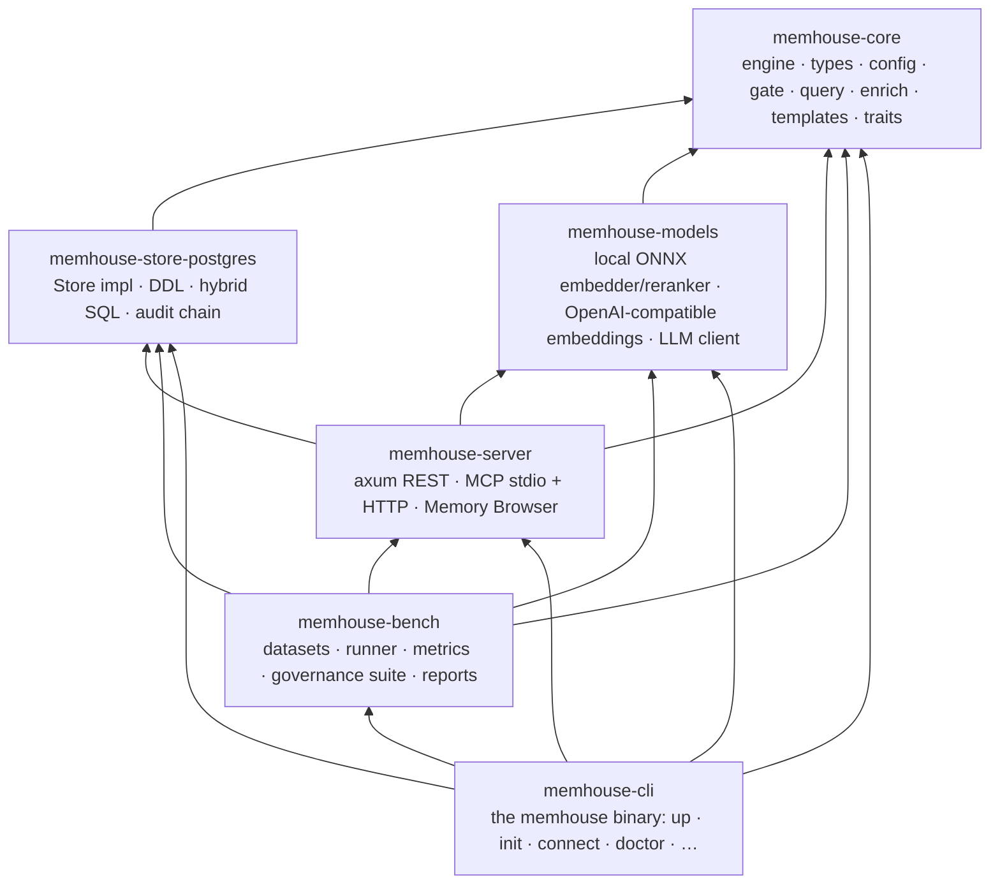
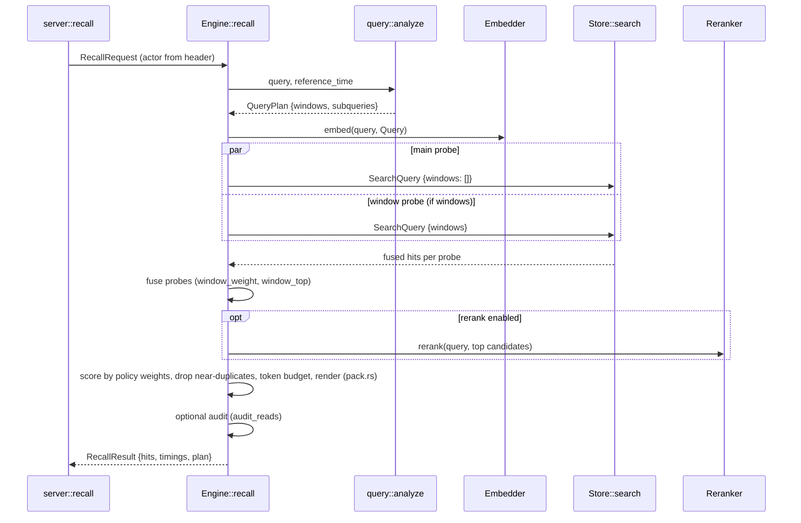
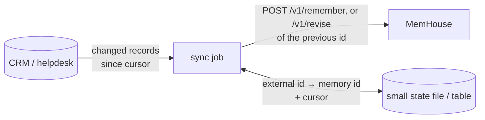
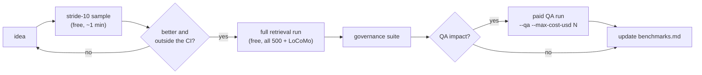

<!-- SPDX-License-Identifier: CC-BY-4.0 -->
# Developer guide

For people changing MemHouse itself: how the code is laid out, how to build and test it, and how to
extend it with a new store, model, transport, governance rule, template or data source.

## Contents

- [Crate layout](#crate-layout)
- [Build](#build)
- [Test](#test)
- [Request lifecycle in code](#request-lifecycle-in-code)
- [Extension points](#extension-points)
  - [Add a store adapter](#add-a-store-adapter)
  - [Add an embedding or rerank provider](#add-an-embedding-or-rerank-provider)
  - [Add a chat model for enrichment](#add-a-chat-model-for-enrichment)
  - [Add a REST route or MCP tool](#add-a-rest-route-or-mcp-tool)
  - [Add a redaction or injection rule](#add-a-redaction-or-injection-rule)
  - [Add a template](#add-a-template)
  - [Feed data from other systems (context providers)](#feed-data-from-other-systems-context-providers)
- [Change the schema](#change-the-schema)
- [Benchmark a change](#benchmark-a-change)
- [Conventions](#conventions)

## Crate layout



`memhouse-core` depends on no adapter. It only knows the traits in
[`traits.rs`](../crates/memhouse-core/src/traits.rs), which is what lets another store or model
replace the defaults without touching the engine.

| File | What lives there |
|---|---|
| `core/src/engine.rs` | `Engine`: remember, ingest, recall, update, forget, erase, retention |
| `core/src/gate.rs` | redaction rules and injection patterns (deterministic, unit-tested) |
| `core/src/query.rs` | query analysis: time expressions → windows; "A or B" sub-queries |
| `core/src/enrich.rs` | enrichment workers, prompt, robust JSON parsing, cost tracking |
| `core/src/templates.rs` | the five use-case templates |
| `core/src/config.rs` | every config key, its default and its environment override |
| `store-postgres/src/lib.rs` | schema, the single-statement hybrid search, the audit chain, cascading deletes |
| `server/src/lib.rs` / `mcp.rs` | routes, auth middleware, MCP tools |
| `core/src/policy.rs` | policy specs, the compiler and its precedence checks, the per-type rules (gate, retention, retrieval, access), versions, diff, approval and rollback |
| `core/src/working.rs` | the session cache of working memory |
| `core/src/preference.rs`, `promote.rs`, `sharing.rs` | scope-ordered preferences, promotion between types, grants between agents |
| `bench/src/governance.rs` | the governance suite (56 checks); the API, identity, intake, schema, telemetry, policy, memory-type and packing checks are in `*_checks.rs` next to it |

## Build

Requirements: Rust 1.85+, and Docker for `memhouse up` and the tests that need Postgres.

```bash
cargo build --release -p memhouse-cli          # → target/release/memhouse
```

The `local` feature of `memhouse-models`, on by default, bundles ONNX Runtime for the offline
embedder and reranker. It isn't exposed as a CLI feature yet, so every `memhouse` binary includes
it. A remote-only build needs `default-features = false` on `memhouse-models` in the workspace
`Cargo.toml`.

macOS: if linking fails to find system headers, point `SDKROOT` at the Command Line Tools SDK,
e.g. `export SDKROOT=$(xcrun --show-sdk-path)`.

Use your own home directory for development so you never touch `~/.memhouse`:

```bash
export MEMHOUSE_HOME=$PWD/.dev-home            # gitignored
./target/release/memhouse up --name memhouse-dev --port 54331
```

## Test

One command runs everything, in order, and stops at the first failure:

```bash
cargo xtask ci
```

| Step | What it runs | Needs |
|---|---|---|
| fmt | `cargo fmt --all -- --check` (settings in `rustfmt.toml`) | — |
| spdx headers | `cargo xtask spdx`: every source and doc file carries the licence its path requires | — |
| secret scan | `cargo xtask secrets`: no credentials or credential files in the tree ([secrets.md](security/secrets.md)) | — |
| dependency policy | `cargo deny check -D unmatched-wrapper`: permissive licences only, no known vulnerabilities, crates.io only, no bundled CA lists (`deny.toml`) | `cargo install cargo-deny --locked` |
| clippy | `cargo clippy --workspace --all-targets --release -- -D warnings` (MSRV in `clippy.toml`) | — |
| unit tests | `cargo test --workspace --release`: gate (including `proptest` properties), query analysis, enrichment parsing, metrics, batching, SQL quoting, plan checker | — |
| release build | `cargo build --release -p memhouse-cli` | — |
| e2e | `scripts/e2e.sh`: up → CLI → REST → MCP → doctor → audit, in a throwaway home and container | Docker |
| benchmark guard | `memhouse bench guard`: the governance suite plus the T1 benchmark runs, compared with `bench/baselines.json` | a benchmark database (`memhouse up` once) and the datasets (`memhouse bench download longmemeval-s`, `locomo`) |

It takes about 5 minutes on a laptop. Options: `--tier 2` (adds LoCoMo with cached enrichment,
about $0.01), `--fix` (apply rustfmt and add missing SPDX headers), `--skip-e2e` (no Docker), `--skip-guard` (no benchmark
database), `--skip-latency` (report the guard's timings without failing on them, for a machine
known to be busy; `MEMHOUSE_CI_SKIP_LATENCY=1` does the same for the pre-push hook, which passes no
options). `scripts/ci.sh` is the same command.

Hosted CI (`.github/workflows/ci.yml`) runs every step on each pull request except the benchmark
guard: the e2e step there includes the governance suite. Benchmarks need the public datasets
(LoCoMo is licensed for non-commercial use only) and, for paid tiers, an LLM key, so they run on a
maintainer's machine, on demand, and their results are published with the commands that produced
them ([benchmarks.md](benchmarks.md#where-benchmarks-run)).

Install the hooks once per clone:

```bash
cargo xtask install-hooks
```

| Hook | Runs | Skip once |
|---|---|---|
| pre-commit | `cargo xtask secrets --staged` | `git commit --no-verify` (false positives only) |
| commit-msg | requires a DCO `Signed-off-by` line (`git commit -s`, see [CONTRIBUTING.md](../CONTRIBUTING.md)) | — |
| pre-push | `cargo xtask ci` | `git push --no-verify` |

The hooks check the checkout git is working on: in a worktree they build `xtask` from that
worktree and check its tree, not the main checkout's.

`cargo xtask install-hooks --repo ../other-repo` installs the pre-commit and commit-msg hooks in
another repository.

### The benchmark guard

```bash
memhouse bench guard              # tier 1: free, ~2 min
memhouse bench guard --tier 2     # adds cached enrichment
```

It runs the governance suite (every check must pass, and there must be at least as many checks as
the baseline), LongMemEval_S on a 50-question sample, and LoCoMo, then prints a table of each
metric against its baseline and threshold (see
[roadmap section 3](roadmap.md#3-the-benchmark-guard)). The
report is also written to `bench-results/guard/`.

- **Quality metrics are deterministic**: the same code gives the same numbers, so any drop is real.
- **Timings are not.** Latency is gated on the SQL search time with generous limits (+50% or
  +5 ms), and total recall time only catches large regressions (+100%). A run where only timings
  fail is repeated once. On a machine you know is busy, `--skip-latency` reports timings without
  failing on them.
- **Check that the guard can fail** by passing a bad setting to every run:
  `memhouse bench guard -- --vector-weight 0` fails on nDCG and round recall.
- **After a deliberate improvement**, record the new values with `memhouse bench guard --update`
  (thresholds are kept) and commit `bench/baselines.json` with the change.

The governance suite includes three checks that guard the recall statement itself: its query plan
never reads outside the subject (`recall_plan_scoped`, TR-RQ-01), vector top-K equals brute force
(`exact_topk`, TR-RQ-02) and random sequences of writes, revisions and deletions stay consistent
with a reference model (`invariants`).

`scripts/e2e.sh` on its own keeps its container with `KEEP=1`, and takes `BIN`, `PORT`, `PG_PORT`,
`CONTAINER` and `MEMHOUSE_MODEL_CACHE` (reuse downloaded models) overrides.

## Request lifecycle in code

A recall, from the HTTP handler to Postgres and back:



Writes go `server::remember` → `Engine::remember` → `gate::screen` → `Store::find_by_hash` →
`Engine::embed_passages` (embedding cache) → `Store::nearest` → `Store::insert` →
`Store::audit`.

## Extension points

### Add a store adapter

Implement `memhouse_core::Store` ([`traits.rs`](../crates/memhouse-core/src/traits.rs)). The
contract the engine relies on:

| Method group | Must guarantee |
|---|---|
| `search` | filters on tenant, subject, `status = committed`, kinds, tags, denied labels, validity at `valid_at`, event time ≤ `as_of`, and windows; returns RRF-fused hits with per-retriever ranks |
| `insert`, `set_superseded`, `set_status` | atomic per call |
| `delete`, `delete_subject` | remove derived data too (cached vectors, facts whose `source_ids` contain the id, enrichment jobs, cached extractions) and write a ledger row, all in one transaction |
| `audit`, `audit_verify` | a linear hash chain (serialise inserts); the same `audit_hash` field order |
| `enrich_claim` | never hands one job to two live workers; re-offers jobs whose lease has expired |
| `embed_cache_*`, `llm_cache_*` | content-addressed get/put; deletions purge them |

Skeleton:

```rust
pub struct SqliteStore { /* pool */ }

#[async_trait::async_trait]
impl memhouse_core::Store for SqliteStore {
    async fn migrate(&self, dim: usize, embedder_id: &str) -> anyhow::Result<()> { todo!() }
    async fn insert(&self, records: &[NewMemory]) -> anyhow::Result<()> { todo!() }
    async fn search(&self, q: &SearchQuery) -> anyhow::Result<Vec<Hit>> { todo!() }
    // … every other method in the trait
}
```

Then wire it into `memhouse_server::build_engine` (selected by the URL scheme, for example) and
run the governance suite against it. **The suite is the acceptance test for a store:** all 18
checks must pass.

### Add an embedding or rerank provider

Implement `Embedder` (`id`, `dim`, `embed(texts, kind)`) or `Reranker` (`id`, `rerank(query, docs)`)
in `memhouse-models`, and add a `provider` arm in `build_embedder` / `build_reranker`.
`OpenAiEmbedder` in [`models/src/lib.rs`](../crates/memhouse-models/src/lib.rs) is a complete
example in about 60 lines.

Rules:
- `id()` must be stable and include the provider and model (`"cohere:embed-english-v3.0"`). It is
  stored with every record and is part of the embedding-cache key.
- Return vectors in input order, exactly `dim()` long.
- Treat `EmbedKind::Query` and `Passage` differently if the model wants prefixes or input types.

### Add a chat model for enrichment

`ChatModel` has two methods:

```rust
#[async_trait]
pub trait ChatModel: Send + Sync {
    fn id(&self) -> String;                                   // part of the LLM-cache key
    async fn chat(&self, system: &str, user: &str) -> anyhow::Result<(String, LlmUsage)>;
}
```

Any OpenAI-compatible or Anthropic endpoint already works through `memhouse_models::Llm`, so a new
implementation is only needed for a different protocol. Include the endpoint in `id()` (the
built-in one uses `provider:model@host`). Otherwise answers cached from one endpoint are served
for another. Fill in `LlmUsage` (tokens, `cost_usd` if known, `ms`, `attempts`) so cost reports
stay right. `StubExtractor` in
[`bench/src/governance.rs`](../crates/memhouse-bench/src/governance.rs) is a deterministic test
double.

If you change the extraction prompt in `enrich.rs`, bump `PROMPT_VERSION`. It is part of the
cache key, so old answers aren't reused for the new prompt.

### Add a REST route or MCP tool

Both transports call the engine and nothing else. Business logic belongs in `Engine` so that
REST, MCP, the CLI and the benchmark behave the same way.

1. Add the method to `Engine` (with an audit event if it changes data).
2. REST: add a handler and `.route(…)` in [`server/src/lib.rs`](../crates/memhouse-server/src/lib.rs),
   inside the `api` router so the auth middleware applies.
3. MCP: add the tool's JSON schema to `tools()` and a match arm in `call_tool` in
   [`server/src/mcp.rs`](../crates/memhouse-server/src/mcp.rs). Set `readOnlyHint` or
   `destructiveHint`. Write the description for the agent: say *when* to call the tool.
4. Document it in [api.md](api.md).

### Add a redaction or injection rule

Rules live in [`gate.rs`](../crates/memhouse-core/src/gate.rs). A rule has a category, a regex, a
replacement and an optional validator (cards use Luhn to avoid false positives).

```rust
Rule {
    category: "nhs",                                   // UK NHS number, checked with mod 11
    re: r(r"\b\d{3} ?\d{3} ?\d{4}\b"),
    replacement: "[REDACTED:nhs]",
    check: Some(nhs_mod11_ok),
},
```

Add a unit test with true positives **and** look-alikes that must survive (order numbers, dates,
version strings). For an injection pattern, also add the benign phrasing it must not catch to
`flags_injection` and to the `false_quarantine` check. The categories a deployment uses are set in
`[governance] redact`, so a new category is opt-in until you add it to the defaults.

### Add a template

Add a `Template` to `TEMPLATES` in [`templates.rs`](../crates/memhouse-core/src/templates.rs):

```rust
Template {
    name: "hr",
    title: "HR assistant",
    subject_hint: "employee:<hris-id>",
    default_subject: "employee:unknown",
    redact: &["secret", "card", "ssn", "iban", "email", "phone"],
    recency_weight: 0.02,
    tags: &["benefit", "leave", "policy-question", "case"],
    guidance: "The subject is the employee. Remember open cases and promised follow-ups as `commitment`, \
               benefit choices as `semantic`. Never store health details or compensation figures.",
},
```

`guidance` is sent to the agent in MCP `initialize`, so write it as an instruction to the agent.
`memhouse up --template hr` and `memhouse agents` pick the new template up automatically.

### Feed data from other systems (context providers)

A plugin system for context providers (HubSpot, Salesforce, Zendesk, Shopify) is designed but not
built yet. Until it ships, the supported pattern is a **sync job** that writes through the public
API. That way imported records pass the same gate and audit as everything else.



The rules that keep it correct:

- **One subject per external entity** (`account:<crm-id>`).
- **Revise, don't append.** Keep a map from external field to memory id, and `revise` that id
  when a value changes, so recall never sees two plans for one account.
- **Send an idempotency key** made of the external id, the field and its change time, so a job
  that crashes and runs again writes nothing twice.
- **Set `source`** to the system (`hubspot`) and `actor` to the job, so audits show where a fact came from.
- **Set `occurred_at`** to the record's change time, not the sync time.
- **Propagate deletions:** when the CRM deletes a contact, erase the subject.

A minimal HubSpot-style example:

```python
import json, os, pathlib, httpx

MH = httpx.Client(base_url="http://127.0.0.1:7077",
                  headers={"authorization": f"Bearer {os.environ['MEMHOUSE_API_KEY']}",
                           "x-memhouse-actor": "hubspot-sync"})
STATE = pathlib.Path("hubspot-sync.json")
state = json.loads(STATE.read_text()) if STATE.exists() else {"cursor": None, "ids": {}}

def facts(deal):
    yield "stage",  f"Deal '{deal['name']}' is in stage {deal['stage']}"
    yield "amount", f"Deal '{deal['name']}' is worth {deal['amount']} {deal['currency']}"
    yield "close",  f"Deal '{deal['name']}' is expected to close on {deal['close_date']}"

for deal in fetch_changed_deals(since=state["cursor"]):          # your CRM client
    subject = f"account:{deal['account_id']}"
    for field, text in facts(deal):
        key = f"{deal['id']}:{field}"
        prev = state["ids"].get(key)
        if prev and prev["text"] == text:
            continue                      # unchanged: nothing to write
        body = {"content": text, "tags": ["deal", field], "source": "hubspot", "occurred_at": deal["updated_at"]}
        retry_safe = {"idempotency-key": f"hubspot:{key}:{deal['updated_at']}"}
        if prev:
            r = MH.post("/v1/revise", json={"id": prev["id"], **body}, headers=retry_safe)
        else:
            r = MH.post("/v1/remember", json={"subject": subject, "kind": "semantic", **body}, headers=retry_safe)
        state["ids"][key] = {"id": r.raise_for_status().json()["id"], "text": text}
    state["cursor"] = deal["updated_at"]
    STATE.write_text(json.dumps(state))
```

The planned plugin interface will move this loop into the server: a `ContextProvider` adapter
with cursor-based `pull`, an id map kept in Postgres, and a scheduler. The rules above are the
contract it will follow, so sync jobs written now will port across directly.

## Change the API

API v1 is frozen ([stability policy](api-stability.md)). Within v1 a change may only add.

1. Change the request or response type in `memhouse-core/src/types.rs`. Doc comments become the
   field descriptions in the OpenAPI document and in the MCP tool schemas, so write them for API
   users.
2. For a new route, add the handler in `memhouse-server/src/lib.rs` and the operation in
   `openapi::ops`. For a new MCP tool, add it in `mcp::build_tools` with the REST body's
   properties it offers.
3. Regenerate the published document: `MEMHOUSE_WRITE_OPENAPI=1 cargo test -p memhouse-server
   openapi`. Commit `api/openapi.json` with the change.
4. `cargo test -p memhouse-server` fails on any breaking change against
   `api/baseline/openapi-1.0.0.json`. If it fails, the change needs a new field or route, not an
   edit to the old one.
5. Cover the behaviour in the governance check `api_contract` (`crates/memhouse-bench/src/api_checks.rs`).
   It fails if a documented operation is never called.

Deprecating a route: add it to `openapi::DEPRECATED` with its successor. The server then sends
the deprecation headers, and the document marks it. List it in the deprecation table of the
stability policy.

## Change the schema

The logical model is [docs/schema.md](schema.md); change it there first. The Postgres DDL is
`schema_v1_ddl` plus one block per later version (`SCHEMA_V2_DDL`), run in order by
`PgStore::migrate` ([`store-postgres/src/lib.rs`](../crates/memhouse-store-postgres/src/lib.rs)).

- Expand, backfill, switch, contract: only **additive** DDL (`CREATE TABLE/INDEX IF NOT EXISTS`,
  `ALTER TABLE … ADD COLUMN IF NOT EXISTS`, nullable columns), a batched idempotent backfill, and
  removals only in a later version. Old and new binaries must share a database during a rolling
  restart; the `schema_upgrade` governance check proves it for v1 → v2.
- Bump `memhouse_core::format::SCHEMA_VERSION`, extend the upgrade check, and say what changed in
  the commit message.
- A new field that belongs to a record goes into [Memory Format](memory-format.md) too
  (`RecordLine`, the spec, a conformance vector), or export → import loses it; the
  `format_roundtrip` check fails until it does.
- New tables holding subject data must be covered by `delete` and `delete_subject`, with a
  governance check that proves it.
- Don't add an approximate vector index to `mh_memory`. Per-subject recall is exact by design
  (SCALE-03).

## Benchmark a change

Every ranking change is judged by the benchmark, not by intuition.

For routine changes, `memhouse bench guard` is enough. For a ranking experiment, compare runs
directly:

```bash
memhouse bench download longmemeval-s
memhouse bench run --dataset longmemeval-s --stride 10 --label before     # 50 questions, ~1 min
# … make the change, rebuild …
memhouse bench run --dataset longmemeval-s --stride 10 --label after
memhouse bench report bench-results/*before* bench-results/*after*        # side-by-side with CIs
```



- Retrieval runs need no LLM and cost nothing. Run them as often as you like.
- QA runs (`--qa`) call paid models. Use them only to confirm a change, and always set
  `--max-cost-usd`. Each report records its tokens and spend.
- Tune on a sample, then confirm on the full set, so you don't overfit the sample.
- See [benchmarks.md](benchmarks.md#reproduce) for the commands behind every published number.

## Conventions

- **Errors:** `anyhow` with context. Messages say what to do ("run `memhouse init`", "use a new
  database"). The REST layer maps "not found" to 404 and "required", "limit is", "empty" and
  "expected" to 400, so keep that wording for client errors.
- **No LLM on the hot path.** Write and recall must stay deterministic and fast; LLM work happens
  in background workers.
- **Every data change writes an audit event**, and every new kind of derived data is purged on
  deletion.
- **Config:** every new key gets a default in `config.rs`, a doc comment, and a row in
  [configuration.md](configuration.md).
- **Comments** explain *why*, and cite the requirement id (`TR-…`, `GOV-…`) when there is one.
