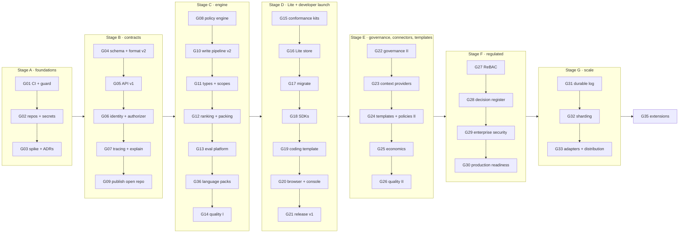

<!-- SPDX-License-Identifier: CC-BY-4.0 -->
# MemHouse — Roadmap: goals for Claude Code

| Field | Value |
|---|---|
| Version | 2.2 (the public edition of development plan v2) |
| Date | 7 November 2026 |
| Progress | 10 of 35 goals done ([goal tracker](#goal-tracker)) |
| Product version | 2.0.0 (the Rust + Postgres implementation; the Elixir 0.x line is archived as `memhousehq/archive-memhouse`) |

This plan is a **sequence of goals**. Each goal is sized for one or a few Claude Code sessions and
starts with a `/goal` line that can be pasted as is. Goals run in order: each one assumes the
earlier goals are done. Every requirement ID from the design requirements is assigned to exactly one
goal (see the [coverage index](#appendix-a--coverage-index)), so nothing is forgotten.

## Contents

1. [Where we are](#1-where-we-are)
2. [Ordering principles: build each thing once](#2-ordering-principles-build-each-thing-once)
3. [The benchmark guard](#3-the-benchmark-guard)
4. [Repositories, licences and secrets](#4-repositories-licences-and-secrets)
5. [How to run a goal](#5-how-to-run-a-goal)
6. [Roadmap at a glance](#6-roadmap-at-a-glance)
7. [Goals](#7-goals)
8. [Risks](#8-risks)
- [Appendix A — Coverage index](#appendix-a--coverage-index)

---

## 1. Where we are

The code is a working **Standard-shaped** service: one Rust binary on Postgres + pgvector, with:

- the write gate (deterministic redaction, injection quarantine), dedup and supersession,
  validity windows and `as_of` recall;
- hybrid recall (BM25 + two vectors per round, weighted RRF, date-aware window probe, optional
  cross-encoder, token budget);
- asynchronous LLM enrichment (Postgres job queue, workers, LLM cache, cost cap);
- hash-chained audit, a deletion ledger, deletion and retention that cascade to derived data;
- REST, MCP (stdio and HTTP), Memory Browser v0, `memhouse up / init / connect / doctor / export / import`;
- five templates (personal, coding, support, sales, success);
- `memhouse bench`: LongMemEval S/M/oracle, LoCoMo, LLM-judged QA with cost tally, and 47 governance checks;
- local CI (`cargo xtask ci`) with a pre-push hook and the benchmark guard (`memhouse bench guard`, G01);
- repository hygiene (G02): Apache-2.0 `LICENSE` and SPDX headers, DCO sign-off hook, `cargo-deny` policy, and a built-in secret scanner (pre-commit and CI);
- API v1 over REST and MCP with an OpenAPI 3.1 document and a stability policy (G05); logical
  schema v5 and Memory Format v2 with conformance vectors (G04);
- principals with per-principal keys and short-lived agent tokens, an authorizer on every call,
  propose-only agents and labels enforced inside the recall statement (G06);
- OpenTelemetry traces, Prometheus metrics and a stored explanation for every recall (G07);
- versioned behaviour policies, compiled under governance, approved by a named person and
  rolled back (G08);
- a staged write pipeline behind an `IntakeQueue` (Postgres table) and a `JobRunner`: writes are
  redacted, durably queued and answered `candidate` at once; a statement gate commits facts,
  holds plans and speculation, supersedes what a correction or a changed value updates; intake
  routing with exact recall over structured records; degradation to an empty flagged result
  (G10, API 1.4, schema v6);
- docs: API, configuration, operations, governance, policy, development, architecture, benchmarks.

Published results: LongMemEval_S QA **86.0** (GPT-4o), LoCoMo QA **83.7** (GPT-4o-mini), recall
p50 about 30 ms on a laptop.

**What diverged from plan v1:** v1 built *Lite first* (an embedded store). The code went Postgres
first. Plan v2 keeps that: the Lite store comes after the logical schema, API and conformance kit
are frozen (goals G04–G15), so it is written once against the final contracts instead of being
reworked.

**What is missing from the code is the unbuilt part of each goal not ticked in the
[goal tracker](#goal-tracker)** (G11 onwards; G25's re-embedding was done early). Some of those
goals start from features that already work and are listed above, such as date-aware recall
(G12) and the v1 sales and success templates (G24). The largest gaps are working memory and
scopes (MEM-01/04), relationship-based access (ACC), SDKs, the Lite store, the coding
template's git-aware features, release engineering, and all of Scale.

---

## 2. Ordering principles: build each thing once

1. **Safety net first.** CI and the benchmark guard (G01) come before any feature, so every later
   change is measured.
2. **Freeze contracts before building on them.** The logical schema and export format (G04), the
   public API (G05), identity and the authorizer seam (G06), tracing and explanations (G07) and
   policy (G08) are touched by every later feature. Changing them later would mean rewriting
   features, so they are fixed first, as *expand-only* changes to the current code.
3. **Seams before implementations.** Each component that will later be replaced at scale gets its
   trait now, with a simple implementation:

   | Seam | Introduced in | Simple implementation now | Scale implementation later |
   |---|---|---|---|
   | `Store` | exists | Postgres | SQLite (G16), sharded Postgres (G32), MongoDB/Vespa (G33) |
   | `Authorizer` | G06 | roles and scopes on API keys | relationship store, ReBAC (G27) |
   | `PolicySource` | G08 | policy files in the database | decision register (G28) |
   | `IntakeQueue` | G10 | Postgres job table | durable log (G31) |
   | `JobRunner` | G10 | in-process workers | workflow engine (G31) |
   | `ContextProvider` | G23 | in-process connectors | the same, on the job runner |
   | `Tracer` | G07 | OpenTelemetry SDK | the same |

4. **Engine before profiles.** The engine semantics (pipeline, memory types, ranking) are completed
   on Postgres (stage C), then a conformance kit is written (G15), and only then is the Lite store
   built against it (G16).
5. **Quality tuning after refactors.** Retrieval tuning (G14, G26) happens after the write
   pipeline and ranking are rebuilt (G10–G12) and the word lists move into language packs (G36),
   so tuning effort isn't lost.
6. **Governance is never weakened.** Every goal keeps the governance suite at 100% and adds checks
   for what it introduces.
7. **Access model before regulated features.** The decision register (G28) sits on ReBAC (G27),
   which sits on the identity seam (G06).
8. **Scale last.** Subject partitioning (SCALE-02 data model), exact per-subject scoring and
   one-statement recall already hold. Sharding, the durable log and multi-region come after the
   product is complete on one database.

---

## 3. The benchmark guard

Every goal ends with the guard. It catches regressions in retrieval quality, latency and safety
while costing nothing for routine work.

The guard runs on the developer's machine (`cargo xtask ci`), not in hosted CI: it needs the
public datasets and, from T2, an LLM key given for the run. Hosted CI runs everything else,
including the governance suite.

| Tier | When | What runs | Cost | Time |
|---|---|---|---|---|
| **T1** | every goal, before each commit that touches the engine, store or models | build + unit tests; governance suite; LongMemEval_S retrieval, stride 10 (50 questions); LoCoMo retrieval (all 1,540 questions) | $0 | ~3 min |
| **T2** | goals that touch enrichment, facts, ranking or the answer context | T1 + LoCoMo retrieval with `--enrich` (served from the LLM cache) | ~$0.01 | ~5 min |
| **T3** | end of each stage (milestones), after quality goals | T2 + LoCoMo QA (`--qa --answer-model gpt-4o-mini --enrich`, `--max-cost-usd 1.5`) | ~$0.70 | ~20 min |
| **T4** | releases only, **with the user's approval** | full LongMemEval_S QA with GPT-4o (`--max-cost-usd 10`) | ~$7.50 | ~1 h |

### Baselines (1 November 2026, `bge-small-en-v1.5-onnx-Q`, laptop CPU)

| Run | Metric | Baseline | Fails the guard if |
|---|---|---|---|
| Governance suite | checks passed | 47 / 47 | any check fails, or fewer checks than the baseline |
| LongMemEval_S, stride 10 (46 scored) | session recall_all@5 | 91.3 | drops by more than 2.2 (one question) |
| | session nDCG@10 | 94.2 | drops by more than 2.0 |
| | round recall_all@10 | 84.8 | drops by more than 2.2 |
| | SQL search p50 | 9.7 ms | rises by more than 50% and 5 ms |
| | recall p95 | 63 ms | doubles |
| LoCoMo (1,536 scored) | session recall_all@5 | 78.8 | drops by more than 1.0 |
| | session nDCG@10 | 78.6 | drops by more than 1.0 |
| | round recall_all@10 | 59.2 | drops by more than 1.0 |
| | SQL search p50 | 9.0 ms | rises by more than 50% and 5 ms |
| | recall p95 | 61 ms | doubles |
| LoCoMo + enrich (T2) | round recall_all@10 | 66.0 | drops by more than 1.0 |
| | session recall_all@5 | 79.6 | drops by more than 1.0 |
| LoCoMo QA (T3) | accuracy, GPT-4o-mini | 83.7 (81.8–85.5) | drops by more than 1.5 |
| LongMemEval_S QA (T4) | accuracy, GPT-4o | 86.0 (83.0–88.8) | drops by more than 2.0 |

The values and thresholds live in `bench/baselines.json`; `memhouse bench guard` applies them.

Rules:

- Quality metrics are deterministic (identical on repeated runs), so any drop is a real change.
- Timings move with machine load. Latency gates on the SQL search time, which the engine and
  store control; total recall time includes query embedding on the CPU and only catches large
  regressions. A run whose only failures are timings is repeated once and the better timing kept.
  On a machine known to be busy, `--skip-latency` reports timings without gating on them.
- If T1 trips on the 50-question sample, run the full LongMemEval_S retrieval (free, ~4 min)
  before deciding. A drop on the full set is a regression.
- A regression is fixed in the same goal, or the goal records why it is accepted (a deliberate
  trade, e.g. a security filter) and the user agrees.
- Baselines change only on a deliberate improvement: `memhouse bench guard --update` records the
  new values and run directories in `bench/baselines.json`; update this table in the same commit.
- Paid tiers always run with `--max-cost-usd`, and their spend is reported in the goal's summary.
  T4 needs explicit approval from the user each time.

---

## 4. Repositories, licences and secrets

The product is one **monorepo**. Planning documents that are not public are kept outside it, and
no repository, public or private, ever holds a secret value.

### Repositories

| Repository | Licence | Holds | Since |
|---|---|---|---|
| [`memhousehq/memhouse`](https://github.com/memhousehq/memhouse) (this repository) | Apache-2.0 code; docs CC BY 4.0 | all product code: crates, xtask, scripts and, as they arrive, SDKs, console, templates, evaluation harness and deploy charts; docs; benchmark baselines and result summaries; this roadmap | G09, as MemHouse 2.0.0. It replaces the Elixir implementation (0.x), archived with its history as [`memhousehq/archive-memhouse`](https://github.com/memhousehq/archive-memhouse) |
| [`memhousehq/memory-format`](https://github.com/memhousehq/memory-format) | spec CC BY 4.0; schemas and vectors Apache-2.0 | the Memory Format specification and conformance vectors (RP-06) | G09, split from `memory-format/` with its history |
| `homebrew-tap` | Apache-2.0 | formulae, updated by the release pipeline | G21 |

The project is run by its author as an individual ([GOVERNANCE.md](../GOVERNANCE.md)). Package
registry names (crates.io, PyPI, npm) are reserved when there is something to publish there (G21).

### Secrets

1. **No secret values in any repository.** Repositories hold the *names* of secrets (the
   configuration already does this with `api_key_env`).
2. **Prefer no long-lived secrets.** Package registries are reached through OIDC trusted
   publishing and artefacts are signed keylessly (Sigstore, G21). Stored keys only where a
   requirement asks for them (SC-02).
3. **One credential per purpose**, with least privilege; paid LLM keys carry a spend cap set at the
   provider.
4. **No secrets in hosted CI.** CI runs no paid calls and no benchmarks, so forks have nothing to
   leak. Benchmarks, paid tiers included, run on a maintainer's machine on demand, with the key
   given for that one run ([benchmarks.md](benchmarks.md#where-benchmarks-run)).
5. **Detection.** A secret scanner runs as a pre-commit hook and in `cargo xtask ci`, over the tree
   and the whole history; GitHub's push protection and secret scanning are on.
6. **Rotation and revocation** are documented per secret in
   [`docs/security/secrets.md`](security/secrets.md), with the inventory.

### Publication and launch

The repository went public in **G09**, at the end of stage B, once the API, schema and format were
frozen, so outside users don't see them churn. Publication is not the launch: packages, the docs
site and the announcement come with the developer launch (G21).

---

## 5. How to run a goal

Paste the goal's `/goal` line into Claude Code. The line of every goal still to do ends by
pointing here. The session should:

1. Read this plan's section for the goal, and the requirement texts it cites (the design
   requirements are kept with the project's planning documents).
2. Plan the change, keeping to the ordering principles (expand-only schema changes; seams, not
   shortcuts).
3. Implement it with unit tests, and a governance check for every new safety property.
4. Run the guard tier the goal names and compare against the baselines.
5. Update the docs the goal touches (`docs/*.md`, README).
6. Log what was done in this file, as described below.
7. Commit with a message naming the goal (e.g. `G06: identity and authorizer seam`), including the
   change to this file.

A goal is **done** when every deliverable box is ticked (or struck through with its reason), its
"Done when" holds, the guard passes, the docs match the code and the work is logged here.

### Logging a goal

This file is the record of what is done. Each session keeps it up to date as it works, not only at
the end, so that the next session, or a reader on GitHub, can see where the goal stands.

- **Deliverables.** Tick a box (`[x]`) in the same commit as the work that completes it. If the goal
  needed something the plan did not list, add a box for it. Never delete a box: if a deliverable is
  dropped, strike it through (`~~…~~`) and give the reason; if it moves, name the goal it moves to.
- **Status.** When the goal is done, tick its **Done** box (the first line of its section) and its
  box in the [goal tracker](#goal-tracker), each with the date, and update the progress count at
  the top of this file. A goal with some deliverables done
  but not all stays unticked, with a note on the **Done** line (see G25).
- **Result.** Add a `**Result (YYYY-MM-DD):**` entry to the goal. It covers:
  - what was built, with the names of commands, routes, tables and checks, and links to the docs;
  - the numbers that show "Done when" holds;
  - the guard tier, its outcome and any paid spend;
  - what differs from the plan and why, and what moved to which later goal;
  - what was decided by the user, and when.

  A goal that takes several sessions adds a dated entry for each one, and later fixes to a done
  goal add a dated line to its result (see G07's T13 entry).
- **Moved work.** When part of a goal moves, add it as a box in the goal that receives it, and say so
  in both. Work done early, in another goal, is ticked where it lives and marked "done early" with
  the date.
- **The rest of this file.** Update [section 1](#1-where-we-are) when a goal changes what the code
  can do, the baselines in [section 3](#3-the-benchmark-guard) when the guard's values change, and
  the [coverage index](#appendix-a--coverage-index) when a requirement moves between goals.

---

## 6. Roadmap at a glance

| Stage | Goals | Milestone at the end | Guard at the end |
|---|---|---|---|
| A. Foundations | G01–G03 | everything measured; repositories split; secrets policy in force; decisions recorded | T1 |
| B. Contracts | G04–G07, G09 | schema, API, identity and tracing frozen (old v1 gate G1); **open repository public** (G09) | T1 |
| C. Engine | G08, G10–G13, G36, G14 | policy engine; every engine Must on Postgres; the 24 EU languages | T3 |
| D. Lite + developer launch | G15–G21 | **developer launch**: Lite + Standard, SDKs, coding template, release pipeline (old G2 + G3) | T3, plus T4 with approval |
| E. Governance, connectors, templates | G22–G26 | regulated-ready Standard; plugin system; template packages | T3 |
| F. Regulated | G27–G30 | **pilot-ready**: ReBAC, decision register, enterprise security, load-tested (old G4/P0) | T3, plus T4 with approval |
| G. Scale | G31–G33 | **general availability**: Scale profile (old G5) | T3 |
| H. Extensions | G35 | Could requirements (old G6) | T1 |

Indicative pace with Claude Code doing the implementation: a goal takes one to three working
sessions; stages A–D are about 6–8 weeks of steady work. Stages E onward have no calendar yet.
Goal numbers are stable; a number missing from this file is a goal planned outside it.

### Goal tracker

One box per goal, ticked when the goal is done ([section 5](#5-how-to-run-a-goal)).

**A. Foundations**

- [x] [G01 — Local CI and benchmark guard](#g01--local-ci-and-benchmark-guard) (1 November 2026)
- [x] [G02 — Repository foundation, licence boundary and secret hygiene](#g02--repository-foundation-licence-boundary-and-secret-hygiene) (1 November 2026)
- [x] [G03 — Technology spike, threat model and decision records](#g03--technology-spike-threat-model-and-decision-records) (1 November 2026)

**B. Contracts**

- [x] [G04 — Logical schema v2 and Memory Format v2](#g04--logical-schema-v2-and-memory-format-v2) (2 November 2026)
- [x] [G05 — Public API v1 contract](#g05--public-api-v1-contract) (2 November 2026)
- [x] [G06 — Identity, principals and the authorizer seam](#g06--identity-principals-and-the-authorizer-seam) (2 November 2026)
- [x] [G07 — Tracing, metrics and recall explanations](#g07--tracing-metrics-and-recall-explanations) (2 November 2026)
- [x] [G09 — Open-source publication](#g09--open-source-publication) (3 November 2026)

**C. Engine**

- [x] [G08 — Policy engine v1 (structured specs, approval, versions)](#g08--policy-engine-v1-structured-specs-approval-versions) (4 November 2026)
- [x] [G10 — Write pipeline v2: intake queue, candidates, classification, routing](#g10--write-pipeline-v2-intake-queue-candidates-classification-routing) (6 November 2026)
- [ ] [G11 — Memory types, scopes and promotion](#g11--memory-types-scopes-and-promotion)
- [ ] [G12 — Ranking and packing v2](#g12--ranking-and-packing-v2)
- [ ] [G13 — Evaluation platform: synthetic timelines, own suites, regression gate](#g13--evaluation-platform-synthetic-timelines-own-suites-regression-gate)
- [ ] [G36 — Language packs: word lists as data, several languages at once](#g36--language-packs-word-lists-as-data-several-languages-at-once)
- [ ] [G14 — Quality iteration I: weak types and tiered extraction](#g14--quality-iteration-i-weak-types-and-tiered-extraction)

**D. Lite + developer launch**

- [ ] [G15 — Adapter and profile conformance kits](#g15--adapter-and-profile-conformance-kits)
- [ ] [G16 — Lite profile: embedded store](#g16--lite-profile-embedded-store)
- [ ] [G17 — Profile migration](#g17--profile-migration)
- [ ] [G18 — SDKs, embedded bindings and first framework adapters](#g18--sdks-embedded-bindings-and-first-framework-adapters)
- [ ] [G19 — Coding template v1](#g19--coding-template-v1)
- [ ] [G20 — Memory browser v2 and admin console](#g20--memory-browser-v2-and-admin-console)
- [ ] [G21 — Packaging and release v1 (developer launch)](#g21--packaging-and-release-v1-developer-launch)

**E. Governance, connectors, templates**

- [ ] [G22 — Governance II](#g22--governance-ii)
- [ ] [G23 — Context-provider plugin system, connectors and importers](#g23--context-provider-plugin-system-connectors-and-importers)
- [ ] [G24 — Templates as packages; policies II](#g24--templates-as-packages-policies-ii)
- [ ] [G25 — Economics, consolidation and re-embedding](#g25--economics-consolidation-and-re-embedding) (re-embedding done early)
- [ ] [G26 — Quality iteration II](#g26--quality-iteration-ii)

**F. Regulated**

- [ ] [G27 — Relationship-based access control](#g27--relationship-based-access-control)
- [ ] [G28 — Access Policy Decision Register](#g28--access-policy-decision-register)
- [ ] [G29 — Enterprise security](#g29--enterprise-security)
- [ ] [G30 — Production readiness on Standard](#g30--production-readiness-on-standard)

**G. Scale**

- [ ] [G31 — Durable log intake and workflow engine](#g31--durable-log-intake-and-workflow-engine)
- [ ] [G32 — Sharding, Standard → Scale migration and multi-region](#g32--sharding-standard--scale-migration-and-multi-region)
- [ ] [G33 — More adapters and distribution](#g33--more-adapters-and-distribution)

**H. Extensions**

- [ ] [G35 — Graph, code structure, prompt overrides, air-gapped](#g35--graph-code-structure-prompt-overrides-air-gapped)

---

## 7. Goals

Legend for status: `[x]` done · `[ ]` to do. Each goal opens with its **Done** box, followed by a
box for each deliverable; [section 5](#logging-a-goal) says how to keep them. Requirement IDs in
**bold** are completed by the goal; plain IDs are partly addressed and finished in a later goal,
which is named.

### Stage A — Foundations

#### G01 — Local CI and benchmark guard

- [x] **Done** (1 November 2026)

> `/goal Build a one-command local CI (scripts/ci.sh or cargo xtask ci) that runs fmt, clippy, unit tests, scripts/e2e.sh, the governance suite and the T1 benchmark guard, comparing results with bench/baselines.json and failing on any regression defined in section 3 of docs/roadmap.md; install it as a git pre-push hook.`

- **Why now:** every later goal relies on it to prove that nothing degraded.
- **Scope:** QUAL-05 (gate for engine changes; extended to policies in G13), **TR-RQ-01** (recall
  plan never leaves the subject: EXPLAIN check on a seeded database), **TR-RQ-02** (exact top-K
  equals brute force, re-verifying **SCALE-03**), property-based tests for supersession, dedup and deletion invariants,
  **RP-01** task-runner entry point.
- **Deliverables:**
  - [x] `memhouse bench guard` that runs T1/T2 and prints a pass/fail table against `bench/baselines.json` (`--update`, `--skip-latency`, extra run arguments after `--`)
  - [x] `bench/baselines.json` with the values in section 3 and the run directories
  - [x] one entry point: `cargo xtask ci` (fmt, clippy `-D warnings`, test, e2e, guard with governance); `scripts/ci.sh`
  - [x] plan-regression (`recall_plan_scoped`) and exactness (`exact_topk`) checks; seeded random-sequence `invariants` check; `proptest` properties for the write gate
  - [x] git pre-push hook installer (`cargo xtask install-hooks`); docs in `docs/development.md`
- **Done when:** a deliberately bad change (e.g. vector weight 0) fails the guard; a clean tree passes in under 5 minutes.
- **Result (1 November 2026):** `-- --vector-weight 0` fails on LongMemEval nDCG (94.2 → 91.6) and
  LoCoMo round recall (59.2 → 56.4); the clean tree passes in 309 s with other heavy processes
  running (fmt 0.1 s, clippy 13 s, tests 54 s, build 38 s, e2e 71 s, guard 133 s). The plan check
  found that the last step of recall (fetching the fused hits) could read the whole table on a
  small database; it now fetches only the top `k` ids by primary key, filtered on tenant and
  subject. rustfmt (`rustfmt.toml`) and clippy (`clippy.toml`) were applied to the whole workspace.
- **Guard:** T1 (it creates it). **Depends on:** nothing.

#### G02 — Repository foundation, licence boundary and secret hygiene

- [x] **Done** (1 November 2026)

> `/goal Prepare the repository for publication and for the long run: move the plan to docs/roadmap.md and keep planning documents that are not public out of the repository, add LICENSE, NOTICE, SPDX headers with a check, CONTRIBUTING with DCO sign-off, CODE_OF_CONDUCT, CODEOWNERS, cargo-deny licence and advisory policy, a secret scanner as a pre-commit hook and in cargo xtask ci, .env.example, docs/security/secrets.md with the secret inventory from section 4 of the roadmap, and a .mailmap with a real author identity for new commits.`

- **Why now:** everything committed from now on may become public. SPDX headers, DCO and the
  dependency licence policy are cheap on a small codebase and expensive later; private documents
  and secrets must never enter the product history again.
- **Scope:** **RP-03**, **RP-04**, RP-05 (no secrets in any repository), the third-party licence
  policy, the licence decision record (Apache-2.0, confirmed in G09).
- **Deliverables:**
  - [x] `LICENSE` (Apache-2.0), `NOTICE`, `docs/LICENSE` (CC BY 4.0); ADR for the licence choice
  - [x] SPDX identifier on every source and doc file; `cargo xtask ci` rejects missing or wrong ones per path
  - [x] `CONTRIBUTING.md` (DCO sign-off, `cargo xtask ci`, coding standards), `CODE_OF_CONDUCT.md`, `CODEOWNERS`; a `commit-msg` hook from `cargo xtask install-hooks` that requires `Signed-off-by`
  - [x] `deny.toml` (permissive licences allowed, copyleft blocked unless approved, RustSec advisories) run by `cargo xtask ci`
  - [x] secret scanner (gitleaks or equivalent) as a pre-commit hook and a CI step over the tree and new commits
  - [x] `.env.example`; `docs/security/secrets.md` with the rules and inventory of section 4
  - [x] `docs/roadmap.md` in place, every reference updated (guard, baselines, docs); planning documents that are not public kept outside the repository
  - [x] real author identity configured; `.mailmap` maps the old local address
- **Done when:** `cargo xtask ci` fails on a planted fake API key, on a file without an SPDX header,
  and on a GPL-only dependency, and passes on the clean tree; no private planning document is left
  in the working tree.
- **Result (1 November 2026):** `cargo xtask ci` stops at the secret scan on a planted GitHub-style
  token, at the SPDX check on a new file without a header, and at the dependency policy on a
  GPL-3.0-only crate; the clean tree passes. The scanner is built into `xtask` (no install, works
  offline, scans other repositories with `--repo`) instead of gitleaks; the full history scan is
  clean apart from one reviewed fake key in a test, listed in `.secret-scan-allow`. Internal crates
  now carry versions so they can be published. (G09 later removed the last two licence exceptions
  from the shipped dependencies.)
- **Guard:** T1. **Depends on:** G01.

#### G03 — Technology spike, threat model and decision records

- [x] **Done** (1 November 2026)

> `/goal Run the technology spike from the technical requirements (section 6.10) and write ADRs in docs/adr/ for: Lite embedded store, vector storage format, intake queue/log, authorization store, connection pooler, minimum pgvector and gRPC; write docs/threat-model.md and the AP-10 security-baseline design.`

- **Why now:** G04 (schema) and G16 (Lite) depend on the vector format and the store choice; G06 and
  G27 on the authorization store; G10 and G31 on the intake log.
- **Scope:** **TR-LT-02** (SQLite chosen or replaced, with evidence), **TR-DB-02** (pgvector minimum
  for `halfvec`/`bit` on RDS, Cloud SQL, Azure, Supabase), SCALE-06 decision (half-precision plus a
  binary-quantised copy; implemented in G16/G30), the intake-log and workflow candidates (G31),
  the authorization store (in-Postgres tuples vs SpiceDB/OpenFGA; G27), PgBouncer compatibility
  with prepared statements (G30), gRPC (G30). (The licence record is in G02.)
- **Deliverables:**
  - [x] `docs/adr/0001…` one record per decision, each with the benchmark or test that decided it
  - [x] micro-benchmarks: SQLite FTS5 + in-process binary/half-precision scoring vs Postgres on LongMemEval_S stride 10 (same top-K, latency)
  - [x] `docs/threat-model.md` (STRIDE over REST, MCP, enrichment egress, database, backups)
  - [x] security baseline design (AP-10): which code paths are shared and impossible to disable (input to TR-CORE-05 in G06)
- **Done when:** every ADR is accepted by the user; nothing in G04–G16 needs a choice that isn't recorded.
- **Result (1 November 2026):** ADRs [0002](adr/0002-lite-embedded-store.md) to
  [0008](adr/0008-grpc.md), evidence in [adr/evidence/](adr/evidence/), reproducible with
  `crates/memhouse-bench/examples/spike_storage.rs` (`--features spike`) and `scripts/spike/run.sh`;
  [threat model](threat-model.md) and [AP-10 baseline design](security/baseline.md). Key findings:
  half precision is as exact as f32 on real data at half the size; a binary prefilter alone is not
  exact at 10,000 memories per subject, so it is optional; SQLite + FTS5 meets the Lite latency
  budget with the subject inside the `MATCH`; Postgres covers the Lite and Standard intake queue
  and authorization checks (p95 2.75 ms at 16 clients over 1.1 million tuples); PgBouncer works
  only with `max_prepared_statements`. Acceptance tests at 25% of the national profile can't run on
  a laptop: each ADR lists them under "Still to verify" with the goal that runs them. The threat
  model found a stored XSS in the Memory Browser's subject list, fixed with a regression test.
- **Section 6.10 coverage** ([evidence/spike-acceptance.md](adr/evidence/spike-acceptance.md)):
  - *Lite on the reference laptop:* 100,000 memories, fresh process, networking denied —
    PROF-04 ✓, PROF-07 ✓ (recall p95 26 ms with local embedding, durable ack p95 3.3 ms, recallable
    in 23 ms), PROF-06 ✓ for the store (16 MB); the bundled local model (394 MB with one session)
    gets its own budget, **decided by the user** (ADR 0002), and a remote embedding API is the
    low-memory option (`[embedding] provider = "openai"`, with retries, timeout and `dimensions`).
  - *Sovereign, no external dependencies:* ✓ for every candidate (Lite measured with the network
    denied; the others run inside Postgres or are self-hostable).
  - *25% of the national profile:* per-node capacity measured and compared (the Postgres queue
    can't drain 25,000 writes/s on one node, confirming the log for Scale; authorization needs two
    nodes or a cache); the load tests themselves need a production-like cluster — **moved** to
    G27, G30 and G31.
  - *Managed database service:* **moved to G30 by the user** ("keep managed Postgres for later");
    provider versions are from documentation so far, Cloud SQL unconfirmed.
- **Status:** ADRs 0002–0008 **accepted by the user on 1 November 2026**. Accepted by the user: [x]
- **Guard:** T1. **Depends on:** G02.

### Stage B — Contracts (freeze before building on them)

#### G04 — Logical schema v2 and Memory Format v2

- [x] **Done** (2 November 2026)

> `/goal Implement logical schema v2 and Memory Format v2 as expand-only migrations: principals and provenance on every record, policy version, scopes, labels, the candidate lifecycle, request keys, working memory, links, code references and structured records; publish the format spec with conformance vectors; export/import must round-trip losslessly.`

- **Why now:** every later goal writes or reads these fields. Adding them later means migrating
  records and touching every feature twice.
- **Scope:**
  - record fields: writing agent, acting user, policy version, confidence and source turn
    (provenance, finished in G08 for GOV-03), labels (ACC-04 field; enforcement in G06/G27),
    scope columns (org, team, agent, user, session, for MEM-04 in G11);
  - **CORE-02** state machine stored (candidate → committed / rejected / superseded / quarantined /
    expired; behaviour in G10);
  - a request-key table for **CORE-06** idempotency;
  - `working` kind with session TTL (MEM-01 in G11);
  - a subject-links table (ACC-06, used in G27);
  - code-reference table (TR-TPL-02, used in G19);
  - structured-records table (HYB-02, used in G10);
  - model id, version and configuration hash on every derived record and vector (**TR-MS-02**,
    **INT-07**, **INT-09**);
  - one logical id across representations (**HYB-04**);
  - **TR-CORE-04** logical schema documented independently of Postgres;
  - **QUAL-08** / **TR-DB-01** expand-then-contract migrations tested across two versions;
  - Memory Format v2 covering records, versions, provenance, labels, links, policies and decision
    values (**TR-CORE-03**, **INT-10**), PROF-02 (cross-profile proof in G17);
  - **RP-06** format spec with conformance vectors in `memory-format/`.
- **Deliverables:**
  - [x] migration with backfill; `SCHEMA_VERSION` 2
  - [x] `docs/memory-format.md` + `memory-format/vectors/*.jsonl`
  - [x] export/import v2 with a lossless round-trip test (hash every record before and after)
  - [x] import of v1 exports
  - [x] start-up check of `extversion`: warn below pgvector 0.7.0, refuse below 0.5 ([ADR 0007](adr/0007-minimum-pgvector.md))
- **Done when:** a v1 database upgrades in place; export → import → export is byte-identical apart from timestamps of the run.
- **Result (2 November 2026):** [logical schema v2](schema.md) (independent of Postgres) and
  [Memory Format v2](memory-format.md) with 14 conformance vectors in
  [`memory-format/`](../memory-format/README.md). Expand-only DDL (`schema_v1_ddl` +
  `SCHEMA_V2_DDL`) with a batched backfill; the benchmark database (5,201 records) upgraded in
  place. Records carry provenance (agent, user, policy version, request key, extractor),
  scope, labels, `expires_at`; the six-state lifecycle is enforced by the store; `working` kind
  with a TTL; tables for structured records, code references, links, policies and request keys,
  all deleted with their record or subject; every vector stamped with its model and
  configuration hash. Remember and ingest honour request keys. Five new governance checks
  (24 in all): `idempotency`, `lifecycle`, `representations`, `format_roundtrip` (the full vector
  reproduced byte for byte through a database; recall identical after import) and
  `schema_upgrade` (a v1 database upgraded in place exports exactly what importing its v1 export
  gives; vectors untouched; a v1 writer still works). The vectors stay in this repository until
  publication splits them out (RP-06, G09).
- **Guard:** T1. **Depends on:** G03.

#### G05 — Public API v1 contract

- [x] **Done** (2 November 2026)

> `/goal Freeze public API v1: remember (returns a candidate id), recall, revise, forget (by record, user, agent, source, tenant) with idempotency keys, scopes and structured plus rendered output across REST and MCP; publish an OpenAPI spec and the API stability policy; keep the current endpoints as aliases.`

- **Why now:** SDKs (G18), adapters, connectors (G23) and the browser (G20) are generated from or
  built on it.
- **Scope:** **CORE-01**, **CORE-03** (scope, type filter, as-of, token budget), **CORE-04**
  (revise naming; supersession already works), **CORE-05** (forget by user, agent, source and
  tenant), CORE-06 (API side of G04's table), **INT-02** (MCP tool names `remember`, `recall`,
  `revise` and `forget`, plus the existing tools), **INT-04** (structured JSON + rendered text
  block), **QUAL-09** (breaking changes only in a new major version, 12-month deprecation), error
  model, pagination, OpenAPI 3.1 at `/v1/openapi.json`. gRPC (INT-01) is G30.
- **Deliverables:**
  - [x] routes and MCP tools renamed with aliases; `Idempotency-Key` header and `request_key` field
  - [x] `forget` variants with an audit event per scope
  - [x] OpenAPI spec generated from the types (schemars) and contract tests against it
  - [x] `docs/api.md` rewritten for v1; deprecation table
- **Done when:** a retried write with the same key returns the same result without a second record; the contract tests pass against the spec.
- **Result (2026-11-02):** done. API v1 `1.0.0`: `POST /v1/remember`, `/v1/recall`, `/v1/revise`,
  `/v1/forget`, `/v1/ingest`, `GET /v1/memories/{id}`, `GET /v1/subjects/{subject}/memories`
  (keyset-paged); MCP tools `remember`, `recall`, `revise`, `forget`, `ingest`, `list_memories`
  whose input schemas are cut from the REST request types and whose `structuredContent` is the
  REST response, with a rendered text block (`render` on REST). `forget` by record, subject, user,
  agent, source and tenant (with `confirm`), `dry_run`, one audit event per call. Errors are
  `{error, code}` with five stable codes. Recall gained a `scope` filter; as-of recall now finds
  superseded versions for the time they were true (a version ends exactly when its successor
  starts), and `revise` refuses a version that is no longer current. The OpenAPI 3.1 document is
  generated from the types, served at `/v1/openapi.json` and kept in [`api/`](../api/openapi.json)
  with a release baseline; a test fails on any breaking change against it. Stability policy:
  [docs/api-stability.md](api-stability.md). The pre-v1 routes and tool names answer as before
  with `Deprecation`/`Sunset`/`Link` headers until 2027-11-02. Four new governance checks (28 in
  all), run over HTTP against a real server: `api_contract` (every documented operation called
  with valid and invalid payloads, every response validated against the document, MCP outputs
  against the same schemas), `api_idempotency` (five retries of each write with one key: one
  record, one audit event), `revise_history` (CORE-04's three revisions with as-of probes) and
  `forget_scopes` (every mode on seeded data, nothing that matched left in any representation).
- **Guard:** T1. **Depends on:** G04.

#### G06 — Identity, principals and the authorizer seam

- [x] **Done** (2 November 2026)

> `/goal Add principals (agents, users, admins) with per-principal API keys and short-lived agent tokens; every call carries a verified agent and acting-user identity; introduce an Authorizer trait checked on every operation (role and scope rules for now), propose-only agent credentials, and settable labels with denied-label enforcement inside the recall statement.`

- **Why now:** policies, explanations, provenance, connectors and ReBAC all need a principal, and a
  check point that exists on every path. Adding it later would touch every handler.
- **Scope:**
  - **GOV-01** verified identity on every call;
  - GOV-02 (tenant, scope, agent, user, type and label evaluated now; relationships come in G27);
  - **GOV-08** propose-only agents (agents create candidates; the engine commits);
  - **TR-LT-07** API keys per principal, no unauthenticated mode; GOV-13 (short-lived agent tokens
    now; SSO comes in G29);
  - **TR-CORE-05** security paths shared and not configurable off;
  - **PROF-12** verified (secure defaults with an empty file);
  - **TR-RQ-03** label filter inside the statement before ranking;
  - GOV-14 measured (authorization ≤ 10 ms p95);
  - `memhouse principal add / key create / key revoke` CLI; audit actor = principal id.
- **Deliverables:**
  - [x] `principals` and `api_keys` tables (hashed keys, scopes, expiry); key rotation
  - [x] `Authorizer` trait plus `ScopeAuthorizer`; a decision object with reasons (feeds GOV-04 in G07)
  - [x] labels on remember/ingest/revise; `denied_labels` per principal role
  - [x] governance checks: a key without scope is refused; an agent cannot commit directly; a label is filtered before ranking
  - [x] baseline floor ([security/baseline.md](security/baseline.md)): `secret` redaction and the injection screen can't be configured off; start-up rejects a weaker config
  - [x] v1 types designed to map cleanly to protobuf for the later gRPC binding ([ADR 0008](adr/0008-grpc.md))
- **Done when:** every REST/MCP route goes through the authorizer (checked by a test that lists routes); the governance suite adds 3 checks and passes.
- **Result (2026-11-02):** done; API 1.1.0, schema version 3.
  - **Identity:** principals (agent, user, admin) bound to a tenant, with subject patterns, kinds,
    denied labels, org and team; keys `mh_<id>_<secret>` stored as hashes, with permissions,
    expiry, revocation and rotation with a grace period (`memhouse principal …`, `memhouse key
    create | list | revoke | rotate`).
  - **Agent tokens:** HMAC-signed, at most an hour, narrower permissions, carrying the verified
    user of the key that asked (`POST /v1/tokens`); revoking the issuing key ends them.
    `[server] api_keys` became bootstrap keys of `admin:bootstrap`. Credentials are cached for
    5 s, so a revocation takes effect within 5 s.
  - **Authorization:** `identity::Authenticator`, the `access::Authorizer` trait with
    `ScopeAuthorizer`, and `caller::Caller`, the only way REST and MCP handlers reach the engine.
    Tenant, verified user, scope filter and denied labels are injected; caller-supplied ones are
    checked. Denials are audited as `access.denied`, failed authentications as `auth.failed`; the
    audit actor is the principal.
  - **Propose-only agents:** `candidate` admitted by the engine (`admission = "auto"`) or by a
    reviewer (`"review"`, `POST /v1/review`); `--commit` is the explicit grant. Labels can be set
    on ingest and with `POST /v1/labels` (no re-embedding); `GET /v1/whoami` shows the identity.
  - **Agents and the baseline floor:** `memhouse mcp` needs the agent's key, and
    `memhouse connect` gives each agent its own principal and key. Start-up refuses a config
    without `secret` redaction or with the injection screen off.
  - **Checks:** five new governance checks (33 in all): `authentication`, `route_authorization`
    (a key without permissions refused on every documented route and every MCP tool, each
    audited), `propose_only`, `label_filter` (the label condition is in the `mh_memory` scan of
    the plan and k=3 still returns 3 hits among 12 denied ones; tampered tenant, user and scope
    refused) and `authz_latency` (p95 3.9 ms uncached on a loaded machine). Unit tests cover
    PROF-12 (an empty config is secure) and the protobuf mapping of the stable types.
- **Guard:** T1 (latency rule matters here). **Depends on:** G05.

#### G07 — Tracing, metrics and recall explanations

- [x] **Done** (2 November 2026)

> `/goal Instrument every memory operation with OpenTelemetry traces (record ids, policy version, latency per stage, principal), add a Prometheus metrics endpoint, and store a retrievable explanation for every recall: returned records with ranking signals and excluded records with the reason (access, label, validity, budget).`

- **Why now:** every later goal adds stages that need spans and explanation reasons. Doing it after
  the pipeline refactor would mean instrumenting twice.
- **Scope:** **QUAL-07**, **TR-OPS-06** (works with Langfuse and other LLM-observability tools),
  **GOV-04**, **PERF-02** verified by trace (one statement per backend), metrics for queue lag,
  enrichment spend, recall latency per stage, and refused calls.
- **Deliverables:**
  - [x] `tracing-opentelemetry` with an OTLP exporter (off by default); `/metrics`
  - [x] `recall_id` in every response; `GET /v1/recalls/{id}/explanation`
  - [x] explanations retained according to policy (a default in G08)
  - [x] a test that logs and traces carry identifiers and timings, never memory content or query text (threat model T13)
- **Done when:** a recall's explanation lists the records excluded by label and by budget with correct reasons (governance check); overhead with tracing off is < 2% of p50.
- **Result (2026-11-02):** done; API 1.2.0, schema version 4.
  - **Traces:** spans for every operation (`memhouse.remember`, `.revise`, `.ingest`, `.forget`,
    `.recall`, `.enrich`) with principal, subject, policy version, record ids and outcome; stage
    spans (`recall.embed`, `.search`, `.rerank`); one `db.*` span per statement; the
    authorization decision; HTTP spans by route template; `gen_ai.chat` spans with model, tokens
    and cost for enrichment. Exported over OTLP/HTTP when `[telemetry] otlp_endpoint` (or
    `OTEL_EXPORTER_OTLP_ENDPOINT`) is set, so a collector, Jaeger, Tempo or Langfuse works;
    checked against a local OTLP receiver for the CLI and the server.
  - **Metrics:** `GET /metrics` (Prometheus, `ops:read`): requests, operations, recall latency per
    stage, statements per recall, writes by state, refused calls, enrichment queue depth, lag,
    tokens and spend.
  - **Explanations:** every recall has a `recall_id`; `GET /v1/recalls/{id}/explanation` returns
    the results with ranking signals and every other matching record with its reason (status,
    access, label, validity, filter, budget, rank). Budget and rank cuts are recorded at the
    recall; the rest is replayed on read. Ids are hidden from non-auditors, the explanation is
    refused to other principals, and it is kept 30 days (`explanation_retention_days`) and
    erased with its subject, tenant or user. Written off the request path.
  - **PERF-02:** a recall's probes (query, time window, sub-queries) now run as one SQL statement
    instead of one each.
  - **Checks:** three new governance checks (36 in all): `recall_explanation`,
    `recall_round_trip` (one `db.search` per recall with and without a window probe, complete
    operation spans, no content in any span field) and `telemetry_overhead` (0.07%: 0.002 ms of
    a 2.6 ms p50).
  - **T13 (2026-11-04):** governance check `telemetry_no_content` (37 in all). It captures every
    span and log event, at every level and from every crate, while the API serves writes,
    recalls, an explanation, MCP, a refused and an invalid write, and while the embedder and the
    LLM fail with errors that quote the request; no word sent may appear. It found that provider
    errors carried the provider's message, which can quote the input (and part of an API key),
    into the retry warnings and the internal-error log line: they now keep only the status and
    the provider's `type` and `code`.
- **Guard:** T1. **Depends on:** G06.

#### G09 — Open-source publication

- [x] **Done** (3 November 2026)

> `/goal Prepare and, after the founder signs off, publish the product monorepo: confirm every prerequisite in the G09 checklist, rewrite the history so no private planning document remains, scan the whole rewritten history for secrets, split memory-format into its own repository, set up hosted CI with fork-safe workflows, protected branches and required checks, turn on push protection and dependency updates, and push to the chosen forge.`

- **Why here:** the API (G05), schema and format (G04), identity (G06) and tracing (G07) are
  frozen, so the public sees stable contracts. The policy engine (G08) moved after publication: it
  adds a contract and changes none of the frozen ones. Waiting for the developer launch (G21)
  would hide months of work from early users.
- **Scope:** RP-06 (memory-format split out), RP-05 (repository side), the checklist below, hosted
  CI. Packages, the docs site and the announcement stay in G21.
- **Decisions (the author, 2 November 2026):**
  - licence Apache-2.0 for code and CC BY 4.0 for docs ([ADR 0001](adr/0001-licence.md)); no
    trademark for now;
  - GitHub, organisation `memhousehq`, run by the author as an individual. The code replaces the
    Elixir implementation as `memhousehq/memhouse`, **MemHouse 2.0.0**; the Elixir repository is
    archived as `memhousehq/archive-memhouse`. Package registry names are reserved when needed (G21);
  - security reports through GitHub private vulnerability reporting only: acknowledgement within
    5 working days, first assessment within 20 ([SECURITY.md](../SECURITY.md));
  - the history is rewritten, not squashed; commits made locally carry the author's public
    identity (Aleksei Popov, GitHub no-reply address). Merges made on GitHub may carry the
    author's account address, which the author accepted on 5 November 2026;
  - the author is named as the project's author and copyright holder ([GOVERNANCE.md](../GOVERNANCE.md), `NOTICE`);
  - the commercial and business plans, the design requirements and the earlier drafts of this
    roadmap stay private;
  - hosted CI runs no benchmarks and holds no secrets. Benchmarks, paid tiers included, run
    locally on demand, and their numbers are published with the commands that produced them.
- **Checklist:**

  | Owner | Item |
  |---|---|
  | author | [x] decisions above |
  | Claude Code | [x] G02–G07 done and `cargo xtask ci` green; G08 moved after publication |
  | Claude Code | [x] history rewritten (`scripts/publish/prepare.sh`, `git filter-repo`): private paths and the roadmap's earlier drafts removed from every commit (the roadmap returns in its public form in the last commit), authors normalised, private addresses and names replaced; a fresh clone passes CI |
  | Claude Code | [x] secret scan over the full rewritten history is clean; dependency licence report reviewed; no licence exception ships: `dirs` (and MPL-2.0 `option-ext`) replaced, TLS uses the OS certificate store and models are fetched without `hf-hub`, so `webpki-roots` (CDLA-Permissive-2.0) is only in the ONNX Runtime download at build time, held there by `deny.toml` bans |
  | Claude Code | [x] no restricted data committed: datasets are downloaded at run time and their licences are listed in `docs/benchmarks.md` |
  | Claude Code | [x] link check in `cargo xtask ci`; [x] README and quickstart on a clean machine (the first hosted CI run, in a private rehearsal repository before the public push) |
  | Claude Code | [x] `GOVERNANCE.md`, `SECURITY.md`, issue and pull-request templates, labels |
  | Claude Code | [x] hosted CI on GitHub: checks, end-to-end and governance suite on every pull request, forks included, with no secrets; `main` takes pull requests only, with required checks, linear history and no force pushes; release tags protected; secret scanning, push protection and Dependabot on (workflow and `scripts/publish/forge-setup.sh` written; applied when publishing) |
  | Claude Code | [x] `memory-format` repository built with its history (pushed when publishing) |
- **Done when:** the first public push to `memhousehq/memhouse` and `memhousehq/memory-format` is
  made, and a fresh public clone passes `cargo xtask ci`.
- **Result (2026-11-03):** done. Both repositories were created private, passed hosted CI (after
  a private rehearsal repository), and were made public; then secret scanning with push
  protection, Dependabot alerts and security updates, private vulnerability reporting, approval
  for first-time fork contributors, and the rulesets were turned on (the free plan allows them
  only on public repositories). An anonymous clone of the public repository passed the full
  `cargo xtask ci`, all 36 governance checks included.
  - `main` has been force-pushed once, on 2026-11-04, with its ruleset paused for that push: the
    squash merge of the first pull request had taken the author's account address instead of the
    no-reply one, and the commit was rebuilt with the same tree. On 5 November 2026 the author
    accepted their account address in merge commits, so pull requests land with auto-merge and
    no history is rewritten for it.
  - **Verification (2026-11-05),** on GitHub and on anonymous fresh clones of both repositories:
    - both repositories are public; `memory-format` has its own history (the monorepo's two
      format commits and the stand-alone commit), and its `vectors/` tree is identical to the
      monorepo's;
    - no commit of either repository holds a private path, a private term, a local host name or
      a home path (41 terms checked, commit authors out of scope). The earliest version of
      `docs/roadmap.md` is the published one; every later one is a public pull-request edit. `cargo xtask secrets
      --history` finds nothing in either repository;
    - both repositories: secret scanning, push protection, Dependabot alerts and security
      updates, and private vulnerability reporting on; read-only workflow tokens; approval for
      first-time fork contributors;
    - `memhouse` CI runs `checks` and `end-to-end and governance suite` on every pull request,
      forks included (`pull_request` only, `contents: read`, no secrets, actions pinned);
    - rulesets active on both repositories: `main` takes pull requests only, with linear history,
      no force pushes or deletion; `v*` tags cannot be moved or deleted. `memhouse` requires its
      two checks, strict;
    - gap closed: `memory-format` had no CI. A `conformance` workflow (DCO, manifest coverage,
      MemHouse's reader on every vector) and Dependabot for actions were added
      (memhousehq/memory-format#1, merged as aa4ba3c); `conformance` is now a required check;
    - gap closed: the T13 check `telemetry_no_content` failed without a leak when a timing field
      (`elapsed_secs` 0.000987666) held the probe `9876`; numeric probes now match whole numbers
      only (pull request #15);
    - an anonymous fresh clone of `main` at b56f452 passed plain `cargo xtask ci`: every step,
      the benchmark guard included (all 40 governance checks, every quality and latency metric).
      Earlier runs on a busy machine (load average 15–55) missed only the guard's latency limits.
- **Guard:** T1. **Depends on:** G07. **Milestone:** open repository public.

### Stage C — Engine completeness on Postgres

#### G08 — Policy engine v1 (structured specs, approval, versions)

- [x] **Done** (4 November 2026)

*Moved after publication (2 November 2026): it opens stage C.*

> `/goal Build policy engine v1: structured policy specs covering scope, memory types, write-gate rules, retention, redaction and ranking weights; compile with precedence checks so behaviour policy can never loosen governance; only approved versioned specs execute; diff, approve with named approver, roll back; stamp the policy version on every record and trace.`

- **Why now:** templates (G24), retention per type (G22), ranking weights (G12), the decision
  register (G28) and provenance all read compiled policy. Today these settings live in TOML.
- **Scope:** **POL-01**, **POL-03**, **POL-04**, **POL-08**, **GOV-03** (complete provenance with
  the policy version), `PolicySource` seam (decision register in G28), CFG-07 principle
  (configuration never rewrites memory records).
- **Deliverables:**
  - [x] policy schema (TOML/JSON) and compiler with precedence errors that explain themselves
  - [x] `memhouse policy validate / diff / propose / approve / rollback`; REST equivalents
  - [x] the current `[memory]` and `[governance]` settings become the default compiled policy (config stays as bootstrap)
  - [x] audit events for every policy change; governance check that a loosening behaviour policy is rejected
- **Done when:** changing ranking weights through a policy changes recall without a restart, and rolling back restores the earlier results exactly.
- **Guard:** T1. **Depends on:** G09. **Milestone:** policy contract frozen.
- **Result (2026-11-04):** done; API 1.3.0, schema version 5. See [policy.md](policy.md).
  - **Specs and compiler** (`core/src/policy.rs`): a spec covers scope (one tenant), memory
    types, write gate, retention, redaction, recall labels and audit, and ranking weights. Fields
    left out keep the configured value, so the configuration compiles to the default policy
    (`gov-<hash>`). Governance is the floor: a setting that would loosen it fails with the field,
    the governance key and the rule (PR-1, or the security baseline), and every problem is
    reported at once. Unknown fields are errors.
  - **Lifecycle:** versions are numbered per tenant (`mh_policy_spec`); approval names the
    approver and activates (`mh_policy_activation`); rollback goes to the previous, a named
    approved version or the default. A trigger refuses to activate an unapproved version.
    Changes are audited as `policy.propose`, `policy.approve`, `policy.rollback` and
    `policy.reject`. A spec that later governance outranks stops running, and the default runs
    instead, with a warning in `policy status`.
  - **Runtime:** the engine reads each tenant's compiled policy through a cache. It refreshes it
    from the `PolicySource` seam (the database now, the decision register in G28) every 2 s, and
    at once in the process that made the change. Records (`provenance.policy_version`), write and
    recall spans and recall explanations carry the compiled version (`policy-v<n>-<hash>`), and
    explanations replay with that version's weights. The compiled body is kept in `mh_policy`.
  - **Checks:** three new governance checks (40 in all). `policy_precedence`: 30/30 loosening
    specs refused with their rule, audited, none stored; an outranked policy stops running.
    `policy_approval`: unapproved never runs or activates, at the engine or the database; the
    approved version is stamped on records, the explanation and spans. `policy_rollback`: new
    weights changed 3/3 result lists at once, and in a second engine within the refresh time;
    rollback restored 3/3 exactly (ids and scores). The API contract check covers the five new
    operations; e2e runs the CLI flow.

#### G10 — Write pipeline v2: intake queue, candidates, classification, routing

- [x] **Done** (6 November 2026)

> `/goal Rebuild the write path as a staged pipeline (authorize, redact, classify and gate, route, embed, insert) behind an IntakeQueue trait with a durable Postgres implementation; remember returns a candidate at once; the gate classifies statements as fact, completed event, correction, plan or speculation and commits, supersedes or rejects; route structured records to the structured table with exact-query recall; add degradation behaviour. Log progress and results in docs/roadmap.md as its section 5 describes.`

- **Why now:** classification and candidates change what gets stored, so quality tuning (G14) must
  come after this. The `IntakeQueue` and `JobRunner` seams let G31 swap in a durable log without
  touching the stages.
- **Scope:**
  - **TR-IN-04** stage order; CORE-02 behaviour (from G04); **QUAL-02** classification and gate;
    **QUAL-01** verified (no silent overwrite);
  - **HYB-01** intake routing; **HYB-02** structured records with exact query; **HYB-03** recall
    planning (keyword, vector, exact or a mix); **HYB-06** consistency after revise/forget;
  - **TR-IN-03** idempotent workers; **TR-IN-07** poison messages to quarantine;
  - TR-IN-06 back-pressure (basic lag metric; surge mode in G30);
  - **TR-LT-05** durable ack plus jobs that resume after restart;
  - **PERF-03** / **PERF-04** measured on one node (load in G30);
  - **PERF-07** degradation: an empty flagged result within 500 ms on retrieval failure;
  - **TR-MS-01** model-neutral internal API for extract, classify, detect PII, embed and rerank;
  - the existing enrichment becomes a pipeline stage.
- **Deliverables:**
  - [x] `IntakeQueue` and `JobRunner` traits with Postgres implementations; existing enrichment moved onto them (its workers run on the `JobRunner`, its job is queued by the insert stage and its facts go through the pipeline's stages; its job table stays `mh_enrich_job`, see the result)
  - [x] rule-based classifier first, small-model classifier behind the same interface (tiers in G14)
  - [x] structured-record routing (e.g. order, plan, address tables) and exact recall in `HYB-03` planning
  - [x] kill-and-restart test; poison-message test; freshness test (gated write recallable in ≤ 5 s p95)
  - [x] Postgres queue as in [ADR 0004](adr/0004-intake-queue-and-log.md): claimed with `SKIP LOCKED`, finished jobs pruned so the pending index stays small
  - [x] model-neutral `PiiDetector` and `Classifier` traits next to `Embedder`, `Reranker` and `ChatModel` (TR-MS-01) (added: not listed)
  - [x] degradation (PERF-07): recall answers empty and flagged on failure or timeout; a write that can't be queued is refused as retryable `503 unavailable` (added: not listed)
  - [x] value-update supersession: the same statement with a changed quantity supersedes the old one, which the knowledge-update sample needed (added: not listed)
  - [x] API 1.4.0 (`wait`, `include_candidates`, `exact`, `degraded`, `statement`, `route`, `queued`, `unavailable`) and schema version 6 (`mh_intake`) (added: not listed)
- **Done when:** the guard passes; a correction supersedes the fact it corrects in the LongMemEval knowledge-update sample with no loss; governance adds checks for candidates and classification.
- **Result (2026-11-06):** done; API 1.4.0, schema version 6. See
  [architecture.md § Write path](architecture.md#write-path) and [api.md](api.md#post-v1remember-propose-a-memory).
  - **Pipeline** (`core/src/intake.rs`): authorize (the caller layer) → redact (text and every
    string attribute of a structured form, `PiiDetector`) → exact dedup → durable enqueue →
    answer `candidate` → gate (injection screen, then the `Classifier`) → route → embed → insert.
    `remember`, `revise`, `ingest` and enrichment facts all take it. The insert stage
    (`Store::apply_intake`) settles each record against what is stored (near-duplicates
    `rejected` with `duplicate_of`; revisions; corrections; plan confirmations) and writes the
    records, structured rows, supersessions, confirmations, the session's enrichment job, the
    proposal's completion and the audit events in one transaction that locks the proposal: the
    record ids are the idempotency key (TR-IN-03), and an erasure that deletes the proposal waits
    for it, so nothing lands after it. `wait: true` answers after the gate (CLI, pre-v1 routes and
    tools, benchmarks); without it, the request's own task finishes the pipeline right after the
    answer, and `JobRunner` workers (`[intake] workers`, 2 in `serve`, 1 in `mcp`) pick up the rest.
  - **Queue** (`mh_intake`, schema v6): claimed with `FOR UPDATE SKIP LOCKED`, only the oldest
    unfinished proposal of each subject (so a correction lands after what it corrects), a lease
    for crash recovery, backoff 0.5 s doubling to 30 s, `dead` after `max_attempts` with the
    records stored `quarantined` (`intake_failed`). A finished proposal drops its content at once
    and is pruned after `keep_done_secs`; the claim indexes cover unfinished rows only. A trigger
    refuses proposals from a process on an embedding model the database left. Erasure by subject,
    tenant, user, agent or source removes queued proposals.
  - **Gate** (`core/src/classify.rs`, QUAL-02): `RuleClassifier` reads fact, event, correction,
    plan, speculation, preference or instruction; `ChatClassifier` (`[intake] classifier =
    "llm"`) does the same with a small model and falls back to the rules. Plans and speculation
    stay `candidate`, hidden from recall unless `include_candidates` (PR-7), confirmed by a
    completed event (cosine ≥ 0.9 and a shared content word) or expired at `valid_to`, else after
    `plan_ttl_days`; a caller's own `commitment` is an open item and is committed. A correction
    marker, or the same statement with a changed quantity (dates and identifiers don't count, a
    relation word on one side only means another person), supersedes the closest committed
    record of its kind (cosine ≥ 0.8, not newer than it; extracted facts only supersede extracted
    facts), keeping it with its link (QUAL-01).
  - **Routing and exact recall** (HYB-01/02/03): structured forms and JSON content with a
    `record_type` go to `mh_structured`, code is tagged, relationships recorded in
    `metadata.route`. Recall planning adds an exact probe for identifiers in the question or an
    `exact` query; exact hits come first, marked, under the same filters.
  - **Degradation** (PERF-07): retrieval that fails or overruns `[memory] recall_timeout_ms`
    (450 ms) answers empty with `degraded`; a refused caller still gets `403`; a write that can't
    be queued gets `503 unavailable` with `Retry-After`. A stale embedder is a `409` refusal, not
    a degraded answer.
  - **Checks:** seven new governance checks (47 in all). `intake_candidates`: 200 writes answered
    `candidate` (ack p95 1.4–2.7 ms on one node, PERF-03 measured), readable at once, resolved in
    1–1.6 s, each stored once; no PII canary in the queue or storage (the TR-IN-04 stage-order
    test). `intake_restart`: 10 of 30 proposals abandoned by a killed worker and one processed by
    two workers at once → 30 records, 30 write events. `intake_poison`: set aside after 3 attempts
    in 1.7 s, quarantined and audited; the subject's next write committed. `intake_freshness`:
    p95 42 ms to recallable over 30 writes (PERF-04, target 5 s). `statement_gate`: 0 of 10 plans
    and speculation committed (QUAL-02 contamination ≤ 2%), 10 of 10 facts committed; held
    candidates only on request; a correction superseded with the old version kept; a plan
    confirmed by its event, a lapsed one expired. `exact_recall`: 300 orders routed to the
    structured table; 50 of 50 single-row lookups exact from the question and by explicit query
    (vector-only top-1: 15 of 50, HYB-03); after a revise only the new version, after a forget
    nothing (HYB-06). `degradation`: hanging model 452 ms, failing model and database down 0 ms,
    empty and flagged; refused access no data; queue down → `unavailable`.
  - **Done when, the knowledge-update sample** (LongMemEval_S `--types knowledge-update
    --enrich`, 72 scored, every extraction from the cache, $0): the gate superseded 32 extracted
    facts in 31 of the 72 questions (31 value updates such as "three bikes" → "four bikes",
    "$350,000" → "$400,000", "twice a week" → "three times a week", 1 correction marker); all 32
    were checked by hand to be real updates. No loss against `main` on the same run: session
    recall_all@5 98.6 = 98.6, session nDCG@10 99.0 = 99.0, round recall_all@10 97.2 = 97.2; round
    recall_all@5 rose from 84.7 to 88.9. Round recall_any@1 fell from 72.2 to 65.3 (5 questions):
    the benchmark counts the old value's round as evidence, and that round loses its superseded
    fact. 34% of the extracted facts (5,990 of 17,504) were plans and are now held candidates;
    their rounds stay recallable.
  - **Guard:** T2 passed: governance 47/47; LongMemEval_S stride 10 and LoCoMo at their baselines
    on every quality metric, search p50 9.5 and 8.3 ms; LoCoMo + enrich session recall_all@5
    79.4 (baseline 79.6), round recall_all@10 65.5 (66.0), both inside the limits. Spend $0. Full
    `cargo xtask ci` passed (388 s), the Docker end-to-end included. The governance baseline is
    now 47 checks.
  - **Differs from the plan:** the enrichment job table stays `mh_enrich_job` behind the store
    rather than the `IntakeQueue` (it is a later stage: queued by the insert stage, run by the
    `JobRunner`, its facts through the gate; a subject's sessions are now enriched in order); one
    log for both arrives with G31. Relationship statements are routed and labelled but create no
    links (the graph is G35). The requirement acceptance tests were run at smaller scale than
    written (200 writes, not 1,000, for CORE-02; a 20-statement labelled set, not 150
    conversations, for QUAL-02; HYB-01's 1,000-item routing set is not built): G13's evaluation
    platform builds those suites. QA accuracy on the knowledge-update sample (paid) was not run;
    G14 tunes the classifier tiers and thresholds against it. The guard database's audit table
    (about a million events) made one run's uncached authentication p95 read 17 ms; on a fresh
    database it is 3.1 ms (`main` 3.9 ms), and later guard runs measured 1–2 ms.
- **Guard:** T2. **Depends on:** G09 (G08 if publication is waiting on its legal prerequisites).

#### G11 — Memory types, scopes and promotion

- [ ] **Done**

> `/goal Give each memory type its own gate, retention, retrieval method and access rules (working, episodic, semantic, preference; procedural and taxonomic as candidates), add session working memory with a low-latency cache, scopes with explicit inheritance (tenant, org, team, agent, user, session), audited promotion between types, and sharing across agents with explicit grants. Log progress and results in docs/roadmap.md as its section 5 describes.`

- **Scope:** **MEM-01**, **PERF-05**, **MEM-04**, **MEM-05**, **INT-06**, **ACC-10** (notes about a
  subject stored in that subject's partition), MEM-02 / MEM-03 storage only (behaviour in G19/G25).
- **Deliverables:**
  - [ ] per-type policy sections (from G08) and tests per type
  - [ ] working-memory cache per session with TTL and eviction
  - [ ] scope resolution with inheritance; preference precedence (user over team over org)
  - [ ] promotion API and an audit event that preserves provenance
- **Done when:** the type-specific scenario suite passes 100%; recall in a session sees working memory first without extra latency (p95 within the guard).
- **Guard:** T2. **Depends on:** G10.

#### G12 — Ranking and packing v2

- [ ] **Done**

> `/goal Make ranking combine relevance, recency, confidence and validity with weights from compiled policy, make packing remove near-duplicates and treat the token budget as a hard cap, and return a rendered text block alongside structured hits; tune only within the guard. Log progress and results in docs/roadmap.md as its section 5 describes.`

- **Scope:** **HYB-05**, **ECON-03**, **PERF-06**, INT-04 rendering (contract in G05).
- **Deliverables:**
  - [ ] ranking function reading policy weights; recency and confidence features
  - [ ] near-duplicate removal (cosine and text shingles) in packing
  - [ ] rendered block templates (plain, markdown, XML-ish) chosen per request
- **Done when:** the token budget is never exceeded (property test); T2 is equal or better.
- **Guard:** T2. **Depends on:** G11.

#### G13 — Evaluation platform: synthetic timelines, own suites, regression gate

- [ ] **Done**

> `/goal Build the evaluation platform: a synthetic timeline generator with checkpointed ground truth (500 conversations to start), customer-defined suites runnable on demand and on every policy or model change, storage and retrieval F1, stale-fact and contamination metrics, and the regression gate that blocks a policy, model or engine change that degrades them. Log progress and results in docs/roadmap.md as its section 5 describes.`

- **Why now:** the coding (G19) and support (G24) templates need suites, and quality iteration (G14)
  needs metrics beyond the public datasets.
- **Scope:** **QUAL-03**, **QUAL-04**, **QUAL-05** (completed: gates policy and model changes too),
  **QUAL-11**, **QUAL-10** reproducibility with pinned models.
- **Deliverables:**
  - [ ] `memhouse bench synth` generator (personas, events, corrections, plans, distractors) with seed
  - [ ] a suite format (YAML) and runner; per-template suite folders
  - [ ] storage F1 and retrieval F1, stale-fact rate, contamination rate in reports
  - [ ] the policy approval in G08 runs the gate before activation
- **Done when:** a policy that disables corrections is blocked by the gate with a clear report.
- **Guard:** T1 + its own suites. **Depends on:** G12.

#### G36 — Language packs: word lists as data, several languages at once

- [ ] **Done**

> `/goal Move every natural-language word list and phrase pattern out of the code into language packs (one file per language, English the default), let the configuration enable several languages at once and load the operator's own packs, detect the language of each write and query without a model and use the matching full-text search configuration, and ship packs for the 24 official EU languages, each with a labelled test set. Log progress and results in docs/roadmap.md as its section 5 describes.`

- **Why now:** the rules that read statements, time phrases and queries are English word lists
  compiled into the code, and G10 added more of them. G14 tunes those rules, so they become data
  first and are tuned once, per language, on G13's suites. The pack format is also fixed before
  the Lite store (G16) and the SDKs (G18) build on it.
- **Scope:** new scope, with no requirement ID yet (one is to be added to the design
  requirements). It extends QUAL-02 (the statement gate), HYB-03 (query planning) and the
  injection screen to every enabled language. The English built into the code today:
  - `memhouse-core/src/classify.rs`: statement markers (speculation, correction, plan, preference,
    instruction, event), relationship and code markers, stopwords, number words, relation words,
    date and quantity patterns;
  - `memhouse-core/src/query.rs`: number and unit words, month and weekday names, relative-time
    phrases ("ago", "last", "yesterday", "this week"), clause words, leading articles;
  - `memhouse-core/src/gate.rs`: the injection phrases (the PII patterns vary by country rather
    than by language, and stay with GOV-05);
  - `memhouse-store-postgres`: full-text search fixed to the `english` configuration, in the
    generated `tsv` column and in the query;
  - ASCII-only letter classes (`[A-Za-z]`) in identifier and word matching;
  - the classifier and enrichment prompts, which are written in English;
  - the default embedder, `bge-small-en-v1.5`, which is English-only.
- **Deliverables:**
  - [ ] a versioned language-pack format (TOML, with a JSON Schema) holding statement markers,
    relation and number words, stopwords, month and weekday names, relative-time phrases, query
    clause words, injection phrases and the Postgres text-search configuration (`simple` where
    Postgres has no stemmer); packs are compiled to patterns at load and validated, and
    `memhouse lang check <file>` reports errors with file and line
  - [ ] built-in packs embedded in the binary; English is the default, and its pack reproduces
    today's behaviour exactly
  - [ ] configuration: `[language] enabled = ["en", …]` (one or more), `default`, and `packs_dir`
    for the operator's own packs, which add a language or replace a built-in pack; each key with
    a default, a doc comment and a row in `docs/configuration.md`; a tenant policy may narrow the
    enabled set
  - [ ] language detection without a model (a library such as `lingua` or `whatlang`, limited to
    the enabled languages) for each write and each query, recorded on the record (an expand-only
    schema change); detection never narrows the injection screen: every write is screened with
    the injection phrases of every enabled pack, whatever language it was detected in, and the
    built-in English phrases always apply as a floor, even when English is not enabled, a tenant
    narrows the set or an operator pack replaces the English one, so the screen never weakens
  - [ ] full-text search in the record's language (a `regconfig` column feeding the generated
    `tsv`), with the query probing each enabled configuration
  - [ ] Unicode letter classes wherever a word or identifier is matched
  - [ ] the classifier and enrichment prompts handle every enabled language and keep facts in the
    language they were stated in
  - [ ] embedder: a warning at start and in `memhouse doctor` when a language other than English
    is enabled with an English-only model, and a documented multilingual model (switching uses
    the existing `memhouse reembed`)
  - [ ] packs for the 24 official EU languages: Bulgarian, Croatian, Czech, Danish, Dutch,
    English, Estonian, Finnish, French, German, Greek, Hungarian, Irish, Italian, Latvian,
    Lithuanian, Maltese, Polish, Portuguese, Romanian, Slovak, Slovenian, Spanish and Swedish.
    Each pack comes with a labelled test set (statements for the gate, temporal and identifier
    queries, injection attempts) and is marked stable once a speaker of the language has reviewed
    it
  - [ ] governance checks: `language_packs` (every built-in pack loads, validates and passes its
    test set; an invalid operator pack stops startup with the file and line) and
    `injection_languages` (every enabled pack's injection attempts are quarantined, including in
    text whose language is not detected and in mixed-language text such as a French write
    carrying an English injection; today's English injection fixtures are still quarantined with
    only German enabled, with a tenant narrowed to German, and with an operator English pack)
  - [ ] docs: `docs/languages.md` (the format, how to write and test a pack, each language's
    support level), plus configuration, operations and architecture
- **Done when:** with only English enabled, the guard's values are unchanged. Each of the 24 packs
  passes its own test set: the statement gate reads at least 95% of its labelled statements
  correctly, commits no plan, and quarantines every injection attempt. A tenant with
  `enabled = ["en", "de", "fr"]` and a multilingual embedder recalls a German correction over the
  French fact it supersedes. An operator's pack in `packs_dir` replaces a built-in one without a
  rebuild.
- **Guard:** T1 plus the packs' test sets; T2 for the English results. **Depends on:** G13 (its
  suite format carries the test sets). G14 then tunes the rules per language.

#### G14 — Quality iteration I: weak types and tiered extraction

- [ ] **Done**

> `/goal Raise answer quality on the weak categories (LongMemEval preference 66.7 and multi-session 78.5; LoCoMo open-domain 66.7 and multi-hop 79.8) with tiered extraction (rules, then small model, then large model only below a confidence threshold) and session-batched extraction, keeping enrichment cost under $0.0002 per session; verify with T2 on every change and T3 at the end. Log progress and results in docs/roadmap.md as its section 5 describes.`

- **Scope:** **ECON-04**, **TR-MS-05**, **SCALE-08**, **TR-IN-05**, measured gains on the synthetic
  suites too. Each change is validated on a sample first, then confirmed on the full set
  (development guide, "Benchmark a change").
- **Deliverables:**
  - [ ] confidence score on extracted facts; escalation path to a larger model with a per-tenant cap
  - [ ] preference-aware fact extraction and recall (the cause of the 80.0 → 66.7 drop after the premise check)
  - [ ] multi-session aggregation (counting, dedup across sessions) at fact level
  - [ ] results added to `docs/benchmarks.md`
- **Done when:** LongMemEval_S QA (T4, with approval) ≥ 86.0 with preference ≥ 80; LoCoMo QA (T3) ≥ 84.5; large-model calls ≤ 30% of writes.
- **Guard:** T2 per change, T3 at the end. **Depends on:** G13, G36. **Milestone:** engine complete.

### Stage D — Lite profile and developer launch

#### G15 — Adapter and profile conformance kits

- [ ] **Done**

> `/goal Publish conformance kits for every adapter type (store, embedder, reranker, chat model, intake queue, authorizer) as reusable test suites, plus the profile conformance suite (technical document 6.11); run them against the Postgres profile in CI. Log progress and results in docs/roadmap.md as its section 5 describes.`

- **Why now:** the Lite store (G16) and later adapters (G32–G33) are written against the kit.
- **Scope:** **TR-CORE-01** (verified: no profile reimplements engine logic), **TR-CORE-02**,
  **DEP-02**, **DEP-01** (verified Postgres-only), PROF-01 (finished in G16), **SCALE-05**.
- **Deliverables:**
  - [ ] `memhouse-conformance` crate with one `run_store_kit(store)`-style entry per adapter type
  - [ ] profile suite: the same scenario file run through REST, MCP, the CLI and (later) SDKs
- **Done when:** Postgres passes every kit; a mock store that drops one cascade fails the kit with a clear message.
- **Guard:** T1. **Depends on:** G14.

#### G16 — Lite profile: embedded store

- [ ] **Done**

> `/goal Implement the Lite profile: an embedded store (per ADR, SQLite + FTS5) with in-process exact per-subject vector scoring (binary-quantised prefilter, half-precision rescoring), in-process jobs, automatic migrations with a pre-upgrade snapshot, optional file encryption, backup by snapshot plus export with deletion-ledger replay; make it the default for memhouse up --lite; pass every conformance kit, the governance suite and the guard within noise of Postgres. Log progress and results in docs/roadmap.md as its section 5 describes.`

- **Scope:** **PROF-04**, **PROF-01**, **PROF-08**, **PROF-06**, **PROF-07**, **TR-LT-01** (binary and
  container; bindings in G18), **TR-LT-03**, **TR-LT-04**, **TR-LT-06**, **TR-LT-08**,
  **TR-LT-09**, **TR-LT-10**, SCALE-06 (Lite side).
- **Deliverables:**
  - [ ] `memhouse-store-sqlite` crate; `memhouse up --lite` with no Docker
  - [ ] in-process scorer with an exactness test against brute force
  - [ ] footprint and latency report (binary ≤ 100 MB excluding models, RSS ≤ 256 MB at 100k memories, recall p95 ≤ 50 ms)
  - [ ] as decided in [ADR 0002](adr/0002-lite-embedded-store.md) and [ADR 0003](adr/0003-vector-storage-format.md): rusqlite with bundled SQLite, FTS5 with the subject token inside `MATCH`, half-precision blobs with an exact full scan, binary copy for an optional prefilter
  - [ ] embedding model revisions pinned and file hashes verified on download (threat model T19)
  - [ ] Lite runs one embedding-model session by default; PROF-06 as decided in ADR 0002: the store and binary within 256 MB / 100 MB, the optional local model on its own budget (394 MB peak measured in G03), reported separately
  - [ ] Lite with a remote embedding API (`provider = "openai"`, already in the engine) loads no model; the footprint report covers both modes
- **Done when:** the guard on Lite matches the Postgres baseline within the thresholds; conformance and governance are 100%.
- **Guard:** T1 on both profiles. **Depends on:** G15.

#### G17 — Profile migration

- [ ] **Done**

> `/goal Add memhouse migrate: Lite to Standard (export, import, per-record hash verification, switch-over) with a dry-run mode reporting counts, size, duration and records needing attention; prove lossless round trips in every direction between profiles. Log progress and results in docs/roadmap.md as its section 5 describes.`

- **Scope:** **TR-MIG-01**, **TR-MIG-03**, PROF-03 (the Standard → Scale half is G32), **PROF-02**.
- **Deliverables:**
  - [ ] `memhouse migrate --from lite://… --to postgres://… [--dry-run]`
  - [ ] a migration test with 1 million records (synthetic)
- **Done when:** Lite → Standard → export → Lite is identical by record hashes.
- **Guard:** T1. **Depends on:** G16.

#### G18 — SDKs, embedded bindings and first framework adapters

- [ ] **Done**

> `/goal Ship Python and TypeScript SDKs generated from the OpenAPI spec with lifecycle hooks (before model call, after turn, on tool result, at session end) that only call the API, embedded Lite bindings for Python and Node, and adapters for the first two agent frameworks; run the profile conformance scenarios through each. Log progress and results in docs/roadmap.md as its section 5 describes.`

- **Scope:** **INT-03**, **PK-04**, TR-LT-01 (bindings), INT-05 (two adapters now, the rest in
  G23). Candidates: OpenAI Agents SDK and LangGraph.
- **Deliverables:**
  - [ ] `sdk/python` (uv) and `sdk/typescript` (pnpm) packages; hook test proving governance holds with hooks removed
  - [ ] PyO3 / napi-rs Lite bindings
  - [ ] two framework adapters with examples
- **Done when:** the profile scenario suite passes through both SDKs and both adapters.
- **Guard:** T1. **Depends on:** G17.

#### G19 — Coding template v1

- [ ] **Done**

> `/goal Finish the coding template: code-reference table, git-aware staleness (memories linked to file paths and content hashes are excluded when the file changes, until revalidated), file-touched recall through harness hooks for Claude Code and one more harness, procedural memory promoted after repeated corrections, and a coding evaluation suite from the synthetic generator. Log progress and results in docs/roadmap.md as its section 5 describes.`

- **Scope:** **TPL-03**, **TPL-04**, **TPL-05**, **TR-TPL-02**, **TR-TPL-03**, **MEM-02**
  (procedural promotion), **TPL-06** and **TR-TPL-04** (already done; re-verified).
- **Deliverables:**
  - [ ] `memhouse hook file-opened|file-edited|post-commit` commands used by harness hook configs
  - [ ] staleness checker (content hash per path) and revalidation
  - [ ] coding suite in `bench/suites/coding/`
- **Done when:** 200 staleness cases: 100% of affected memories flagged, 0 unaffected; 100 file-touched cases: 100% linked memories returned.
- **Guard:** T1 + coding suite. **Depends on:** G18.

#### G20 — Memory browser v2 and admin console

- [ ] **Done**

> `/goal Upgrade the Memory Browser to an admin console: view, search, edit, supersede and delete; recall explanations; candidate review and the quarantine console (approve or reject, audited); principals and keys; policy versions; and a profile advisor that warns near Lite limits with the migrate command. Log progress and results in docs/roadmap.md as its section 5 describes.`

- **Scope:** **PROF-09**, **GOV-11**, **PROF-11**.
- **Deliverables:**
  - [ ] console pages; every action audited; works on Lite and Standard
  - [ ] session login instead of a key in `localStorage`, a Content-Security-Policy without inline script, and a CORS origin allow-list (threat model T3)
- **Done when:** each PROF-09 action works and is audited on both profiles; a quarantined candidate can be rejected or rephrased and approved.
- **Guard:** T1. **Depends on:** G19.

#### G21 — Packaging and release v1 (developer launch)

- [ ] **Done**

> `/goal Make MemHouse releasable: multi-arch non-root container images, a Helm chart, install script, Homebrew tap and crates.io, lockstep versioning with a changelog, a release pipeline from a signed tag that signs artefacts keylessly with checksums, SBOM and provenance and publishes through OIDC trusted publishing (no stored registry tokens), the homebrew-tap and website repositories, a docs site, and a scripted quickstart test that reaches first recall in under 10 minutes on a clean container. Log progress and results in docs/roadmap.md as its section 5 describes.`

- **Scope:** **PK-02**, **PK-03**, **PK-05**, **DEP-05**, **RL-01**, **RL-02**, **RL-03**,
  **SC-01**, **TR-OPS-03**, **PROF-05**, **DEP-08** (stateless service verified). Repository hygiene
  (licence, SPDX, DCO, secret scanning) is G02; hosted CI is G09.
- **Deliverables:**
  - [ ] release workflow with a `release` environment (required reviewer), OIDC publishing to crates.io, PyPI, npm and the container registry; Sigstore signing
  - [ ] `Dockerfile`, `deploy/helm/memhouse`, `install.sh`, Homebrew formula
  - [ ] docs site built from `docs/`
  - [ ] package names reserved on the registries the release publishes to (crates.io `memhouse*`, PyPI, npm); trademark question revisited before the announcement (moved from G09)
- **Done when:** a release dry run from a signed tag produces every artefact with SBOM and signatures; the quickstart test passes.
- **Guard:** T3, plus T4 with the user's approval. **Depends on:** G20. **Milestone:** developer launch.

### Stage E — Governance, connectors and templates

#### G22 — Governance II

- [ ] **Done**

> `/goal Complete governance: retention per memory type and scope from policy with monthly episodic partitions, legal hold exempting data from retention, a deletion workflow that issues a completion certificate with canary verification, memhouse restore that re-applies the deletion ledger before serving, bulk purge by source and untrusted-source candidates, row-level security as a second line, audit-head anchoring, SIEM export within 60 seconds, and a compliance evidence export mapped to SOC 2 and ISO 27001. Log progress and results in docs/roadmap.md as its section 5 describes.`

- **Scope:** **GOV-05** (configurable redact/mask/reject per category, verified), **GOV-06**,
  **GOV-07** (completion certificate), **GOV-09**, **GOV-10**, **GOV-12** (anchoring), **GOV-15**,
  **GOV-16**, **TR-WF-01**, **TR-WF-02** (retention and legal-hold jobs resume without duplicates),
  **TR-WF-03**, **TR-DB-03**, **TR-DB-04**.
- **Deliverables:**
  - [ ] partitioned episodic table with partition-drop retention
  - [ ] `memhouse restore`, `memhouse deletion certificate <id>`, `memhouse audit anchor`
  - [ ] RLS policies with session settings set by the service; a direct-connection bypass test
  - [ ] SIEM exporter (syslog/CEF and OTLP logs); evidence bundle command
- **Done when:** governance adds checks for legal hold, source purge, RLS bypass and restore replay; all pass.
- **Guard:** T1. **Depends on:** G21.

#### G23 — Context-provider plugin system, connectors and importers

- [ ] **Done**

> `/goal Build the context-provider plugin system: a ContextProvider trait with cursor-based pull, an external-id map in Postgres, scheduling on the JobRunner, supersede-on-change and deletion propagation, writing through the normal pipeline as a principal; ship HubSpot and Zendesk providers first, then Salesforce and Shopify; add importers for Mem0 and Zep exports and chat logs that report unmapped items; add the remaining framework adapters. Log progress and results in docs/roadmap.md as its section 5 describes.`

- **Why now:** it needs principals (G06), the pipeline (G10), the job runner (G10) and policy (G08);
  the support and sales templates (G24) use it.
- **Scope:** the plugin system (a project goal not in the v1 plan), **TPL-07**, **TR-TPL-06**,
  **PROF-10**, **TR-MIG-05**, **INT-05** (four or more adapters in total).
- **Deliverables:**
  - [ ] `memhouse-providers` crate; `memhouse provider add hubspot …`; per-provider config and secrets by env var name
  - [ ] id map with cursor and last-sync status in the console
  - [ ] importers and their mapping reports
  - [ ] provider conformance kit (added to G15's crate)
- **Done when:** a mocked HubSpot account change supersedes the old fact; a deleted contact erases the subject; 99% of reference Mem0/Zep records map.
- **Guard:** T1. **Depends on:** G22.

#### G24 — Templates as packages; policies II

- [ ] **Done**

> `/goal Turn templates into signed, versioned packages that compile to policies and install, upgrade or roll back in one command; ship support v2 (commitments as candidates with due dates, promoted or expired by connector events; help-centre content in the org partition), sales v2 and success v2 with starter evaluation suites; add layered policies with conflict detection, dry runs against recent traffic, and plain-language authoring compiled to a structured spec. Log progress and results in docs/roadmap.md as its section 5 describes.`

- **Scope:** **TPL-01**, **TR-TPL-01**, **PK-06**, **TPL-02**, **TR-TPL-05**, **TPL-08**, **POL-02**,
  **POL-05**, **POL-06**, sales and success templates (built; now packaged with suites).
- **Deliverables:**
  - [ ] template package format, signing and registry (local directory first)
  - [ ] support, sales and success suites from the synthetic generator plus provider fixtures
  - [ ] `memhouse policy dry-run` and the LLM-assisted policy author that always produces a reviewable structured diff
- **Done when:** each template's starter suite runs in ≤ 30 minutes on a 500-conversation sample; no commitment is asserted as fulfilled before the connector confirms it.
- **Guard:** T2. **Depends on:** G23.

#### G25 — Economics, consolidation and re-embedding

- [ ] **Done** (one deliverable done early, 2 November 2026)

> `/goal Add the cost and value meter per tenant and agent (operations, extraction spend, storage, tokens saved), per-tenant budgets and quotas with hard caps that defer consolidation first, batched scheduled consolidation that summarises old episodic memory with links to sources, taxonomic memory with admin approval, staged re-embedding to a new model without downtime, and a value report from a no-memory holdout. Log progress and results in docs/roadmap.md as its section 5 describes.`

- **Scope:** **ECON-01**, **ECON-02**, **ECON-05**, **ECON-06**, **ECON-08**, **MEM-03**, **MEM-06**,
  **PERF-12**, **INT-08**, **TR-MS-04**, **QUAL-06** (shadow mode, needed to measure ECON-02
  safely).
- **Deliverables:**
  - [ ] meter tables and `GET /v1/usage`; budget enforcement tests
  - [ ] consolidation job with a provenance-preserving summary and rollback
  - [x] `memhouse reembed` in place: staged columns, resumable backfill while serving, one-transaction cut-over, abort, old-model processes refused; governance check `reembed` (done early, 2 November 2026, at the user's request)
  - [ ] re-embedding under synthetic load with zero recall errors, and the T1 guard on the new model before cut-over (shadow comparison)
  - [ ] shadow mode and holdout configuration; value report
- **Done when:** a re-embedding under synthetic load has zero recall errors and passes the guard before cut-over.
- **Guard:** T2. **Depends on:** G24.

#### G26 — Quality iteration II

- [ ] **Done**

> `/goal Second quality pass with consolidation, templates and connectors in place: close the remaining gap to the best published LongMemEval and LoCoMo scores, and report storage/retrieval F1 on the synthetic and template suites; keep enrichment cost under $0.0002 per session and recall p95 within the guard. Log progress and results in docs/roadmap.md as its section 5 describes.`

- **Scope:** benchmark parity (a project goal); QUAL-11 reporting on public and private suites.
- **Deliverables:**
  - [ ] each change measured on a sample (T2), then confirmed on the full set
  - [ ] storage and retrieval F1 reported on the synthetic and template suites
  - [ ] results with confidence intervals and cost in `docs/benchmarks.md`
- **Done when:** results are published in `docs/benchmarks.md` with CIs and cost; no T3 metric is below its baseline; enrichment costs under $0.0002 per session; the gap to the best published LongMemEval and LoCoMo scores is closed, or the Result records why it remains.
- **Guard:** T2 per change, T3 at the end; T4 with approval. **Depends on:** G25. **Milestone:** regulated-ready Standard.

### Stage F — Regulated

#### G27 — Relationship-based access control

- [ ] **Done**

> `/goal Implement the relationship store per the ADR: tuples (principal, relation, subject, valid from/to, purpose, consent reference) with teams, wards and organisations; a ReBAC Authorizer behind the existing seam with an in-process decision cache invalidated by a change stream (≤ 5 s TTL), consistency tokens, explainable decisions, revocation within 5 seconds, agent access as the overlap of its grants and its principal's, subject links, and cross-subject queries taking the subject set from the store; add differential authorization testing. Log progress and results in docs/roadmap.md as its section 5 describes.`

- **Scope:** **ACC-01**, **ACC-02**, **ACC-03**, **ACC-04**, **ACC-06**, **ACC-07**, **ACC-09**,
  **SCALE-04**, **GOV-02**, **GOV-14**, **TR-AZ-01**, **TR-AZ-02**, **TR-AZ-03**, **TR-AZ-04**,
  **TR-GW-04**, **TR-RQ-04**.
- **Deliverables:**
  - [ ] relationship store and change stream; `RebacAuthorizer`
  - [ ] differential test: the engine's decisions equal a brute-force reference on 10 million generated cases
- **Done when:** a revocation probe sees denial within 5 s p99; authorization p95 ≤ 10 ms; the guard passes with ReBAC on.
- **Guard:** T1. **Depends on:** G26.

#### G28 — Access Policy Decision Register

- [ ] **Done**

> `/goal Implement the Access Policy Decision Register: decisions D-01 to D-07 configurable through API and console at their scopes, no silent defaults before go-live, an approval workflow with two approvers for widening changes, simulation of who gains or loses access, versioned values with rationale and review dates, restrict-fast/widen-on-schedule, precedence enforcement, rollback, overdue-review flags, patient-facing summaries, export and import, and emergency (break-glass) access. Log progress and results in docs/roadmap.md as its section 5 describes.`

- **Scope:** **ACC-05**, **ACC-08**, **TR-AZ-05**, **CFG-01**, **CFG-02**, **CFG-03**, **CFG-04**,
  **CFG-05**, **CFG-06**, **CFG-07**, **CFG-08**, **CFG-09**, **CFG-10**, **CFG-11**, **CFG-12**,
  **D-01**, **D-02**, **D-03**, **D-04**, **D-05**, **D-06**, **D-07**, **TR-MIG-04**.
- **Deliverables:**
  - [ ] register tables as a `PolicySource`; console pages; go-live gate
  - [ ] register acceptance tests from the decision-register document
- **Done when:** go-live is refused with one decision unconfirmed; a widening change with one approver is refused; a D-03 rollback restores behaviour within 5 minutes.
- **Guard:** T1. **Depends on:** G27.

#### G29 — Enterprise security

- [ ] **Done**

> `/goal Add enterprise security: OIDC and SAML SSO for humans with SCIM provisioning, admin SSO, mutual TLS and workload identity between components, envelope encryption of content columns with customer-managed keys through a KMS or HSM, an egress policy so sovereign tenants make no external model calls unless enabled, and per-tenant region pinning. Log progress and results in docs/roadmap.md as its section 5 describes.`

- **Scope:** **GOV-13**, **TR-OPS-01**, **DEP-07**, **TR-OPS-02**, **TR-MS-03**, **DEP-09**,
  **SC-02** (release keys in an HSM, two-person approval).
- **Deliverables:**
  - [ ] OIDC and SAML SSO for humans and admins; SCIM provisioning
  - [ ] mutual TLS and workload identity between components
  - [ ] envelope encryption of content columns with customer-managed keys in a KMS or HSM
  - [ ] egress policy (no external model calls for sovereign tenants unless enabled); per-tenant region pinning
  - [ ] release keys in an HSM with two-person approval (SC-02)
  - [ ] key-revocation test (content unreadable after the key is revoked); egress test
- **Done when:** the key-revocation and egress tests pass.
- **Guard:** T1. **Depends on:** G28.

#### G30 — Production readiness on Standard

- [ ] **Done**

> `/goal Make Standard production-ready: a reference load test (1,000 concurrent agents, 10 million records) meeting recall p95 ≤ 150 ms, write ack p95 ≤ 50 ms and freshness ≤ 5 s; SLOs with error budgets and alerts; runbooks rehearsed in game days; admission control with per-tenant, per-principal and per-subject token buckets and priority classes; pinned prepared statements and pooled connections; replicas with a freshness check; gRPC alongside REST; and half-precision/binary vector storage if the ADR chose it. Log progress and results in docs/roadmap.md as its section 5 describes.`

- **Scope:** **PERF-01**, **PERF-03**, **PERF-04**, **PERF-08**, **PERF-10**, **TR-OPS-04**,
  **TR-OPS-05**, **SCALE-07**, **TR-GW-01**, **TR-GW-03**, **TR-GW-05**, **TR-GW-06**,
  **TR-GW-07**, **INT-01**, **SCALE-06**, **TR-DB-07**, **TR-IN-06** (surge mode), PERF-11 and
  TR-DB-05 (in-region part; cross-region in G32).
- **Deliverables:**
  - [ ] `bench/load` (k6 or a Rust load generator) and a reference environment description
  - [ ] SLO definitions, dashboards, alert rules; runbooks in `docs/runbooks/`
  - [ ] `halfvec` and `bit` columns by expand-then-contract migration, switched after T3/T4 ([ADR 0003](adr/0003-vector-storage-format.md)); start-up refuses pgvector below 0.7.0
  - [ ] PgBouncer ≥ 1.21 in transaction mode with `max_prepared_statements` measured at reference load; `memhouse doctor` detects a pooler without prepared-statement support ([ADR 0006](adr/0006-connection-pooler.md))
  - [ ] gRPC binding with tonic in the same binary, with REST/gRPC contract tests ([ADR 0008](adr/0008-grpc.md))
  - [ ] section 6.10 checks moved from G03: the guard, the queue and authorization spikes and the PgBouncer test on at least one managed Postgres (RDS, Cloud SQL or Azure), confirming the pgvector minimum there ([ADR 0007](adr/0007-minimum-pgvector.md)); Cloud SQL's version confirmed
- **Done when:** the load test report meets every target; a surge test degrades as specified.
- **Guard:** T3, plus T4 with approval. **Depends on:** G29. **Milestone:** pilot-ready.

### Stage G — Scale

#### G31 — Durable log intake and workflow engine

- [ ] **Done**

> `/goal Swap the Postgres IntakeQueue and JobRunner for the durable log and workflow engine chosen in the ADR: intake partitioned by subject bucket so per-subject order holds, acknowledgement after replication to two or more replicas, the audit stream with a local disk buffer that refuses traffic rather than drop audit, and workflows for retention, legal hold, re-embedding and resharding that survive restarts. Log progress and results in docs/roadmap.md as its section 5 describes.`

- **Scope:** **SCALE-09**, **TR-IN-01**, **TR-IN-02**, **TR-GW-08**, TR-WF-02 (moved to the engine;
  completed in G22 on Postgres).
- **Deliverables:**
  - [ ] the durable log behind `IntakeQueue` and the workflow engine behind `JobRunner`, as chosen in [ADR 0004](adr/0004-intake-queue-and-log.md)
  - [ ] intake partitioned by subject bucket; acknowledgement after replication to two or more replicas
  - [ ] audit stream with a local disk buffer that refuses traffic rather than drop audit
  - [ ] workflows for retention, legal hold, re-embedding and resharding that survive restarts
  - [ ] broker-failure, ordering and kill-and-resume tests
  - [ ] section 6.10 acceptance moved from G03: the chosen log at 25% of the national profile, on one managed service and self-hosted with no external dependencies ([ADR 0004](adr/0004-intake-queue-and-log.md), "Still to verify")
- **Done when:** broker-failure, ordering and kill-and-resume tests pass; the conformance kits pass with the new seams; the guard is unchanged.
- **Guard:** T1. **Depends on:** G30.

#### G32 — Sharding, Standard → Scale migration and multi-region

- [ ] **Done**

> `/goal Build the Scale profile: 4,096 virtual buckets over physical Postgres shards with a shard map refreshed from a change stream, online resharding, online Standard to Scale migration, model services sized for the national profile, synchronous in-region and asynchronous cross-region replication with failover drills, and national ramp tests at 25%, 50% and 100% of the reference profile. Log progress and results in docs/roadmap.md as its section 5 describes.`

- **Scope:** **SCALE-01**, **SCALE-02**, **TR-DB-05**, **TR-DB-06**, **TR-GW-02**, **TR-MIG-02**,
  **PROF-03**, **TR-MS-06**, **PERF-09**, **PERF-11**.
- **Deliverables:**
  - [ ] 4,096 virtual buckets over physical Postgres shards; a shard map refreshed from a change stream
  - [ ] online resharding; online Standard → Scale migration
  - [ ] model services sized for the national profile
  - [ ] synchronous in-region and asynchronous cross-region replication; a region failover drill
  - [ ] ramp tests at 25%, 50% and 100% of the reference profile
- **Done when:** the 100% ramp holds for 72 hours meeting PERF-01/03/04; a region failover drill passes.
- **Guard:** T1 on Scale + load reports. **Depends on:** G31.

#### G33 — More adapters and distribution

- [ ] **Done**

> `/goal Add MongoDB and Vespa store adapters passing the conformance kit, the customer-cloud deployment model (vendor control plane, customer data plane), LTS branches, EU-hosted mirrors, reproducible builds with SLSA level 3 provenance, and security fixes released for every supported line at once. Log progress and results in docs/roadmap.md as its section 5 describes.`

- **Scope:** **DEP-03**, **DEP-06**, **RL-04**, **RL-05**, **PK-08**, **SC-03**, **SC-04**, **SC-05**.
- **Deliverables:**
  - [ ] MongoDB and Vespa store adapters passing the conformance kit
  - [ ] customer-cloud deployment model (vendor control plane, customer data plane)
  - [ ] LTS branches, with security fixes released for every supported line at once
  - [ ] EU-hosted mirrors
  - [ ] reproducible builds with SLSA level 3 provenance
- **Done when:** both adapters pass every conformance kit and the guard; a release rebuilt from its tag is identical to the published one, with SLSA level 3 provenance.
- **Guard:** T1 per adapter. **Depends on:** G32.

### Stage H — Extensions (Could requirements)

#### G35 — Graph, code structure, prompt overrides, air-gapped

- [ ] **Done**

> `/goal Add the optional graph backend with multi-hop retrieval, structural code memory (files, symbols, tests), per-consumer prompt overrides within policy limits, air-gapped deployment with local extraction and embedding models and an offline bundle, and clinical domain templates. Log progress and results in docs/roadmap.md as its section 5 describes.`

- **Scope:** **DEP-04**, **HYB-07**, **HYB-08**, **POL-07**, **DEP-10**, **PK-07**.
- **Deliverables:**
  - [ ] optional graph backend with multi-hop retrieval
  - [ ] structural code memory (files, symbols, tests)
  - [ ] per-consumer prompt overrides within policy limits
  - [ ] air-gapped deployment: local extraction and embedding models, an offline bundle
  - [ ] clinical domain templates
- **Done when:** each extension works when enabled and changes nothing when off (governance and the guard unchanged); the graph backend improves LoCoMo multi-hop; an air-gapped install reaches first recall with no network access.
- **Guard:** T2 (multi-hop should improve LoCoMo multi-hop). **Depends on:** G33.

---

## 8. Risks

| Risk | Effect | Mitigation in this plan |
|---|---|---|
| Contracts (G04–G08) take longer than expected | features start later | they are expand-only changes on working code; the guard keeps the product shippable throughout |
| Lite store can't match Postgres quality or latency | G16 slips | decided by the spike in G03 with a benchmark; conformance kit makes a second candidate cheap |
| Quality regresses during refactors | lost benchmark lead | T1 on every goal, T2/T3 on engine goals; tuning only after the refactors (G14, G26) |
| Paid benchmark spend grows | cost | T1 and T2 are free or nearly; T3 ≈ $0.70 per stage; T4 only with approval |
| ReBAC adds latency | GOV-14 / PERF-01 missed | decision cache from day one (G27); latency rule in the guard |
| Plugin connectors drift with vendor APIs | broken syncs | provider conformance kit with recorded fixtures (G23) |
| Regulated approvals are slow | pilot slips | started early; the developer launch doesn't depend on them |
| A private document or a secret reaches the public history | leaked plans or credentials | private documents are kept out of the repository (G02); secret scanning in the pre-commit hook and CI; the history was rewritten and scanned before publication (G09) |

---

## Appendix A — Coverage index

Every requirement ID in the design requirements, and the goal that completes it. "done" means the
current code already meets it and the named goal re-verifies it; it isn't reopened.

| Area | IDs → goal |
|---|---|
| Core operations | CORE-01 G05 · CORE-02 G04/G10 · CORE-03 G05 · CORE-04 G05 · CORE-05 G05 · CORE-06 G04/G05 |
| Memory types | MEM-01 G11 · MEM-02 G19 · MEM-03 G25 · MEM-04 G11 · MEM-05 G11 · MEM-06 G25 |
| Hybrid retrieval | HYB-01 G10 · HYB-02 G10 · HYB-03 G10 · HYB-04 G04 · HYB-05 G12 · HYB-06 G10 · HYB-07 G35 · HYB-08 G35 |
| Quality | QUAL-01 G10 (done, verified) · QUAL-02 G10 · QUAL-03 G13 · QUAL-04 G13 · QUAL-05 G01/G13 · QUAL-06 G25 · QUAL-07 G07 · QUAL-08 G04 · QUAL-09 G05 · QUAL-10 G13 · QUAL-11 G13 |
| Policy | POL-01 G08 · POL-02 G24 · POL-03 G08 · POL-04 G08 · POL-05 G24 · POL-06 G24 · POL-07 G35 · POL-08 G08 |
| Governance | GOV-01 G06 · GOV-02 G06/G27 · GOV-03 G08 · GOV-04 G07 · GOV-05 G22 (done, verified) · GOV-06 G22 · GOV-07 G22 · GOV-08 G06 · GOV-09 G22 · GOV-10 G22 · GOV-11 G20 · GOV-12 G22 · GOV-13 G06/G29 · GOV-14 G27 · GOV-15 G22 · GOV-16 G22 |
| Access | ACC-01 G27 · ACC-02 G27 · ACC-03 G27 · ACC-04 G27 · ACC-05 G28 · ACC-06 G27 · ACC-07 G27 · ACC-08 G28 · ACC-09 G27 · ACC-10 G11 |
| Decision register | CFG-01…CFG-12 G28 · D-01…D-07 G28 |
| Languages | new scope, no requirement ID yet: language packs and the 24 official EU languages G36 |
| Integration | INT-01 G30 · INT-02 G05 · INT-03 G18 · INT-04 G05/G12 · INT-05 G18/G23 · INT-06 G11 · INT-07 G04 · INT-08 G25 · INT-09 G04 · INT-10 G04 |
| Performance | PERF-01 G30 · PERF-02 G07 · PERF-03 G30 · PERF-04 G30 · PERF-05 G11 · PERF-06 G12 · PERF-07 G10 · PERF-08 G30 · PERF-09 G32 · PERF-10 G30 · PERF-11 G32 · PERF-12 G25 |
| Scale | SCALE-01 G32 · SCALE-02 G32 (data model done) · SCALE-03 G01 (done, verified) · SCALE-04 G27 · SCALE-05 G15 · SCALE-06 G30 · SCALE-07 G30 · SCALE-08 G14 · SCALE-09 G31 |
| Economics | ECON-01 G25 · ECON-02 G25 · ECON-03 G12 · ECON-04 G14 · ECON-05 G25 · ECON-06 G25 · ECON-08 G25 |
| Deployment | DEP-01 G15 (done, verified) · DEP-02 G15 · DEP-03 G33 · DEP-04 G35 · DEP-05 G21 · DEP-06 G33 · DEP-07 G29 · DEP-08 G21 · DEP-09 G29 · DEP-10 G35 |
| Profiles | PROF-01 G16 · PROF-02 G17 · PROF-03 G32 · PROF-04 G16 · PROF-05 G21 · PROF-06 G16 · PROF-07 G16 · PROF-08 G16 · PROF-09 G20 · PROF-10 G23 · PROF-11 G20 · PROF-12 G06 |
| Templates | TPL-01 G24 · TPL-02 G24 · TPL-03 G19 · TPL-04 G19 · TPL-05 G19 · TPL-06 G19 (done, verified) · TPL-07 G23 · TPL-08 G24 |
| Gateway | TR-GW-01 G30 · TR-GW-02 G32 · TR-GW-03 G30 · TR-GW-04 G27 · TR-GW-05 G30 · TR-GW-06 G30 · TR-GW-07 G30 · TR-GW-08 G31 |
| Intake | TR-IN-01 G31 · TR-IN-02 G31 · TR-IN-03 G10 · TR-IN-04 G10 · TR-IN-05 G14 · TR-IN-06 G30 · TR-IN-07 G10 |
| Model services | TR-MS-01 G10 · TR-MS-02 G04 · TR-MS-03 G29 · TR-MS-04 G25 · TR-MS-05 G14 · TR-MS-06 G32 |
| Database | TR-DB-01 G04 · TR-DB-02 G03 · TR-DB-03 G22 · TR-DB-04 G22 · TR-DB-05 G32 · TR-DB-06 G32 · TR-DB-07 G30 |
| Recall query | TR-RQ-01 G01 · TR-RQ-02 G01 · TR-RQ-03 G06 · TR-RQ-04 G27 |
| Authorization | TR-AZ-01 G27 · TR-AZ-02 G27 · TR-AZ-03 G27 · TR-AZ-04 G27 · TR-AZ-05 G28 |
| Workflows | TR-WF-01 G22 · TR-WF-02 G22/G31 · TR-WF-03 G22 |
| Operations | TR-OPS-01 G29 · TR-OPS-02 G29 · TR-OPS-03 G21 · TR-OPS-04 G30 · TR-OPS-05 G30 · TR-OPS-06 G07 |
| Core library | TR-CORE-01 G15 (done, verified) · TR-CORE-02 G15 · TR-CORE-03 G04 · TR-CORE-04 G04 · TR-CORE-05 G06 |
| Lite | TR-LT-01 G16/G18 · TR-LT-02 G03 · TR-LT-03 G16 · TR-LT-04 G16 · TR-LT-05 G10 · TR-LT-06 G16 · TR-LT-07 G06 · TR-LT-08 G16 · TR-LT-09 G16 · TR-LT-10 G16 |
| Migration | TR-MIG-01 G17 · TR-MIG-02 G32 · TR-MIG-03 G17 · TR-MIG-04 G28 · TR-MIG-05 G23 |
| Template tech | TR-TPL-01 G24 · TR-TPL-02 G19 · TR-TPL-03 G19 · TR-TPL-04 G19 (done, verified) · TR-TPL-05 G24 · TR-TPL-06 G23 |
| Repository | RP-01 G01 · RP-03 G02 · RP-04 G02 · RP-05 G02/G09 · RP-06 G04/G09 |
| Packaging | PK-02 G21 · PK-03 G21 · PK-04 G18 · PK-05 G21 · PK-06 G24 · PK-07 G35 · PK-08 G33 |
| Release | RL-01 G21 · RL-02 G21 · RL-03 G21 · RL-04 G33 · RL-05 G33 |
| Supply chain | SC-01 G21 · SC-02 G29 · SC-03 G33 · SC-04 G33 · SC-05 G33 |
| Not in the v1 requirements | benchmark parity on public datasets G01/G14/G26 · async enrichment (built) G10 · date-aware recall (built) G12 · LLM cost tally (built) G25 · sales and success templates G24 · **context-provider plugin system G23** · CI G01 · secrets management and publication gate G02/G09 · release engineering G21 · per-key scopes G06 · labels on writes G06 · audit anchoring G22 |
