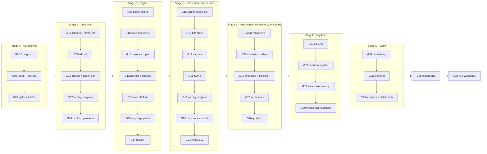

<!-- SPDX-License-Identifier: CC-BY-4.0 -->
# MemHouse — Roadmap: goals for Claude Code

| Field | Value |
|---|---|
| Version | 2.2 (the public edition of development plan v2) |
| Date | 13 November 2026 |
| Progress | 20 of 36 goals done; G12 built and waiting for its latency check; G14 partly built, waiting for its paid runs ([goal tracker](#goal-tracker)) |
| Product version | 2.0.0 (the Rust + Postgres implementation; the Elixir 0.x line is archived as `memhousehq/archive-memhouse`) |

This plan is a **sequence of goals**. Each goal is sized for one or a few Claude Code sessions and
starts with a `/goal` line that can be pasted as is. Goals run in order: each one assumes the
earlier goals are done. Every requirement ID from the design requirements is assigned to exactly one
goal (see the [coverage index](#appendix-a--coverage-index)), so nothing is forgotten.

## Contents

1. [Where we are](#1-where-we-are)
2. [Ordering principles: build each thing once](#2-ordering-principles-build-each-thing-once)
3. [The benchmark guard](#3-the-benchmark-guard)
4. [Repositories, licences and secrets](#4-repositories-licences-and-secrets)
5. [How to run a goal](#5-how-to-run-a-goal)
6. [Roadmap at a glance](#6-roadmap-at-a-glance)
7. [Goals](#7-goals)
8. [Risks](#8-risks)
- [Appendix A — Coverage index](#appendix-a--coverage-index)

---

## 1. Where we are

The code is a working **Standard-shaped** service: one Rust binary on Postgres + pgvector, with:

- the write gate (deterministic redaction, injection quarantine), dedup and supersession,
  validity windows and `as_of` recall;
- hybrid recall (BM25 + two vectors per round, weighted RRF, date-aware window probe, optional
  cross-encoder, token budget);
- asynchronous LLM enrichment (Postgres job queue, workers, LLM cache, cost cap);
- hash-chained audit, a deletion ledger, deletion and retention that cascade to derived data;
- REST, MCP (stdio and HTTP), `memhouse up / init / connect / doctor / export / import`;
- five templates (personal, coding, support, sales, success);
- `memhouse bench`: LongMemEval S/M/oracle, LoCoMo, LLM-judged QA with cost tally, and 97 governance checks;
- the Lite profile (G16): the same engine on one SQLite file, `memhouse up --lite`, backup and restore with the deletion ledger re-applied;
- conformance kits for every adapter type and a profile suite over REST, MCP and the command line (G15);
- Python and TypeScript SDKs with lifecycle hooks, embedded Lite bindings for Python and Node, and adapters for the OpenAI Agents SDK and LangGraph (G18);
- the coding template (G19, API 1.9, schema v10): memories linked to files by content hash,
  left out of recall when a file changes until they are revalidated or revised; file-touched
  recall through `memhouse hook` adapters for Claude Code and Gemini CLI and a git
  `post-commit` hook; procedural memory promoted on repeated correction and recalled by task;
  a coding evaluation suite in the benchmark guard;
- the admin console (G20, API 1.10, schema v11) at `/` on both profiles: view, search, edit,
  supersede and delete memories, recall explanations, the review queue with quarantined
  records (reject, or rephrase and approve), principals and keys, policy versions, evaluation
  by policy version and the profile advisor; session login with a cookie script cannot read,
  a CSRF token, a Content-Security-Policy without inline script or style, and a CORS origin
  allow-list that is empty by default;
- packaging and a release pipeline (G21, built, not yet run on GitHub and nothing published):
  a non-root distroless container image, a Helm chart for a customer's own Postgres,
  `install.sh`, a Homebrew formula template, crates.io metadata, one product version in
  lockstep (`cargo xtask version`), a release workflow from a signed tag with Sigstore
  signatures, provenance, SBOMs and OIDC publishing, a documentation site rendered from `docs/`
  (`cargo xtask site`), and the README's quickstart run in a clean container against a
  ten-minute limit;
- Governance II (G22, API 1.11, schema v12): legal holds; a deletion workflow that ends every
  forget in a completion certificate with canary verification; retention per memory type and
  scope as a run that resumes after a restart, with expired working memory purged;
  `memhouse restore` re-applying the deletion ledger on both profiles, and a guard that keeps
  a restored database from serving before it has; purge by source with every descendant and
  of candidates from untrusted sources; redact, mask or reject per category; anchors of the
  audit head; SIEM export as CEF over syslog and OTLP logs; a compliance evidence bundle
  mapped to SOC 2 and ISO 27001; and, on Postgres and off by default, row-level security as a
  second line and monthly partitions for episodic memory;
- local CI (`cargo xtask ci`) with a pre-push hook and the benchmark guard (`memhouse bench guard`, G01);
- repository hygiene (G02): Apache-2.0 `LICENSE` and SPDX headers, DCO sign-off hook, `cargo-deny` policy, and a built-in secret scanner (pre-commit and CI);
- API v1 over REST and MCP with an OpenAPI 3.1 document and a stability policy (G05); logical
  schema v5 and Memory Format v2 with conformance vectors (G04);
- principals with per-principal keys and short-lived agent tokens, an authorizer on every call,
  propose-only agents and labels enforced inside the recall statement (G06);
- OpenTelemetry traces, Prometheus metrics and a stored explanation for every recall (G07);
- versioned behaviour policies, compiled under governance, approved by a named person and
  rolled back (G08);
- a staged write pipeline behind an `IntakeQueue` (Postgres table) and a `JobRunner`: writes are
  redacted, durably queued and answered `candidate` at once; a statement gate commits facts,
  holds plans and speculation, supersedes what a correction or a changed value updates; intake
  routing with exact recall over structured records; degradation to an empty flagged result
  (G10, API 1.4, schema v6);
- memory types with their own gate, retention, retrieval method and access rules in the compiled
  policy; session working memory served first from a per-session cache; scopes that inherit from
  tenant to session, with preferences resolved user over team over org; audited promotion
  between types; grants between agents; the `taxonomic` kind (G11, API 1.5, schema v7);
- ranking that combines relevance, recency, confidence and validity with the compiled policy's
  weights; packing that leaves out near-duplicates and treats the token budget as a hard cap;
  the rendered block as plain text, Markdown or XML (G12, API 1.6);
- an evaluation platform: suites of scripted conversations with ground truth at checkpoints, a
  seeded generator of synthetic timelines, storage and retrieval F1 with the stale-fact and
  contamination rates, a tenant's own suites, and a regression gate that refuses a policy that
  degrades them (G13, API 1.7, schema v8);
- docs: API, configuration, operations, governance, policy, development, architecture, benchmarks.

Published results: LongMemEval_S QA **86.0** (GPT-4o), LoCoMo QA **83.7** (GPT-4o-mini), recall
p50 about 30 ms on a laptop.

**What diverged from plan v1:** v1 built *Lite first* (an embedded store). The code went Postgres
first. Plan v2 keeps that: the Lite store comes after the logical schema, API and conformance kit
are frozen (goals G04–G15), so it is written once against the final contracts instead of being
reworked.

**What is missing from the code is the unbuilt part of each goal not ticked in the
[goal tracker](#goal-tracker)** (G14 onwards, and G12's latency check; G25's re-embedding was done early). Some of those
goals start from features that already work and are listed above, such as the v1 sales and
success templates (G24). The largest gaps are relationship-based
access (ACC), SDKs, the Lite store, release
engineering, and all of Scale.

---

## 2. Ordering principles: build each thing once

1. **Safety net first.** CI and the benchmark guard (G01) come before any feature, so every later
   change is measured.
2. **Freeze contracts before building on them.** The logical schema and export format (G04), the
   public API (G05), identity and the authorizer seam (G06), tracing and explanations (G07) and
   policy (G08) are touched by every later feature. Changing them later would mean rewriting
   features, so they are fixed first, as *expand-only* changes to the current code.
3. **Seams before implementations.** Each component that will later be replaced at scale gets its
   trait now, with a simple implementation:

   | Seam | Introduced in | Simple implementation now | Scale implementation later |
   |---|---|---|---|
   | `Store` | exists | Postgres | SQLite (G16), sharded Postgres (G32), MongoDB/Vespa (G33) |
   | `Authorizer` | G06 | roles and scopes on API keys | relationship store, ReBAC (G27) |
   | `PolicySource` | G08 | policy files in the database | decision register (G28) |
   | `IntakeQueue` | G10 | Postgres job table | durable log (G31) |
   | `JobRunner` | G10 | in-process workers | workflow engine (G31) |
   | `ContextProvider` | G23 | in-process connectors | the same, on the job runner |
   | `Tracer` | G07 | OpenTelemetry SDK | the same |

4. **Engine before profiles.** The engine semantics (pipeline, memory types, ranking) are completed
   on Postgres (stage C), then a conformance kit is written (G15), and only then is the Lite store
   built against it (G16).
5. **Quality tuning after refactors.** Retrieval tuning (G14, G26) happens after the write
   pipeline and ranking are rebuilt (G10–G12) and the word lists move into language packs (G36),
   so tuning effort isn't lost.
6. **Governance is never weakened.** Every goal keeps the governance suite at 100% and adds checks
   for what it introduces.
7. **Access model before regulated features.** The decision register (G28) sits on ReBAC (G27),
   which sits on the identity seam (G06).
8. **Scale last.** Subject partitioning (SCALE-02 data model), exact per-subject scoring and
   one-statement recall already hold. Sharding, the durable log and multi-region come after the
   product is complete on one database.

---

## 3. The benchmark guard

Every goal ends with the guard. It catches regressions in retrieval quality, latency and safety
while costing nothing for routine work.

The guard runs on the developer's machine (`cargo xtask ci`), not in hosted CI: it needs the
public datasets and, from T2, an LLM key given for the run. Hosted CI runs everything else,
including the governance suite.

| Tier | When | What runs | Cost | Time |
|---|---|---|---|---|
| **T1** | every goal, before each commit that touches the engine, store or models | build + unit tests; governance suite; LongMemEval_S retrieval, stride 10 (50 questions); LoCoMo retrieval (all 1,540 questions); the synthetic starter suites `bench/suites/personal` (from G13) and `bench/suites/coding` (from G19) | $0 | ~4 min |
| **T2** | goals that touch enrichment, facts, ranking or the answer context | T1 + LoCoMo retrieval with `--enrich` (served from the LLM cache) | ~$0.01 | ~5 min |
| **T3** | end of each stage (milestones), after quality goals | T2 + LoCoMo QA (`--qa --answer-model gpt-4o-mini --enrich`, `--max-cost-usd 1.5`) | ~$0.70 | ~20 min |
| **T4** | releases only, **with the user's approval** | full LongMemEval_S QA with GPT-4o (`--max-cost-usd 10`) | ~$7.50 | ~1 h |

### Baselines (1 November 2026, `bge-small-en-v1.5-onnx-Q`, laptop CPU)

| Run | Metric | Baseline | Fails the guard if |
|---|---|---|---|
| Governance suite | checks passed | 97 / 97 (27 November 2026, G22) | any check fails, or fewer checks than the baseline |
| LongMemEval_S, stride 10 (46 scored) | session recall_all@5 | 91.3 | drops by more than 2.2 (one question) |
| | session nDCG@10 | 94.2 | drops by more than 2.0 |
| | round recall_all@10 | 84.8 | drops by more than 2.2 |
| | SQL search p50 | 9.7 ms | rises by more than 50% and 5 ms |
| | recall p95 | 63 ms | doubles |
| LoCoMo (1,536 scored) | session recall_all@5 | 78.8 | drops by more than 1.0 |
| | session nDCG@10 | 78.6 | drops by more than 1.0 |
| | round recall_all@10 | 59.2 | drops by more than 1.0 |
| | SQL search p50 | 9.0 ms | rises by more than 50% and 5 ms |
| | recall p95 | 61 ms | doubles |
| Synthetic personal starter (20 conversations, 20 November 2026) | storage F1 | 97.6 | drops by more than 2.0 |
| | retrieval F1 | 97.5 | drops by more than 2.0 |
| | questions about a corrected fact answered without a stale version | 84.9 | drops by more than 1.0 |
| | plans and guesses not committed | 100.0 | drops by more than 1.0 |
| Synthetic coding starter (20 conversations, 27 November 2026) | storage F1 | 97.2 | drops by more than 2.0 |
| | retrieval F1 | 97.6 | drops by more than 2.0 |
| | questions about a corrected fact answered without a stale version | 83.6 | drops by more than 1.0 |
| | plans and guesses not committed | 100.0 | drops by more than 1.0 |
| | file-touched questions answered with the linked memory | 100.0 | drops at all |
| | memories about a changed file withheld | 100.0 | drops at all |
| LoCoMo + enrich (T2) | round recall_all@10 | 66.0 | drops by more than 1.0 |
| | session recall_all@5 | 79.6 | drops by more than 1.0 |
| LoCoMo QA (T3) | accuracy, GPT-4o-mini | 83.7 (81.8–85.5) | drops by more than 1.5 |
| LongMemEval_S QA (T4) | accuracy, GPT-4o | 86.0 (83.0–88.8) | drops by more than 2.0 |

The values and thresholds live in `bench/baselines.json`; `memhouse bench guard` applies them.

Rules:

- Quality metrics are deterministic (identical on repeated runs), so any drop is a real change.
- Timings move with machine load. Latency gates on the SQL search time, which the engine and
  store control; total recall time includes query embedding on the CPU and only catches large
  regressions. A run whose only failures are timings is repeated once and the better timing kept.
  On a machine known to be busy, `--skip-latency` reports timings without gating on them.
- If T1 trips on the 50-question sample, run the full LongMemEval_S retrieval (free, ~4 min)
  before deciding. A drop on the full set is a regression.
- A regression is fixed in the same goal, or the goal records why it is accepted (a deliberate
  trade, e.g. a security filter) and the user agrees.
- Baselines change only on a deliberate improvement: `memhouse bench guard --update` records the
  new values and run directories in `bench/baselines.json`; update this table in the same commit.
- Paid tiers always run with `--max-cost-usd`, and their spend is reported in the goal's summary.
  T4 needs explicit approval from the user each time.

---

## 4. Repositories, licences and secrets

The product is one **monorepo**. Planning documents that are not public are kept outside it, and
no repository, public or private, ever holds a secret value.

### Repositories

| Repository | Licence | Holds | Since |
|---|---|---|---|
| [`memhousehq/memhouse`](https://github.com/memhousehq/memhouse) (this repository) | Apache-2.0 code; docs CC BY 4.0 | all product code: crates, xtask, scripts and, as they arrive, SDKs, console, templates, evaluation harness and deploy charts; docs; benchmark baselines and result summaries; this roadmap | G09, as MemHouse 2.0.0. It replaces the Elixir implementation (0.x), archived with its history as [`memhousehq/archive-memhouse`](https://github.com/memhousehq/archive-memhouse) |
| [`memhousehq/memory-format`](https://github.com/memhousehq/memory-format) | spec CC BY 4.0; schemas and vectors Apache-2.0 | the Memory Format specification and conformance vectors (RP-06) | G09, split from `memory-format/` with its history |
| `homebrew-tap` | Apache-2.0 | formulae, taken from the formula each release generates ([packaging/homebrew](../packaging/homebrew/README.md)) | G21 |

The project is run by its author as an individual ([GOVERNANCE.md](../GOVERNANCE.md)). Package
registry names (crates.io, PyPI, npm) are reserved when there is something to publish there (G21).

### Secrets

1. **No secret values in any repository.** Repositories hold the *names* of secrets (the
   configuration already does this with `api_key_env`).
2. **Prefer no long-lived secrets.** Package registries are reached through OIDC trusted
   publishing and artefacts are signed keylessly (Sigstore, G21). Stored keys only where a
   requirement asks for them (SC-02).
3. **One credential per purpose**, with least privilege; paid LLM keys carry a spend cap set at the
   provider.
4. **No secrets in hosted CI.** CI runs no paid calls and no benchmarks, so forks have nothing to
   leak. Benchmarks, paid tiers included, run on a maintainer's machine on demand, with the key
   given for that one run ([benchmarks.md](benchmarks.md#where-benchmarks-run)).
5. **Detection.** A secret scanner runs as a pre-commit hook and in `cargo xtask ci`, over the tree
   and the whole history; GitHub's push protection and secret scanning are on.
6. **Rotation and revocation** are documented per secret in
   [`docs/security/secrets.md`](security/secrets.md), with the inventory.

### Publication and launch

The repository went public in **G09**, at the end of stage B, once the API, schema and format were
frozen, so outside users don't see them churn. Publication is not the launch: packages, the docs
site and the announcement come with the developer launch (G21).

---

## 5. How to run a goal

Paste the goal's `/goal` line into Claude Code. The line of every goal still to do ends by
pointing here. The session should:

1. Read this plan's section for the goal, and the requirement texts it cites (the design
   requirements are kept with the project's planning documents).
2. Plan the change, keeping to the ordering principles (expand-only schema changes; seams, not
   shortcuts).
3. Implement it with unit tests, and a governance check for every new safety property.
4. Run the guard tier the goal names and compare against the baselines.
5. Update the docs the goal touches (`docs/*.md`, README).
6. Log what was done in this file, as described below.
7. Commit with a message naming the goal (e.g. `G06: identity and authorizer seam`), including the
   change to this file.

A goal is **done** when every deliverable box is ticked (or struck through with its reason), its
"Done when" holds, the guard passes, the docs match the code and the work is logged here.

### Logging a goal

This file is the record of what is done. Each session keeps it up to date as it works, not only at
the end, so that the next session, or a reader on GitHub, can see where the goal stands.

- **Deliverables.** Tick a box (`[x]`) in the same commit as the work that completes it. If the goal
  needed something the plan did not list, add a box for it. Never delete a box: if a deliverable is
  dropped, strike it through (`~~…~~`) and give the reason; if it moves, name the goal it moves to.
- **Status.** When the goal is done, tick its **Done** box (the first line of its section) and its
  box in the [goal tracker](#goal-tracker), each with the date, and update the progress count at
  the top of this file. A goal with some deliverables done
  but not all stays unticked, with a note on the **Done** line (see G25).
- **Result.** Add a `**Result (YYYY-MM-DD):**` entry to the goal. It covers:
  - what was built, with the names of commands, routes, tables and checks, and links to the docs;
  - the numbers that show "Done when" holds;
  - the guard tier, its outcome and any paid spend;
  - what differs from the plan and why, and what moved to which later goal;
  - what was decided by the user, and when.

  A goal that takes several sessions adds a dated entry for each one, and later fixes to a done
  goal add a dated line to its result (see G07's T13 entry).
- **Moved work.** When part of a goal moves, add it as a box in the goal that receives it, and say so
  in both. Work done early, in another goal, is ticked where it lives and marked "done early" with
  the date.
- **The rest of this file.** Update [section 1](#1-where-we-are) when a goal changes what the code
  can do, the baselines in [section 3](#3-the-benchmark-guard) when the guard's values change, and
  the [coverage index](#appendix-a--coverage-index) when a requirement moves between goals.

---

## 6. Roadmap at a glance

| Stage | Goals | Milestone at the end | Guard at the end |
|---|---|---|---|
| A. Foundations | G01–G03 | everything measured; repositories split; secrets policy in force; decisions recorded | T1 |
| B. Contracts | G04–G07, G09 | schema, API, identity and tracing frozen (old v1 gate G1); **open repository public** (G09) | T1 |
| C. Engine | G08, G10–G13, G36, G14 | policy engine; every engine Must on Postgres; the 24 EU languages | T3 |
| D. Lite + developer launch | G15–G21 | **developer launch**: Lite + Standard, SDKs, coding template, release pipeline (old G2 + G3) | T3, plus T4 with approval |
| E. Governance, connectors, templates | G22–G26 | regulated-ready Standard; plugin system; template packages | T3 |
| F. Regulated | G27–G30 | **pilot-ready**: ReBAC, decision register, enterprise security, load-tested (old G4/P0) | T3, plus T4 with approval |
| G. Scale | G31–G33 | **general availability**: Scale profile (old G5) | T3 |
| H. Extensions | G35, G37 | Could requirements (old G6); strict session scopes in the next major API | T1 |

Indicative pace with Claude Code doing the implementation: a goal takes one to three working
sessions; stages A–D are about 6–8 weeks of steady work. Stages E onward have no calendar yet.
Goal numbers are stable; a number missing from this file is a goal planned outside it.

### Goal tracker

One box per goal, ticked when the goal is done ([section 5](#5-how-to-run-a-goal)).

**A. Foundations**

- [x] [G01 — Local CI and benchmark guard](#g01--local-ci-and-benchmark-guard) (1 November 2026)
- [x] [G02 — Repository foundation, licence boundary and secret hygiene](#g02--repository-foundation-licence-boundary-and-secret-hygiene) (1 November 2026)
- [x] [G03 — Technology spike, threat model and decision records](#g03--technology-spike-threat-model-and-decision-records) (1 November 2026)

**B. Contracts**

- [x] [G04 — Logical schema v2 and Memory Format v2](#g04--logical-schema-v2-and-memory-format-v2) (2 November 2026)
- [x] [G05 — Public API v1 contract](#g05--public-api-v1-contract) (2 November 2026)
- [x] [G06 — Identity, principals and the authorizer seam](#g06--identity-principals-and-the-authorizer-seam) (2 November 2026)
- [x] [G07 — Tracing, metrics and recall explanations](#g07--tracing-metrics-and-recall-explanations) (2 November 2026)
- [x] [G09 — Open-source publication](#g09--open-source-publication) (3 November 2026)

**C. Engine**

- [x] [G08 — Policy engine v1 (structured specs, approval, versions)](#g08--policy-engine-v1-structured-specs-approval-versions) (4 November 2026)
- [x] [G10 — Write pipeline v2: intake queue, candidates, classification, routing](#g10--write-pipeline-v2-intake-queue-candidates-classification-routing) (6 November 2026)
- [x] [G11 — Memory types, scopes and promotion](#g11--memory-types-scopes-and-promotion) (13 November 2026)
- [ ] [G12 — Ranking and packing v2](#g12--ranking-and-packing-v2) (built 13 November 2026; latency still to confirm on a quiet machine)
- [x] [G13 — Evaluation platform: synthetic timelines, own suites, regression gate](#g13--evaluation-platform-synthetic-timelines-own-suites-regression-gate) (13 November 2026)
- [x] [G36 — Language packs: word lists as data, several languages at once](#g36--language-packs-word-lists-as-data-several-languages-at-once) (14 November 2026)
- [ ] [G14 — Quality iteration I: weak types and tiered extraction](#g14--quality-iteration-i-weak-types-and-tiered-extraction)

**D. Lite + developer launch**

- [x] [G15 — Adapter and profile conformance kits](#g15--adapter-and-profile-conformance-kits) (20 November 2026)
- [x] [G16 — Lite profile: embedded store](#g16--lite-profile-embedded-store) (21 November 2026)
- [x] [G17 — Profile migration](#g17--profile-migration) (25 November 2026)
- [x] [G18 — SDKs, embedded bindings and first framework adapters](#g18--sdks-embedded-bindings-and-first-framework-adapters) (25 November 2026)
- [x] [G19 — Coding template v1](#g19--coding-template-v1) (27 November 2026)
- [x] [G20 — Memory browser v2 and admin console](#g20--memory-browser-v2-and-admin-console) (27 November 2026)
- [ ] [G21 — Packaging and release v1 (developer launch)](#g21--packaging-and-release-v1-developer-launch)

**E. Governance, connectors, templates**

- [x] [G22 — Governance II](#g22--governance-ii) (27 November 2026)
- [ ] [G23 — Context-provider plugin system, connectors and importers](#g23--context-provider-plugin-system-connectors-and-importers)
- [ ] [G24 — Templates as packages; policies II](#g24--templates-as-packages-policies-ii)
- [ ] [G25 — Economics, consolidation and re-embedding](#g25--economics-consolidation-and-re-embedding) (re-embedding done early)
- [ ] [G26 — Quality iteration II](#g26--quality-iteration-ii)

**F. Regulated**

- [ ] [G27 — Relationship-based access control](#g27--relationship-based-access-control)
- [ ] [G28 — Access Policy Decision Register](#g28--access-policy-decision-register)
- [ ] [G29 — Enterprise security](#g29--enterprise-security)
- [ ] [G30 — Production readiness on Standard](#g30--production-readiness-on-standard)

**G. Scale**

- [ ] [G31 — Durable log intake and workflow engine](#g31--durable-log-intake-and-workflow-engine)
- [ ] [G32 — Sharding, Standard → Scale migration and multi-region](#g32--sharding-standard--scale-migration-and-multi-region)
- [ ] [G33 — More adapters and distribution](#g33--more-adapters-and-distribution)

**H. Extensions**

- [ ] [G35 — Graph, code structure, prompt overrides, air-gapped](#g35--graph-code-structure-prompt-overrides-air-gapped)
- [ ] [G37 — API v2: strict scope inheritance for sessions](#g37--api-v2-strict-scope-inheritance-for-sessions)

---

## 7. Goals

Legend for status: `[x]` done · `[ ]` to do. Each goal opens with its **Done** box, followed by a
box for each deliverable; [section 5](#logging-a-goal) says how to keep them. Requirement IDs in
**bold** are completed by the goal; plain IDs are partly addressed and finished in a later goal,
which is named.

### Stage A — Foundations

#### G01 — Local CI and benchmark guard

- [x] **Done** (1 November 2026)

> `/goal Build a one-command local CI (scripts/ci.sh or cargo xtask ci) that runs fmt, clippy, unit tests, scripts/e2e.sh, the governance suite and the T1 benchmark guard, comparing results with bench/baselines.json and failing on any regression defined in section 3 of docs/roadmap.md; install it as a git pre-push hook.`

- **Why now:** every later goal relies on it to prove that nothing degraded.
- **Scope:** QUAL-05 (gate for engine changes; extended to policies in G13), **TR-RQ-01** (recall
  plan never leaves the subject: EXPLAIN check on a seeded database), **TR-RQ-02** (exact top-K
  equals brute force, re-verifying **SCALE-03**), property-based tests for supersession, dedup and deletion invariants,
  **RP-01** task-runner entry point.
- **Deliverables:**
  - [x] `memhouse bench guard` that runs T1/T2 and prints a pass/fail table against `bench/baselines.json` (`--update`, `--skip-latency`, extra run arguments after `--`)
  - [x] `bench/baselines.json` with the values in section 3 and the run directories
  - [x] one entry point: `cargo xtask ci` (fmt, clippy `-D warnings`, test, e2e, guard with governance); `scripts/ci.sh`
  - [x] plan-regression (`recall_plan_scoped`) and exactness (`exact_topk`) checks; seeded random-sequence `invariants` check; `proptest` properties for the write gate
  - [x] git pre-push hook installer (`cargo xtask install-hooks`); docs in `docs/development.md`
- **Done when:** a deliberately bad change (e.g. vector weight 0) fails the guard; a clean tree passes in under 5 minutes.
- **Result (1 November 2026):** `-- --vector-weight 0` fails on LongMemEval nDCG (94.2 → 91.6) and
  LoCoMo round recall (59.2 → 56.4); the clean tree passes in 309 s with other heavy processes
  running (fmt 0.1 s, clippy 13 s, tests 54 s, build 38 s, e2e 71 s, guard 133 s). The plan check
  found that the last step of recall (fetching the fused hits) could read the whole table on a
  small database; it now fetches only the top `k` ids by primary key, filtered on tenant and
  subject. rustfmt (`rustfmt.toml`) and clippy (`clippy.toml`) were applied to the whole workspace.
- **Guard:** T1 (it creates it). **Depends on:** nothing.

#### G02 — Repository foundation, licence boundary and secret hygiene

- [x] **Done** (1 November 2026)

> `/goal Prepare the repository for publication and for the long run: move the plan to docs/roadmap.md and keep planning documents that are not public out of the repository, add LICENSE, NOTICE, SPDX headers with a check, CONTRIBUTING with DCO sign-off, CODE_OF_CONDUCT, CODEOWNERS, cargo-deny licence and advisory policy, a secret scanner as a pre-commit hook and in cargo xtask ci, .env.example, docs/security/secrets.md with the secret inventory from section 4 of the roadmap, and a .mailmap with a real author identity for new commits.`

- **Why now:** everything committed from now on may become public. SPDX headers, DCO and the
  dependency licence policy are cheap on a small codebase and expensive later; private documents
  and secrets must never enter the product history again.
- **Scope:** **RP-03**, **RP-04**, RP-05 (no secrets in any repository), the third-party licence
  policy, the licence decision record (Apache-2.0, confirmed in G09).
- **Deliverables:**
  - [x] `LICENSE` (Apache-2.0), `NOTICE`, `docs/LICENSE` (CC BY 4.0); ADR for the licence choice
  - [x] SPDX identifier on every source and doc file; `cargo xtask ci` rejects missing or wrong ones per path
  - [x] `CONTRIBUTING.md` (DCO sign-off, `cargo xtask ci`, coding standards), `CODE_OF_CONDUCT.md`, `CODEOWNERS`; a `commit-msg` hook from `cargo xtask install-hooks` that requires `Signed-off-by`
  - [x] `deny.toml` (permissive licences allowed, copyleft blocked unless approved, RustSec advisories) run by `cargo xtask ci`
  - [x] secret scanner (gitleaks or equivalent) as a pre-commit hook and a CI step over the tree and new commits
  - [x] `.env.example`; `docs/security/secrets.md` with the rules and inventory of section 4
  - [x] `docs/roadmap.md` in place, every reference updated (guard, baselines, docs); planning documents that are not public kept outside the repository
  - [x] real author identity configured; `.mailmap` maps the old local address
- **Done when:** `cargo xtask ci` fails on a planted fake API key, on a file without an SPDX header,
  and on a GPL-only dependency, and passes on the clean tree; no private planning document is left
  in the working tree.
- **Result (1 November 2026):** `cargo xtask ci` stops at the secret scan on a planted GitHub-style
  token, at the SPDX check on a new file without a header, and at the dependency policy on a
  GPL-3.0-only crate; the clean tree passes. The scanner is built into `xtask` (no install, works
  offline, scans other repositories with `--repo`) instead of gitleaks; the full history scan is
  clean apart from one reviewed fake key in a test, listed in `.secret-scan-allow`. Internal crates
  now carry versions so they can be published. (G09 later removed the last two licence exceptions
  from the shipped dependencies.)
- **Guard:** T1. **Depends on:** G01.

#### G03 — Technology spike, threat model and decision records

- [x] **Done** (1 November 2026)

> `/goal Run the technology spike from the technical requirements (section 6.10) and write ADRs in docs/adr/ for: Lite embedded store, vector storage format, intake queue/log, authorization store, connection pooler, minimum pgvector and gRPC; write docs/threat-model.md and the AP-10 security-baseline design.`

- **Why now:** G04 (schema) and G16 (Lite) depend on the vector format and the store choice; G06 and
  G27 on the authorization store; G10 and G31 on the intake log.
- **Scope:** **TR-LT-02** (SQLite chosen or replaced, with evidence), **TR-DB-02** (pgvector minimum
  for `halfvec`/`bit` on RDS, Cloud SQL, Azure, Supabase), SCALE-06 decision (half-precision plus a
  binary-quantised copy; implemented in G16/G30), the intake-log and workflow candidates (G31),
  the authorization store (in-Postgres tuples vs SpiceDB/OpenFGA; G27), PgBouncer compatibility
  with prepared statements (G30), gRPC (G30). (The licence record is in G02.)
- **Deliverables:**
  - [x] `docs/adr/0001…` one record per decision, each with the benchmark or test that decided it
  - [x] micro-benchmarks: SQLite FTS5 + in-process binary/half-precision scoring vs Postgres on LongMemEval_S stride 10 (same top-K, latency)
  - [x] `docs/threat-model.md` (STRIDE over REST, MCP, enrichment egress, database, backups)
  - [x] security baseline design (AP-10): which code paths are shared and impossible to disable (input to TR-CORE-05 in G06)
- **Done when:** every ADR is accepted by the user; nothing in G04–G16 needs a choice that isn't recorded.
- **Result (1 November 2026):** ADRs [0002](adr/0002-lite-embedded-store.md) to
  [0008](adr/0008-grpc.md), evidence in [adr/evidence/](adr/evidence/), reproducible with
  `crates/memhouse-bench/examples/spike_storage.rs` (`--features spike`) and `scripts/spike/run.sh`;
  [threat model](threat-model.md) and [AP-10 baseline design](security/baseline.md). Key findings:
  half precision is as exact as f32 on real data at half the size; a binary prefilter alone is not
  exact at 10,000 memories per subject, so it is optional; SQLite + FTS5 meets the Lite latency
  budget with the subject inside the `MATCH`; Postgres covers the Lite and Standard intake queue
  and authorization checks (p95 2.75 ms at 16 clients over 1.1 million tuples); PgBouncer works
  only with `max_prepared_statements`. Acceptance tests at 25% of the national profile can't run on
  a laptop: each ADR lists them under "Still to verify" with the goal that runs them. The threat
  model found a stored XSS in the Memory Browser's subject list, fixed with a regression test.
- **Section 6.10 coverage** ([evidence/spike-acceptance.md](adr/evidence/spike-acceptance.md)):
  - *Lite on the reference laptop:* 100,000 memories, fresh process, networking denied —
    PROF-04 ✓, PROF-07 ✓ (recall p95 26 ms with local embedding, durable ack p95 3.3 ms, recallable
    in 23 ms), PROF-06 ✓ for the store (16 MB); the bundled local model (394 MB with one session)
    gets its own budget, **decided by the user** (ADR 0002), and a remote embedding API is the
    low-memory option (`[embedding] provider = "openai"`, with retries, timeout and `dimensions`).
  - *Sovereign, no external dependencies:* ✓ for every candidate (Lite measured with the network
    denied; the others run inside Postgres or are self-hostable).
  - *25% of the national profile:* per-node capacity measured and compared (the Postgres queue
    can't drain 25,000 writes/s on one node, confirming the log for Scale; authorization needs two
    nodes or a cache); the load tests themselves need a production-like cluster — **moved** to
    G27, G30 and G31.
  - *Managed database service:* **moved to G30 by the user** ("keep managed Postgres for later");
    provider versions are from documentation so far, Cloud SQL unconfirmed.
- **Status:** ADRs 0002–0008 **accepted by the user on 1 November 2026**. Accepted by the user: [x]
- **Guard:** T1. **Depends on:** G02.

### Stage B — Contracts (freeze before building on them)

#### G04 — Logical schema v2 and Memory Format v2

- [x] **Done** (2 November 2026)

> `/goal Implement logical schema v2 and Memory Format v2 as expand-only migrations: principals and provenance on every record, policy version, scopes, labels, the candidate lifecycle, request keys, working memory, links, code references and structured records; publish the format spec with conformance vectors; export/import must round-trip losslessly.`

- **Why now:** every later goal writes or reads these fields. Adding them later means migrating
  records and touching every feature twice.
- **Scope:**
  - record fields: writing agent, acting user, policy version, confidence and source turn
    (provenance, finished in G08 for GOV-03), labels (ACC-04 field; enforcement in G06/G27),
    scope columns (org, team, agent, user, session, for MEM-04 in G11);
  - **CORE-02** state machine stored (candidate → committed / rejected / superseded / quarantined /
    expired; behaviour in G10);
  - a request-key table for **CORE-06** idempotency;
  - `working` kind with session TTL (MEM-01 in G11);
  - a subject-links table (ACC-06, used in G27);
  - code-reference table (TR-TPL-02, used in G19);
  - structured-records table (HYB-02, used in G10);
  - model id, version and configuration hash on every derived record and vector (**TR-MS-02**,
    **INT-07**, **INT-09**);
  - one logical id across representations (**HYB-04**);
  - **TR-CORE-04** logical schema documented independently of Postgres;
  - **QUAL-08** / **TR-DB-01** expand-then-contract migrations tested across two versions;
  - Memory Format v2 covering records, versions, provenance, labels, links, policies and decision
    values (**TR-CORE-03**, **INT-10**), PROF-02 (cross-profile proof in G17);
  - **RP-06** format spec with conformance vectors in `memory-format/`.
- **Deliverables:**
  - [x] migration with backfill; `SCHEMA_VERSION` 2
  - [x] `docs/memory-format.md` + `memory-format/vectors/*.jsonl`
  - [x] export/import v2 with a lossless round-trip test (hash every record before and after)
  - [x] import of v1 exports
  - [x] start-up check of `extversion`: warn below pgvector 0.7.0, refuse below 0.5 ([ADR 0007](adr/0007-minimum-pgvector.md))
- **Done when:** a v1 database upgrades in place; export → import → export is byte-identical apart from timestamps of the run.
- **Result (2 November 2026):** [logical schema v2](schema.md) (independent of Postgres) and
  [Memory Format v2](memory-format.md) with 14 conformance vectors in
  [`memory-format/`](../memory-format/README.md). Expand-only DDL (`schema_v1_ddl` +
  `SCHEMA_V2_DDL`) with a batched backfill; the benchmark database (5,201 records) upgraded in
  place. Records carry provenance (agent, user, policy version, request key, extractor),
  scope, labels, `expires_at`; the six-state lifecycle is enforced by the store; `working` kind
  with a TTL; tables for structured records, code references, links, policies and request keys,
  all deleted with their record or subject; every vector stamped with its model and
  configuration hash. Remember and ingest honour request keys. Five new governance checks
  (24 in all): `idempotency`, `lifecycle`, `representations`, `format_roundtrip` (the full vector
  reproduced byte for byte through a database; recall identical after import) and
  `schema_upgrade` (a v1 database upgraded in place exports exactly what importing its v1 export
  gives; vectors untouched; a v1 writer still works). The vectors stay in this repository until
  publication splits them out (RP-06, G09).
- **Guard:** T1. **Depends on:** G03.

#### G05 — Public API v1 contract

- [x] **Done** (2 November 2026)

> `/goal Freeze public API v1: remember (returns a candidate id), recall, revise, forget (by record, user, agent, source, tenant) with idempotency keys, scopes and structured plus rendered output across REST and MCP; publish an OpenAPI spec and the API stability policy; keep the current endpoints as aliases.`

- **Why now:** SDKs (G18), adapters, connectors (G23) and the browser (G20) are generated from or
  built on it.
- **Scope:** **CORE-01**, **CORE-03** (scope, type filter, as-of, token budget), **CORE-04**
  (revise naming; supersession already works), **CORE-05** (forget by user, agent, source and
  tenant), CORE-06 (API side of G04's table), **INT-02** (MCP tool names `remember`, `recall`,
  `revise` and `forget`, plus the existing tools), **INT-04** (structured JSON + rendered text
  block), **QUAL-09** (breaking changes only in a new major version, 12-month deprecation), error
  model, pagination, OpenAPI 3.1 at `/v1/openapi.json`. gRPC (INT-01) is G30.
- **Deliverables:**
  - [x] routes and MCP tools renamed with aliases; `Idempotency-Key` header and `request_key` field
  - [x] `forget` variants with an audit event per scope
  - [x] OpenAPI spec generated from the types (schemars) and contract tests against it
  - [x] `docs/api.md` rewritten for v1; deprecation table
- **Done when:** a retried write with the same key returns the same result without a second record; the contract tests pass against the spec.
- **Result (2026-11-02):** done. API v1 `1.0.0`: `POST /v1/remember`, `/v1/recall`, `/v1/revise`,
  `/v1/forget`, `/v1/ingest`, `GET /v1/memories/{id}`, `GET /v1/subjects/{subject}/memories`
  (keyset-paged); MCP tools `remember`, `recall`, `revise`, `forget`, `ingest`, `list_memories`
  whose input schemas are cut from the REST request types and whose `structuredContent` is the
  REST response, with a rendered text block (`render` on REST). `forget` by record, subject, user,
  agent, source and tenant (with `confirm`), `dry_run`, one audit event per call. Errors are
  `{error, code}` with five stable codes. Recall gained a `scope` filter; as-of recall now finds
  superseded versions for the time they were true (a version ends exactly when its successor
  starts), and `revise` refuses a version that is no longer current. The OpenAPI 3.1 document is
  generated from the types, served at `/v1/openapi.json` and kept in [`api/`](../api/openapi.json)
  with a release baseline; a test fails on any breaking change against it. Stability policy:
  [docs/api-stability.md](api-stability.md). The pre-v1 routes and tool names answer as before
  with `Deprecation`/`Sunset`/`Link` headers until 2027-11-02. Four new governance checks (28 in
  all), run over HTTP against a real server: `api_contract` (every documented operation called
  with valid and invalid payloads, every response validated against the document, MCP outputs
  against the same schemas), `api_idempotency` (five retries of each write with one key: one
  record, one audit event), `revise_history` (CORE-04's three revisions with as-of probes) and
  `forget_scopes` (every mode on seeded data, nothing that matched left in any representation).
- **Guard:** T1. **Depends on:** G04.

#### G06 — Identity, principals and the authorizer seam

- [x] **Done** (2 November 2026)

> `/goal Add principals (agents, users, admins) with per-principal API keys and short-lived agent tokens; every call carries a verified agent and acting-user identity; introduce an Authorizer trait checked on every operation (role and scope rules for now), propose-only agent credentials, and settable labels with denied-label enforcement inside the recall statement.`

- **Why now:** policies, explanations, provenance, connectors and ReBAC all need a principal, and a
  check point that exists on every path. Adding it later would touch every handler.
- **Scope:**
  - **GOV-01** verified identity on every call;
  - GOV-02 (tenant, scope, agent, user, type and label evaluated now; relationships come in G27);
  - **GOV-08** propose-only agents (agents create candidates; the engine commits);
  - **TR-LT-07** API keys per principal, no unauthenticated mode; GOV-13 (short-lived agent tokens
    now; SSO comes in G29);
  - **TR-CORE-05** security paths shared and not configurable off;
  - **PROF-12** verified (secure defaults with an empty file);
  - **TR-RQ-03** label filter inside the statement before ranking;
  - GOV-14 measured (authorization ≤ 10 ms p95);
  - `memhouse principal add / key create / key revoke` CLI; audit actor = principal id.
- **Deliverables:**
  - [x] `principals` and `api_keys` tables (hashed keys, scopes, expiry); key rotation
  - [x] `Authorizer` trait plus `ScopeAuthorizer`; a decision object with reasons (feeds GOV-04 in G07)
  - [x] labels on remember/ingest/revise; `denied_labels` per principal role
  - [x] governance checks: a key without scope is refused; an agent cannot commit directly; a label is filtered before ranking
  - [x] baseline floor ([security/baseline.md](security/baseline.md)): `secret` redaction and the injection screen can't be configured off; start-up rejects a weaker config
  - [x] v1 types designed to map cleanly to protobuf for the later gRPC binding ([ADR 0008](adr/0008-grpc.md))
- **Done when:** every REST/MCP route goes through the authorizer (checked by a test that lists routes); the governance suite adds 3 checks and passes.
- **Result (2026-11-02):** done; API 1.1.0, schema version 3.
  - **Identity:** principals (agent, user, admin) bound to a tenant, with subject patterns, kinds,
    denied labels, org and team; keys `mh_<id>_<secret>` stored as hashes, with permissions,
    expiry, revocation and rotation with a grace period (`memhouse principal …`, `memhouse key
    create | list | revoke | rotate`).
  - **Agent tokens:** HMAC-signed, at most an hour, narrower permissions, carrying the verified
    user of the key that asked (`POST /v1/tokens`); revoking the issuing key ends them.
    `[server] api_keys` became bootstrap keys of `admin:bootstrap`. Credentials are cached for
    5 s, so a revocation takes effect within 5 s.
  - **Authorization:** `identity::Authenticator`, the `access::Authorizer` trait with
    `ScopeAuthorizer`, and `caller::Caller`, the only way REST and MCP handlers reach the engine.
    Tenant, verified user, scope filter and denied labels are injected; caller-supplied ones are
    checked. Denials are audited as `access.denied`, failed authentications as `auth.failed`; the
    audit actor is the principal.
  - **Propose-only agents:** `candidate` admitted by the engine (`admission = "auto"`) or by a
    reviewer (`"review"`, `POST /v1/review`); `--commit` is the explicit grant. Labels can be set
    on ingest and with `POST /v1/labels` (no re-embedding); `GET /v1/whoami` shows the identity.
  - **Agents and the baseline floor:** `memhouse mcp` needs the agent's key, and
    `memhouse connect` gives each agent its own principal and key. Start-up refuses a config
    without `secret` redaction or with the injection screen off.
  - **Checks:** five new governance checks (33 in all): `authentication`, `route_authorization`
    (a key without permissions refused on every documented route and every MCP tool, each
    audited), `propose_only`, `label_filter` (the label condition is in the `mh_memory` scan of
    the plan and k=3 still returns 3 hits among 12 denied ones; tampered tenant, user and scope
    refused) and `authz_latency` (p95 3.9 ms uncached on a loaded machine). Unit tests cover
    PROF-12 (an empty config is secure) and the protobuf mapping of the stable types.
- **Guard:** T1 (latency rule matters here). **Depends on:** G05.

#### G07 — Tracing, metrics and recall explanations

- [x] **Done** (2 November 2026)

> `/goal Instrument every memory operation with OpenTelemetry traces (record ids, policy version, latency per stage, principal), add a Prometheus metrics endpoint, and store a retrievable explanation for every recall: returned records with ranking signals and excluded records with the reason (access, label, validity, budget).`

- **Why now:** every later goal adds stages that need spans and explanation reasons. Doing it after
  the pipeline refactor would mean instrumenting twice.
- **Scope:** **QUAL-07**, **TR-OPS-06** (works with Langfuse and other LLM-observability tools),
  **GOV-04**, **PERF-02** verified by trace (one statement per backend), metrics for queue lag,
  enrichment spend, recall latency per stage, and refused calls.
- **Deliverables:**
  - [x] `tracing-opentelemetry` with an OTLP exporter (off by default); `/metrics`
  - [x] `recall_id` in every response; `GET /v1/recalls/{id}/explanation`
  - [x] explanations retained according to policy (a default in G08)
  - [x] a test that logs and traces carry identifiers and timings, never memory content or query text (threat model T13)
- **Done when:** a recall's explanation lists the records excluded by label and by budget with correct reasons (governance check); overhead with tracing off is < 2% of p50.
- **Result (2026-11-02):** done; API 1.2.0, schema version 4.
  - **Traces:** spans for every operation (`memhouse.remember`, `.revise`, `.ingest`, `.forget`,
    `.recall`, `.enrich`) with principal, subject, policy version, record ids and outcome; stage
    spans (`recall.embed`, `.search`, `.rerank`); one `db.*` span per statement; the
    authorization decision; HTTP spans by route template; `gen_ai.chat` spans with model, tokens
    and cost for enrichment. Exported over OTLP/HTTP when `[telemetry] otlp_endpoint` (or
    `OTEL_EXPORTER_OTLP_ENDPOINT`) is set, so a collector, Jaeger, Tempo or Langfuse works;
    checked against a local OTLP receiver for the CLI and the server.
  - **Metrics:** `GET /metrics` (Prometheus, `ops:read`): requests, operations, recall latency per
    stage, statements per recall, writes by state, refused calls, enrichment queue depth, lag,
    tokens and spend.
  - **Explanations:** every recall has a `recall_id`; `GET /v1/recalls/{id}/explanation` returns
    the results with ranking signals and every other matching record with its reason (status,
    access, label, validity, filter, budget, rank). Budget and rank cuts are recorded at the
    recall; the rest is replayed on read. Ids are hidden from non-auditors, the explanation is
    refused to other principals, and it is kept 30 days (`explanation_retention_days`) and
    erased with its subject, tenant or user. Written off the request path.
  - **PERF-02:** a recall's probes (query, time window, sub-queries) now run as one SQL statement
    instead of one each.
  - **Checks:** three new governance checks (36 in all): `recall_explanation`,
    `recall_round_trip` (one `db.search` per recall with and without a window probe, complete
    operation spans, no content in any span field) and `telemetry_overhead` (0.07%: 0.002 ms of
    a 2.6 ms p50).
  - **T13 (2026-11-04):** governance check `telemetry_no_content` (37 in all). It captures every
    span and log event, at every level and from every crate, while the API serves writes,
    recalls, an explanation, MCP, a refused and an invalid write, and while the embedder and the
    LLM fail with errors that quote the request; no word sent may appear. It found that provider
    errors carried the provider's message, which can quote the input (and part of an API key),
    into the retry warnings and the internal-error log line: they now keep only the status and
    the provider's `type` and `code`.
- **Guard:** T1. **Depends on:** G06.

#### G09 — Open-source publication

- [x] **Done** (3 November 2026)

> `/goal Prepare and, after the founder signs off, publish the product monorepo: confirm every prerequisite in the G09 checklist, rewrite the history so no private planning document remains, scan the whole rewritten history for secrets, split memory-format into its own repository, set up hosted CI with fork-safe workflows, protected branches and required checks, turn on push protection and dependency updates, and push to the chosen forge.`

- **Why here:** the API (G05), schema and format (G04), identity (G06) and tracing (G07) are
  frozen, so the public sees stable contracts. The policy engine (G08) moved after publication: it
  adds a contract and changes none of the frozen ones. Waiting for the developer launch (G21)
  would hide months of work from early users.
- **Scope:** RP-06 (memory-format split out), RP-05 (repository side), the checklist below, hosted
  CI. Packages, the docs site and the announcement stay in G21.
- **Decisions (the author, 2 November 2026):**
  - licence Apache-2.0 for code and CC BY 4.0 for docs ([ADR 0001](adr/0001-licence.md)); no
    trademark for now;
  - GitHub, organisation `memhousehq`, run by the author as an individual. The code replaces the
    Elixir implementation as `memhousehq/memhouse`, **MemHouse 2.0.0**; the Elixir repository is
    archived as `memhousehq/archive-memhouse`. Package registry names are reserved when needed (G21);
  - security reports through GitHub private vulnerability reporting only: acknowledgement within
    5 working days, first assessment within 20 ([SECURITY.md](../SECURITY.md));
  - the history is rewritten, not squashed; commits made locally carry the author's public
    identity (Aleksei Popov, GitHub no-reply address). Merges made on GitHub may carry the
    author's account address, which the author accepted on 5 November 2026;
  - the author is named as the project's author and copyright holder ([GOVERNANCE.md](../GOVERNANCE.md), `NOTICE`);
  - the commercial and business plans, the design requirements and the earlier drafts of this
    roadmap stay private;
  - hosted CI runs no benchmarks and holds no secrets. Benchmarks, paid tiers included, run
    locally on demand, and their numbers are published with the commands that produced them.
- **Checklist:**

  | Owner | Item |
  |---|---|
  | author | [x] decisions above |
  | Claude Code | [x] G02–G07 done and `cargo xtask ci` green; G08 moved after publication |
  | Claude Code | [x] history rewritten (`scripts/publish/prepare.sh`, `git filter-repo`): private paths and the roadmap's earlier drafts removed from every commit (the roadmap returns in its public form in the last commit), authors normalised, private addresses and names replaced; a fresh clone passes CI |
  | Claude Code | [x] secret scan over the full rewritten history is clean; dependency licence report reviewed; no licence exception ships: `dirs` (and MPL-2.0 `option-ext`) replaced, TLS uses the OS certificate store and models are fetched without `hf-hub`, so `webpki-roots` (CDLA-Permissive-2.0) is only in the ONNX Runtime download at build time, held there by `deny.toml` bans |
  | Claude Code | [x] no restricted data committed: datasets are downloaded at run time and their licences are listed in `docs/benchmarks.md` |
  | Claude Code | [x] link check in `cargo xtask ci`; [x] README and quickstart on a clean machine (the first hosted CI run, in a private rehearsal repository before the public push) |
  | Claude Code | [x] `GOVERNANCE.md`, `SECURITY.md`, issue and pull-request templates, labels |
  | Claude Code | [x] hosted CI on GitHub: checks, end-to-end and governance suite on every pull request, forks included, with no secrets; `main` takes pull requests only, with required checks, linear history and no force pushes; release tags protected; secret scanning, push protection and Dependabot on (workflow and `scripts/publish/forge-setup.sh` written; applied when publishing) |
  | Claude Code | [x] `memory-format` repository built with its history (pushed when publishing) |
- **Done when:** the first public push to `memhousehq/memhouse` and `memhousehq/memory-format` is
  made, and a fresh public clone passes `cargo xtask ci`.
- **Result (2026-11-03):** done. Both repositories were created private, passed hosted CI (after
  a private rehearsal repository), and were made public; then secret scanning with push
  protection, Dependabot alerts and security updates, private vulnerability reporting, approval
  for first-time fork contributors, and the rulesets were turned on (the free plan allows them
  only on public repositories). An anonymous clone of the public repository passed the full
  `cargo xtask ci`, all 36 governance checks included.
  - `main` has been force-pushed once, on 2026-11-04, with its ruleset paused for that push: the
    squash merge of the first pull request had taken the author's account address instead of the
    no-reply one, and the commit was rebuilt with the same tree. On 5 November 2026 the author
    accepted their account address in merge commits, so pull requests land with auto-merge and
    no history is rewritten for it.
  - **Verification (2026-11-05),** on GitHub and on anonymous fresh clones of both repositories:
    - both repositories are public; `memory-format` has its own history (the monorepo's two
      format commits and the stand-alone commit), and its `vectors/` tree is identical to the
      monorepo's;
    - no commit of either repository holds a private path, a private term, a local host name or
      a home path (41 terms checked, commit authors out of scope). The earliest version of
      `docs/roadmap.md` is the published one; every later one is a public pull-request edit. `cargo xtask secrets
      --history` finds nothing in either repository;
    - both repositories: secret scanning, push protection, Dependabot alerts and security
      updates, and private vulnerability reporting on; read-only workflow tokens; approval for
      first-time fork contributors;
    - `memhouse` CI runs `checks` and `end-to-end and governance suite` on every pull request,
      forks included (`pull_request` only, `contents: read`, no secrets, actions pinned);
    - rulesets active on both repositories: `main` takes pull requests only, with linear history,
      no force pushes or deletion; `v*` tags cannot be moved or deleted. `memhouse` requires its
      two checks, strict;
    - gap closed: `memory-format` had no CI. A `conformance` workflow (DCO, manifest coverage,
      MemHouse's reader on every vector) and Dependabot for actions were added
      (memhousehq/memory-format#1, merged as aa4ba3c); `conformance` is now a required check;
    - gap closed: the T13 check `telemetry_no_content` failed without a leak when a timing field
      (`elapsed_secs` 0.000987666) held the probe `9876`; numeric probes now match whole numbers
      only (pull request #15);
    - an anonymous fresh clone of `main` at b56f452 passed plain `cargo xtask ci`: every step,
      the benchmark guard included (all 40 governance checks, every quality and latency metric).
      Earlier runs on a busy machine (load average 15–55) missed only the guard's latency limits.
- **Guard:** T1. **Depends on:** G07. **Milestone:** open repository public.

### Stage C — Engine completeness on Postgres

#### G08 — Policy engine v1 (structured specs, approval, versions)

- [x] **Done** (4 November 2026)

*Moved after publication (2 November 2026): it opens stage C.*

> `/goal Build policy engine v1: structured policy specs covering scope, memory types, write-gate rules, retention, redaction and ranking weights; compile with precedence checks so behaviour policy can never loosen governance; only approved versioned specs execute; diff, approve with named approver, roll back; stamp the policy version on every record and trace.`

- **Why now:** templates (G24), retention per type (G22), ranking weights (G12), the decision
  register (G28) and provenance all read compiled policy. Today these settings live in TOML.
- **Scope:** **POL-01**, **POL-03**, **POL-04**, **POL-08**, **GOV-03** (complete provenance with
  the policy version), `PolicySource` seam (decision register in G28), CFG-07 principle
  (configuration never rewrites memory records).
- **Deliverables:**
  - [x] policy schema (TOML/JSON) and compiler with precedence errors that explain themselves
  - [x] `memhouse policy validate / diff / propose / approve / rollback`; REST equivalents
  - [x] the current `[memory]` and `[governance]` settings become the default compiled policy (config stays as bootstrap)
  - [x] audit events for every policy change; governance check that a loosening behaviour policy is rejected
- **Done when:** changing ranking weights through a policy changes recall without a restart, and rolling back restores the earlier results exactly.
- **Guard:** T1. **Depends on:** G09. **Milestone:** policy contract frozen.
- **Result (2026-11-04):** done; API 1.3.0, schema version 5. See [policy.md](policy.md).
  - **Specs and compiler** (`core/src/policy.rs`): a spec covers scope (one tenant), memory
    types, write gate, retention, redaction, recall labels and audit, and ranking weights. Fields
    left out keep the configured value, so the configuration compiles to the default policy
    (`gov-<hash>`). Governance is the floor: a setting that would loosen it fails with the field,
    the governance key and the rule (PR-1, or the security baseline), and every problem is
    reported at once. Unknown fields are errors.
  - **Lifecycle:** versions are numbered per tenant (`mh_policy_spec`); approval names the
    approver and activates (`mh_policy_activation`); rollback goes to the previous, a named
    approved version or the default. A trigger refuses to activate an unapproved version.
    Changes are audited as `policy.propose`, `policy.approve`, `policy.rollback` and
    `policy.reject`. A spec that later governance outranks stops running, and the default runs
    instead, with a warning in `policy status`.
  - **Runtime:** the engine reads each tenant's compiled policy through a cache. It refreshes it
    from the `PolicySource` seam (the database now, the decision register in G28) every 2 s, and
    at once in the process that made the change. Records (`provenance.policy_version`), write and
    recall spans and recall explanations carry the compiled version (`policy-v<n>-<hash>`), and
    explanations replay with that version's weights. The compiled body is kept in `mh_policy`.
  - **Checks:** three new governance checks (40 in all). `policy_precedence`: 30/30 loosening
    specs refused with their rule, audited, none stored; an outranked policy stops running.
    `policy_approval`: unapproved never runs or activates, at the engine or the database; the
    approved version is stamped on records, the explanation and spans. `policy_rollback`: new
    weights changed 3/3 result lists at once, and in a second engine within the refresh time;
    rollback restored 3/3 exactly (ids and scores). The API contract check covers the five new
    operations; e2e runs the CLI flow.

#### G10 — Write pipeline v2: intake queue, candidates, classification, routing

- [x] **Done** (6 November 2026)

> `/goal Rebuild the write path as a staged pipeline (authorize, redact, classify and gate, route, embed, insert) behind an IntakeQueue trait with a durable Postgres implementation; remember returns a candidate at once; the gate classifies statements as fact, completed event, correction, plan or speculation and commits, supersedes or rejects; route structured records to the structured table with exact-query recall; add degradation behaviour. Log progress and results in docs/roadmap.md as its section 5 describes.`

- **Why now:** classification and candidates change what gets stored, so quality tuning (G14) must
  come after this. The `IntakeQueue` and `JobRunner` seams let G31 swap in a durable log without
  touching the stages.
- **Scope:**
  - **TR-IN-04** stage order; CORE-02 behaviour (from G04); **QUAL-02** classification and gate;
    **QUAL-01** verified (no silent overwrite);
  - **HYB-01** intake routing; **HYB-02** structured records with exact query; **HYB-03** recall
    planning (keyword, vector, exact or a mix); **HYB-06** consistency after revise/forget;
  - **TR-IN-03** idempotent workers; **TR-IN-07** poison messages to quarantine;
  - TR-IN-06 back-pressure (basic lag metric; surge mode in G30);
  - **TR-LT-05** durable ack plus jobs that resume after restart;
  - **PERF-03** / **PERF-04** measured on one node (load in G30);
  - **PERF-07** degradation: an empty flagged result within 500 ms on retrieval failure;
  - **TR-MS-01** model-neutral internal API for extract, classify, detect PII, embed and rerank;
  - the existing enrichment becomes a pipeline stage.
- **Deliverables:**
  - [x] `IntakeQueue` and `JobRunner` traits with Postgres implementations; existing enrichment moved onto them (its workers run on the `JobRunner`, its job is queued by the insert stage and its facts go through the pipeline's stages; its job table stays `mh_enrich_job`, see the result)
  - [x] rule-based classifier first, small-model classifier behind the same interface (tiers in G14)
  - [x] structured-record routing (e.g. order, plan, address tables) and exact recall in `HYB-03` planning
  - [x] kill-and-restart test; poison-message test; freshness test (gated write recallable in ≤ 5 s p95)
  - [x] Postgres queue as in [ADR 0004](adr/0004-intake-queue-and-log.md): claimed with `SKIP LOCKED`, finished jobs pruned so the pending index stays small
  - [x] model-neutral `PiiDetector` and `Classifier` traits next to `Embedder`, `Reranker` and `ChatModel` (TR-MS-01) (added: not listed)
  - [x] degradation (PERF-07): recall answers empty and flagged on failure or timeout; a write that can't be queued is refused as retryable `503 unavailable` (added: not listed)
  - [x] value-update supersession: the same statement with a changed quantity supersedes the old one, which the knowledge-update sample needed (added: not listed)
  - [x] API 1.4.0 (`wait`, `include_candidates`, `exact`, `degraded`, `statement`, `route`, `queued`, `unavailable`) and schema version 6 (`mh_intake`) (added: not listed)
- **Done when:** the guard passes; a correction supersedes the fact it corrects in the LongMemEval knowledge-update sample with no loss; governance adds checks for candidates and classification.
- **Result (2026-11-06):** done; API 1.4.0, schema version 6. See
  [architecture.md § Write path](architecture.md#write-path) and [api.md](api.md#post-v1remember-propose-a-memory).
  - **Pipeline** (`core/src/intake.rs`): authorize (the caller layer) → redact (text and every
    string attribute of a structured form, `PiiDetector`) → exact dedup → durable enqueue →
    answer `candidate` → gate (injection screen, then the `Classifier`) → route → embed → insert.
    `remember`, `revise`, `ingest` and enrichment facts all take it. The insert stage
    (`Store::apply_intake`) settles each record against what is stored (near-duplicates
    `rejected` with `duplicate_of`; revisions; corrections; plan confirmations) and writes the
    records, structured rows, supersessions, confirmations, the session's enrichment job, the
    proposal's completion and the audit events in one transaction that locks the proposal: the
    record ids are the idempotency key (TR-IN-03), and an erasure that deletes the proposal waits
    for it, so nothing lands after it. `wait: true` answers after the gate (CLI, pre-v1 routes and
    tools, benchmarks); without it, the request's own task finishes the pipeline right after the
    answer, and `JobRunner` workers (`[intake] workers`, 2 in `serve`, 1 in `mcp`) pick up the rest.
  - **Queue** (`mh_intake`, schema v6): claimed with `FOR UPDATE SKIP LOCKED`, only the oldest
    unfinished proposal of each subject (so a correction lands after what it corrects), a lease
    for crash recovery, backoff 0.5 s doubling to 30 s, `dead` after `max_attempts` with the
    records stored `quarantined` (`intake_failed`). A finished proposal drops its content at once
    and is pruned after `keep_done_secs`; the claim indexes cover unfinished rows only. A trigger
    refuses proposals from a process on an embedding model the database left. Erasure by subject,
    tenant, user, agent or source removes queued proposals.
  - **Gate** (`core/src/classify.rs`, QUAL-02): `RuleClassifier` reads fact, event, correction,
    plan, speculation, preference or instruction; `ChatClassifier` (`[intake] classifier =
    "llm"`) does the same with a small model and falls back to the rules. Plans and speculation
    stay `candidate`, hidden from recall unless `include_candidates` (PR-7), confirmed by a
    completed event (cosine ≥ 0.9 and a shared content word) or expired at `valid_to`, else after
    `plan_ttl_days`; a caller's own `commitment` is an open item and is committed. A correction
    marker, or the same statement with a changed quantity (dates and identifiers don't count, a
    relation word on one side only means another person), supersedes the closest committed
    record of its kind (cosine ≥ 0.8, not newer than it; extracted facts only supersede extracted
    facts), keeping it with its link (QUAL-01).
  - **Routing and exact recall** (HYB-01/02/03): structured forms and JSON content with a
    `record_type` go to `mh_structured`, code is tagged, relationships recorded in
    `metadata.route`. Recall planning adds an exact probe for identifiers in the question or an
    `exact` query; exact hits come first, marked, under the same filters.
  - **Degradation** (PERF-07): retrieval that fails or overruns `[memory] recall_timeout_ms`
    (450 ms) answers empty with `degraded`; a refused caller still gets `403`; a write that can't
    be queued gets `503 unavailable` with `Retry-After`. A stale embedder is a `409` refusal, not
    a degraded answer.
  - **Checks:** seven new governance checks (47 in all). `intake_candidates`: 200 writes answered
    `candidate` (ack p95 1.4–2.7 ms on one node, PERF-03 measured), readable at once, resolved in
    1–1.6 s, each stored once; no PII canary in the queue or storage (the TR-IN-04 stage-order
    test). `intake_restart`: 10 of 30 proposals abandoned by a killed worker and one processed by
    two workers at once → 30 records, 30 write events. `intake_poison`: set aside after 3 attempts
    in 1.7 s, quarantined and audited; the subject's next write committed. `intake_freshness`:
    p95 42 ms to recallable over 30 writes (PERF-04, target 5 s). `statement_gate`: 0 of 10 plans
    and speculation committed (QUAL-02 contamination ≤ 2%), 10 of 10 facts committed; held
    candidates only on request; a correction superseded with the old version kept; a plan
    confirmed by its event, a lapsed one expired. `exact_recall`: 300 orders routed to the
    structured table; 50 of 50 single-row lookups exact from the question and by explicit query
    (vector-only top-1: 15 of 50, HYB-03); after a revise only the new version, after a forget
    nothing (HYB-06). `degradation`: hanging model 452 ms, failing model and database down 0 ms,
    empty and flagged; refused access no data; queue down → `unavailable`.
  - **Done when, the knowledge-update sample** (LongMemEval_S `--types knowledge-update
    --enrich`, 72 scored, every extraction from the cache, $0): the gate superseded 32 extracted
    facts in 31 of the 72 questions (31 value updates such as "three bikes" → "four bikes",
    "$350,000" → "$400,000", "twice a week" → "three times a week", 1 correction marker); all 32
    were checked by hand to be real updates. No loss against `main` on the same run: session
    recall_all@5 98.6 = 98.6, session nDCG@10 99.0 = 99.0, round recall_all@10 97.2 = 97.2; round
    recall_all@5 rose from 84.7 to 88.9. Round recall_any@1 fell from 72.2 to 65.3 (5 questions):
    the benchmark counts the old value's round as evidence, and that round loses its superseded
    fact. 34% of the extracted facts (5,990 of 17,504) were plans and are now held candidates;
    their rounds stay recallable.
  - **Guard:** T2 passed: governance 47/47; LongMemEval_S stride 10 and LoCoMo at their baselines
    on every quality metric, search p50 9.5 and 8.3 ms; LoCoMo + enrich session recall_all@5
    79.4 (baseline 79.6), round recall_all@10 65.5 (66.0), both inside the limits. Spend $0. Full
    `cargo xtask ci` passed (388 s), the Docker end-to-end included. The governance baseline is
    now 47 checks.
  - **Differs from the plan:** the enrichment job table stays `mh_enrich_job` behind the store
    rather than the `IntakeQueue` (it is a later stage: queued by the insert stage, run by the
    `JobRunner`, its facts through the gate; a subject's sessions are now enriched in order); one
    log for both arrives with G31. Relationship statements are routed and labelled but create no
    links (the graph is G35). The requirement acceptance tests were run at smaller scale than
    written (200 writes, not 1,000, for CORE-02; a 20-statement labelled set, not 150
    conversations, for QUAL-02; HYB-01's 1,000-item routing set is not built): G13's evaluation
    platform builds those suites. QA accuracy on the knowledge-update sample (paid) was not run;
    G14 tunes the classifier tiers and thresholds against it. The guard database's audit table
    (about a million events) made one run's uncached authentication p95 read 17 ms; on a fresh
    database it is 3.1 ms (`main` 3.9 ms), and later guard runs measured 1–2 ms.
- **Guard:** T2. **Depends on:** G09 (G08 if publication is waiting on its legal prerequisites).

#### G11 — Memory types, scopes and promotion

- [x] **Done** (13 November 2026)

> `/goal Give each memory type its own gate, retention, retrieval method and access rules (working, episodic, semantic, preference; procedural and taxonomic as candidates), add session working memory with a low-latency cache, scopes with explicit inheritance (tenant, org, team, agent, user, session), audited promotion between types, and sharing across agents with explicit grants. Log progress and results in docs/roadmap.md as its section 5 describes.`

- **Scope:** **MEM-01**, **PERF-05**, **MEM-04**, **MEM-05**, **INT-06**, **ACC-10** (notes about a
  subject stored in that subject's partition), MEM-02 / MEM-03 storage only (behaviour in G19/G25).
- **Deliverables:**
  - [x] per-type policy sections (from G08) and tests per type
  - [x] working-memory cache per session with TTL and eviction
  - [x] scope resolution with inheritance; preference precedence (user over team over org)
  - [x] promotion API and an audit event that preserves provenance
  - [x] grants between agents: `mh_grant`, `/v1/grants`, `memhouse grant`, the `grant:manage` permission (added: in the goal line, not listed)
  - [x] the `taxonomic` kind, stored as a candidate until an administrator approves it; procedural memory held until confirmed (added: MEM-02 / MEM-03 storage)
  - [x] the author's partition for a type (`types.<kind>.access.partition = "author"`, ACC-10) (added: not listed)
  - [x] a write is deduplicated against, and supersedes, only records of its own scope; the scope is part of the deduplication key (added: not listed; the scope-blind checks would have let one scope's write replace another's)
  - [x] API 1.5.0 (`/v1/promote`, `/v1/subjects/{subject}/preferences`, `/v1/grants`, `working` on a hit, `scope` in `/v1/whoami`, the `overridden` exclusion reason) and schema version 7 (added: not listed)
- **Done when:** the type-specific scenario suite passes 100%; recall in a session sees working memory first without extra latency (p95 within the guard).
- **Result (2026-11-12, closed 2026-11-13):** done; API 1.5.0, schema version 7. See
  [memory-types.md](memory-types.md), [policy.md § Per-type sections](policy.md#per-type-sections)
  and [api.md § Memory types](api.md#memory-types).
  - **Type rules** (`core/src/policy.rs`): the compiled policy has a `types` section with, per
    kind, `gate` (`none`, `source`, `full`, `explicit`, `confirmation`, `approval`),
    `retention_days` or `ttl_secs`, `retrieval` and `access` (`agent_private`, `partition`,
    `approver`). The defaults follow the type table of the requirements; a spec's
    `[types.<kind>]` section may only tighten them (a looser gate, a non-private working memory
    or a reviewer approving taxonomic memory fails with PR-1). The engine reads the rules where
    behaviour differs: how a write enters (`caller.rs`), the gate and resolve stages
    (`intake.rs`), recall and retention (`engine.rs`). Working memory is committed without the
    statement gate, the duplicate check or review; episodic memory on its source; a preference
    sent as an inferred signal (`metadata.signal`) is held until it repeats
    (`[intake] preference_signals`); an agent's procedural proposal waits for a reviewer also
    under `admission = "auto"`; taxonomic memory is committed only by an admin.
  - **Session working memory** (`core/src/working.rs`, PERF-05): `scope.session` names the
    session. Its working memory lives until the session's last write plus the TTL
    (`Store::session_extend`), is session-local and private to the writing agent, and comes
    first in the session's recalls (`Hit.working`), read from a per-process cache while the query
    is embedded. The cache holds up to `[memory] working_cache_items` notes for
    `working_cache_sessions` sessions (least recently used evicted), follows the writes and
    deletions made through the process and is read again after `working_cache_secs` (5). A recall
    of `kinds: ["working"]` makes no database statement.
  - **Scopes** (`Scope::sees`, one rule for the recall statement, lists, reads by id and the
    cache): a reader sees a record when every level the record names is the reader's own. A
    recall or list returns a session's working memory only when it names that session; for the
    other types a request that names no session still gets session-scoped records, as in API
    1.4 (strict inheritance there is G37). Keyed
    preferences (`structured.record_type = "preference"`, `attrs.key`) have one value per key in
    a scope and resolve session, user, agent, team, org, tenant (`core/src/preference.rs`,
    `GET /v1/subjects/{subject}/preferences`); recall replaces an overridden hit and explains it
    as `overridden`.
  - **Promotion** (`core/src/promote.rs`, `POST /v1/promote`, `memhouse promote`): a new record
    of the target type through the write pipeline and that type's gate, with
    `metadata.promoted_from`, the sources' labels and earliest event time, and a `memory.promote`
    audit event in the insert's transaction. Never into working memory, across subjects or from
    records the caller can't see. Forgetting a source removes what was promoted from it;
    retention of a source does not.
  - **Grants** (`core/src/sharing.rs`, schema v7 `mh_grant`): records scoped to an agent are
    read by that agent only; a grant (grantor, grantee, subject pattern, kinds, expiry) adds the
    grantor to the grantee's reads, in the recall statement, lists, reads by id and the session
    cache. Read access only; applied within 2 seconds on other nodes; audited.
  - **Checks:** six new governance checks (53 in all), on scratch databases through the caller
    layer. `memory_types` (MEM-01, with the storage of MEM-02 and
    MEM-03): 28 of 28 scenarios (32 after the review fixes below), among them a note the statement gate would hold committed as
    working memory, never waiting for review, quarantined when injected; its expiry moved by a
    later write in the session; first in the session's recall and absent outside it and for
    another agent; a round committed on its source and rejected without one; a 366-day-old round
    purged under a 365-day retention, a 364-day-old one and an 800-day-old fact kept; the time
    window read from a dated question; a fact superseded by its revision and an order found
    exactly; an inferred preference held, then committed by its repeat; one value per preference
    key in a scope; an agent's procedure and anyone's term held until reviewed, a term only by an
    admin; three loosening specs refused. `working_session` (PERF-05): 200 cached recalls of a
    session's 20 notes at p95 0.06 ms with 0 database statements; read-your-writes; a forgotten
    and an expired note gone; a note written through another process visible within the cache
    lifetime. `scope_inheritance` (MEM-04): 90 of 90 cases: 20 preferences set at org, team and
    user level in all six orders resolve to the user's for the user, the team's for a teammate,
    the org's for another team and nothing for another org; one fact per level is seen by exactly
    the readers that inherit it; the same words in two scopes are two records. `promotion`
    (MEM-05): 100 promotions (working to semantic and episodic, pairs of rounds to semantic,
    semantic to procedural), 100 linked to their sources and 100 audited; refused into working
    memory, across subjects and for unseen sources; an agent's promoted procedure waits; a forged
    `promoted_from` is dropped; forgetting a source removes its promotion. `agent_grants`
    (INT-06): 14 of 14 cases: nothing of agent A's own without a grant, by kind and by subject
    with one, read-only, nothing again after revocation and expiry. `partitions` (ACC-10): 1,000
    mixed writes by three clinicians, half through an agent: 1,000 in the correct partition,
    1,000 with the correct author and writer. The API contract and route-authorization checks
    cover the five new operations.
  - **Done when:** `memory_types` passes every scenario; `working_session` shows working memory
    first in a session at 13.3 ms p95 against 13.0 ms for the same questions outside
    it, and the cached recall of PERF-05 at 0.06 ms p95 (target 20 ms).
  - **Guard:** T2, run with `--skip-latency` (section 3: a machine known to be busy; an
    unrelated job held four to five of its eight cores throughout): governance 53/53;
    LongMemEval_S stride 10 and LoCoMo at their baselines on every quality metric (91.3 / 94.2 /
    84.8 and 78.8 / 78.6 / 59.2); LoCoMo + enrich session recall_all@5 79.3 (baseline 79.6),
    round recall_all@10 65.6 (66.0), inside the limits. Spend $0 (every extraction from the
    cache). **Latency:** search p50 (limits 14.7 ms on LongMemEval_S, 14.0 ms on
    LoCoMo) read 13.8 and 20.5 ms, 16.5 and 43.0 ms, 16.3 and 19.0 ms in the three guard runs of
    12 November, all with unrelated jobs holding five or more of the machine's eight cores; the
    goal stayed unticked. **The gated T2 guard passed on 13 November**, with the other job down to
    one core, on the code after every review fix: governance 53/53; search p50 8.5 ms
    (LongMemEval_S) and 7.9 ms (LoCoMo), recall p95 43.4 and 45.3 ms; quality as above (LoCoMo +
    enrich 79.3 / 65.6); spend $0. No baseline was changed. Clippy, the unit
    tests (78) and the Docker end-to-end passed; `cargo xtask ci` as a whole stops at its
    dependency-policy step on RUSTSEC-2026-0459 (`libsqlite3-sys 0.30.1`, an optional dependency
    of the G03 spike examples), published after G10 and not touched by this goal: the fixed
    release can't be selected while `sqlx 0.9` holds `libsqlite3-sys` below 0.38. The governance
    baseline is now 53 checks. Decided by the user on 2026-11-12: the advisory is a reviewed
    exception in `deny.toml` (the crate is in no default build, only behind the `spike` feature),
    to be removed when sqlx allows the fixed release; the dependency-policy step passes again.
  - **Differs from the plan:** the built-in episodic retention stays "keep" (the type table says
    12 months): switching it on by default would delete stored conversations on upgrade, so it is
    a setting (`[governance] episodic_retention_days`, or a policy) and a decision moved to G22;
    the suite runs the 365-day case. Expired working memory is marked `expired` and never
    recalled, but not purged (G22). Procedural memory's promotion after repeated corrections and
    task-matched retrieval stay in G19, taxonomic term matching in G25 (boxes added there); both
    types are found by hybrid search meanwhile. A type's retrieval method is fixed by the engine
    and shown in the compiled policy, not settable in a spec. Promotion and grants have REST and
    CLI surfaces but no MCP tool: the MCP tool set is the one INT-02 names. ACC-10 is met for the
    partition a write names plus the author's partition by policy; relationship checks on who
    may write about whom are G27.
  - **Changes for API 1.4 clients** (listed in [api-stability.md](api-stability.md)): working
    memory in a session is session-local (a recall or list without `scope.session` no longer
    returns it); an agent's working memory is private to that agent; an agent's procedural
    proposals wait for review. Decided by the user on 2026-11-12, after review: strict session
    inheritance for every type would break what a 1.x client relies on, so the first version of
    this goal, which hid all session-scoped records from a request naming no session, was
    narrowed to working memory, and the strict rule moved to G37.
  - **Review fixes (2026-11-12, pull request 23):** ingest takes the episodic gate like any
    write; a revision that names a scope keeps an agent-private record the agent's, and a revised
    session note keeps following its session; a write queued before a policy raised its type to
    `confirmation` or `approval` waits for a reviewer; `full` is no longer accepted in place of
    `explicit` (it would drop the signal threshold); signals repeat only under the same key and
    scope, searched within the scope, and a keyed signal committed by its repeat supersedes the
    old value; preferences are resolved over every page, and a replacement outside a recall's
    tag filter takes no place; a promotion is refused for an expired source and into another
    subject for a type kept in its author's partition, and one still queued when its source is
    forgotten is not written (checked again, with the sources locked, inside the insert); the
    author reads back by id what was stored in their own partition; the session cache never
    takes in what was read before a deletion or relabel, and a recall of working memory alone
    reaches past the cache's capacity. `memory_types` now has 32 scenarios; governance 53/53.
    Second batch: a promotion onto an identical promoted record adds its sources, kinds and
    labels to it with the audit event, in one transaction (`Store::promotion_merge`); `forget`
    follows the whole promotion chain; a grant and its audit event, and a revocation and its
    event, commit together; authorization reads every active grant of an agent, without the
    listing's cap; `kind` is required in `PromoteRequest`; a multi-byte subject pattern no longer
    panics; the G03 spike examples keep their databases in the user's own MemHouse home (and
    build again with their feature), which the advisory exception in `deny.toml` relies on.
    Follow-up on erasure: forgetting a record also removes a promotion of it that is still
    queued (gone by its id at once), and a promotion whose source is gone is stored without its
    content on every path: rejected by policy, or set aside as poison.
    Third round (2026-11-13): erasing a record also removes queued promotions of it and of
    what went with it, on every path including bulk erasure by user, agent or source (inside
    `Store::delete`); a promotion takes its subject's lock before any row lock; a revision
    can't turn a record of another subject into a type kept in its author's partition; an
    inferred preference that also needs review is counted on one held record and never
    committed by its repeats; a reader whose notes lie beyond a session cache filled by other
    agents gets them from a filtered read; an expiry the store failed to extend is not cached;
    an exact preference match is not replaced by the one that applies; scoped rounds are
    deduplicated within their scope; a single source's structured form carries over only with
    its own text. A promotion is queued under its subject's lock with its sources checked, so
    one that read its source before an erasure is refused, not queued; the session fallback
    triggers on what was read before expired notes are left out, and is one statement with the
    reader's scope, grants, labels, tags, validity and expiry applied before its limit.
    `memory_types` has 35 scenarios.
    The question the review raised about session reads within API v1 is settled above
    ("Changes for API 1.4 clients").
- **Guard:** T2. **Depends on:** G10.

#### G12 — Ranking and packing v2

- [ ] **Done** (built 13 November 2026; one box open: the latency check)

> `/goal Make ranking combine relevance, recency, confidence and validity with weights from compiled policy, make packing remove near-duplicates and treat the token budget as a hard cap, and return a rendered text block alongside structured hits; tune only within the guard. Log progress and results in docs/roadmap.md as its section 5 describes.`

- **Scope:** **HYB-05**, **ECON-03**, **PERF-06**, INT-04 rendering (contract in G05).
- **Deliverables:**
  - [x] ranking function reading policy weights; recency and confidence features
  - [x] near-duplicate removal (cosine and text shingles) in packing
  - [x] rendered block templates (plain, markdown, XML-ish) chosen per request
  - [ ] the guard's latency gates passed on a quiet machine with near-duplicate removal on (added 13 November 2026: every run of this goal was made while another process loaded the machine, so the timings were reported, not gated)
- **Done when:** the token budget is never exceeded (property test); T2 is equal or better.
- **Result (2026-11-13):**
  - **Built.** `memhouse-core/src/pack.rs` holds the last steps of a recall, with no model and
    no further statement. *Ranking* (HYB-05): every hit's final score is
    `relevance_weight × relevance + recency_weight × recency + confidence_weight × confidence +
    validity_weight × validity`, with the weights read from the compiled policy (`[ranking]` in
    a spec; defaults in `[memory]`: 1, 0, 0, 0, so the default order is the relevance order,
    bit for bit). Validity is 1 for a committed record valid now, 0.5 for a candidate, 0 for a
    version an `as_of` recall found that is no longer valid. A recall's explanation lists the
    four features of each returned record (`features`). *Packing* (ECON-03): of hits whose
    vectors are at least `dedup_cosine` similar (0.97) or whose texts share at least
    `dedup_overlap` of their three-word shingles (0.9), only the best-ranked is returned; the
    places freed are filled from a reserve of up to 20 candidates ranked just below, fetched in
    the same statement by the main probe (with removal on, the search statement also returns
    each row's vector; with it off the statement is the one of G11). A keyed preference never
    fills a place from the reserve, since only returned preferences are resolved by scope. A committed record
    is preferred to a candidate that says the same, an exact structured match is never dropped,
    and two episodic records of different sessions are different events and both stay. The
    removed records are in the explanation with the new reason `duplicate`. *Budget* (PERF-06):
    `token_budget` is a hard cap on the content of the returned memories and on the rendered
    block; a memory that doesn't fit is passed over and smaller ones below it may still fit.
    *Rendering* (INT-04): `render_format` picks `plain` (as before), `markdown` or `xml` (text
    escaped, so a memory can't close its own element); the MCP `recall` tool takes it too.
    API 1.6.0; no schema change. Docs: [api.md](api.md#ranking-four-features-weights-from-the-policy),
    [configuration.md](configuration.md), [policy.md](policy.md), [governance.md](governance.md),
    [architecture.md](architecture.md), [api-stability.md](api-stability.md).
  - **Done when.** Property tests in `pack.rs`: for any memories, budget (0 to 9,000) and form,
    neither the returned content nor the block exceeds the budget and rank order is kept; after
    removal no two kept hits reach a threshold. Three governance checks, 56 of 56 in all:
    `ranking_weights` (five policies, each changing the order of a controlled set as
    specified), `packing_dedup` (10 duplicates seeded over 7 statements, 0 pairs at a
    threshold, places refilled, off by policy returns them) and `token_budget` (500 recalls,
    budgets 200 to 8,000 tokens, plain, Markdown and XML: 0 over).
  - **Guard: T2, $0 spent (enrichment served from the cache); quality passed, latency open.**
    Quality with removal on: LongMemEval_S 91.3 / 94.2 / 84.8; LoCoMo 78.8 / 78.7 / 59.2;
    LoCoMo with enrichment 79.4 / 65.6. "Equal or better" is measured against the engine as G11
    left it, which is the same build with removal turned off: LoCoMo round recall_all@10 is
    59.18 off and 59.24 on, and the enrichment run is 79.3 / 65.6 off. The enrichment pair is
    below the 1 November baseline (79.6 / 66.0), inside its limit, with removal on or off: that
    difference predates this goal. **Latency is not confirmed.** Another process held the
    machine at a load average of 11 to 28 during every run, and the same build measured a SQL
    search p50 anywhere from 16 to 46 ms (baseline 9.0 ms). A/B runs under that load (LoCoMo,
    k = 100) put removal at 2 to 6 ms of search time, for up to 20 reserve rows and the
    vectors of the rows returned; a recall with the default k of 10 fetches far fewer. The runs
    were made with `--skip-latency`, so the timings were reported and not gated. The open box
    above stays until the gated guard passes on a quiet machine; if it does not, the cost is
    reduced in this goal.
  - **Tuned within the guard.** The first thresholds tried (cosine 0.95, overlap 0.85) cost one
    LoCoMo question (round recall_all@10 59.1), so the defaults are 0.97 (the write gate's own
    duplicate threshold) and 0.9, which change no guard value. The first version also removed
    the second of two identical rounds said in different sessions; the `memory_types` suite
    caught it, hence the rule for episodic records.
  - **Differs from the plan.** The token budget was "approximate" in API 1.5, and the first hit
    was returned even when it alone exceeded it. Making it a hard cap, as this goal's line
    asks, changes that inside v1: it is recorded as an exception in
    [api-stability.md](api-stability.md#recorded-exception-the-token-budget-is-a-hard-cap-16).
    Confidence can't yet be set on a write through the API (extracted facts carry it; explicit
    writes are 1.0): the confidence score on extracted facts is G14's.
  - **Review fixes (2026-11-13, pull request 24):** each retriever returns at least as many
    candidates as the recall fetches, so the reserve is not empty when `candidates` is no
    larger than `k`; a confirmed record in the reserve replaces a kept candidate that says the
    same even when no place is free; a confirmed record that replaces a candidate is compared
    with the hits kept below it, which give way if they duplicate it; `packing_dedup` seeds a
    twin with the same words in reverse order, which only the cosine rule can remove, and
    fails on a hit returned without its vector.
- **Guard:** T2. **Depends on:** G11.

#### G13 — Evaluation platform: synthetic timelines, own suites, regression gate

- [x] **Done** (13 November 2026)

> `/goal Build the evaluation platform: a synthetic timeline generator with checkpointed ground truth (500 conversations to start), customer-defined suites runnable on demand and on every policy or model change, storage and retrieval F1, stale-fact and contamination metrics, and the regression gate that blocks a policy, model or engine change that degrades them. Log progress and results in docs/roadmap.md as its section 5 describes.`

- **Why now:** the coding (G19) and support (G24) templates need suites, and quality iteration (G14)
  needs metrics beyond the public datasets.
- **Scope:** **QUAL-03**, **QUAL-04**, **QUAL-05** (completed: gates policy and model changes too),
  **QUAL-11**, **QUAL-10** reproducibility with pinned models.
- **Deliverables:**
  - [x] `memhouse bench synth` generator (personas, events, corrections, plans, distractors) with seed
  - [x] a suite format (YAML) and runner; per-template suite folders
  - [x] storage F1 and retrieval F1, stale-fact rate, contamination rate in reports
  - [x] the policy approval in G08 runs the gate before activation
- **Done when:** a policy that disables corrections is blocked by the gate with a clear report.
- **Result (2026-11-13):**
  - **Built.** *The harness* (`memhouse-core/src/eval.rs`, QUAL-03): a suite is a list of
    multi-session conversations; each turn says what should become of it (`commit`, `hold`,
    `ignore`) and which `key` it sets, and each session ends with a checkpoint of questions.
    `Engine::eval_replay` writes a suite through the real write path into a scratch tenant
    that runs the policy under evaluation, compares the store with the truth at every
    checkpoint, asks the questions through the real recall path, and erases the scratch
    tenant. *Metrics* (QUAL-11): storage precision, recall and F1; retrieval precision (first
    hit), recall (top k) and F1; the stale-fact rate; the contamination rate; each with a 95%
    bootstrap interval over conversations. *The generator* (`memhouse bench synth`,
    `memhouse-bench/src/synth.rs`): a world model of what is true of a subject writes facts,
    corrections, plans carried out or dropped, guesses and small talk, for five profiles
    (personal, support, coding, sales, success), deterministic from a seed with its own random
    numbers. *Suites as files* (YAML, `memhouse bench run --suite <file or folder>`,
    `--repeat` for QUAL-10), with starter suites per template in `bench/suites/`. *A tenant's
    suites* (QUAL-04): `memhouse eval add | list | remove | run | runs | gate`, stored in
    `mh_eval_suite`, every replay kept in `mh_eval_run` with its policy version, trigger and
    engine fingerprint (schema version 8). *The gate* (QUAL-05): `policy_approve` replays the
    tenant's suites under the running policy and under the proposed one and refuses the
    approval (`409`, `policy.refuse` with reason `regression_gate`, the version left
    `proposed`) when storage or retrieval F1 falls by more than 2 points or the stale-fact or
    contamination rate rises by more than 1 (`[eval]`); `memhouse eval gate` does the same for
    an engine or model change, against the last stored replay. To have a policy that turns
    corrections off, a spec gained `[write_gate] corrections` (default true). API 1.7.0.
    Docs: [evaluation.md](evaluation.md), [configuration.md](configuration.md#eval),
    [policy.md](policy.md), [schema.md](schema.md), [benchmarks.md](benchmarks.md#synthetic-timeline-suites).
  - **Done when.** The governance check `eval_gate` proposes a policy with
    `corrections = false` for a tenant that has a suite: the approval is refused with
    "regression gate failed … stale_rate 0.0 -> 100.0 (+100.0 points, limit 1.0)", audited, and
    the version stays proposed; a harmless policy passes and is activated, with both replays
    stored under their policy versions. `eval_harness` checks the scored counts of a controlled
    suite and that nothing is left in the store; `eval_reproducible` replays a suite three
    times with 100% of 158 records ending the same. Governance: 59 of 59.
  - **The reference suite: 500 conversations** (seed 7, personal; 8,511 turns, 10,289 facts at
    checkpoints, 7,196 questions): storage 76.7 / 100.0 / F1 86.8 [86.1–87.5], retrieval 82.7 /
    99.8 / F1 90.4 [89.4–91.4], stale facts returned 76.2% [73.6–78.6], contamination 0.0%
    (0 of 4,399; 2 of the 10,289 facts were not stored). The five starter suites are in [benchmarks.md](benchmarks.md#synthetic-timeline-suites).
  - **What the suites found.** Nothing that should be stored is lost and plans are held, but
    most corrections do not supersede what they correct: three quarters of the questions about
    a corrected fact still get a stale version in the top 5. The correction rule needs the two
    records to be 0.8 similar as vectors, and ordinary correction sentences are not. The
    public datasets have few explicit corrections, so they never showed it. Not tuned here
    (the ordering principles keep tuning for G14); a box is added to G14 for it.
  - **A bug the suites found, fixed here.** A correction whose text has a word with letters
    outside ASCII ("Kraków") made the intake job panic: `classify::shares_content_word` cut the
    word at a byte, inside a letter. The write was then retried and set aside, and a replay
    scored differently from run to run depending on when it looked (the pre-push guard caught
    that: 86.4 against 88.7 on the same suite). The word is now cut between letters, and a
    replay waits for every write to settle and fails rather than score a half-written state.
    Five replays of the starter suite then gave identical values.
  - **Guard: T1, $0.** Passed with `--skip-latency` (another process still loaded the machine, as
    during G12, whose latency box stays open): governance 59 of 59; LongMemEval_S 91.3 / 94.2 /
    84.8; LoCoMo 78.8 / 78.7 / 59.2; and the new guard run, the synthetic personal starter suite:
    storage F1 88.7, retrieval F1 92.8, 15.1% of questions about a corrected fact answered
    without a stale version, 100% of plans and guesses not committed. Those four values are
    now baselines in `bench/baselines.json`.
  - **Differs from the plan.** The gate runs on the suites a tenant has stored, so a tenant
    without suites approves as before. A replay takes about two seconds per conversation, and
    the approval waits for it. A model change is gated by a command (`memhouse eval gate`), not
    automatically: the automatic check before a re-embedding cut-over is G25's shadow
    comparison, which can call the same gate. REST routes and the console page for suites and
    runs (the console half of QUAL-11) move to G20, which builds the console. The suites are
    replayed with `remember`, as an agent writes; replaying them as ingested conversations with
    enrichment is for G14, which needs it for extraction.
  - **Review fixes (2026-11-13, pull request 25):** a scratch tenant's queued writes are claimed
    only by the engine that replays, by tenant and subject, never by an intake worker, which
    would run them under the tenant's own policy (the scratch tenant's name carries `~eval~`);
    no recall explanation is kept for a replay; a write the policy refuses is scored as not
    stored instead of failing the replay; an expired record is not counted as stored; a plan
    that a later turn carries out (`id` and `confirms` on turns) is out of the scoring from
    then on, since the engine rightly commits it (the 13 "contaminations" of the first
    reference run were such plans); the generator's sentences for a pet and a competitor
    replace the value instead of adding another; the fingerprint includes a hash of `[intake]`;
    a replay that failed a gate is never the reference of a later gate; an approval whose
    running policy changed while the gate ran is refused and asked for again; agreement between
    replays counts a record only some of them have; a suite file is refused together with
    `--dataset`, `--mode` or `--rerank`; the gate on approval is recorded as an exception in
    [api-stability.md](api-stability.md#recorded-exception-the-regression-gate-on-policy-approval-17).
    Suites and published numbers were regenerated and re-measured. Second round: a write is
    taken as refused only when the error was raised as a refusal (`error::coded`); a recall that
    degrades, or a write the pipeline gave up on, fails the replay instead of being scored
    (found by injecting a failing embedder in `eval_harness`), and a replay's recalls are not
    cut off by the recall timeout; a gate is one decision over all suites, carried by every
    replay made for it, and its reference is looked up as such, not among recent runs; tenant
    names containing `~eval~` are reserved, with claim isolation tested.
- **Guard:** T1 + its own suites. **Depends on:** G12.

#### G36 — Language packs: word lists as data, several languages at once

- [x] **Done** (14 November 2026)

> `/goal Move every natural-language word list and phrase pattern out of the code into language packs (one file per language, English the default), let the configuration enable several languages at once and load the operator's own packs, detect the language of each write and query without a model and use the matching full-text search configuration, and ship packs for the 24 official EU languages, each with a labelled test set. Log progress and results in docs/roadmap.md as its section 5 describes.`

- **Why now:** the rules that read statements, time phrases and queries are English word lists
  compiled into the code, and G10 added more of them. G14 tunes those rules, so they become data
  first and are tuned once, per language, on G13's suites. The pack format is also fixed before
  the Lite store (G16) and the SDKs (G18) build on it.
- **Scope:** new scope, with no requirement ID yet (one is to be added to the design
  requirements). It extends QUAL-02 (the statement gate), HYB-03 (query planning) and the
  injection screen to every enabled language. The English built into the code today:
  - `memhouse-core/src/classify.rs`: statement markers (speculation, correction, plan, preference,
    instruction, event), relationship and code markers, stopwords, number words, relation words,
    date and quantity patterns;
  - `memhouse-core/src/query.rs`: number and unit words, month and weekday names, relative-time
    phrases ("ago", "last", "yesterday", "this week"), clause words, leading articles;
  - `memhouse-core/src/gate.rs`: the injection phrases (the PII patterns vary by country rather
    than by language, and stay with GOV-05);
  - `memhouse-store-postgres`: full-text search fixed to the `english` configuration, in the
    generated `tsv` column and in the query;
  - ASCII-only letter classes (`[A-Za-z]`) in identifier and word matching;
  - the classifier and enrichment prompts, which are written in English;
  - the default embedder, `bge-small-en-v1.5`, which is English-only.
- **Deliverables:**
  - [x] a versioned language-pack format (TOML, with a JSON Schema) holding statement markers,
    relation and number words, stopwords, month and weekday names, relative-time phrases, query
    clause words, injection phrases and the Postgres text-search configuration (`simple` where
    Postgres has no stemmer); packs are compiled to patterns at load and validated, and
    `memhouse lang check <file>` reports errors with file and line
  - [x] built-in packs embedded in the binary; English is the default, and its pack reproduces
    today's behaviour exactly
  - [x] configuration: `[language] enabled = ["en", …]` (one or more), `default`, and `packs_dir`
    for the operator's own packs, which add a language or replace a built-in pack; each key with
    a default, a doc comment and a row in `docs/configuration.md`; a tenant policy may narrow the
    enabled set
  - [x] language detection without a model (a library such as `lingua` or `whatlang`, limited to
    the enabled languages) for each write and each query, recorded on the record (an expand-only
    schema change); detection never narrows the injection screen: every write is screened with
    the injection phrases of every enabled pack, whatever language it was detected in, and the
    built-in English phrases always apply as a floor, even when English is not enabled, a tenant
    narrows the set or an operator pack replaces the English one, so the screen never weakens
  - [x] full-text search in the record's language (a `regconfig` column feeding the generated
    `tsv`), with the query probing each enabled configuration
  - [x] Unicode letter classes wherever a word or identifier is matched
  - [x] the classifier and enrichment prompts handle every enabled language and keep facts in the
    language they were stated in
  - [x] embedder: a warning at start and in `memhouse doctor` when a language other than English
    is enabled with an English-only model, and a documented multilingual model (switching uses
    the existing `memhouse reembed`)
  - [x] packs for the 24 official EU languages: Bulgarian, Croatian, Czech, Danish, Dutch,
    English, Estonian, Finnish, French, German, Greek, Hungarian, Irish, Italian, Latvian,
    Lithuanian, Maltese, Polish, Portuguese, Romanian, Slovak, Slovenian, Spanish and Swedish.
    Each pack comes with a labelled test set (statements for the gate, temporal and identifier
    queries, injection attempts) and is marked stable once a speaker of the language has reviewed
    it
  - [x] governance checks: `language_packs` (every built-in pack loads, validates and passes its
    test set; an invalid operator pack stops startup with the file and line) and
    `injection_languages` (every enabled pack's injection attempts are quarantined, including in
    text whose language is not detected and in mixed-language text such as a French write
    carrying an English injection; today's English injection fixtures are still quarantined with
    only German enabled, with a tenant narrowed to German, and with an operator English pack)
  - [x] docs: `docs/languages.md` (the format, how to write and test a pack, each language's
    support level), plus configuration, operations and architecture
- **Done when:** with only English enabled, the guard's values are unchanged. Each of the 24 packs
  passes its own test set: the statement gate reads at least 95% of its labelled statements
  correctly, commits no plan, and quarantines every injection attempt. A tenant with
  `enabled = ["en", "de", "fr"]` and a multilingual embedder recalls a German correction over the
  French fact it supersedes. An operator's pack in `packs_dir` replaces a built-in one without a
  rebuild.
- **Result (2026-11-14):**
  - **Built.** *The format* (`memhouse-core/src/lang.rs`, `languages/*.toml`,
    `languages/pack.schema.json`): a pack is one TOML file, format 1, with the statement markers,
    the value words, the time phrases as templates (`{num}`, `{unit}`, `{weekday}`, `{month}`,
    `{day}`), the sub-query words, the injection phrases, the text-search configuration and the
    words and letters the language is detected by. A pack is validated and compiled once, at
    load; a pack with no plan or speculation markers, or with a pattern that matches empty text,
    is refused; problems are reported as `file:line: message`, by `memhouse lang check` and at
    start. *English* is generated from the expressions that were in the code, alternative by
    alternative, so it reads as before. *Configuration*: `[language] enabled`, `default`,
    `packs_dir` (`MEMHOUSE_LANGUAGES`, `MEMHOUSE_LANGUAGE_PACKS_DIR`); `[language] enabled` in a
    policy spec narrows a tenant's set and can't widen it. *Detection* is done from the packs
    themselves (function words one point, other plain words and marking letters half, shared
    among the packs that claim them), so an operator's pack is detected like a built-in one; the
    language is recorded on the record (`language`, schema 9, API 1.8.0, Memory Format field and
    vector `v2-language.jsonl`). *Caution*: a detection is sure only with two points of evidence
    and a lead of half over the next language; otherwise every enabled pack's markers are read
    and the most cautious reading wins, and even a sure detection lets a close contender add a
    held reading. *Injection screen*: every enabled pack's phrases and the built-in English ones
    on every write, whatever was detected, enabled or narrowed. *Search*: `ts_config` and
    `tsv_lang` on `mh_memory`, filled by a trigger for records whose language has another
    configuration than `english`; the recall statement parses the question with every enabled
    configuration. With English alone the statement is byte for byte the old one. *Prompts*:
    one sentence added to the classifier and extraction prompts when more than one language is
    enabled; unchanged with one. *Embedder*: a warning at start and in `memhouse doctor` for an
    English-only model with another language enabled; `multilingual-e5-small` documented.
    *CLI*: `memhouse lang list|check|detect|schema`. *Unicode*: identifiers, quantities, word
    lengths and e-mail addresses are matched with letter classes of every script.
  - **Packs.** 24 built in: English (stable) and 23 drafts, each with a test set of 42 labelled
    statements, 8 injection attempts (7 for English), 9 time questions and 2 identifier
    questions (`languages/tests/`). Every pack reads 42 of 42 statements as labelled, reads no
    plan or guess as something to commit, catches every attempt and quarantines no ordinary
    statement. **No draft has been reviewed by a speaker of its language**: the packs and their
    test sets were written together, so the test sets show that a pack works on everyday
    phrasing and no more. `languages/REVIEW.md` lists, per language, what a reviewer should look
    at first (markers that are also ordinary words, missing forms, date readings).
  - **Two deviations from the deliverables as written, with reasons.** (1) Detection uses no
    library: neither `lingua` nor `whatlang` knows Maltese, `lingua`'s models would add tens of
    megabytes per language to the binary, and no library can detect a language an operator adds
    with a pack. (2) The record's configuration is a `text` column and the per-language index is
    filled by a trigger, not a `regconfig` column feeding a generated `tsv`: `pg_upgrade`
    refuses tables with `regconfig` columns, a generated column can't be changed in place (a new
    one rewrites the table), and this way a server with English alone stores and computes
    nothing more. The `english` `tsv` stays on every row (expand-only).
  - **Measured with all 24 languages enabled at once** (the `language_packs` check, 1,008
    labelled statements): the language of 90.2% is detected; none of the 288 plans and guesses
    is read as something to commit; 1.4% of the other statements are held by mistake, because a
    marker of another language matched. The first measurement, before the caution rules, had six
    plans and guesses read as facts after a confident wrong detection of a short sentence; that
    is what the evidence and lead thresholds fix.
  - **Governance checks (3 new, 62 in all).** `language_packs` (every pack validates and passes
    its set; the all-languages measurement above; an operator's pack replaces English, adds a
    language, and one that does not validate stops `Languages::load` and `build_engine` with
    file and line); `injection_languages` (196 of 196 attempts quarantined with all 24 enabled,
    also around text in a language that is not enabled and in mixed text; the English attempts
    quarantined with only German enabled, for a tenant narrowed to German, and under an
    operator's English pack with no injection phrases; a policy naming a language the server
    has not enabled is refused); `language_recall` (French, German and English writes detected
    and indexed in their own configuration; the German correction supersedes the French fact
    and is what a recall returns; "Rechnung" finds "Rechnungen" by keyword; a German question's
    time phrase is read).
  - **Done when.** English alone, guard values unchanged: LongMemEval_S 91.3 / 94.2 / 84.8,
    LoCoMo 78.8 / 78.7 / 59.2, the synthetic personal starter 88.7 / 92.8 / 15.1 / 100.0, all
    equal to the baselines. Each of the 24 packs passes its test set. An operator's pack
    replaces a built-in one without a rebuild. The German correction over the French fact is
    shown in `language_recall` **with a stand-in multilingual embedder** (a test double that
    gives words of the same meaning the same vector component), and once with a real model:
    `bench/suites/languages/correction.yaml` replayed with `multilingual-e5-small` and
    `en`, `de`, `fr` enabled stores 6 of 6 current facts, answers 4 of 4 questions in German,
    English and French with the current fact first, and returns 0 stale facts of 3 (a German
    correction of a French fact, an English correction of a German one). Two conversations: an
    existence proof, not a quality measurement; no multilingual model is in the guard.
  - **Guard.** T1 inside `cargo xtask ci` (fmt, SPDX, links, secret scan, dependency policy,
    clippy, unit tests, end to end): quality values as above; governance 61 of 62 in that run
    (`promotion`: 99 of 100 promotions linked and audited, on a machine under load) and 62 of 62
    in the four runs after it; not investigated further. T2 (`memhouse bench guard --tier 2`):
    LoCoMo + enrich 79.3 / 65.6 (baselines 79.6 / 66.0, the values G12 and G13 measured), so the
    unchanged prompts still hit the extraction cache. Latency could not be judged: another job
    held the machine at a load of 20 to 100 throughout (search p50 14 to 56 ms against 9.7 and
    9.0); the English recall statement is unchanged, and the write path gained one detection
    call that returns at once with a single language. G12's latency box stays open and covers
    this too.
  - **Left for later goals.** Speaker reviews of the 23 drafts (each then marked stable). Time
    phrases the templates cannot express ("a week ago" without a number, "last year" as one
    word), listed in `languages/REVIEW.md`. A multilingual embedder in the benchmarks and per
    language tuning of the rules on the suites (G14). Records written before a language was
    enabled keep the English index until they are written again.
- **Guard:** T1 plus the packs' test sets; T2 for the English results. **Depends on:** G13 (its
  suite format carries the test sets). G14 then tunes the rules per language.

#### G14 — Quality iteration I: weak types and tiered extraction

- [ ] **Done** (partly built, 20 November 2026: the correction rule, the tiers and the confidence score are in; the preference and multi-session work and every paid run are still to do)

> `/goal Raise answer quality on the weak categories (LongMemEval preference 66.7 and multi-session 78.5; LoCoMo open-domain 66.7 and multi-hop 79.8) with tiered extraction (rules, then small model, then large model only below a confidence threshold) and session-batched extraction, keeping enrichment cost under $0.0002 per session; verify with T2 on every change and T3 at the end. Log progress and results in docs/roadmap.md as its section 5 describes.`

- **Scope:** **ECON-04**, **TR-MS-05**, **SCALE-08**, **TR-IN-05**, measured gains on the synthetic
  suites too. Each change is validated on a sample first, then confirmed on the full set
  (development guide, "Benchmark a change").
- **Deliverables:**
  - [x] confidence score on extracted facts; escalation path to a larger model with a per-tenant cap (20 November 2026; not yet run with a real large model)
  - [ ] preference-aware fact extraction and recall (the cause of the 80.0 → 66.7 drop after the premise check)
  - [ ] multi-session aggregation (counting, dedup across sessions) at fact level
  - [ ] results added to `docs/benchmarks.md`
  - [ ] corrections supersede what they correct: the stale-fact rate on the synthetic suites (76% on the 500-conversation reference suite, found by G13) brought down, and the suites replayed as ingested conversations with enrichment (added from G13, 13 November 2026). Half done, 20 November 2026: the rate is 14.0% on the reference suite; the ingested replay is built (`memhouse bench run --suite … --enrich`) and has not been run with a real extractor
  - [x] tiered classifier for the write gate: rules, small model, large model within a per-tenant cap (`[intake] classifier = "tiered"`; added 20 November 2026, ECON-04 names the gate's confidence; not yet run with real models)
- **Done when:** LongMemEval_S QA (T4, with approval) ≥ 86.0 with preference ≥ 80; LoCoMo QA (T3) ≥ 84.5; large-model calls ≤ 30% of writes.
- **Guard:** T2 per change, T3 at the end. **Depends on:** G13, G36. **Milestone:** engine complete.
- **Result (2026-11-20), first session: what could be built and measured without a model key.**
  - **Corrections supersede what they correct.** A statement with a correction marker now
    supersedes the closest older record at cosine 0.6 (`[intake] marked_correction_threshold`;
    it was 0.8 for everything) and any further older version at 0.7, each with its own audit
    event; below 0.8 it must name no person the old record does not, and the name the old
    record leads with. An unmarked value update, a statement only a model read as a correction,
    and a fact extracted by enrichment keep 0.8 and the closest record. On the 500-conversation
    reference suite the share of questions about a corrected fact that get a stale version fell
    from 76.2% to **14.4%** [12.6–16.1]; storage F1 86.8 → 97.3, retrieval F1 90.4 → 97.6. The
    five starter suites: stale share 74–92% → 15–34% ([benchmarks.md](benchmarks.md#synthetic-timeline-suites)).
    The cost: storage recall on the reference suite 99.98% → 99.7% (about 30 current facts of
    10,289 retired wrongly). Sweeping every older version at 0.6 gave 13.4% stale but recall
    99.1%, so it was not kept. What is left is mostly a change stated with no marker and no old
    value ("I bought a Fairphone 5 yesterday"), which rules cannot read.
  - **Tiered write gate** (ECON-04, TR-MS-05). `[intake] classifier = "tiered"`: the rules
    decide a statement with a marker; the small model (`[intake.llm]`) reads one without; the
    large model (`[intake.large_llm]`) reads it only when the small one's confidence is below
    `large_below`, within `large_max_share` (0.3) of the tenant's classified writes and
    `large_max_per_day`. A model can add caution, never release what the rules hold; a failing
    model or a used-up cap leaves the tier below in charge. Metrics
    `memhouse_gate_tier_total{tier}` and `memhouse_gate_tier_capped_total`.
  - **Tiered extraction and the confidence score** (ECON-04, SCALE-08, TR-IN-05). Each
    extracted fact's `confidence` is the part of its content words found in the rounds it
    cites (0.3 to 0.95; it was a fixed 0.9). With `[enrich] escalate`, a session whose mean is
    below `escalate_below` (0.6) is extracted again by `[enrich.large_llm]`, for at most
    `large_max_share` (0.3) of a tenant's sessions; past the cap, or if that call fails, the
    small model's facts are stored. Each job's outcome records its tier, confidence, rounds
    and calls; `memhouse_enrich_tier_total{tier}`. Extraction was already one call per session;
    this goal measures it: on LoCoMo 0.046 calls per round (SCALE-08 asks for 0.2 or fewer),
    mean confidence 0.79, and 3 of 272 sessions (1.1%) below the escalation threshold.
  - **Suites as ingested conversations.** `memhouse bench run --suite … --enrich` ingests each
    session, extracts its facts and scores those (`ReplayMode::Ingest`).
  - **Governance checks (4 new, 66 in all).** `gate_tiers`, `extraction_tiers`,
    `corrections_supersede`, `ingested_replay` ([governance.md](governance.md)); all use
    stand-in models. The evaluation-gate check now turns off both correction thresholds to
    make its "worse" engine.
  - **Guard: T2, $0** (extractions from the cache), with `--skip-latency` on a loaded machine:
    governance 66 of 66; LongMemEval_S 91.3 / 94.2 / 84.8; LoCoMo 78.8 / 78.7 / 59.2; LoCoMo
    with extraction 79.4 / 65.6 (79.3 / 65.6 before this change); the
    starter suite storage F1 97.6, retrieval F1 97.5, 84.9% of the questions about a corrected
    fact answered without a stale version, 100% of plans and guesses not committed. Those
    three starter values are the new baselines.
  - **Not done, and why.** No model key was available to this session, so nothing here was
    run with a real model: the "Done when" numbers (T3, T4) are not measured, the tiers and
    the ingested replay have only run with stand-in models, and the default extraction prompt
    is unchanged (changing it would need new paid extractions to judge). The preference work
    and multi-session aggregation are not started: both change what the answer model sees,
    and that can only be judged by a QA run. TR-IN-05's batching across sessions (several
    short sessions in one call) is not built.
  - **Review fixes (2026-11-20, pull request 30).** The lower correction bar needs the marker
    in the text (a model's reading does not lower it) and is not applied to extracted facts,
    which restored LoCoMo with extraction to its earlier value; a record that leads with a name
    is retired only by a correction that names it; a marked correction looks at 20 neighbours,
    not 5, and every record it retires has an audit event. The large model cannot release a
    hold of the small one. The cap on escalated sessions counts a session once however often
    its job is retried, and with `max_cost_usd` set the large model stops being called once a
    call reports no cost. An ingested replay claims its own subject's extraction jobs only
    (`Store::enrich_claim_for`), counts a fact for a turn only when it restates the turn, keeps
    one spend counter for the whole run, and reports every extracted fact in its outcomes.
    `[intake.large_llm]` and `[enrich.large_llm]` tables keep their tier's defaults for keys
    left out. Not changed: the default key variable of the large extraction model stays the
    same as the small one's.
  - **Second review round (2026-11-20).** Names are compared whole, and a correction that
    leads with a name the old record never mentions is about someone else; a leading marker
    is taken off by the pack's own pattern before the comparison. The large model does not
    turn a small-model guess into a plan. The escalation cap counts by session, not by job.
    Shares and thresholds outside 0 to 1 are refused when the configuration is loaded. The
    four tier counters are registered for `/metrics` (they were incremented and never
    shown). The global extraction claim leaves evaluation scratch tenants to the replay. An
    ingested replay fails rather than score a session whose write has not committed, counts
    an extracted fact that restates no turn as stored and not true, and accepts a correction
    turn's fact that names only the new value. Declined: an unbounded search past 20
    neighbours, a price check before the first large-model call (one call can go uncounted
    before escalation stops), and proving an extracted fact true by rules.

### Stage D — Lite profile and developer launch

#### G15 — Adapter and profile conformance kits

- [x] **Done** (20 November 2026)

> `/goal Publish conformance kits for every adapter type (store, embedder, reranker, chat model, intake queue, authorizer) as reusable test suites, plus the profile conformance suite (technical document 6.11); run them against the Postgres profile in CI. Log progress and results in docs/roadmap.md as its section 5 describes.`

- **Why now:** the Lite store (G16) and later adapters (G32–G33) are written against the kit.
- **Scope:** **TR-CORE-01** (verified: no profile reimplements engine logic), **TR-CORE-02**,
  **DEP-02**, **DEP-01** (verified Postgres-only), PROF-01 (finished in G16), **SCALE-05**.
- **Deliverables:**
  - [x] `memhouse-conformance` crate with one `run_store_kit(store)`-style entry per adapter type
  - [x] profile suite: the same scenario file run through REST, MCP, the CLI and (later) SDKs (the SDKs add their own way in G18)
- **Done when:** Postgres passes every kit; a mock store that drops one cascade fails the kit with a clear message.
- **Guard:** T1. **Depends on:** G14.
- **Result (2026-11-20).**
  - **The kits.** The crate `memhouse-conformance` has one function per adapter type, each
    returning a report of named checks with what was expected and what the adapter did:
    `run_store_kit` (15 checks), `run_intake_queue_kit` (12), `run_embedder_kit` (9),
    `run_reranker_kit` (6), `run_chat_kit` (4), `run_authorizer_kit` (12). Most of the store
    kit drives the real engine over the store under test with a deterministic embedder and
    extractor (`fakes`), so it tests the store as it is used. [conformance.md](conformance.md)
    lists what each checks and how an adapter author runs them.
  - **The profile suite.** A scenario is a YAML file of steps (`remember`, `recall`, `revise`,
    `forget`, `ingest`) with the outcome each must have. `run_profile_suite` runs it through
    each way in and requires every expectation met and the same outcome at every step. Three
    ways are built in: `Rest`, `Mcp` and `Cli`; `revise`, `forget` and `ingest` gained `--json`
    on the command line for it. The basic scenario has 13 steps.
  - **Done when.** Postgres passes every kit: store 15 of 15, intake queue 12 of 12, the
    configured embedder 9 of 9, the default authorizer 12 of 12 (the reranker kit runs when a
    reranker is enabled; its own tests cover it otherwise). The store that drops a cascade is
    the same Postgres store on a database where one deletion of an extracted fact silently
    does nothing: the kit fails with "delete_cascades_to_derived_facts: expected: deleting a
    conversation round also deletes the facts extracted from it; found: after the round was
    deleted, 1 fact(s) extracted from it are still stored". The basic scenario gives the same
    13 outcomes through REST, MCP and the command line.
  - **In CI.** Two governance checks, `adapter_conformance` and `profile_conformance` (68 in
    all), run in the hosted end-to-end job on every pull request.
  - **What the kits found.** A failed attempt reported to the Postgres intake queue without
    `keep_payload` lost the proposal's content, so its retry had nothing to run. The engine
    always sets the flag, so no write was affected; the queue now keeps the content of any
    proposal that will be retried.
  - **Guard: T1, $0**, latency not gated on a loaded machine: governance 68 of 68;
    LongMemEval_S 91.3 / 94.2 / 84.8; LoCoMo 78.8 / 78.7 / 59.2; the starter suite 97.6 / 97.5,
    84.9% without a stale version, 100% of plans and guesses not committed.
  - **Differs from the plan, and limits.** The faulty store is a fault injected into Postgres
    (a trigger), not a second store implementation: the `Store` interface has about 110
    methods and a hand-written mock of it would be a store of its own. The chat-model kit runs
    in CI with a stand-in model, since the suite calls no paid model; a real model is checked
    by calling `run_chat_kit` on it. SCALE-05's acceptance test names two managed Postgres
    services: the kits were run on self-hosted Postgres with pgvector only. PROF-01 is
    finished in G16, when the Lite profile runs the same scenario. The store kit needs a
    store with an intake queue and a claim of one subject's extraction jobs
    (`Store::enrich_claim_for`); a store without them fails those checks rather than skip them.

#### G16 — Lite profile: embedded store

- [x] **Done** (21 November 2026; one thing waits for the user: whether the three governance checks reported as not applicable on Lite are acceptable)

> `/goal Implement the Lite profile: an embedded store (per ADR, SQLite + FTS5) with in-process exact per-subject vector scoring (binary-quantised prefilter, half-precision rescoring), in-process jobs, automatic migrations with a pre-upgrade snapshot, optional file encryption, backup by snapshot plus export with deletion-ledger replay; make it the default for memhouse up --lite; pass every conformance kit, the governance suite and the guard within noise of Postgres. Log progress and results in docs/roadmap.md as its section 5 describes.`

- **Scope:** **PROF-04**, **PROF-01**, **PROF-08**, **PROF-06**, **PROF-07**, **TR-LT-01** (binary and
  container; bindings in G18), **TR-LT-03**, **TR-LT-04**, **TR-LT-06**, **TR-LT-08**,
  **TR-LT-09**, **TR-LT-10**, SCALE-06 (Lite side).
- **Deliverables:**
  - [x] `memhouse-store-sqlite` crate; `memhouse up --lite` with no Docker
  - [x] in-process scorer with an exactness test against brute force
  - [x] footprint and latency report (binary ≤ 100 MB excluding models, RSS ≤ 256 MB at 100k memories, recall p95 ≤ 50 ms)
  - [x] as decided in [ADR 0002](adr/0002-lite-embedded-store.md) and [ADR 0003](adr/0003-vector-storage-format.md): rusqlite with bundled SQLite, FTS5 with the subject token inside `MATCH`, half-precision blobs with an exact full scan, binary copy for an optional prefilter
  - [x] embedding model revisions pinned and file hashes verified on download (threat model T19)
  - [x] Lite runs one embedding-model session by default; PROF-06 as decided in ADR 0002: the store and binary within 256 MB / 100 MB, the optional local model on its own budget (394 MB peak measured in G03), reported separately
  - [x] Lite with a remote embedding API (`provider = "openai"`, already in the engine) loads no model; the footprint report covers both modes (the report is measured with no model loaded; the local model's memory is reported apart)
  - [x] automatic migration with a copy of the database made first (TR-LT-10), and backup and restore with the deletion ledger re-applied (TR-LT-09) (from the goal's line, added 21 November 2026)
  - [x] the governance suite made store-neutral, so it runs on both profiles (added 21 November 2026: "governance 100% on Lite" needed it)
  - ~~optional encryption of the store file with a user-supplied key (TR-LT-08, a Should; from the goal's line)~~ not built: the bundled SQLite has no encryption, and SQLCipher is another build of SQLite with a cryptography library to choose and ship. It needs a decision of its own; moved to G29 with the other encryption work
- **Done when:** the guard on Lite matches the Postgres baseline within the thresholds; conformance and governance are 100%.
- **Guard:** T1 on both profiles. **Depends on:** G15.
- **Result (2026-11-21).**
  - **The store.** `crates/memhouse-store-sqlite` implements `Store` and `IntakeQueue` on one
    SQLite file as ADRs 0002 and 0003 decided: WAL, FTS5 (`porter unicode61`, BM25) with the
    subject as a token inside the `MATCH`, vectors as half-precision blobs scored by an exact
    scan of the subject, a bit copy for an optional prefilter that is off. The logical schema
    is the Postgres one; physical types differ ([lite.md](lite.md)). A write is acknowledged
    after a flush to the device (`synchronous = FULL`); the pipeline's work after it commits
    without waiting and is re-run from the queue after a power failure. Reads use their own
    connections, so a vector scan does not hold up the writer.
  - **The profile.** `[database] url = "sqlite:<path>"` selects it
    (`memhouse_server::open_store`); `memhouse up --lite` writes the configuration and the file
    under `MEMHOUSE_HOME` with no Docker, and sets one model session. The file is created for
    its owner only, and the store refuses a database directory that another user owns or can
    write to.
  - **Backup, restore, upgrade.** `memhouse backup <dir>` (a consistent snapshot, the canonical
    export, the deletion ledger, a manifest with hashes) and `memhouse restore <dir>`, which
    re-applies every deletion and erasure made after the snapshot (TR-LT-09; audit actions
    `backup.create`, `backup.restore`, `deletion.reapply`). On start an older file is upgraded
    in place after a copy is written beside it, and a newer file is refused (TR-LT-10).
  - **Model files (T19).** The six built-in local models are pinned to a revision in the binary
    with the SHA-256 of each file, checked on download and when a process first loads them;
    `[embedding] revision` and `sha256` (and the same under `[rerank]`) pin another model.
  - **Conformance and governance.** The store and queue kits pass on SQLite (15 of 15, 12 of
    12). The governance suite was written against Postgres (scratch databases, direct table
    inspections); it is now store-neutral (`crates/memhouse-bench/src/scratch.rs`), and a check
    can report that it does not apply to a profile. Postgres: 68 of 68. SQLite: **65 of 65
    applicable, 3 not applicable**: `recall_plan_scoped` (it reads the Postgres planner's
    plan), `schema_upgrade` (it upgrades a version-1 Postgres database), `language_recall` (it
    verifies per-language text-search configurations, which SQLite does not have).
  - **Guard on Lite** (T1, `memhouse bench guard --skip-latency -- --database-url sqlite:…`):
    LongMemEval_S 91.3 / 93.8 / 84.8 (Postgres 91.3 / 94.2 / 84.8), LoCoMo 78.3 / 78.3 / 59.2
    (78.8 / 78.7 / 59.2), the starter suite identical. All within the thresholds; the latency
    baselines are Postgres's and are not applied to Lite.
  - **Footprint and latency** (`memhouse bench footprint`, 100,000 memories, 10,000 per
    subject, through the engine): binary 60.5 MB, resident memory 52 MB, recall p95 35.5 ms,
    write acknowledgement p95 3.8 ms, a gated memory recallable in 97 ms at p95
    ([benchmarks.md](benchmarks.md#lite-profile)).
  - **What Lite does not do, and what was found.** Keyword search has one English-stemming
    index for every record: no per-language stemming. A burst of 200 back-to-back writes on a
    large subject is acknowledged in 123 ms at p95 (one writer). The default local model
    peaked at about 850 MB of resident memory with one session on a macOS laptop, against the
    394 MB of the technology spike; not explained yet, and unrelated to the store. Two
    neighbours closer than half precision resolves (about 0.001 in cosine) can come back in
    either order: the `exact_topk` check, which allowed ties within single precision, allows
    them within half precision on Lite (the pre-push CI found this with the default model).
    Erased
    content can stay in the file's free pages, and backups and pre-upgrade copies keep what
    was erased after they were made. The container image is G21's.
  - **Review fixes (2026-11-25, pull request 34).** 31 of the reviewer's 40 points were
    fixed. Restore and backup: a deletion of a record that was still queued is written to the
    ledger and replayed against queued records; a record deletion is replayed whatever the
    clocks said; the restore stops if the database it replaces cannot be checkpointed; backup
    files, the pre-upgrade copy and the restored database flush their directory. The store:
    the embedding identity (model, size, prefix) is checked inside write transactions and on
    re-embedding; a recall runs in one read transaction; the newer-version check no longer
    opens the file for writing; source references are indexed in canonical form. The engine,
    on both stores: facts extracted from a round are refused if the round was deleted during
    the model call. `memhouse up` never writes a key or database URL from the environment into
    the configuration, and `up --lite` refuses an environment override that names another
    database. Declined, with reasons on the threads: fencing queue and job updates by attempt
    on both stores, a model revision in the embedding identity, unique scratch database names,
    and a rule for writable parent directories (documented as a limit instead).
  - **Review fixes, second round (2026-11-25, pull request 34).** A cached extraction answer
    is stored together with its key on the job, in one transaction, so an erasure finds it at
    any moment and an answer that returns after the deletion is not stored (both stores; a job
    now records the key of every model that read it). A restore re-applies a purge by
    retention to queued records too, and re-applies an erasure of a subject or tenant to
    everything the snapshot holds, with no cutoff by time (a backup of a copy written
    elsewhere therefore loses what the copy wrote about an erased subject). The database file
    and its directory are created with their final modes; a failed flush of a parent
    directory is an error. `memhouse up` takes the profile from the configuration file and
    refuses an environment URL of the other profile; a Lite benchmark never uses the
    configured file; `memhouse doctor` reports a model as verified only when every file it
    loaded has a checksum; attribute matching compares an integer and a float exactly. The
    directory checks are Unix only, which the exception and the Lite page now say. Declined:
    rebuilding source references written by earlier Lite builds (there are none), and
    batching a per-record query (an optimisation).
  - **Decided by the user (2026-11-25).** Lite ships with the documented exception for the
    bundled SQLite's advisory (below), with its two stated limits.
  - **For the user to decide.** Whether three not-applicable checks are acceptable as
    "governance 100%" on Lite. (The other question raised here, the exception for the bundled
    SQLite's advisory RUSTSEC-2026-0459, was decided on 25 November 2026, above.)

#### G17 — Profile migration

- [x] **Done** (25 November 2026)

> `/goal Add memhouse migrate: Lite to Standard (export, import, per-record hash verification, switch-over) with a dry-run mode reporting counts, size, duration and records needing attention; prove lossless round trips in every direction between profiles. Log progress and results in docs/roadmap.md as its section 5 describes.`

- **Scope:** **TR-MIG-01**, **TR-MIG-03**, PROF-03 (the Standard → Scale half is G32), **PROF-02**.
- **Deliverables:**
  - [x] `memhouse migrate --from lite://… --to postgres://… [--dry-run]`
  - [x] a migration test with 1 million records (synthetic)
- **Done when:** Lite → Standard → export → Lite is identical by record hashes.
- **Guard:** T1. **Depends on:** G16.
- **Result (2026-11-25):**
  - **The command.** `memhouse migrate --from <url> --to <url> [--dry-run] [--yes]` works in
    every direction: Lite to Standard, Standard to Lite, and between two databases of one
    kind. The source defaults to the configured database and is only read. Everything moves:
    records in every state with their versions, vectors as stored (nothing is embedded
    again), policies and approvals, principals, key hashes and signing keys, links, grants,
    evaluation suites and runs, the deletion ledger, the audit log with its ids and hashes,
    and queued work. Caches, recall explanations and idempotency keys are left behind. After
    the copy every record is read back and compared by hash, the other tables row for row,
    and the audit chain is verified; only then is the configuration switched, with the old
    file kept beside it. A failed verification names the records and changes nothing. An
    interrupted run resumes. A dry run reports counts, size, an estimated duration and what
    needs attention, and fails when something blocks. Documented in
    [operations.md](operations.md#moving-between-profiles).
  - **Done when: met.** Governance check `migrate_round_trip`: Lite → Standard → Lite,
    12 records identical by hash and 33 table rows equal; Standard → Lite → Standard,
    13 records identical by hash.
  - **Where a copy is not bit-identical.** Vectors moved to Lite are rounded once to half
    precision (largest change of a component 0.000107), reported by the command; later moves
    are exact. A number in JSON attributes that Postgres writes differently (`1e16`) changes
    that record's hash: such records are reported as equal in value, and any other difference
    fails. Text with NUL characters blocks a migration to Postgres in the dry run.
  - **One million records** (`memhouse bench migrate`, Lite to Postgres, one run on a laptop
    that was also running a CI job): dry run 21.3 s, copy 63.4 s, verification 45.7 s,
    120.1 s in all, **2.0 minutes per million against PROF-03's 5**; 0 of 1,000,000 records
    differ. Export now pages along the id index on both stores: before, each page sorted the
    whole tenant on SQLite.
  - **Governance: four new checks**, on both profiles: `migrate_round_trip`,
    `migrate_erasure_and_audit` (the ledger moves, erased text is absent, the chain verifies),
    `migrate_no_credentials` (no database password in any output, log or audit event) and
    `migrate_failed_verification`. Postgres: 72 of 72. SQLite: 69 of 69 applicable, 3 not
    applicable as before (its round trip is Lite → Lite → Lite, having no Postgres).
  - **Review fixes (2026-11-25, pull request 36).** 12 of the reviewer's 15 points were
    fixed. The source is compared again after verification and immediately before the
    configuration is switched; a SQLite source is locked against writes for the whole run, and
    for a Postgres source the window after the last comparison is documented. A rerun on a
    target that is already complete is refused when the source has changed since it was
    verified. The closing instructions say the source is unused only after a real cutover,
    also when the environment sets the database URL. The managed container is kept in the
    configuration only for another database on the same server. `redact_url` looks for
    credentials in the authority only. The migration checks compare the exact half-precision
    vector, cover data that does not migrate in "source unchanged", search for passwords
    given as query parameters, and report a failed teardown. The benchmark's scratch database
    has a fixed name of its own, no longer one derived from the configured database.
    Declined: unique names for governance scratch databases (as in G16), and keeping the
    scratch database URL out of the temporary configuration file of one check (the
    configuration file holds the URL by design; the directory is removed).
    A second round: the comparison of the source also digests every row of every moved
    table except the audit log, so a row changed in place (a queued job that failed) counts as
    a change; the closing instructions follow the database URL the server would use, the
    environment's when it is set; the benchmark keeps its generated file when it cannot be
    moved. The cost of reading those tables again at one million records was not measured.
    A third round: the comparison also carries a sum over every record's change time, which
    moves when a record that is not the newest changes; a percent-encoded parameter name in a
    database URL is refused by the command and its value never printed; the closing
    instructions no longer say which database is in use when the command cannot know.
    Declined: refusing unknown parameters on every Postgres connection, server start
    included (existing behaviour outside this goal; `memhouse migrate` refuses them), and
    reading every record again for the comparison: one change is not seen and is documented,
    extending the session of a working record imported with a change time in the future.
  - **Not measured or not tested.** Postgres to Lite and Lite to Lite at one million records;
    the timing was not measured again after the review fixes, which add two summaries of the
    source. Resuming is tested on a half-copied target, not by killing a run. A write to a
    Postgres source is caught by the comparisons, which are tested with a live write on SQLite
    only. A source whose audit chain is already broken is copied as it is and reported; that
    path has no test. The store conformance kit does not cover the new transfer methods; the
    governance checks do.

#### G18 — SDKs, embedded bindings and first framework adapters

- [x] **Done** (25 November 2026)

> `/goal Ship Python and TypeScript SDKs generated from the OpenAPI spec with lifecycle hooks (before model call, after turn, on tool result, at session end) that only call the API, embedded Lite bindings for Python and Node, and adapters for the first two agent frameworks; run the profile conformance scenarios through each. Log progress and results in docs/roadmap.md as its section 5 describes.`

- **Scope:** **INT-03**, **PK-04**, TR-LT-01 (bindings), INT-05 (two adapters now, the rest in
  G23). Candidates: OpenAI Agents SDK and LangGraph.
- **Deliverables:**
  - [x] `sdk/python` (uv) and `sdk/typescript` (pnpm) packages; hook test proving governance holds with hooks removed
  - [x] PyO3 / napi-rs Lite bindings (`bindings/python`, `bindings/node`; built and tested on macOS arm64 and in the hosted Linux job; wheels and npm packages for the platform matrix are release work, G21)
  - [x] two framework adapters with examples (OpenAI Agents SDK, LangGraph)
  - [x] added: the governance check `embedded_same_controls`, the generator `cargo xtask sdk` with a check in CI, and a hosted CI job for the SDKs, bindings and adapters
- **Done when:** the profile scenario suite passes through both SDKs and both adapters.
- **Guard:** T1. **Depends on:** G17.

**Result (2026-11-25):**

- **SDKs.** `sdk/python` (package `memhouse`, uv, Python 3.9 or newer, no runtime dependencies)
  and `sdk/typescript` (package `@memhouse/sdk`, pnpm, Node 20 or newer, no runtime
  dependencies). The low-level client of each is generated from `api/openapi.json` by
  `cargo xtask sdk` (35 operations, 95 schema types, API 1.8.0); `cargo xtask sdk --check` is a
  step of `cargo xtask ci`, so a change to the API without regenerated clients fails CI. Both
  have one client, `MemHouse`, over a transport: HTTP, or the embedded library. See
  [sdk.md](sdk.md).
- **Hooks (INT-03).** `MemoryHooks` in both languages: before a model call (`recall`, rendered
  for a prompt), after a turn (`ingest`), on a tool result (`remember`), at session end (sends
  buffered turns through `ingest` under the session id, which is the unit of background
  enrichment; there is no separate consolidation route, and without buffering every turn is
  already written, so the hook has nothing to send). The hooks hold no enforcement: tests in
  each SDK record the calls every hook makes, and against a live server get the same outcome
  with the hooks and with the bare client (an injection attempt quarantined and never recalled,
  a plan held as a candidate).
- **Embedded bindings (TR-LT-01, PK-04).** `memhouse_server::Embedded` runs the server's own
  router in process, with no socket, so the embedded library offers exactly the REST API and
  every request passes the same authentication, authorizer, write gate and audit. A request
  that carries no credential is sent with the configuration's bootstrap key, which the
  embedding process holds; any credential it does carry is verified as it stands; with no
  configured key nothing authenticates. `bindings/python` (PyO3, `abi3-py39`, module
  `memhouse_lite`) and `bindings/node` (napi-rs 3, package `@memhouse/lite`) expose it as
  `Lite` with `request` and `close`. `memhouse serve` and the embedded library start the same
  background workers (`Background`). The bindings are built with the cargo profile `bindings`
  (release without link-time optimisation: with it the macOS library loses a symbol the bundled
  ONNX Runtime calls and fails when it is loaded). See [lite.md](lite.md).
- **Adapters (INT-05, two of four; the rest in G23).** `memhouse.adapters.openai_agents`
  (function tools, a model-input filter that recalls before each model call, run hooks for
  turns and tool results) and `memhouse.adapters.langgraph` (tools, recall and propose nodes,
  and a `BaseStore`), as extras of the Python SDK, each with an example that runs on a stand-in
  model. Tested with `openai-agents` 0.26.0 and `langgraph` 1.2.24 on Python 3.12. What the
  LangGraph store cannot express honestly raises `NotImplementedError` (a `put` under a key the
  caller chose, since MemHouse assigns ids and a write is a proposal; filters, offsets, listing
  namespaces). The Agents SDK adapter has no `Session`: a session must return the transcript
  exactly, and governed memory cannot.
- **Done when.** The profile suite gained a way `Process` (a child process speaking JSON
  lines). `scripts/sdk-conformance.sh` starts a throwaway Lite server and runs the basic
  scenario: 13 steps through REST, the Python SDK, the TypeScript SDK, the OpenAI Agents SDK
  adapter and the LangGraph adapter, 0 unmet expectations and 0 differences between ways; then
  the same 13 steps through both SDKs over the embedded bindings, 0 and 0.
- **Governance.** New check `embedded_same_controls` (wrong credentials refused and audited,
  nothing authenticates without a configured key, an injection write quarantined and not
  recalled, writes audited, all through the embedded transport). Postgres: 73 of 73. SQLite:
  70 of 70 applicable, 3 not applicable.
- **Guard.** T1 passed, with every quality metric equal to its baseline; no paid spend. A first
  run on a loaded machine failed on `search_p50_ms` alone (15.0 against 14.7 and 15.8 against
  14.0) and the second passed (13.6 against 14.0 on LoCoMo): the latency limits are close on
  this machine.
- **CI.** A third hosted job, `SDKs, embedded bindings and adapters`, builds both bindings and
  runs the script. It is not a required check.
- **Differs from the plan / not done.** Nothing was published: packages on PyPI and npm, and
  bindings for the platform matrix, are release work (G21). The bindings were built on macOS
  arm64 only before the hosted job. No real model was called by the adapter examples. Node 20
  was not run locally (Node 26 was).

**Review fixes (2026-11-26, pull request 37):** the LangGraph store refuses a namespace label
that is empty or contains `:` (two namespaces could map to one subject), checks that a record
belongs to the namespace before revising or deleting it, and gained `revise`, which returns the
new version's id; the Python client follows redirects only within its origin, so the key is not
sent elsewhere; both clients refuse a base URL with credentials, a query or a fragment, refuse
a path parameter of `.` or `..`, and remove their own key from an error message; the session-end
hook sends each batch once, under an idempotency key, and overlapping calls share one flush;
the embedded transport refuses a header given twice in different letter case; `close()` called
twice waits for the same shutdown, and the Python binding ends its runtime at `close()`; the
`Process` way drops its child after an unfinished exchange; `embedded_same_controls` counts the
committed record's own write event and the refusals of each phase. Declined: patching the
loader that the napi-rs tool generates. Kept: `put` on the LangGraph store revises and the
corrected record gets a new key, as documented.

**Review fixes, second round (2026-11-26):** both clients refuse an API key with a character a
header cannot carry, with a message that does not repeat it, and no error raised while sending
carries the key; the TypeScript client cuts credentials from a URL named by a transport
failure; a session-end flush that found nothing is not kept as the one under way. Stopping the
background workers (`memhouse serve` and the embedded library) now ends them: one still busy
after ten seconds is cancelled and its job run again after its lease, and a cancelled
`shutdown` no longer detaches them. Declined and documented as a limit of `close()`: a write
answered just before it is finished on a task of the engine's own, which `close()` does not
wait for.

**Hosted job fix (2026-11-26):** the hosted `ci` workflow did not start on this pull request:
the repository allows only GitHub's own actions and two others, and the new job used the setup
actions of uv and pnpm. The job now installs both at fixed versions with `pipx` and `npm`.

#### G19 — Coding template v1

- [x] **Done** (27 November 2026)

> `/goal Finish the coding template: code-reference table, git-aware staleness (memories linked to file paths and content hashes are excluded when the file changes, until revalidated), file-touched recall through harness hooks for Claude Code and one more harness, procedural memory promoted after repeated corrections, and a coding evaluation suite from the synthetic generator. Log progress and results in docs/roadmap.md as its section 5 describes.`

- **Scope:** **TPL-03**, **TPL-04**, **TPL-05**, **TR-TPL-02**, **TR-TPL-03**, **MEM-02**
  (procedural promotion), **TPL-06** and **TR-TPL-04** (already done; re-verified).
- **Deliverables:**
  - [x] `memhouse hook file-opened|file-edited|post-commit` commands used by harness hook configs
  - [x] staleness checker (content hash per path) and revalidation
  - [x] coding suite in `bench/suites/coding/`
  - [x] procedural memory promoted after the configured number of repeated corrections, and task-matched retrieval for it (moved from G11, which stores procedural memory, holds an agent's proposal until confirmed and counts repeated signals for preferences: `metadata.held = "signal"`, `[intake] preference_signals`)
  - [x] added: schema v10 (staleness kept on the code reference and its record) in both stores, exported in Memory Format from schema 10, with store conformance checks
  - [x] added: API 1.9 (`POST /v1/code/touched`, `/v1/code/changed`, `/v1/code/revalidate`; `include_stale` and `paths` on recall; the `stale` and `task` exclusion reasons), MCP tools `file_memories` and `revalidate`, regenerated SDK clients
  - [x] added: hook installers (`memhouse connect claude-code --hooks`, `memhouse connect gemini --hooks`, `memhouse hook install-git`) that merge without overwriting, and `memhouse remember --file`
  - [x] added: suite format 2 (file links, file changes, file-touched questions) and the coding suite as a tier 1 guard run
  - [x] added: six governance checks (`code_staleness`, `file_touched_recall`, `stale_until_revalidated`, `file_touched_access`, `procedural_promotion`, `hooks_only_call_api`), 73 to 79
  - [x] added: the guide [coding.md](coding.md)
- **Done when:** 200 staleness cases: 100% of affected memories flagged, 0 unaffected; 100 file-touched cases: 100% linked memories returned.
- **Guard:** T1 + coding suite. **Depends on:** G18.

**Result (2026-11-27):**

- **Staleness (TPL-04, TR-TPL-02).** A code reference records since when its file has other
  content than its stored hash, and the hash last seen (`mh_code_ref.stale_since`,
  `seen_hash`); its record carries the earliest of them (`mh_memory.stale_since`), which the
  recall statement of each store filters on, so a stale record never takes one of the `k`
  places and the statement reads no other table. Schema v10, expand-only (three nullable
  columns; SQLite upgrade step 10). The rules are one pure function every store applies
  (`memhouse_core::staleness::plan`): another hash or a deletion makes a reference stale, the
  stored hash seen again clears it, a rename moves it and it is stale only if the content
  changed. Store methods `code_refs_observe`, `code_refs_at`, `code_refs_revalidate`, with
  three checks added to the store kit (15 to 18; 19 with the fix below). Staleness travels with a record: Memory
  Format gained `stale_since` and `seen_hash` on a code reference (from schema 10, an
  addition within format version 2, with a vector), so export, import and `memhouse migrate`
  keep it. See [schema.md](schema.md#code-reference).
- **Recall.** Default recall leaves stale records out on every path: hybrid search, the exact
  probe and the session cache. `include_stale` returns them, marked by `stale_since`; an
  `as_of` recall is not filtered; the explanation names the reason `stale`. A revision
  supersedes the stale version, and the references it inherits take the hash last seen.
- **API 1.9.** `POST /v1/code/touched` (file-touched recall, TPL-05: updates staleness from
  the hashes, then returns every linked memory the caller may recall, with those needing
  revalidation apart), `POST /v1/code/changed` (a commit's changed, deleted and renamed files)
  and `POST /v1/code/revalidate`. Access is that of a recall; staleness is recorded only for a
  caller with `memory:write`. Audit actions `memory.stale`, `memory.fresh`,
  `memory.code_moved`, `memory.revalidate`. MCP: `file_memories`, `revalidate`, `code_refs` on
  `remember` and `revise`. See [api.md](api.md#code).
- **Hooks (TR-TPL-03).** `memhouse hook file-opened | file-edited | post-commit` read the
  harness's hook input, take the file's git blob hash (from git when it is installed, since
  the review fixes below; computed in process without a git binary), call the API over HTTP
  or in process, and print the memories as
  `hookSpecificOutput.additionalContext`. They hold no rule of their own and exit 0 whatever
  happens. Installers for Claude Code (`PostToolUse`) and Gemini CLI (`AfterTool`), formats as
  documented on 27 November 2026, and for git's `post-commit`. An integration test runs the
  commands with each harness's documented input and with git. See [coding.md](coding.md).
- **Procedural memory (MEM-02).** An agent's procedural proposal marked as a correction
  (`metadata.correction`, or worded as one) is counted on one held record and committed at
  `[intake] procedural_corrections` (3; never by one occurrence; 0 turns it off; not under an
  `approval` gate), audited as `memory.admit` with reason, count and threshold. Task-matched
  retrieval: a procedure is returned only for a recall that shares two content words with it,
  filters by a tag, or names one of its files in `paths`. See
  [memory-types.md](memory-types.md#procedural-memory).
- **Coding suite (TPL-03).** The `coding` profile covers conventions, architecture decisions,
  pitfalls, build and test quirks and their corrections, with file links, edits, renames,
  deletions, revalidations and file-touched questions (suite format 2; format 1 suites read
  as before). `bench/suites/coding`, 20 conversations: storage F1 97.2, retrieval F1 97.6,
  stale facts returned 16.4%, contamination 0.0%, file-touched recall 100.0% (198 of 198),
  stale memories withheld 100.0% (114 of 114). It is a tier 1 guard run.
- **Done when.** `code_staleness`: 200 cases (40 each: opened with other content, changed,
  deleted, renamed and changed, renamed only), 320 of 320 affected memories flagged and left
  out of the next recall, 0 of 480 unaffected flagged. `file_touched_recall`: 100 cases (50 on
  open, 50 on edit), 620 of 620 linked, non-stale memories returned, 100 cases exact. The
  same numbers on Postgres and on SQLite.
- **Governance.** 79 checks. Postgres: 79 of 79. SQLite: 76 of 76 applicable, 3 not applicable. The
  store kit passes its 18 checks on both (19 with the fix below).
- **Guard.** T1 with the coding suite, run with `MEMHOUSE_CI_SKIP_LATENCY=1` on a loaded
  machine: passed, every quality metric equal to its baseline; no paid spend. Timings,
  reported and not gated, in two such runs: SQL search p50 13.3 and 13.7 ms on LongMemEval_S
  (limit 14.7), 18.5 and 14.6 ms on LoCoMo (limit 14.0). An earlier run with timings gated
  failed on LoCoMo's search p50 alone (see below).
- **TPL-06 and TR-TPL-04, re-verified.** `memhouse connect cursor --project`, `gemini --project --hooks` and `claude-code --project --hooks` (without the `claude` binary on the path, so its command was printed and the hooks still installed) were run on a new Lite installation with the coding template: each wrote its configuration and verified a recall through the MCP server the agent launches ("8 tools, recall OK") in about 2 seconds; existing hooks and settings in the files were kept. The harnesses themselves were not started.
- **Differs from the plan / not done.**
  - No harness was run. The hook commands were tested with the input each harness documents,
    not inside Claude Code or Gemini CLI, and the installed settings were not loaded by either.
    Gemini CLI's documentation says it was replaced by another client for some account tiers
    in June 2026; that client was not looked at. Cursor's documented hooks can report a file
    but not return context for it from a documented input, so it was not chosen.
  - The API is frozen at v1, and two changes here are changes of behaviour, recorded in the
    [stability policy](api-stability.md): a `procedural` memory is no longer returned for a
    recall it does not match, and an agent's repeated correction now commits a procedure
    without a reviewer. The second is what MEM-02 asks for; it also means an agent that
    repeats a correction by itself promotes it, since the server can't tell who gave it.
  - Any caller with `memory:write` in a repository's subject can report a hash, and so hold a
    memory back or bring it back; a propose-only agent can also revalidate. Each is audited,
    none is reviewed. The staleness of a file applies to every memory about it, also those the
    reporting caller can't read.
  - Task matching is by words, files and tags; there is no similarity criterion, so a
    procedure worded unlike the question is not recalled without a file or a tag.
  - The `coding` profile changed, so `coding` suites generated before this goal are different
    suites; the published numbers of the old `coding-starter` stay in
    [benchmarks.md](benchmarks.md) with their date.
  - Not in the plan: on Postgres the recall statement is no longer kept as a prepared
    statement (`persistent(false)`), so it is planned for the values of each call. The first
    guard run of this goal failed on LoCoMo's SQL search p50 alone (18.4 ms against a limit of
    14.0, after its one rerun). The database's log showed why a run is sometimes slow: after
    five executions on a connection Postgres may switch a kept statement to a generic plan,
    which knows no subject and joins by nested loops; on the benchmark's new subjects its
    estimated cost and the custom plan's are nearly equal, so the choice flips. Measured on a
    loaded laptop, LoCoMo SQL search p50 per run: this goal's build with the staleness filter
    left out of the statement 13.2 to 19.3 ms (11 runs, none slow); with the staleness filter and kept statements 15.1 to
    43.7 ms (17 runs, 7 of them above 28 ms); with the filter and statements planned per call
    18.5 to 20.7 ms (6 runs, none slow). The same generic plan took 68 ms against 10 ms for a
    subject the statistics know, with and without the filter, so the change also helps
    outside the benchmark. Why the filter made the slow choice more frequent was not
    established. The latency baselines were not changed and should be measured again on a
    quiet machine.
  - ~~The post-commit hook's hashes are git's; the file hooks hash the bytes on disk. Where they
    differ (line-ending conversion, filters), memories are flagged after each commit.
    `GET /v1/subjects/{subject}/preferences` is not filtered by staleness.~~ Both changed
    with the review fixes below: the file hooks ask git for the hash, and effective
    preferences leave stale records out.

**Fix (2026-11-27, flaky `procedural_promotion` on Postgres):** in one guard run the scenario
"a correction recognised by its wording" ended with the held record still a candidate after
the third repeat. Cause, in the product: `Store::find_by_hash` took the first row with the
content hash (`LIMIT 1`, no order). A counted repeat is stored as a rejected record with the
same hash, and counting it rewrites the held record's row, which Postgres may then place behind
the repeat. The next identical write (one without the `correction` mark, which goes through
the lookup) then found the rejected repeat, was answered as a duplicate of it and never reached
the gate, so it was not counted. Both stores now order the lookup: a committed record, else a
candidate, else any other, the oldest first. The store kit checks it
(`find_by_hash_prefers_the_live_record`, 19 checks), and the scenario's failure message now
gives the state after the third write and what that write answered. The same lookup also made
an ordinary identical write answer with a rejected duplicate's id and state instead of the
live record's, when both existed.

**Review fixes (2026-11-27, pull request 39):** the first review round, each finding checked
against the code; what changed:

- **Staleness is written as one unit.** `code_refs_observe` and `code_refs_revalidate` take
  the caller's audit events and write them in the transaction that changes the references
  (before: after it, so a failure between the two left a change without its event). The
  Postgres store locks the records in id order before their references, so two reports about
  the same files cannot deadlock. A rename into a path that another reference of the same
  memory holds, and a chain of renames in one report, no longer collide on the key. The
  revalidation event is built from the hashes the transaction wrote. Store kit: the observe
  check covers these (19 checks, no new name).
- **What a report answers.** A change carries `was_stale` beside `stale`; `flagged` and
  `cleared` of `POST /v1/code/changed` count the memories whose staleness changed, and only
  memories a recall could give the caller now are named (valid, unexpired). A read-only
  caller's `touched` follows a rename (`renamed_from`) without storing anything.
- **Stale records are left out everywhere a default recall reads.** The working-memory
  fallback and the effective preferences ask the store for non-stale records (`fresh_only`),
  so stale notes no longer fill the fallback's limit and a stale narrow preference no longer
  shadows a live broad one. `GET /v1/subjects/{subject}/preferences` is therefore filtered
  too.
- **Task-matched procedures.** Request paths are normalized like stored ones; a procedure
  returned for another reason is not also listed as excluded; and when off-task procedures
  are dropped, recall searches once more without procedures so the dropped places are filled
  (one more store search, only on a recall that dropped one).
- **Promotion.** A write the statement gate holds as a plan or speculation is never counted
  as a correction.
- **A revision that names its own `code_refs`** is judged when it takes effect: a reference
  whose hash is not the one its file was last seen with starts stale. This is a rule applied
  after the supersession, not inside its transaction, and a candidate revision admitted
  later by a reviewer is not judged; the next report of the file settles either.
- **Hooks.** The file hooks ask `git hash-object` for the hash when git is installed, so it
  is the hash a commit records (line endings, clean filters); without git they hash the
  bytes on disk, reading no more than the size limit. Reading the hook input and running git
  are under the hook's deadline (a harness that keeps stdin open no longer holds the hook).
  The post-commit hook reports every batch and names the ones refused, instead of stopping
  at the first. `connect --hooks` recognises its groups by the program's name, not by words
  in the command; a key file is named per deployment when `--config` names another one;
  `install-git` writes an absolute key-file path.
- **Evaluation.** The regression gate compares file-touched recall and stale memories
  withheld (`max_f1_drop`); a `touch` question about a file that does not exist at that
  point fails the replay instead of being skipped.
- **Descriptions.** The `revalidate` tool, the template guidance and the API reference say
  to pass the hashes actually checked and what a partial revalidation leaves; the `remember`
  tool and the admission table state when a correction is promoted.
- **Not changed:** a commit report that arrives after a later edit's report can clear the
  edit's flag until the file is touched again. Ordering observations needs a time per
  reference from the reporter, a schema change left for a later goal; it is listed in
  [coding.md](coding.md#limits).
- Governance: 79 checks; the new cases are scenarios of `stale_until_revalidated` (25),
  `file_touched_access` (14), `procedural_promotion` (22) and `hooks_only_call_api` (9).

**Review fixes, second round (2026-11-27, pull request 39):** the findings on the first
round's commit, each checked against the code; what changed:

- **A revision's references are judged where it is stored.** The stores read the replaced
  version's references in the transaction that inserts the revision
  (`staleness::successor_refs`): a revision that names none takes them as they are then (the
  hash last seen, the path after a rename, a restored file as restored); one that names its
  own starts stale where the predecessor's reference to that path is stale with another
  hash. On Postgres an observation and such an insert take the subject's lock, so neither
  runs inside the other. A proposed revision is judged the same way and is observed while it
  waits, so a reviewer commits it as stale as its files say. This replaces the first round's
  rule, which read the predecessor outside the transaction. Not closed, because no state
  records it: a hash or a path a revision names itself that its predecessor never saw is
  taken as stated, also when the file was reported back at its old content or renamed after
  the writer read it ([coding.md](coding.md#limits)).
- **Revalidation with a hash** no longer clears a mismatch seen with another hash: the
  reference takes the confirmed hash and stays stale, with the hash seen, until the file is
  seen with the confirmed content or that hash is confirmed.
- **Every write of an observation has a change.** A stale reference merged away by a rename
  is reported (and, when it was the memory's last stale one, as cleared: audited, and the
  session cache drops its copy). Another hash seen on a reference that is stale already is
  audited as `memory.code_seen`; it is no transition and in no answer.
- **A read-only caller's reports** are applied in order to a copy of the references, like a
  recorded observation: a file changed and changed back in one request is as it was.
- **References stored before schema 10** with another spelling of their path (`./src//a.rs`)
  are put in canonical form by the upgrade to version 10, in both stores; of two rows of one
  record for one file the canonical one is kept.
- **Promotion.** A proposal marked as a signal and as a correction is counted as a
  correction. The held correction is looked up among corrections (`Held.counted`, filtered
  in the store before the limit), so nearer ordinary signals cannot hide it.
- **Task-matched recall.** The refill after dropping off-task procedures searches all the
  requested kinds, further down (four times the limit and sixteen more), and holds the
  procedures it finds to the same test: a matching procedure ranked below one that does not
  match is returned.
- **Hooks.** A hook group is ours only when every command in it is one plain MemHouse file
  hook; a command chained with one of the user's is left alone (and a quoted program with
  letters outside ASCII no longer panics the parser). The post-commit summary counts each
  memory once per commit, by its state before the first batch and after the last.
- **Descriptions.** The changelog and the guide say the hook prefers git's hash and falls
  back to hashing the file as read; the `revalidate` tool says when it fails without
  `code_refs` and what to do.
- **Still not changed:** the order of a late commit report against a newer edit report (first
  round).
- Governance: 79 checks, store kit 19; new cases are scenarios of the existing checks and of
  the store kit's observe and revalidate checks, and one in `schema_upgrade`.

**Review fixes, third round (2026-11-27, pull request 39):** the findings on the second
round's commit; what changed:

- **A held record is matched by a write with its own labels** (GOV-02). The lookup of held
  signals, corrections and plans (`Held.labels`, in both stores, before the limit), the
  pipeline's comparison and the update that counts, confirms or commits the record all
  require the same label set. A caller that is denied a label writes none of it, so its
  repeat no longer counts on, commits or names (`duplicate_of`) a record held under that
  label, and cannot make a keyed preference held under it supersede others. The gap was in
  the preference signals of G11 (labels were never part of the match) and this goal's
  corrections inherited it. Scope was already part of the match; a scenario covers both.
- **Inherited references keep what the reviser read.** The second round let a revision
  without `code_refs` take the hash its file had when it was stored, also when that changed
  after the revision was made. Now the hash is the one read when the revision was made, and
  a file reported with other content in between (changed, restored, deleted) leaves the
  reference stale; a rename with the same content is followed.
- **Revalidation.** A given hash other than the stored one is refused (`409`) for a
  reference that is not stale: after a file changed and changed back, a late confirmation of
  the content in between would have been written as fresh. The stores check under their lock
  that the record is still the committed version (a record superseded after the caller read
  it was revalidated and audited).
- **Upgrade.** On a version-1 Postgres database the schema version is stamped once, after
  every backfill (the v2 backfill stamped it before the path backfill ran). A trigger on
  `mh_code_ref` puts a new row's path in canonical form, for a version 9 process that keeps
  writing during a rolling upgrade. Lite needs none: an older build refuses a newer file.
- **Task refill** looks as far in each retriever as it does in all (`per_retriever`), so it
  works with `ranking.candidates = 1`.
- **Hook groups:** ours only when the command has exactly the options the installer writes
  (`--format`, `--key-file`, `--subject`); a line with another option is the user's.
- **Not changed:** a revision that names its own hash or path its predecessor never saw is
  still taken as stated ([coding.md](coding.md#limits)); the order of a late commit report.
- Governance: 79 checks, store kit 19; new cases are scenarios of the existing checks.

**Review fixes, fourth round (2026-11-27):** labels are compared as sets, so a repeat that
names a label twice still counts on its held record. Declined: keeping a `matcher` or
`timeout` the user changed on a hook group the installer owns; a reinstall writes its own
values, which the guide now says. Two more cases of a file reported between a read and a
write: a revision without `code_refs` whose file was renamed and then deleted before the
revision was stored keeps the reference, stale (it was dropped, so the revision started
fresh and nothing could flag it); and a hash given to revalidate a file last reported
deleted is taken but leaves the reference stale until the file is reported with that
content (it was cleared). Unit tests and store-kit cases for both; 19 kit checks, 79
governance checks. The schema-10 path backfill now logs, as a warning, how many stored
paths it could not put in canonical form (a path with `..`); [schema.md](schema.md) says
what that means and how to fix them.

**Review fixes, fifth round (2026-11-27):** the rule for a revision without `code_refs` no
longer pairs anything. Each reference the reviser read is kept with the hash read for it:
at its path when the replaced version still has it there, at the new path when exactly one
live file with that content is its rename, and otherwise at the path it was read at, stale
with no hash seen. The fourth round paired deleted references with reads by time and
position, which could give a path another file's hash or keep a reference to a file the
reviser never read. The recovery query in [schema.md](schema.md) measures the path limit in
bytes, as the upgrade does.

#### G20 — Memory browser v2 and admin console

- [x] **Done** (27 November 2026)

> `/goal Upgrade the Memory Browser to an admin console: view, search, edit, supersede and delete; recall explanations; candidate review and the quarantine console (approve or reject, audited); principals and keys; policy versions; and a profile advisor that warns near Lite limits with the migrate command. Log progress and results in docs/roadmap.md as its section 5 describes.`

- **Scope:** **PROF-09**, **GOV-11**, **PROF-11**.
- **Deliverables:**
  - [x] console pages; every action audited; works on Lite and Standard
  - [x] evaluation in the console: REST routes for a tenant's suites and runs, and the quality metrics with their trend by policy version (the console half of QUAL-11, moved from G13, which stores the runs and has the `memhouse eval` commands)
  - [x] session login instead of a key in `localStorage`, a Content-Security-Policy without inline script, and a CORS origin allow-list (threat model T3)
  - [x] added: API 1.10 (`POST`, `GET` and `DELETE /v1/session`; `GET /v1/review/queue`; `content` on `POST /v1/review` and `rephrased_from` on its answer; `GET` and `PUT /v1/principals`, `POST /v1/principals/{id}/disable` and `/enable`; `GET` and `POST /v1/keys`, `POST /v1/keys/{id}/rotate` and `/revoke`; `GET /v1/eval/suites`, `/runs`, `/trend` and `GET /v1/advisor` as preview), the `principal:manage` permission, regenerated SDK clients
  - [x] added: schema v11 (`mh_session`: console sessions by the hash of their secret) in both stores, expand-only, with the `schema_upgrade` check and the Lite upgrade test extended, a store kit check (19 to 20), sessions deleted with a tenant, by the retention pass and by `memhouse restore`
  - [x] added: the profile advisor (PROF-11): `GET /v1/advisor`, a console panel and a line of `memhouse doctor`; `[advisor]` settings
  - [x] added: `[server] console`, `cors_origins`, `public_url`, `session_ttl_secs`, `session_idle_secs`, `session_cookie_secure`
  - [x] added: six governance checks (`console_actions`, `console_session`, `console_csp_cors`, `quarantine_review`, `console_evaluation`, `profile_advisor`), 79 to 85
  - [x] added: the guide [console.md](console.md)
  - [x] added: the governance checks run their recalls without `memory.recall_timeout_ms` (a recall past its budget answers empty, which a check on a loaded machine read as "not recalled"); see the result
- **Done when:** each PROF-09 action works and is audited on both profiles; a quarantined candidate can be rejected or rephrased and approved.
- **Guard:** T1. **Depends on:** G19.

**Result (2026-11-27):**

- **The console (PROF-09).** Three static files served at `/`, `/console.css` and
  `/console.js` by `memhouse serve` on both profiles, with no build step and nothing loaded
  from elsewhere: memories (list, search, the explanation of a recall, remember, edit,
  supersede, delete), review, principals and keys, policies, evaluation, status and advisor,
  audit. It replaces the Memory Browser page. The console holds no rule: every action is an
  API call as the logged-in principal, and the server decides. See [console.md](console.md).
- **Session login (threat model T3).** `POST /v1/session` opens a session for the key the
  request presents; the browser keeps a cookie (`HttpOnly`, `SameSite=Strict`, `Path=/`;
  `Secure` under the name `__Host-memhouse_session`, except for a request to a loopback host,
  where it is `memhouse_session` without `Secure`: `[server] session_cookie_secure`). The
  store keeps the SHA-256 of the session secret (`mh_session`, schema v11), so sessions
  survive a restart and are valid on every replica. A request made with the cookie must come
  from the server's own origin (see the review fixes below) and, to change anything, carry
  the session's CSRF token (derived from the secret, stored nowhere) in `x-memhouse-csrf`;
  a refusal is audited (`access.denied`, rule `csrf`). The session is checked against its
  key and principal on every request, uncached: revoking the key or disabling the principal
  ends it with the next request. It also ends after `session_ttl_secs` (8 hours), after
  `session_idle_secs` without use (30 minutes), and on logout (`DELETE /v1/session`), which
  deletes the row. Audit actions `session.login` and `session.logout`.
- **The pages.** Served with `Content-Security-Policy: default-src 'none'; script-src 'self';
  style-src 'self'; img-src 'self'; connect-src 'self'; base-uri 'none'; form-action 'none';
  frame-ancestors 'none'`, `nosniff`, `X-Frame-Options: DENY` and no referrer. No
  `unsafe-inline` for styles either: the page has no `style` attribute and the script sets
  classes only. The script builds the page from data as text nodes and keeps nothing in the
  browser's storage.
- **CORS.** `CorsLayer::permissive()` is gone. A request with an `Origin` that is neither the
  server's own nor in `[server] cors_origins` (empty by default; a wildcard is a
  configuration error) is refused with 403 before anything runs. A listed origin is answered
  with that origin and never with credentials: its pages use a key, not the cookie.
- **Review and the quarantine (GOV-11).** `GET /v1/review/queue` lists candidates and
  quarantined records. `POST /v1/review` gained `content`: the reviewer's wording is written
  through the whole write gate and committed, and the reviewed record is rejected and names
  its replacement (`memory.rephrase`). A quarantined record is not committed as it stands
  (409, as before; the message now says what to do); a rephrasing the gate holds changes
  nothing.
- **Principals and keys.** `GET` and `PUT /v1/principals`, `disable` and `enable`, `GET` and
  `POST /v1/keys`, `rotate` and `revoke`, under the new permission `principal:manage`. A key
  carries at most the permissions of the credential that creates it; a principal gets
  subjects within the manager's own and at least its denied labels. `memhouse principal` and
  `memhouse key` call the same engine methods.
- **Evaluation (QUAL-11).** `GET /v1/eval/suites`, `/v1/eval/runs` and `/v1/eval/trend`
  (preview): the tenant's suites without their conversations, its replays, and for each suite
  the metrics of the latest replay under each policy version, which the console shows with
  the change from the version before.
- **Profile advisor (PROF-11).** `GET /v1/advisor` (preview), a console panel and a line of
  `memhouse doctor`: records in the store against 100,000 and the largest subject against
  10,000 (the sizes [lite.md](lite.md) states), with the file size and the writes of the
  last hour reported and judged only when a limit is configured (`[advisor]`). From 80% of a
  limit it recommends Standard and names `memhouse migrate --to postgres://<user>@<host>:5432/<database> --dry-run`.
- **Done when.** `console_actions`: remember, view, list, search, explanation, edit,
  supersede, delete, and a principal and a key, each through a session and each with its
  audit event by the logged-in principal; 15 requests of a principal with `memory:read` alone
  refused with 403, 15 `access.denied` events, nothing changed. `quarantine_review`: 50
  quarantined records, 25 rejected and 25 rephrased and approved; 50 of 50 decisions applied
  and 50 audited; the queue empty; recall returns the 25 approved wordings only. The same on
  Postgres and on SQLite.
- **Governance.** 85 checks. Postgres: 85 of 85. SQLite: 82 of 82 applicable, 3 not applicable. The store kit passes its 20 checks on both.
- **Guard.** T1, run with `MEMHOUSE_CI_SKIP_LATENCY=1` on a loaded machine: passed, every
  quality metric equal to its baseline (LoCoMo session nDCG@10 78.7 against 78.6); no paid
  spend. Timings, reported and not gated: SQL search p50 13.6 ms on LongMemEval_S (limit
  14.7) and 15.7 ms on LoCoMo (limit 14.0). `min_checks` raised to 85 by hand; no other
  baseline changed.
- **The load-dependent misses** (two governance checks had shown rare misses on SQLite under
  load). One cause was found, in the checks: a recall that overruns
  `[memory] recall_timeout_ms` (450 ms) answers empty and flagged `degraded` (PERF-07, as
  designed), and the checks did not look at the flag, so on a loaded machine "nothing
  recalled" was read as a missing record, and a check that expects a record to be left out
  could pass for the wrong reason. The engines the governance suite runs on now have no
  recall deadline (the evaluation replay already did this); `degradation` sets the budget it
  tests. The other, not established: a `wait: true` write answered `candidate` with the note
  "still in the intake queue". That answer is given when the bounded wait
  (`[intake] wait_timeout_ms`) ends first, and at once when the write's first pipeline
  attempt fails (it is then retried behind the answer); which of the two happened, and
  why an attempt would fail on SQLite under load, was not found by reading the code. Ruled
  out by reading: a reader connection with an old snapshot (every statement is reset when
  its rows are dropped), the completion committing apart from the records (one transaction),
  the claim order. `promotion` now waits for the gate's decision when it gets that answer
  and its failure message carries the note. An experiment that ran four suites at once to
  provoke the miss exhausted the machine's memory and was stopped; it gave no result.
- **Differs from the plan / not done.**
  - **The pages are not driven in a browser by any test.** They were tried once by hand in a
    browser on a new Lite installation (2026-11-27): login with a bootstrap key, remember,
    list, the audit page, the advisor, every tab opened, logout; no script error. The review,
    key, policy and evaluation forms were opened, not used. No browser-test tooling was added. What is
    tested is every request the pages make (in process on a Lite file with all headers, and
    over HTTP on both stores in the governance suite), the headers they are served with, and
    their text (no inline script, style or handler; no browser storage; no markup from
    data). A typo in the script that only shows when a page runs would not be caught.
  - The requirement's acceptance test names the Scale profile too; it does not exist yet.
  - The console does not start an evaluation replay (the command line does), edit labels,
    manage grants or erase a subject; it lists one subject's memories at a time.
  - `/v1/subjects`, `/v1/stats`, `/v1/audit`, `/v1/enrich/status` and `/metrics` stay
    preview: the plan had them become stable or be replaced with this goal; the console was
    built on them as they are, without paging or filters.
  - Changes of behaviour, recorded in the [stability policy](api-stability.md): browser
    requests from other origins are refused unless listed; an admin key created before
    API 1.10 does not carry `principal:manage` (keys list their permissions), so it cannot
    manage principals over the API until a new key is made; bootstrap keys can.
  - A credential that carries no permission opens no session, so the rule that such a key
    is refused on every route but `/v1/whoami` still holds (`route_authorization`).
  - `memhouse restore` (Lite) now ends every console session, and
    [operations.md](operations.md#console-sessions-after-a-restore) gives the statement for
    a restored Postgres dump: a session logged out after the backup must not come back.
    Sessions are not moved by `memhouse migrate`.
  - No limit on login attempts (failed ones are audited), and no single sign-on.
  - The advisor's counts read the whole memory table; on a large Standard database that is
    slow. On Standard nothing is judged: there is no next profile to recommend yet.
  - Behind a reverse proxy that does not pass the public `Host` on, the console's own
    requests look foreign and are refused until `[server] public_url` states the origin;
    the operations guide says so.

**Review fixes (2026-11-27, pull request 40):** the first review round, each finding checked
against the code; what changed:

- **A key is not issued for a principal with more access than its maker.** A key acts with
  its principal's subjects, labels and kinds whatever permissions it carries, so a restricted
  administrator could create or rotate a key of an unrestricted one and use it. `POST
  /v1/keys` and `/rotate` now hold the target principal to the bounds a principal update is
  held to (subjects within the caller's, at least its denied labels, kinds within its own).
- **Rephrase and approve.** A wording that is already the text of another record is taken
  only when that record has the reviewed record's labels, scope and subject; otherwise the
  call answers 409 and nothing is committed (the duplicate lookup does not compare labels,
  and the approval committed a candidate the reviewer could not see). The new record keeps
  the reviewed record's `code_refs` and structured form, so it goes stale with its files.
- **The server's own origin** is scheme, host and port: `[server] public_url` when set, else
  the request's `Host` (either scheme on a loopback host, `https` on any other).
  `X-Forwarded-Host` is no longer read. With an `https` `public_url` the session cookie is
  always the `Secure` one, so a proxy that sends a loopback `Host` upstream no longer gets
  the plain cookie issued and accepted for a public console. A request with the cookie whose
  `Sec-Fetch-Site` is anything but `same-origin` is refused (a sibling host's read passed).
- **The idle limit** counts from the last accepted request: the stored time is written after
  the origin and CSRF rules passed (a refused request extended it), at most once per interval
  (a twentieth of the limit, at most a minute), and the limit allows for that interval, so a
  session is never ended early; `session_idle_secs` is 0 or at least 60. A lookup that fails
  no longer deletes the session: only an answer that the key or the principal is gone does.
- **The page.** Logging in and out clears everything a session put on the page (lists,
  tables, an issued key, forms, the selected subject, cursors) and drops answers that arrive
  for an earlier session; a late answer for another subject or filter no longer replaces the
  memory list; a logout the server did not confirm is reported as not done.
- **The API document.** The rotation body is optional; the session operations state the
  credential each takes; `DELETE /v1/session` lists the `x-memhouse-csrf` header (the SDK
  clients were regenerated); `name` is documented as kept when left out of a principal update.
- **Checks and tests.** One page scan (`console::scan_page`) for the server's test and the
  governance check, which finds a `style` or handler attribute however it is spaced; the
  console checks set the console's settings themselves, require the session cookie itself to
  be expired on logout, the idle session's row to be gone, an approved wording to be
  recalled, and seed a suite of another tenant; failure messages no longer print a login
  body, a cookie or a created key; `promotion` reads the outcome of a retried write as the
  API does and settles its negative control before judging it. New scenarios in
  `console_actions` and `console_session`; 85 checks, store kit 20, as before.
- **Docs.** The CORS change is a recorded exception of the stability policy; the console
  guide says what a refusal leaves (audit event or metric) and that a refused rephrasing
  stays as a rejected record.
- **Declined or partly done:** no test injects a store failure into a session lookup (the
  store trait has no fault seam; the change is two match arms). The CSRF header is modelled
  on `DELETE /v1/session` only: every operation takes the session cookie, and listing the
  header on each would put it in every SDK method, for clients that authenticate with keys.

**Review fixes, second round (2026-11-27):** the findings on the first round's commit, and
one failure of the hosted checks; what changed:

- **Hosted CI (Linux).** The console's integration test compared a session's last use read
  back from the store, which keeps microseconds, with the value it had written from the
  clock, which gives nanoseconds on Linux and microseconds on macOS, so it passed only on
  the Mac. The test compares microseconds, and the governance scenario takes its time in
  microseconds. The other comparisons this goal added between a stored time and a clock time
  (the store kit, the schema upgrade check, the Lite upgrade test) already built their
  times in microseconds.
- **A store that does not answer ends no session, for the principal too.** The session's
  principal is read once, and a lookup that fails is told apart from a principal that is
  gone (`live_principal` answered "unknown principal" for both, and the session was deleted).
  `console_session` takes the principals table away behind the store's back: the request
  is refused, the session's row stays, and the session works again with the table back.
- **A use that cannot be recorded is not accepted.** When the write of a session's last use
  is due and fails, the request is refused (and the session kept) instead of accepted with
  the stored time left behind, which could end the session before its idle limit.
- **`public_url` with letters outside ASCII** no longer panics the origin parser (it cut the
  string at a byte offset); the page scan finds a tag's end outside quoted attribute values
  (`
 b" style=…>` hid the `style`).
- **The page** runs one login at a time: of two overlapping answers the browser keeps the
  cookie of the last to arrive, which need not be the session the page showed.
- **Checks.** The advisor's check sets the advisor's settings itself; `quarantine_review`
  requires the wording the gate held to be stored as one rejected record; no session answer
  is printed in a failure message.
- **Docs.** The `Secure` cookie with an `https` `public_url` is stated for the `auto` and
  `always` modes (`never` overrides it); the nginx example passes `$http_host`, since `$host`
  drops the port and a console on another port than 443 was refused; a held rephrasing is
  said to leave a rejected record; the audit of a refused session request is said to be
  attempted, and the CORS refusal to be of an unlisted foreign origin.
- **The own origin, again.** With `public_url` set it is the only own origin (the `Host`
  fallback still applied beside it, so `http://localhost` passed against
  `public_url = "https://localhost"`). `POST /v1/session` from a browser is answered only
  for the console's own origin: a public origin on `cors_origins`, over a loopback upstream
  `Host` and without `public_url`, got the plain cookie issued.
- **A rephrased record whose files changed while it waited** starts as stale as the record
  it replaces: the files' last seen states are observed again after the write (a writer
  cannot set a reference stale).
- The TypeScript client's `rotateKey` takes its body as an optional argument.
- **Not done:** no test fails the write of a session's last use (taking the session table
  away fails the read before it); the rule is three lines in `session_used`.
- Governance: 85 checks, store kit 20; the new cases are scenarios of `console_session`,
  `quarantine_review` and `profile_advisor`.

**Review fixes, third round (2026-11-27):** what changed:

- **A store that does not answer is not an authentication failure.** A request whose key,
  token or session could not be checked because a lookup failed is answered
  `503 unavailable` with `Retry-After` (it was 401), for keys and tokens as for sessions;
  nothing is audited as `auth.failed` and the outcome is not cached. The console logged out
  on that 401 although the server kept the session: on 503 it stays logged in and says to
  try again. Every authenticated operation documents 503 (API 1.10, no new version).
- **A rephrased record's references are copied where it is stored.** The second round read
  the files' last seen states and observed them again after the write: a newer report in
  between was overwritten, for other records of the subject too. Nothing is observed again
  now. The replacement names the reviewed record (`NewMemory::refs_from`), and each store
  copies that record's references, stale marks and hashes seen included, in the transaction
  that inserts it (under the subject's lock on Postgres, as for a revision). The store kit
  applies a report between the reviewer's read and the insert: the replacement is stale with
  the newer hash, and a sibling record's state is untouched (in `code_refs_observe…`, 20
  checks as before).
- **Docs and comments** say that a held rephrasing leaves a rejected record only when it was
  stored as a new record, not when it is the text of an existing one.
- Governance: 85 checks, store kit 20; `console_session` asserts the 503.

#### G21 — Packaging and release v1 (developer launch)

- [ ] **Done** (built 27 November 2026; waiting for the maintainer's one-time setup and a release dry run on GitHub from a signed tag)

> `/goal Make MemHouse releasable: multi-arch non-root container images, a Helm chart, install script, Homebrew tap and crates.io, lockstep versioning with a changelog, a release pipeline from a signed tag that signs artefacts keylessly with checksums, SBOM and provenance and publishes through OIDC trusted publishing (no stored registry tokens), the homebrew-tap and website repositories, a docs site, and a scripted quickstart test that reaches first recall in under 10 minutes on a clean container. Log progress and results in docs/roadmap.md as its section 5 describes.`

- **Scope:** **PK-02**, **PK-03**, **PK-05**, **DEP-05**, **RL-01**, **RL-02**, **RL-03**,
  **SC-01**, **TR-OPS-03**, **PROF-05**, **DEP-08** (stateless service verified). Repository hygiene
  (licence, SPDX, DCO, secret scanning) is G02; hosted CI is G09.
- **Deliverables:**
  - [ ] release workflow with a `release` environment (required reviewer), OIDC publishing to crates.io, PyPI, npm and the container registry; Sigstore signing — the workflow is written (`.github/workflows/release.yml`) and linted, and its scripts are tested locally; it has not run on GitHub. What remains is the maintainer's: a tag signing key in `.github/release-signers`, the `release` environment with its reviewer, the trusted publishers on crates.io, PyPI and npm, then a dry run ([release.md § One-time setup](release.md#one-time-setup))
  - [ ] `Dockerfile`, `deploy/helm/memhouse`, `install.sh`, Homebrew formula — split into the four boxes below; open until the last two are closed
    - [x] `Dockerfile`: built for `linux/arm64` and checked with `scripts/container-test.sh` (non-root, no shell, read-only root filesystem, Lite, two replicas on one Postgres)
    - [x] `install.sh`: checksum and signature verified before anything is installed; tested against a made-up release (`scripts/install-test.sh`)
    - [ ] `deploy/helm/memhouse`: written, linted, rendered and held to its schema (`scripts/helm-check.sh`); **not yet installed on a cluster**, which is DEP-05's test. Remains: an install on a clean cluster from [install.md](install.md#kubernetes-helm) alone, by the maintainer or a session with a cluster
    - [ ] Homebrew formula: the template and its generator (`packaging/homebrew`, `scripts/release/homebrew.sh`); the tap repository, `brew audit` and `brew test` on the first real formula are the maintainer's
  - [x] docs site built from `docs/` (`cargo xtask site`, built in hosted CI's `packaging checks` job and by the release; publishing it, on GitHub Pages or on the website, is in the one-time setup)
  - [ ] package names reserved on the registries the release publishes to (crates.io `memhouse*`, PyPI, npm); trademark question revisited before the announcement (moved from G09) — the maintainer's, with the exact steps per registry in [release.md](release.md#one-time-setup). Nothing was reserved, registered or published by this session
  - [x] added: one product version in lockstep, `cargo xtask version` (check, `--set`, `--tag`, `--notes`), a step of `cargo xtask ci`
  - [x] added: crates.io packaging of the eight crates (metadata, the files a crate embeds reachable from inside it); `cargo package` builds each from its packed form
  - [x] added: the quickstart test (`scripts/quickstart-test.sh`, PROF-05) and the README's quickstart it runs
  - [x] added: the stateless-service check (DEP-08) in `scripts/container-test.sh`
  - [x] added: `memhouse health`; `memhouse serve` stops on SIGTERM; two servers on one model cache no longer discard each other's download
  - [x] added: SBOMs (CycloneDX, syft), checksums, the completeness check and the local dry run (`scripts/release/`, `scripts/release-dry-run.sh`)
  - [x] added: the guides [install.md](install.md), [release.md](release.md) and [security/supply-chain.md](security/supply-chain.md)
- **Done when:** a release dry run from a signed tag produces every artefact with SBOM and signatures; the quickstart test passes.
- **Guard:** T3, plus T4 with the user's approval. **Depends on:** G20. **Milestone:** developer launch.

**Progress (2026-11-27):** the in-repository part is built. The goal is **not done**: its
"Done when" asks for a release dry run from a signed tag with signatures, and signatures come
only from the workflow's identity on GitHub, where the workflow has not run.

- **Container image (PK-02).** [`Dockerfile`](../Dockerfile): the binary on a distroless
  Debian 13 base, user 65532, no shell, no package manager; writes only to `/data` and `/tmp`;
  health check `memhouse health` (new command: asks the server's `/health`); OCI labels; base
  images pinned by digest. One `Dockerfile` serves two builds: from source
  (`docker build .`), and from prebuilt binaries (`BINARY_STAGE=prebuilt`), which is how the
  release puts the archives' own binaries into a two-architecture image without compiling
  again or emulating. The local embedding model is not in the image: it is fetched on the
  first start into `/data/models`, at the revision and with the checksums pinned in the
  binary (the image stays 158 MB and holds only this project's code and its linked
  libraries; [install.md](install.md#without-access-to-the-model-hub) says how to start
  without access to the hub). Built here for `linux/arm64` only.
- **Stateless service (DEP-08).** `scripts/container-test.sh`, on the image with a read-only
  root filesystem, all capabilities dropped and no new privileges: the image's user and the
  running process are 65532 and there is no shell; Lite: `up --lite`, `serve`, `/health`, a
  write and its recall, a clean exit on SIGTERM, the data there for the next container;
  Standard: two replicas started at once on an empty Postgres, a memory written through one
  recalled through the other, recall unchanged while one replica is gone, then every replica
  **and** the model cache destroyed and recreated: both new replicas answer the recall with
  the same ids and contents as before. Passed (32 s on the image built from source and again on the one built from the prebuilt binary; first start 7 to 8 s with the model download; SIGTERM exit in under a second).
- **Two defects the image found.** `memhouse serve` handled only Ctrl-C; as the first
  process of a container it ignored SIGTERM, so a pod would have been killed at the end of
  its grace period. It now stops on SIGTERM too. And two replicas sharing a model cache
  discarded each other's download: the partial file was named after the process id, which is
  1 in every container. The file now also carries the time and is created exclusively
  (unit test in `hub.rs`).
- **Helm chart (DEP-05).** [`deploy/helm/memhouse`](../deploy/helm/memhouse): a Deployment
  (two replicas, rolling, `maxUnavailable: 0`), Service, ServiceAccount without a token,
  ConfigMap (MemHouse's configuration as a map rendered to TOML), optional Ingress,
  PodDisruptionBudget and a `helm test` pod. The database URL comes only from an existing
  Secret; `values.schema.json` refuses unknown values, a URL as a value, and a database URL or
  API keys inside `config`. Pod and container security contexts: non-root 65532, `RuntimeDefault`
  seccomp, read-only root filesystem, no privilege escalation, all capabilities dropped.
  `scripts/helm-check.sh` (helm 4.3.2): lint `--strict`, two renders held to those properties,
  six kinds of values the schema must refuse. **Not installed on a cluster**: DEP-05's own
  test is still to do.
- **Install script (PK-03).** [`install.sh`](../install.sh), POSIX sh: picks the archive for
  the machine, verifies the Sigstore signature of `SHA256SUMS` when cosign is installed
  (`--require-signature` makes that mandatory), verifies the archive's SHA-256, and only then
  unpacks and installs to `~/.local/bin`; `--version`, `--dir`, `--dry-run`; refuses musl and
  a glibc older than 2.39; never runs `sudo` and executes nothing it downloaded.
  `scripts/install-test.sh` runs it against a made-up release on a loopback web server under
  sh, dash and bash: latest and named releases install; a changed archive, an unlisted one, a
  path that climbs out, a failed signature check and a missing cosign with
  `--require-signature` each install nothing. shellcheck 0.11.0 is clean on it and on every
  new script.
- **Platforms.** Release binaries: `x86_64-unknown-linux-gnu`, `aarch64-unknown-linux-gnu`,
  `aarch64-apple-darwin`. Linux binaries need glibc 2.39 and the C++ runtime of GCC 13
  (measured on the binary built here: `GLIBC_2.39`, `CXXABI_1.3.15`): the prebuilt ONNX
  Runtime does not link on Debian 12, so the image is on Debian 13 and the release builds on
  Ubuntu 24.04 runners and fails a binary that asks for more. No Intel Mac binary (ONNX
  Runtime has no prebuilt for it), no Windows, no musl: the container image covers older
  Linux.
- **Homebrew.** [`packaging/homebrew`](../packaging/homebrew/README.md): a formula template
  filled from the release's `SHA256SUMS`, attached to the release as `memhouse.rb`. A formula,
  not a cask: the macOS binary is not notarised and a formula's download is not quarantined.
  The release workflow does not push to the tap (that would need a stored token for another
  repository): the tap takes the formula from the release. `ruby -c` accepts a generated
  formula; nothing was installed through Homebrew.
- **crates.io (PK-05).** All eight crates are published, because `cargo install
  memhouse-cli` needs each: `memhouse-core`, then `memhouse-store-postgres`,
  `memhouse-store-sqlite`, `memhouse-models` and `memhouse-conformance`, then
  `memhouse-server`, `memhouse-bench`, `memhouse-cli`. Manifests carry description,
  repository, readme, keywords and categories. The language packs and the Memory Format
  vectors that `memhouse-core` and `memhouse-bench` embed lived outside their crates, which a
  packed crate cannot reach: each crate now has a symbolic link to them (and to `LICENSE`),
  which `cargo package` follows. `cargo package --workspace` packs the eight and builds each from its packed form against the others' packages: passed (the largest, `memhouse-bench`, is 454 KiB compressed).
- **One version (RL-01).** `[workspace.package] version` is the product version;
  `cargo xtask version` checks the workspace's internal dependency versions, `Cargo.lock`, both
  SDK manifests, the Python SDK's `__version__` and lock file, the Node binding's manifest and
  the chart's `version` and `appVersion`, and that the changelog has a section; `--set` writes
  them (pre-releases in Python's spelling where Python reads them), `--tag` holds a tag to
  it, `--notes` prints the release notes. A new step of `cargo xtask ci` and so of hosted CI.
  The OpenAPI document's `info.version` is the API's own version (1.10.0) and is left alone:
  there is no product version in it to keep in step.
- **Release workflow (RL-02, RL-03, SC-01, TR-OPS-03).**
  [`release.yml`](../.github/workflows/release.yml), thirteen jobs ([release.md](release.md#the-pipeline-job-by-job)):
  `verify` (the tag is annotated, signed by an SSH key listed in `.github/release-signers`
  *on main*, its commit is on main, it names the version; `cargo deny check`), `binaries`
  and `bindings` on each target, `packages`, `image`, `assemble` (SBOMs, formula,
  `SHA256SUMS`, and `scripts/release/complete.sh`: nothing missing), `sign` (cosign keyless
  on `SHA256SUMS` and the archives, `actions/attest` for provenance over every artefact and
  for the SBOM, then it verifies its own signatures), and the publishing jobs, each in the
  `release` environment and none in a dry run: `publish-oci` (image and chart to the registry
  with the workflow's token, signed by digest), `publish-crates` (the OIDC token exchanged at
  crates.io for a token of the job, revoked at its end), `publish-pypi` (`uv publish`),
  `publish-npm`, `publish-github` (last, so `releases/latest` never points at half a
  release), `publish-site`. Workflow permissions are none by default and stated per job; no
  secret is read except the workflow's own token; only GitHub's actions and the two allowed
  ones are used, pinned by SHA; cosign, syft, helm, shellcheck and actionlint come from
  `scripts/release/tools.sh` at fixed versions with recorded SHA-256 checksums. actionlint
  1.7.12 (with shellcheck on every `run`) is clean on both workflows. **It has not run on
  GitHub**: the publishing jobs in particular are untested, and the first run needs the
  one-time setup.
- **Tag verification** is tested on a throwaway repository with keys made for the run
  (`scripts/release/verify-tag-test.sh`): a listed key is accepted; a lightweight tag, an
  unsigned one, an unlisted key, a tagged commit that adds its own key, a commit not on main,
  another version, and an empty list are each refused.
- **SBOM.** CycloneDX JSON by syft 1.57.2: one of the tagged commit's lock files
  (`Cargo.lock`, the SDKs' `uv.lock` and `pnpm-lock.yaml`), one of the image.
  The source SBOM of this tree lists 615 components (381 crates, 114 npm packages, 87 PyPI packages, 16 GitHub Actions; CycloneDX 1.7); the image's lists its 14 Debian packages and its files (the crates inside the binary are in the source SBOM).
- **Documentation site.** `cargo xtask site` renders `docs/` to static HTML with a Markdown
  crate pinned in `Cargo.lock` (pulldown-cmark, MIT; no generator to install): GitHub's
  heading anchors, links between documents rewritten, links out of `docs/` pointed at the
  repository at the release's tag, Mermaid diagrams left readable as text and rendered by a
  script loaded only on pages that have one. It checks that every internal link of the output
  leads to a page. Link checking of the sources stays with `cargo xtask links`. 40 pages.
- **Quickstart (PROF-05).** The README has a quickstart between markers;
  `scripts/quickstart-test.sh` takes those commands as written and runs them in a clean
  container, with the release served by a web server on the container's loopback address
  (the one substitution: the download host). From an empty Debian 13 container to the first
  recall: **16 s**; Ubuntu 24.04: **13 s** (limit 600 s; a laptop on a fast connection, the
  model download included). Hosted CI's end-to-end job runs it on every pull request.
- **Hosted CI.** A fourth job, `packaging checks`: shellcheck, actionlint, the chart, the
  install script, tag verification, the site.
- **Governance.** No new check: the suite drives the engine through its API, and what this
  goal adds is outside it (how the binary is packed, started and signed). Those properties
  have scripted tests instead: `container-test.sh` (non-root, read-only, stateless),
  `install-test.sh` (nothing unverified is installed), `verify-tag-test.sh` (no release
  without a listed signature), `helm-check.sh` (no secret in values, the security context).
  85 checks, as before.
- **Guard.** T1 only: `MEMHOUSE_CI_SKIP_LATENCY=1 cargo xtask ci` passed in 587 s: every step, the end-to-end script with the governance suite on SQLite (82 of 82 applicable checks), and the guard with 85 of 85 governance checks and every quality metric at its baseline. Timings were reported and not gated, on a machine under load: LoCoMo search p50 was 14.8 ms against a limit of 14.0 and would have tripped; LongMemEval search p50 12.4 ms (limit 14.7), recall p95 49 and 51 ms. **T3 and T4 were not run**: both are paid, T4 needs the
  user's approval each time, and they belong with the release itself
  ([release.md](release.md#cut-a-release), step 2).
- **Local dry run.** `scripts/release-dry-run.sh --linux-binary …` on macOS (Apple silicon) made 21 artefacts with a verified `SHA256SUMS`: the binary archives for `aarch64-apple-darwin` (23.8 MB) and `aarch64-unknown-linux-gnu` (27.7 MB, the binary built in the image's build stage), `install.sh`, the eight crates, the Python SDK's sdist and wheel, the binding's wheel (`macosx_11_0_arm64`, 18.5 MB), the two npm tarballs (the binding's with this platform's addon only), the chart, the site, the `linux/arm64` image as an OCI archive (39.9 MB) and the two SBOMs. Not made here: the `x86_64` Linux archive, the other platforms' wheels and addons, the Homebrew formula (it needs all three archives), and every signature and attestation.
- **What differs from the plan.** The Homebrew tap and the website are not pushed to by the
  pipeline (no stored token; `docs/security/secrets.md` is updated). The docs site is built,
  and deployed only where GitHub Pages is turned on. PyPI's own attestations (PEP 740) are
  not uploaded: the generator is a third-party action the repository does not allow; the
  wheels are covered by the provenance attestation. No sdist of `memhouse-lite`. The npm
  package of the Node binding holds the addons of all three platforms in one package rather
  than one package per platform, which would be four names to set up on npm instead of one.
- **To finish the goal** (all of it outside the repository, so the maintainer's):
  the [one-time setup](release.md#one-time-setup); a dry run of the workflow from a signed
  tag, which must end with `complete.sh --signed` passing; the chart installed on a cluster;
  the first formula audited; T3, and T4 with approval. Then tick the open boxes, the goal and
  the tracker.
- **To decide:** whether third-party licence texts should be bundled in the archives and the
  image (today: `LICENSE`, `NOTICE` and the SBOM's licence names); whether the macOS binary
  should be notarised (needs an Apple Developer ID, a stored credential); whether dry runs on
  GitHub should sign (they do: it is what rehearses the signing, and it leaves public log
  entries).

**Review fixes (2026-11-27):** the findings on the first commit, and one failure of the
hosted checks; what changed:

- **Hosted CI.** `packaging checks` failed in its first step: `scripts/release/tools.sh` moved
  an unpacked tool onto its own name for actionlint and syft, which GNU `mv` refuses (the
  macOS one does not, so it passed here). The move is skipped when there is nothing to move.
- **A published version is never replaced.** The image job reads the registry before it
  writes: a version tag that exists with the same digest is left alone, one with another
  digest stops the job (a run that rebuilt the release would otherwise have moved it); the
  same for the chart, by its chart file. `latest` and the minor tag move only forwards, read
  from the published image's version label, and the job runs for one release at a time. The
  GitHub release is made as a draft, completed file by file (a file with another digest stops
  the job, none is deleted: `--clobber` is gone) and then published, so a draft an interrupted
  attempt left is published too. [release.md](release.md#when-a-release-fails-part-way) says
  what a retry is: the failed jobs of the same run, with its artefacts.
- **The commit that was verified is the commit that is built.** `verify` compares the tag's
  commit with the one checked out and every later job checks out that commit by its id. A
  release tag must carry an SSH signature (a signature of another kind would have been
  checked against the machine's own keys, not the list).
- **Rust 1.94.** The workspace said 1.85; the locked sqlx 0.9 asks for 1.94 (ort for 1.92).
  `rust-version` and the docs say 1.94. `clippy.toml` keeps suggesting for 1.85: at 1.94 it
  asks for rewrites in the write gate, the migration and the Lite vector scan, which are not
  this goal's to make.
- **Symbolic links are part of the checkout's contract.** The links to `languages/` and
  `memory-format/` inside `memhouse-core` and `memhouse-bench` need a checkout with symbolic
  links; without them the two crates' build scripts stop with a message that says so
  ([development.md](development.md#build)).
- **Model downloads.** A download file not written to for an hour is removed by the next
  download of that file, so a container restarting during a fetch no longer fills the cache;
  a file another replica is writing is recent and stays (unit test). A download also holds
  a lock on its file until it is checked and renamed, and only a file whose lock can be
  taken is removed: one that stalled for longer than an hour but is alive is left (tested).
- **Helm.** Whole numbers from a values file reached the configuration as floats
  (`max_connections = 32.0`, which stops the server): the chart turns them back into
  integers, and `helm-check.sh` renders a values file with numbers. Its hardening assertions
  are made on the Deployment and on the test Pod separately.
- **Scripts.** `quickstart-test.sh` stops the container at the deadline instead of waiting
  for it; `container-test.sh` bounds every request; `checksums.sh` stops on a file it cannot
  hash and leaves the old list; `complete.sh` holds each wheel to `SHA256SUMS`; `package.sh`
  fixes the directory's mode and no longer hides a failed `tar` behind `gzip`; `sbom.sh`
  counts the `components` array.
- **xtask.** `version`: the source version is found by its table, not its line; `--set`
  writes nothing unless every place was found; ASCII digits only; the message after a missing
  changelog section says what to do. `site`: the output directory is cleared only when it is
  empty, new or an earlier output (a marker file), and never when it is or holds the
  repository or `docs/`; headings and their anchors are read once, as rendered, for the site
  and for `cargo xtask links`, with GitHub's rule for repeated anchors. `spdx`: the Homebrew
  template (`.rb.in`) is covered, and a header is added after a Dockerfile's parser
  directives. A failed `git ls-files` is an error.
- **Docs.** The connection to Postgres is verified only with `sslmode=verify-full` (the
  default accepts any certificate and may fall back to plaintext):
  [operations.md](operations.md#tls-to-the-database), and the examples use it. The checksum
  command checks the archive's own line; image provenance is verified by the digest cosign
  verified. The CI table in development.md is one table again.
- **Checked:** the xtask unit tests (20), the model hub's (8), `helm-check.sh`,
  `install-test.sh`, `verify-tag-test.sh`, `container-test.sh`, `quickstart-test.sh` (12 s,
  and stopped at a 3 s limit), shellcheck, actionlint, then `cargo xtask ci --skip-e2e
  --skip-guard`. The release workflow has still not run on GitHub: the new registry and
  release steps are, like the rest of the publishing jobs, untested. Governance: 85 checks,
  as before.

### Stage E — Governance, connectors and templates

#### G22 — Governance II

- [x] **Done** (27 November 2026; built and verified, to be reviewed. Row-level security and
  monthly partitions are off by default: see the result)

> `/goal Complete governance: retention per memory type and scope from policy with monthly episodic partitions, legal hold exempting data from retention, a deletion workflow that issues a completion certificate with canary verification, memhouse restore that re-applies the deletion ledger before serving, bulk purge by source and untrusted-source candidates, row-level security as a second line, audit-head anchoring, SIEM export within 60 seconds, and a compliance evidence export mapped to SOC 2 and ISO 27001. Log progress and results in docs/roadmap.md as its section 5 describes.`

- **Scope:** **GOV-05** (configurable redact/mask/reject per category, verified), **GOV-06**,
  **GOV-07** (completion certificate), **GOV-09**, **GOV-10**, **GOV-12** (anchoring), **GOV-15**,
  **GOV-16**, **TR-WF-01**, **TR-WF-02** (retention and legal-hold jobs resume without duplicates),
  **TR-WF-03**, **TR-DB-03**, **TR-DB-04**.
- **Deliverables:**
  - [x] partitioned episodic table with partition-drop retention (Postgres; opt-in with `[database] episodic_partitions`, converted in place)
  - [x] purge of expired working memory, and retention per scope (moved from G11, which expires working memory out of recall and purges by type: `types.<kind>.retention_days`)
  - [x] decide the default episodic retention: the type table's 12 months, or keep (G11 left the built-in default at keep, so an upgrade deletes nothing; a tenant sets it in `[governance]` or a policy). **Decided: keep.**
  - [x] `memhouse restore`, `memhouse deletion certificate <id>`, `memhouse audit anchor`
  - [x] RLS policies with session settings set by the service; a direct-connection bypass test (Postgres; opt-in with `[database] row_level_security`)
  - [x] SIEM exporter (syslog/CEF and OTLP logs); evidence bundle command
  - [x] legal hold: `memhouse hold add / list / release`; held data exempt from retention and every forget; deletions carried out on release (in the goal line, not listed here before)
  - [x] the deletion workflow: a request per forget, canaries, the certificate bound into the audit chain (in the goal line, not listed here before)
  - [x] bulk purge by source with every descendant, and of untrusted-source candidates: `[governance] untrusted_sources`, `forget --untrusted` (in the goal line, not listed here before)
  - [x] redact, mask or reject per category: `[governance] actions`, `redaction.actions` in a policy (GOV-05 of the scope, not listed here before)
  - [x] retention and deletions as durable runs that resume without duplicate effects (TR-WF-02 of the scope, not listed here before)
- **Done when:** governance adds checks for legal hold, source purge, RLS bypass and restore replay; all pass.
- **Guard:** T1. **Depends on:** G21.
- **Result (2026-11-27):** built in one session; schema version 12, API 1.11.0.
  - **Legal hold (GOV-09).** `mh_legal_hold`; `memhouse hold add <kind> <target> --reason`,
    `list`, `release`, on a subject, user, agent, source, org, team, session or the tenant. Both
    stores leave what an active hold matches in `delete`, `delete_subject`, `delete_tenant`,
    forget by user, agent and source, and every retention rule; the same condition
    (`governance::HELD_SQL`) in both. A forget answers with `held`, its request stays `held`,
    and a release carries it out at once (`hold.place`, `hold.release`, `deletion.held`).
    [governance.md](governance.md#legal-hold).
  - **Deletion workflow and certificate (GOV-07, TR-WF-01).** Every `forget` through the API,
    MCP or the CLI is a row of `mh_deletion_request`: up to 50 canaries (ids and cached-vector
    keys) are sampled before the deletion and looked for afterwards in the records, structured
    forms, code references, links, cached vectors, derived and promoted records, the queue and
    the extraction jobs. The certificate carries the counts, where any canary was found and
    the audit head; its hash covers it, and the `deletion.certificate` event carries the hash.
    `memhouse deletion certificate <id> [--verify] [-o file]`, `memhouse deletion list`; the
    forget answer has `deletion_id`.
  - **Retention (GOV-06, TR-WF-02).** `[[retention.scopes]]` in a policy: a rule for one type
    within one subject, org, team, agent, user or session; the more specific level wins, and
    any scope rule wins over `types.<kind>.retention_days`. `Store::purge(PurgeSpec)` replaces
    `purge_older_than` as the store's entry (kept as a wrapper). Expired working memory is
    purged, not only hidden. A pass is a durable run (`mh_job_run`): each batch counts itself
    on the run in its own transaction and each rule's `retention.purge` event is written once
    with the total. `memhouse retention [--json]`. [policy.md](policy.md#retention-per-type-and-scope).
  - **Decided: the built-in default keeps episodic memory.** The type table's twelve months
    stay a recommendation: a default that purges would make an upgrade delete stored
    conversations nobody asked it to delete. Nothing but expired working memory is purged
    until a deployment sets `[governance] episodic_retention_days` or a policy. Checked by `retention_scopes`.
  - **Monthly partitions (TR-DB-04, Postgres, opt-in).** `[database] episodic_partitions =
    true` converts `mh_memory` at the next start into a table partitioned by list on a new
    nullable column `epart`: the table as it is becomes the partition of rows without a month
    (`mh_memory_rest`), so the conversion moves no row; episodic records written afterwards go
    to `mh_memory_e<YYYYMM>`. Retention drops a partition whole, with the cascade of its rows
    and their ledger rows in the same transaction, when every row in it is due, the tenant's,
    outside the scope rules and under no hold; otherwise by row.
    [operations.md](operations.md#monthly-partitions-for-episodic-memory).
  - **Row-level security (TR-DB-03, Postgres, opt-in).** `[database] row_level_security =
    true` enables and forces the policy `mh_isolation` on `mh_memory` and its partitions,
    `mh_structured`, `mh_code_ref`, `mh_link`, `mh_recall`, `mh_intake`, `mh_request_key`,
    `mh_enrich_job` (tenant and subject from `memhouse.tenant` and `memhouse.subject`) and on
    the two caches (service scope only). The pool sets the service scope on every connection
    and resets it on release; recall, get, list and get-many run narrowed to the request's
    tenant and subject, writes narrowed to the tenant. The service scope is the table owner's.
    [operations.md](operations.md#row-level-security).
  - **Restore (TR-WF-03).** `memhouse backup <dir> --ledger-only` and `memhouse restore
    --ledger <file>` (or `--no-ledger`) now work on Postgres: the ledger is re-applied row by
    row with the cascade of each deletion (`Store::ledger_apply`), idempotently. **Before
    serving:** `memhouse serve` keeps the newest audit event of the database it serves under
    `MEMHOUSE_HOME/state/` and refuses a database that is older, on both profiles, until
    `memhouse restore` has run (`[governance] restore_guard`).
  - **Source purge and untrusted sources (GOV-10).** A forget by source already took the
    cascade of each record; it is now verified to leave no descendant. `[governance]
    untrusted_sources` (patterns; a policy may add some) holds a matching write as a
    candidate for a reviewer; `forget` has the scope `untrusted`
    (`memhouse forget --untrusted <source|*>`).
  - **Redact, mask or reject (GOV-05).** `[governance] actions` and `redaction.actions` in a
    policy: `mask` keeps the last four characters (`[MASKED:card:1111]`), `reject` refuses the
    write; a secret is never masked; a policy can only make an action stricter.
  - **Anchoring (GOV-12).** `memhouse audit anchor [--out file] [--verify file]`;
    `[governance] audit_anchor_path` makes `serve` append one an hour; each anchoring writes an
    `audit.anchor` event, so the SIEM export carries the heads too.
  - **SIEM export (GOV-15).** `[siem]`: CEF in RFC 5424 syslog over TCP or UDP, and OTLP logs
    over HTTP as JSON; a cursor per receiver kept in the store and moved only after a receiver
    took a batch; one replica exports at a time (a lease). [operations.md](operations.md#siem-export).
  - **Evidence (GOV-16).** `memhouse evidence export <dir> [--suite-report summary.json]`:
    twelve controls mapped to SOC 2 criteria and ISO/IEC 27001:2022 Annex A, eleven evidence
    files read from the installation, a manifest with checksums.
    [governance.md](governance.md#evidence-for-soc-2-and-iso-27001).
  - **Done when:** the suite has twelve new checks, 97 in all, and all pass on Postgres;
    on Lite 92 pass and 5 are not applicable (the three before, `rls_bypass` and
    `episodic_partitions`). The four the goal names: `legal_hold` (3 holds, 5 held deletions
    and 2 held rounds past retention: 0 deleted while held; all 5 carried out 0.1 s after
    release, 5 certificates verified); `source_purge` (8 records of the source and 4
    descendants: 0 and 0 left; 5 untrusted candidates held, 0 left after the bulk purge);
    `rls_bypass` (a direct connection as a role that does not own the tables: 0 rows of 10
    tables without session settings, 3 of 4 with the tenant's, 2 with the subject's, a foreign
    row refused, the service scope refused; and the service itself run as a role the policies
    bind: writes, recall, reads, a hold, deletions with certificates and a retention pass all
    work); `restore_replay` (5 ledger rows, 1 known to the backup: 4 re-applied, 6 records
    removed, 0 on a second replay; the guard refuses the restored database before and accepts
    it after). The other eight: `deletion_certificate`, `retention_scopes` (13 records under
    5 rules: 6 purged, 7 kept), `retention_resume` (2,300 rounds: 1,010 records purged before
    the stop, 1,300 after the restart, 2,300 ledger rows, one purge event; two interrupted
    deletions, one certificate each), `episodic_partitions` (three months: 1 + 1 partitions
    dropped whole, the month with a held row kept until release), `audit_anchor`,
    `siem_export` (120 events to both receivers, the worst 880 ms after it was written; none
    lost or repeated across an outage), `evidence_export` (12 controls, 0 without evidence),
    `pii_actions` (2,000 of 2,000 labelled items detected, 0 of 200 stored as written).
  - **Guard:** T1 with `--skip-latency` (section 3: a machine known to be busy), no paid
    call, inside `cargo xtask ci`, which passed as a whole (fmt, SPDX, links, versions, secret
    scan, generated SDKs, dependency policy, clippy, the unit tests, the Docker end-to-end and
    the guard): governance 97/97; LongMemEval_S stride 10 at 91.3 / 94.2 / 84.8 and LoCoMo at
    78.8 / 78.7 / 59.2, the baselines; the personal and coding starter suites at their
    baselines (storage F1 97.6 and 97.2, retrieval F1 97.5 and 97.6). The governance minimum
    in `bench/baselines.json` is now 97 checks, with 5 allowed not applicable on Lite; no
    quality baseline was changed. **Latency was reported, not gated:** search p50 read 14.1 ms
    (LongMemEval_S) and 17.8 ms (LoCoMo) in the final run, 16.2 and 18.4 ms in the one
    before, against limits of 14.7 and 14.0 ms, on a machine that was also running other
    work; with both options off the recall statement is the one of G21, but that has not been
    confirmed on a quiet machine.
  - **Differs from the plan:**
    - **Row-level security and monthly partitions are off by default.** Both change what an
      existing deployment sees (a direct `psql` session of the service's role reads nothing
      until it sets the session; the memory table loses its single unique index on `id` and
      its foreign keys, and an older release's `memhouse import` cannot write to it), so an
      upgrade turns neither on. Whether new installations should get either by default is for
      the maintainer to decide.
    - Row-level security does not bind a superuser or a role with `BYPASSRLS`, which is what
      `memhouse up`'s container and the benchmark database run as: the check therefore also
      runs the service as an ordinary role.
    - Legal holds, certificates, anchors and the evidence export are CLI commands; there is no
      REST route or console page for them yet (the forget answer does carry `deletion_id` and
      `held`).
    - The restore guard needs a `MEMHOUSE_HOME` that outlives the restore; where the home is
      rebuilt with every start the runbook must run `memhouse restore`.
    - A certificate is bound into the audit chain, not signed with a key of its own.
    - Syslog export is plain TCP or UDP (a forwarder gives TLS); OTLP may be `https`.
    - The store conformance kit (G15) was not extended: the new store obligations are checked
      by the governance suite on both profiles, and listed in
      [development.md](development.md#add-a-store-adapter).
    - TR-WF-01 names the search index and replicas, and TR-WF-02 re-embedding and resharding:
      the Standard profile has no separate index or replica to purge, and those two workflows
      are G25's (re-embedding, done early) and G32's.
  - **Changes for API 1.10 clients** (listed in [api-stability.md](api-stability.md)): a
    forget that meets a legal hold answers `200` with `held`; working memory past its TTL is
    purged instead of staying readable by id as `expired`.
  - **Review fixes (2026-11-27, pull request 42):** a deletion is completed and certified
    only after a clean probe (a canary still found leaves it open, `deletion.unverified`, and
    it is probed again, not carried out again); its count is added to the stored request by
    every execution, so one that is interrupted or resumed certifies what it deleted in all;
    recovery pages through every open request, oldest first, one pass per tenant at a time;
    a hold is looked up by id, and a release reports a failed recovery beside the release.
    Recall explanations of an erased user, subject or tenant are dropped from memory as well
    as from the store. A queued write that a changed policy rejects is stored sanitised and
    rejected instead of being retried into the poison path, and what is set aside as poison
    is sanitised under the policy in force; a `[MASKED:…]` marker is tightened when its
    category's action becomes `redact` or `reject`; a category given an action in a policy
    counts as listed. A deletion that a legal hold cut short writes `record` ledger rows, which
    a restore re-applies exactly (a kept derived fact or promotion is not taken by the replay);
    the Postgres replay is one transaction; a restore does not record a database whose audit
    chain is broken. Hold placement and deletions are serialised on Postgres; a tenant erasure
    re-checks what is left before removing the tenant's remaining tables; extraction jobs of
    deleted dependents go with them; imports into a partitioned table are serialised. The
    restore guard's state is replaced atomically, written at once after a deletion, and an
    unreadable one stops the start; `memhouse serve` checks the guard before it binds. The
    evidence export fails on a failed lookup, copies only the known fields of a suite report,
    and leaves no bundle behind when its audit event fails. A dry run counts a held match
    under `held` only; the deprecated single-record delete (REST and MCP) no longer reports a
    held record as deleted; a store without the deletion workflow gives out no deletion id
    and keeps its pre-G22 retention path. CLI: a certificate is verified before it is
    written, `audit anchor --verify` conflicts with `--out`, `restore --no-ledger` with
    `--ledger`. Checks strengthened (`legal_hold`, `deletion_certificate`,
    `retention_scopes`, `retention_resume` with the unverified case, `rls_bypass` with a
    retention purge under the policies, `siem_export`, `pii_actions`); still 97. Second batch of the same round: the SIEM export
    renews its lease before every batch and moves a cursor only from where it left it, follows
    no redirect, names a receiver by scheme, host and port only (a user, password, query or
    fragment in `siem.otlp_endpoint` or `siem.syslog` is refused at start), and splits a batch
    a collector refuses (HTTP 400, 413, 422) down to the one event it will not take, which is
    skipped, named and counted (`skipped` in the export's status; checked in `siem_export`);
    retention, anchoring and the export each run on a task of their own; the restore guard's
    task is awaited before the last write at shutdown; a restore detail that is not an object
    is an error in both stores. Documents corrected: expired working memory is purged whatever
    the retention default; anchoring and SIEM export are optional; `restore --no-ledger` is
    for a backup with no deletion after it; the gap between the last ledger export and a lost
    database; UDP syslog is best effort; a version 11 build refuses a version 12 database. **Not
    changed, by decision:** a forget by user, agent or source does not track a held record
    derived from what it deleted ([governance.md](governance.md#legal-hold)); a keyed retry
    of a record forget whose first answer was lost still answers `404`, as before G22.

#### G23 — Context-provider plugin system, connectors and importers

- [ ] **Done**

> `/goal Build the context-provider plugin system: a ContextProvider trait with cursor-based pull, an external-id map in Postgres, scheduling on the JobRunner, supersede-on-change and deletion propagation, writing through the normal pipeline as a principal; ship HubSpot and Zendesk providers first, then Salesforce and Shopify; add importers for Mem0 and Zep exports and chat logs that report unmapped items; add the remaining framework adapters. Log progress and results in docs/roadmap.md as its section 5 describes.`

- **Why now:** it needs principals (G06), the pipeline (G10), the job runner (G10) and policy (G08);
  the support and sales templates (G24) use it.
- **Scope:** the plugin system (a project goal not in the v1 plan), **TPL-07**, **TR-TPL-06**,
  **PROF-10**, **TR-MIG-05**, **INT-05** (four or more adapters in total).
- **Deliverables:**
  - [ ] `memhouse-providers` crate; `memhouse provider add hubspot …`; per-provider config and secrets by env var name
  - [ ] id map with cursor and last-sync status in the console
  - [ ] importers and their mapping reports
  - [ ] provider conformance kit (added to G15's crate)
- **Done when:** a mocked HubSpot account change supersedes the old fact; a deleted contact erases the subject; 99% of reference Mem0/Zep records map.
- **Guard:** T1. **Depends on:** G22.

#### G24 — Templates as packages; policies II

- [ ] **Done**

> `/goal Turn templates into signed, versioned packages that compile to policies and install, upgrade or roll back in one command; ship support v2 (commitments as candidates with due dates, promoted or expired by connector events; help-centre content in the org partition), sales v2 and success v2 with starter evaluation suites; add layered policies with conflict detection, dry runs against recent traffic, and plain-language authoring compiled to a structured spec. Log progress and results in docs/roadmap.md as its section 5 describes.`

- **Scope:** **TPL-01**, **TR-TPL-01**, **PK-06**, **TPL-02**, **TR-TPL-05**, **TPL-08**, **POL-02**,
  **POL-05**, **POL-06**, sales and success templates (built; now packaged with suites).
- **Deliverables:**
  - [ ] template package format, signing and registry (local directory first)
  - [ ] support, sales and success suites from the synthetic generator plus provider fixtures
  - [ ] `memhouse policy dry-run` and the LLM-assisted policy author that always produces a reviewable structured diff
- **Done when:** each template's starter suite runs in ≤ 30 minutes on a 500-conversation sample; no commitment is asserted as fulfilled before the connector confirms it.
- **Guard:** T2. **Depends on:** G23.

#### G25 — Economics, consolidation and re-embedding

- [ ] **Done** (one deliverable done early, 2 November 2026)

> `/goal Add the cost and value meter per tenant and agent (operations, extraction spend, storage, tokens saved), per-tenant budgets and quotas with hard caps that defer consolidation first, batched scheduled consolidation that summarises old episodic memory with links to sources, taxonomic memory with admin approval, staged re-embedding to a new model without downtime, and a value report from a no-memory holdout. Log progress and results in docs/roadmap.md as its section 5 describes.`

- **Scope:** **ECON-01**, **ECON-02**, **ECON-05**, **ECON-06**, **ECON-08**, **MEM-03**, **MEM-06**,
  **PERF-12**, **INT-08**, **TR-MS-04**, **QUAL-06** (shadow mode, needed to measure ECON-02
  safely).
- **Deliverables:**
  - [ ] meter tables and `GET /v1/usage`; budget enforcement tests
  - [ ] consolidation job with a provenance-preserving summary and rollback
  - [ ] taxonomic memory in use: terms matched exactly in questions and offered to extraction (moved from G11, which stores taxonomic memory as candidates that only an administrator approves, MEM-03's acceptance test)
  - [x] `memhouse reembed` in place: staged columns, resumable backfill while serving, one-transaction cut-over, abort, old-model processes refused; governance check `reembed` (done early, 2 November 2026, at the user's request)
  - [ ] re-embedding under synthetic load with zero recall errors, and the T1 guard on the new model before cut-over (shadow comparison), with the tenant's evaluation suites gated too (`Engine::eval_gate_now`, from G13)
  - [ ] shadow mode and holdout configuration; value report
- **Done when:** a re-embedding under synthetic load has zero recall errors and passes the guard before cut-over.
- **Guard:** T2. **Depends on:** G24.

#### G26 — Quality iteration II

- [ ] **Done**

> `/goal Second quality pass with consolidation, templates and connectors in place: close the remaining gap to the best published LongMemEval and LoCoMo scores, and report storage/retrieval F1 on the synthetic and template suites; keep enrichment cost under $0.0002 per session and recall p95 within the guard. Log progress and results in docs/roadmap.md as its section 5 describes.`

- **Scope:** benchmark parity (a project goal); QUAL-11 reporting on public and private suites.
- **Deliverables:**
  - [ ] each change measured on a sample (T2), then confirmed on the full set
  - [ ] storage and retrieval F1 reported on the synthetic and template suites
  - [ ] results with confidence intervals and cost in `docs/benchmarks.md`
- **Done when:** results are published in `docs/benchmarks.md` with CIs and cost; no T3 metric is below its baseline; enrichment costs under $0.0002 per session; the gap to the best published LongMemEval and LoCoMo scores is closed, or the Result records why it remains.
- **Guard:** T2 per change, T3 at the end; T4 with approval. **Depends on:** G25. **Milestone:** regulated-ready Standard.

### Stage F — Regulated

#### G27 — Relationship-based access control

- [ ] **Done**

> `/goal Implement the relationship store per the ADR: tuples (principal, relation, subject, valid from/to, purpose, consent reference) with teams, wards and organisations; a ReBAC Authorizer behind the existing seam with an in-process decision cache invalidated by a change stream (≤ 5 s TTL), consistency tokens, explainable decisions, revocation within 5 seconds, agent access as the overlap of its grants and its principal's, subject links, and cross-subject queries taking the subject set from the store; add differential authorization testing. Log progress and results in docs/roadmap.md as its section 5 describes.`

- **Scope:** **ACC-01**, **ACC-02**, **ACC-03**, **ACC-04**, **ACC-06**, **ACC-07**, **ACC-09**,
  **SCALE-04**, **GOV-02**, **GOV-14**, **TR-AZ-01**, **TR-AZ-02**, **TR-AZ-03**, **TR-AZ-04**,
  **TR-GW-04**, **TR-RQ-04**.
- **Deliverables:**
  - [ ] relationship store and change stream; `RebacAuthorizer`
  - [ ] differential test: the engine's decisions equal a brute-force reference on 10 million generated cases
- **Done when:** a revocation probe sees denial within 5 s p99; authorization p95 ≤ 10 ms; the guard passes with ReBAC on.
- **Guard:** T1. **Depends on:** G26.

#### G28 — Access Policy Decision Register

- [ ] **Done**

> `/goal Implement the Access Policy Decision Register: decisions D-01 to D-07 configurable through API and console at their scopes, no silent defaults before go-live, an approval workflow with two approvers for widening changes, simulation of who gains or loses access, versioned values with rationale and review dates, restrict-fast/widen-on-schedule, precedence enforcement, rollback, overdue-review flags, patient-facing summaries, export and import, and emergency (break-glass) access. Log progress and results in docs/roadmap.md as its section 5 describes.`

- **Scope:** **ACC-05**, **ACC-08**, **TR-AZ-05**, **CFG-01**, **CFG-02**, **CFG-03**, **CFG-04**,
  **CFG-05**, **CFG-06**, **CFG-07**, **CFG-08**, **CFG-09**, **CFG-10**, **CFG-11**, **CFG-12**,
  **D-01**, **D-02**, **D-03**, **D-04**, **D-05**, **D-06**, **D-07**, **TR-MIG-04**.
- **Deliverables:**
  - [ ] register tables as a `PolicySource`; console pages; go-live gate
  - [ ] register acceptance tests from the decision-register document
- **Done when:** go-live is refused with one decision unconfirmed; a widening change with one approver is refused; a D-03 rollback restores behaviour within 5 minutes.
- **Guard:** T1. **Depends on:** G27.

#### G29 — Enterprise security

- [ ] **Done**

> `/goal Add enterprise security: OIDC and SAML SSO for humans with SCIM provisioning, admin SSO, mutual TLS and workload identity between components, envelope encryption of content columns with customer-managed keys through a KMS or HSM, an egress policy so sovereign tenants make no external model calls unless enabled, and per-tenant region pinning. Log progress and results in docs/roadmap.md as its section 5 describes.`

- **Scope:** **GOV-13**, **TR-OPS-01**, **DEP-07**, **TR-OPS-02**, **TR-MS-03**, **DEP-09**,
  **SC-02** (release keys in an HSM, two-person approval).
- **Deliverables:**
  - [ ] OIDC and SAML SSO for humans and admins; SCIM provisioning
  - [ ] mutual TLS and workload identity between components
  - [ ] envelope encryption of content columns with customer-managed keys in a KMS or HSM
  - [ ] optional encryption of the Lite store file with a user-supplied key (TR-LT-08; moved from G16 on 21 November 2026: it needs SQLCipher or another encrypted build of SQLite, a decision of its own)
  - [ ] egress policy (no external model calls for sovereign tenants unless enabled); per-tenant region pinning
  - [ ] release keys in an HSM with two-person approval (SC-02)
  - [ ] key-revocation test (content unreadable after the key is revoked); egress test
- **Done when:** the key-revocation and egress tests pass.
- **Guard:** T1. **Depends on:** G28.

#### G30 — Production readiness on Standard

- [ ] **Done**

> `/goal Make Standard production-ready: a reference load test (1,000 concurrent agents, 10 million records) meeting recall p95 ≤ 150 ms, write ack p95 ≤ 50 ms and freshness ≤ 5 s; SLOs with error budgets and alerts; runbooks rehearsed in game days; admission control with per-tenant, per-principal and per-subject token buckets and priority classes; pinned prepared statements and pooled connections; replicas with a freshness check; gRPC alongside REST; and half-precision/binary vector storage if the ADR chose it. Log progress and results in docs/roadmap.md as its section 5 describes.`

- **Scope:** **PERF-01**, **PERF-03**, **PERF-04**, **PERF-08**, **PERF-10**, **TR-OPS-04**,
  **TR-OPS-05**, **SCALE-07**, **TR-GW-01**, **TR-GW-03**, **TR-GW-05**, **TR-GW-06**,
  **TR-GW-07**, **INT-01**, **SCALE-06**, **TR-DB-07**, **TR-IN-06** (surge mode), PERF-11 and
  TR-DB-05 (in-region part; cross-region in G32).
- **Deliverables:**
  - [ ] `bench/load` (k6 or a Rust load generator) and a reference environment description
  - [ ] SLO definitions, dashboards, alert rules; runbooks in `docs/runbooks/`
  - [ ] `halfvec` and `bit` columns by expand-then-contract migration, switched after T3/T4 ([ADR 0003](adr/0003-vector-storage-format.md)); start-up refuses pgvector below 0.7.0
  - [ ] PgBouncer ≥ 1.21 in transaction mode with `max_prepared_statements` measured at reference load; `memhouse doctor` detects a pooler without prepared-statement support ([ADR 0006](adr/0006-connection-pooler.md))
  - [ ] gRPC binding with tonic in the same binary, with REST/gRPC contract tests ([ADR 0008](adr/0008-grpc.md))
  - [ ] section 6.10 checks moved from G03: the guard, the queue and authorization spikes and the PgBouncer test on at least one managed Postgres (RDS, Cloud SQL or Azure), confirming the pgvector minimum there ([ADR 0007](adr/0007-minimum-pgvector.md)); Cloud SQL's version confirmed
- **Done when:** the load test report meets every target; a surge test degrades as specified.
- **Guard:** T3, plus T4 with approval. **Depends on:** G29. **Milestone:** pilot-ready.

### Stage G — Scale

#### G31 — Durable log intake and workflow engine

- [ ] **Done**

> `/goal Swap the Postgres IntakeQueue and JobRunner for the durable log and workflow engine chosen in the ADR: intake partitioned by subject bucket so per-subject order holds, acknowledgement after replication to two or more replicas, the audit stream with a local disk buffer that refuses traffic rather than drop audit, and workflows for retention, legal hold, re-embedding and resharding that survive restarts. Log progress and results in docs/roadmap.md as its section 5 describes.`

- **Scope:** **SCALE-09**, **TR-IN-01**, **TR-IN-02**, **TR-GW-08**, TR-WF-02 (moved to the engine;
  completed in G22 on Postgres).
- **Deliverables:**
  - [ ] the durable log behind `IntakeQueue` and the workflow engine behind `JobRunner`, as chosen in [ADR 0004](adr/0004-intake-queue-and-log.md)
  - [ ] intake partitioned by subject bucket; acknowledgement after replication to two or more replicas
  - [ ] audit stream with a local disk buffer that refuses traffic rather than drop audit
  - [ ] workflows for retention, legal hold, re-embedding and resharding that survive restarts
  - [ ] broker-failure, ordering and kill-and-resume tests
  - [ ] section 6.10 acceptance moved from G03: the chosen log at 25% of the national profile, on one managed service and self-hosted with no external dependencies ([ADR 0004](adr/0004-intake-queue-and-log.md), "Still to verify")
- **Done when:** broker-failure, ordering and kill-and-resume tests pass; the conformance kits pass with the new seams; the guard is unchanged.
- **Guard:** T1. **Depends on:** G30.

#### G32 — Sharding, Standard → Scale migration and multi-region

- [ ] **Done**

> `/goal Build the Scale profile: 4,096 virtual buckets over physical Postgres shards with a shard map refreshed from a change stream, online resharding, online Standard to Scale migration, model services sized for the national profile, synchronous in-region and asynchronous cross-region replication with failover drills, and national ramp tests at 25%, 50% and 100% of the reference profile. Log progress and results in docs/roadmap.md as its section 5 describes.`

- **Scope:** **SCALE-01**, **SCALE-02**, **TR-DB-05**, **TR-DB-06**, **TR-GW-02**, **TR-MIG-02**,
  **PROF-03**, **TR-MS-06**, **PERF-09**, **PERF-11**.
- **Deliverables:**
  - [ ] 4,096 virtual buckets over physical Postgres shards; a shard map refreshed from a change stream
  - [ ] online resharding; online Standard → Scale migration
  - [ ] model services sized for the national profile
  - [ ] synchronous in-region and asynchronous cross-region replication; a region failover drill
  - [ ] ramp tests at 25%, 50% and 100% of the reference profile
- **Done when:** the 100% ramp holds for 72 hours meeting PERF-01/03/04; a region failover drill passes.
- **Guard:** T1 on Scale + load reports. **Depends on:** G31.

#### G33 — More adapters and distribution

- [ ] **Done**

> `/goal Add MongoDB and Vespa store adapters passing the conformance kit, the customer-cloud deployment model (vendor control plane, customer data plane), LTS branches, EU-hosted mirrors, reproducible builds with SLSA level 3 provenance, and security fixes released for every supported line at once. Log progress and results in docs/roadmap.md as its section 5 describes.`

- **Scope:** **DEP-03**, **DEP-06**, **RL-04**, **RL-05**, **PK-08**, **SC-03**, **SC-04**, **SC-05**.
- **Deliverables:**
  - [ ] MongoDB and Vespa store adapters passing the conformance kit
  - [ ] customer-cloud deployment model (vendor control plane, customer data plane)
  - [ ] LTS branches, with security fixes released for every supported line at once
  - [ ] EU-hosted mirrors
  - [ ] reproducible builds with SLSA level 3 provenance
- **Done when:** both adapters pass every conformance kit and the guard; a release rebuilt from its tag is identical to the published one, with SLSA level 3 provenance.
- **Guard:** T1 per adapter. **Depends on:** G32.

### Stage H — Extensions (Could requirements)

#### G35 — Graph, code structure, prompt overrides, air-gapped

- [ ] **Done**

> `/goal Add the optional graph backend with multi-hop retrieval, structural code memory (files, symbols, tests), per-consumer prompt overrides within policy limits, air-gapped deployment with local extraction and embedding models and an offline bundle, and clinical domain templates. Log progress and results in docs/roadmap.md as its section 5 describes.`

- **Scope:** **DEP-04**, **HYB-07**, **HYB-08**, **POL-07**, **DEP-10**, **PK-07**.
- **Deliverables:**
  - [ ] optional graph backend with multi-hop retrieval
  - [ ] structural code memory (files, symbols, tests)
  - [ ] per-consumer prompt overrides within policy limits
  - [ ] air-gapped deployment: local extraction and embedding models, an offline bundle
  - [ ] clinical domain templates
- **Done when:** each extension works when enabled and changes nothing when off (governance and the guard unchanged); the graph backend improves LoCoMo multi-hop; an air-gapped install reaches first recall with no network access.
- **Guard:** T2 (multi-hop should improve LoCoMo multi-hop). **Depends on:** G33.

#### G37 — API v2: strict scope inheritance for sessions

- [ ] **Done**

> `/goal In the next major API version, make scope inheritance strict at the session level: a recall or list that names no session returns no session-scoped record of any type, and a session's records are read only inside it or by id; keep API v1 behaving as it does, with both versions served side by side, and give clients a migration note. Log progress and results in docs/roadmap.md as its section 5 describes.`

- **Why later:** G11 made working memory session-local and kept the 1.4 rule for the other types,
  because the [stability policy](api-stability.md) allows no change within v1 that a correct
  client could rely on. Strict inheritance for every type (MEM-04 read to the letter) therefore
  needs a new major version. The engine already has both rules: `Scope::sees` and the recall
  statement's session filter treat "no session" as its own case.
- **Scope:** **MEM-04** (session level, all types), **QUAL-09** (versioning and deprecation).
- **Deliverables:**
  - [ ] the major-version mechanics the stability policy describes (`/v2/` prefix served next to `/v1/`, the MCP tool names, the OpenAPI document and its breaking-change baseline), if no earlier goal has built them
  - [ ] the strict session rule on the v2 read paths (recall, list, preferences), chosen per request version, with v1 unchanged
  - [ ] governance: the scope-inheritance check runs both versions (v1 as today; v2: a reader naming no session sees no session-scoped record)
  - [ ] migration note in `docs/api-stability.md` and a deprecation schedule for the v1 behaviour
- **Done when:** the same request answers by the 1.x rule on `/v1/` and by the strict rule on `/v2/`; the breaking-change check against the v1 baseline still passes; governance stays at 100%.
- **Guard:** T1. **Depends on:** G35 (or the first goal that introduces API v2, whichever comes first).

---

## 8. Risks

| Risk | Effect | Mitigation in this plan |
|---|---|---|
| Contracts (G04–G08) take longer than expected | features start later | they are expand-only changes on working code; the guard keeps the product shippable throughout |
| Lite store can't match Postgres quality or latency | G16 slips | decided by the spike in G03 with a benchmark; conformance kit makes a second candidate cheap |
| Quality regresses during refactors | lost benchmark lead | T1 on every goal, T2/T3 on engine goals; tuning only after the refactors (G14, G26) |
| Paid benchmark spend grows | cost | T1 and T2 are free or nearly; T3 ≈ $0.70 per stage; T4 only with approval |
| ReBAC adds latency | GOV-14 / PERF-01 missed | decision cache from day one (G27); latency rule in the guard |
| Plugin connectors drift with vendor APIs | broken syncs | provider conformance kit with recorded fixtures (G23) |
| Regulated approvals are slow | pilot slips | started early; the developer launch doesn't depend on them |
| A private document or a secret reaches the public history | leaked plans or credentials | private documents are kept out of the repository (G02); secret scanning in the pre-commit hook and CI; the history was rewritten and scanned before publication (G09) |

---

## Appendix A — Coverage index

Every requirement ID in the design requirements, and the goal that completes it. "done" means the
current code already meets it and the named goal re-verifies it; it isn't reopened.

| Area | IDs → goal |
|---|---|
| Core operations | CORE-01 G05 · CORE-02 G04/G10 · CORE-03 G05 · CORE-04 G05 · CORE-05 G05 · CORE-06 G04/G05 |
| Memory types | MEM-01 G11 · MEM-02 G19 (storage and gate G11) · MEM-03 G25 (storage and gate G11) · MEM-04 G11 (strict session reads for every type: G37) · MEM-05 G11 · MEM-06 G25 |
| Hybrid retrieval | HYB-01 G10 · HYB-02 G10 · HYB-03 G10 · HYB-04 G04 · HYB-05 G12 · HYB-06 G10 · HYB-07 G35 · HYB-08 G35 |
| Quality | QUAL-01 G10 (done, verified) · QUAL-02 G10 · QUAL-03 G13 · QUAL-04 G13 · QUAL-05 G01/G13 · QUAL-06 G25 · QUAL-07 G07 · QUAL-08 G04 · QUAL-09 G05 · QUAL-10 G13 · QUAL-11 G13 (console page G20) |
| Policy | POL-01 G08 · POL-02 G24 · POL-03 G08 · POL-04 G08 · POL-05 G24 · POL-06 G24 · POL-07 G35 · POL-08 G08 |
| Governance | GOV-01 G06 · GOV-02 G06/G27 · GOV-03 G08 · GOV-04 G07 · GOV-05 G22 (done, verified) · GOV-06 G22 (done) · GOV-07 G22 (done) · GOV-08 G06 · GOV-09 G22 (done) · GOV-10 G22 (done) · GOV-11 G20 · GOV-12 G22 (done) · GOV-13 G06/G29 · GOV-14 G27 · GOV-15 G22 (done) · GOV-16 G22 (done) |
| Access | ACC-01 G27 · ACC-02 G27 · ACC-03 G27 · ACC-04 G27 · ACC-05 G28 · ACC-06 G27 · ACC-07 G27 · ACC-08 G28 · ACC-09 G27 · ACC-10 G11 |
| Decision register | CFG-01…CFG-12 G28 · D-01…D-07 G28 |
| Languages | new scope, no requirement ID yet: language packs and the 24 official EU languages G36 (done; 23 packs are drafts awaiting review by speakers) |
| Integration | INT-01 G30 · INT-02 G05 · INT-03 G18 · INT-04 G05/G12 · INT-05 G18/G23 · INT-06 G11 · INT-07 G04 · INT-08 G25 · INT-09 G04 · INT-10 G04 |
| Performance | PERF-01 G30 · PERF-02 G07 · PERF-03 G30 · PERF-04 G30 · PERF-05 G11 · PERF-06 G12 · PERF-07 G10 · PERF-08 G30 · PERF-09 G32 · PERF-10 G30 · PERF-11 G32 · PERF-12 G25 |
| Scale | SCALE-01 G32 · SCALE-02 G32 (data model done) · SCALE-03 G01 (done, verified) · SCALE-04 G27 · SCALE-05 G15 · SCALE-06 G30 · SCALE-07 G30 · SCALE-08 G14 · SCALE-09 G31 |
| Economics | ECON-01 G25 · ECON-02 G25 · ECON-03 G12 · ECON-04 G14 · ECON-05 G25 · ECON-06 G25 · ECON-08 G25 |
| Deployment | DEP-01 G15 (done, verified) · DEP-02 G15 · DEP-03 G33 · DEP-04 G35 · DEP-05 G21 · DEP-06 G33 · DEP-07 G29 · DEP-08 G21 · DEP-09 G29 · DEP-10 G35 |
| Profiles | PROF-01 G16 · PROF-02 G17 · PROF-03 G32 · PROF-04 G16 · PROF-05 G21 · PROF-06 G16 · PROF-07 G16 · PROF-08 G16 · PROF-09 G20 · PROF-10 G23 · PROF-11 G20 · PROF-12 G06 |
| Templates | TPL-01 G24 · TPL-02 G24 · TPL-03 G19 · TPL-04 G19 · TPL-05 G19 · TPL-06 G19 (done, verified) · TPL-07 G23 · TPL-08 G24 |
| Gateway | TR-GW-01 G30 · TR-GW-02 G32 · TR-GW-03 G30 · TR-GW-04 G27 · TR-GW-05 G30 · TR-GW-06 G30 · TR-GW-07 G30 · TR-GW-08 G31 |
| Intake | TR-IN-01 G31 · TR-IN-02 G31 · TR-IN-03 G10 · TR-IN-04 G10 · TR-IN-05 G14 · TR-IN-06 G30 · TR-IN-07 G10 |
| Model services | TR-MS-01 G10 · TR-MS-02 G04 · TR-MS-03 G29 · TR-MS-04 G25 · TR-MS-05 G14 · TR-MS-06 G32 |
| Database | TR-DB-01 G04 · TR-DB-02 G03 · TR-DB-03 G22 (done; opt-in) · TR-DB-04 G22 (done; opt-in) · TR-DB-05 G32 · TR-DB-06 G32 · TR-DB-07 G30 |
| Recall query | TR-RQ-01 G01 · TR-RQ-02 G01 · TR-RQ-03 G06 · TR-RQ-04 G27 |
| Authorization | TR-AZ-01 G27 · TR-AZ-02 G27 · TR-AZ-03 G27 · TR-AZ-04 G27 · TR-AZ-05 G28 |
| Workflows | TR-WF-01 G22 (done) · TR-WF-02 G22 (retention and legal hold, done) / G31 · TR-WF-03 G22 (done) |
| Operations | TR-OPS-01 G29 · TR-OPS-02 G29 · TR-OPS-03 G21 · TR-OPS-04 G30 · TR-OPS-05 G30 · TR-OPS-06 G07 |
| Core library | TR-CORE-01 G15 (done, verified) · TR-CORE-02 G15 · TR-CORE-03 G04 · TR-CORE-04 G04 · TR-CORE-05 G06 |
| Lite | TR-LT-01 G16/G18 · TR-LT-02 G03 · TR-LT-03 G16 · TR-LT-04 G16 · TR-LT-05 G10 · TR-LT-06 G16 · TR-LT-07 G06 · TR-LT-08 G29 · TR-LT-09 G16 · TR-LT-10 G16 |
| Migration | TR-MIG-01 G17 · TR-MIG-02 G32 · TR-MIG-03 G17 · TR-MIG-04 G28 · TR-MIG-05 G23 |
| Template tech | TR-TPL-01 G24 · TR-TPL-02 G19 · TR-TPL-03 G19 · TR-TPL-04 G19 (done, verified) · TR-TPL-05 G24 · TR-TPL-06 G23 |
| Repository | RP-01 G01 · RP-03 G02 · RP-04 G02 · RP-05 G02/G09 · RP-06 G04/G09 |
| Packaging | PK-02 G21 · PK-03 G21 · PK-04 G18 · PK-05 G21 · PK-06 G24 · PK-07 G35 · PK-08 G33 |
| Release | RL-01 G21 · RL-02 G21 · RL-03 G21 · RL-04 G33 · RL-05 G33 |
| Supply chain | SC-01 G21 · SC-02 G29 · SC-03 G33 · SC-04 G33 · SC-05 G33 |
| Not in the v1 requirements | benchmark parity on public datasets G01/G14/G26 · async enrichment (built) G10 · date-aware recall (built) G12 · LLM cost tally (built) G25 · sales and success templates G24 · **context-provider plugin system G23** · CI G01 · secrets management and publication gate G02/G09 · release engineering G21 · per-key scopes G06 · labels on writes G06 · audit anchoring G22 |
