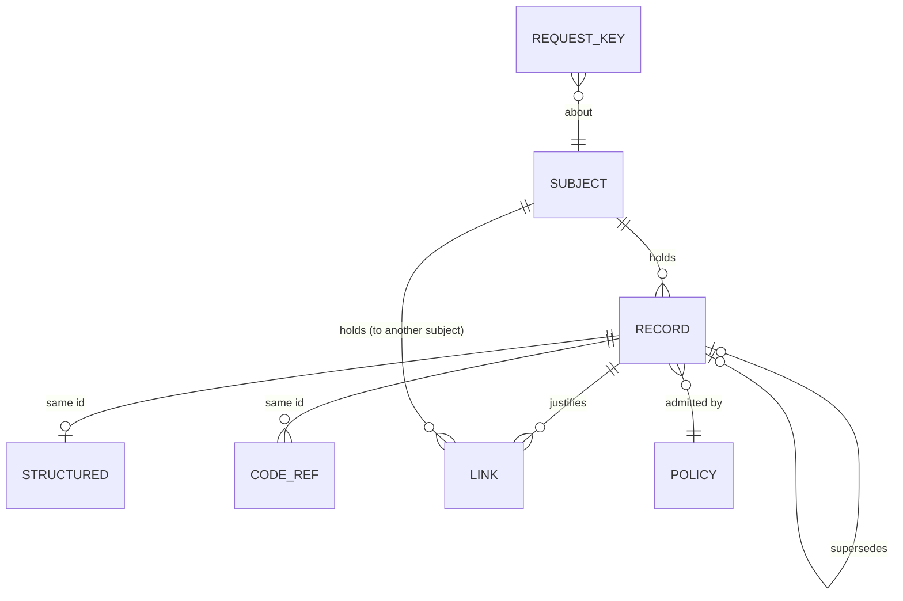
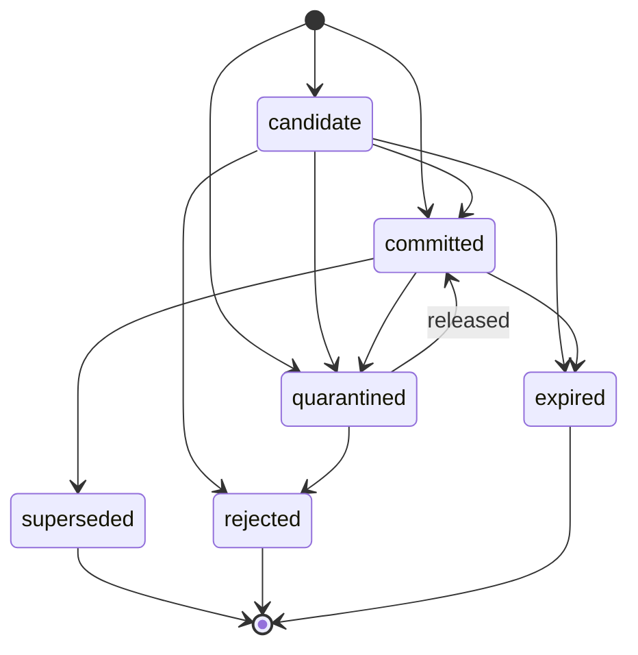

<!-- SPDX-License-Identifier: CC-BY-4.0 -->
# Logical schema v2

This is the data model every MemHouse store holds, independent of how a store lays it out
(TR-CORE-04). The Postgres store maps it to the tables at the end; the Lite store (G16) will map
the same model to SQLite. Exports carry exactly this model ([Memory Format v2](memory-format.md)).

Schema version **7** (`mh_meta.schema_version`). Version 1 to 6 databases upgrade in place on
start-up; see [Upgrading from v1](#upgrading-from-v1). Version 3 added the identity tables
(principals, API keys, token signing keys), version 4 the recall explanations, version 5 the
policy specs and their activations, version 6 the write pipeline's intake queue and version 7
the grants between agents; none of them is memory, so none is exported. Version 7 also added the
`taxonomic` kind and made a record's scope part of its deduplication key.

## Entities

| Entity | What it is | Requirement |
|---|---|---|
| Record | one memory: text, its kind and state, validity, provenance, scope, labels | CORE-02, GOV-03, ACC-04, MEM-04 |
| Structured | the queryable attributes of a record, under the record's id | HYB-02, HYB-04 |
| Code reference | a file a record is about, with the file's content hash | TR-TPL-02 |
| Link | a reference from one subject to another, held by the first | ACC-06 |
| Policy | a compiled policy version and its body | GOV-03 |
| Request key | an idempotency key and the first response to it | CORE-06 |
| Vector | derived from a record's text; stamped with the model and its configuration | INT-07, TR-MS-02 |

One logical id joins a record's representations (HYB-04): its text, keyword index, vectors,
structured row and code references are written together and deleted together.

## Record

| Field | Type | Required | Meaning |
|---|---|---|---|
| `id` | UUID (v7) | yes | the logical id, shared by every representation |
| `tenant` | text | yes | isolation boundary |
| `subject` | text | yes | whose memory it is (`customer:acme`, `user:ana`, `repo:memhouse`); the partition key |
| `kind` | enum | yes | `working`, `episodic`, `semantic`, `preference`, `procedural`, `commitment`, `document`, `taxonomic` (from version 7); each has its own gate, retention, retrieval and access rules ([memory-types.md](memory-types.md)) |
| `status` | enum | yes | lifecycle state, below |
| `content` | text | yes | the text, after redaction |
| `content_hash` | sha256 hex | yes | deduplication key (scheme in [memory-format.md](memory-format.md#content-hash)) |
| `session_id`, `turn_ref` | text | no | the source turn: conversation and message references |
| `occurred_at` | timestamp | no | when the remembered thing happened |
| `valid_from`, `valid_to` | timestamp | from: yes | when the record is true (bitemporal validity) |
| `expires_at` | timestamp | working: yes | after this it is not recalled, and retention marks it `expired` |
| `supersedes`, `superseded_by` | UUID | no | the version chain |
| `labels` | text[] | no | sensitivity labels (ACC-04); recall can exclude labels |
| `tags` | text[] | no | free tags |
| `scope` | {org, team, agent, user, session} | no | where the record applies inside the subject (MEM-04); empty = the whole subject. A reader sees a record when every level it names is the reader's own ([inheritance](memory-types.md#scopes-and-inheritance)) |
| `source` | text | yes | the source label (v1: the writer) |
| `confidence` | 0..1 | yes | |
| `provenance` | object | yes from v2 | `agent` (writing agent), `user` (acting user), `policy_version`, `request_key`, `extractor` and `extractor_config` for derived records |
| `alt_hash` | sha256 hex | no | the key of the round's second vector (the user's words alone) |
| `metadata` | JSON object | yes | open attributes (round number, message references, derivation sources), and the engine's own keys, below |
| `created_at`, `updated_at` | timestamp | yes | |

Not in the logical record, but kept by the store with each vector: `embedder` (model id) and
`embedder_config` (hash of model, dimension and passage prefix), so every vector says what made it.

The engine's keys in `metadata`: `statement` and `route` (what the gate read and where it routed
the record), `held` (`plan`, `speculation` or `signal`: why a candidate is held) and `signals`
(how often a held signal was seen), `duplicate_of`, `supersedes_because`, `confirmed_by`,
`derived` with `source_ids` (an extracted fact and the rounds it came from), `promoted_from`
with `promoted_from_kinds` and `promotion_reason` (a promoted record's sources, MEM-05),
`pref_key` (a keyed preference's key), `ttl` (`session`: working memory that lives as long as
its session), `quarantine_reasons`. A write can't set `promoted_from`, `held`, `signals` or
`pref_key` itself.

### Lifecycle (CORE-02)

Only `committed` records are recalled (and `candidate` ones when a recall asks with
`include_candidates`, labelled, PR-7). `superseded`, `rejected` and `expired` are terminal. A
store refuses any other transition (`set_status` changes nothing and says so), and the
governance check `lifecycle` proves it. Every write is answered as a `candidate` while it waits
in the intake queue (G10; it is not yet a stored row, but its id reads as one). The write gate
then stores it as `committed`, `quarantined`, `rejected` (a near-duplicate, or a revision of a
version that is no longer current), or keeps it `candidate`: a plan or speculation (QUAL-02,
marked `metadata.held`), a plan committed when a completed event in its scope confirms it, and
either `expired` at its `valid_to` or after `intake.plan_ttl_days`; or a proposal from an agent without a commit grant under `[access]
admission = "review"` (GOV-08), which a reviewer commits or rejects.

### Working memory (MEM-01)

`kind = working` records always have `expires_at`: the write's own value, or now + the type's
`ttl_secs` (`[memory] working_ttl_secs`, default 24 hours). One written in a session
(`scope.session`) without its own expiry carries `metadata.ttl = "session"`: every later
working-memory write in the session moves it to the new expiry, so it lives until the session's
last write plus the TTL. Recall skips working memory once expired, and the hourly retention pass
moves it to `expired`. In a session it is served first, from the
[session cache](memory-types.md#working-memory-and-sessions).

## Structured record

`{record_type, attrs}` where `attrs` is a JSON object. Lookups are exact (`attrs @> {...}` on
Postgres), never by similarity (HYB-02). The record's `content` is the text form, so the same id
is also found by recall.

## Code reference

`{path, blob_hash}` per record, at most one per path. A recall that sends a file's current hash
gets back the records whose stored hash differs: those are stale (G19 wires this into recall and
the coding-agent hooks).

## Link

`{tenant, subject, linked_subject, link_type, memory_id?, created_by, created_at}`, unique on
(tenant, subject, linked_subject, link_type). Held in the subject's own partition. Following a link
will require a relationship with the linked subject too (G27). Deleting the justifying record
deletes the link; erasing either subject deletes it.

## Policy

`{version, body, created_at}`: a compiled policy ([policy.md](policy.md)). `version` ends in a hash
of the body, so equal policies get equal versions everywhere: `gov-<hash>` for the default policy
(the configuration), `policy-v<n>-<hash>` for approved spec version n. The body holds every
setting the policy decides (memory types, write gate, retention, redaction, recall, ranking) and,
from G28, the access-decision values (D-01 to D-07). Each record's `provenance.policy_version`
names the policy that admitted it; records from before v2 carry `legacy-v1`.

The specs a compiled policy comes from, their approval and their activations are kept per tenant
(v5) and are not exported: a spec is configuration, not memory.

## Request key

`{tenant, key, subject, operation, request_hash, response, created_at}`. A write with a key that
was seen before returns the stored response if the request is the same, and fails if it differs
(CORE-06). Erasing the subject removes its keys. Exactly-once under concurrent repeats of the same
key arrives with the intake queue (G10).

## Postgres mapping

| Logical | Postgres |
|---|---|
| Record | `mh_memory` (one row; `scope_*` and `prov_*`, `policy_version`, `request_key`, `extractor*` columns; `tsv` generated; `embedding`, `embedding_alt`, `embedder`, `embedder_config`) |
| Structured | `mh_structured` (`memory_id` → `mh_memory.id ON DELETE CASCADE`, GIN on `attrs`) |
| Code reference | `mh_code_ref` (`memory_id` → `mh_memory.id ON DELETE CASCADE`) |
| Link | `mh_link` (`memory_id` → `mh_memory.id ON DELETE CASCADE`) |
| Policy | `mh_policy` |
| Request key | `mh_request_key` |
| Store metadata | `mh_meta`: `schema_version`, `embedder`, `embedding_dim`, `passage_prefix`, re-embedding state |
| Not exported | `mh_embed_cache`, `mh_llm_cache`, `mh_enrich_job`, `mh_audit`, `mh_deletion_ledger` |
| Recall explanations (v4, not exported) | `mh_recall` (id, tenant, subject, principal, acting user, time, the recall record as JSON); erased with the subject, tenant or user, purged after `explanation_retention_days` |
| Policy specs (v5, not exported) | `mh_policy_spec` (tenant, version, spec as JSON, status `proposed` or `approved`, proposer, approver), `mh_policy_activation` (which version, or the default, runs from when, by whom; a trigger refuses a version that is not approved) |
| Intake queue (v6, not exported) | `mh_intake` (the proposal's id, a `seq` for per-subject order, tenant, subject, record ids, writer, user, source and scope for erasure, `status` `pending`, `running`, `done` or `dead`, attempts, lease, the redacted proposal as JSON until it is stored, its outcome, error, embedder with the same guard trigger as `mh_memory`); erased with the subject or tenant, by user, agent or source, pruned after `intake.keep_done_secs` |
| Grants (v7, not exported) | `mh_grant` (id, tenant, grantor and grantee agents, subject pattern, kinds, who created it, expiry, revocation); erased with the tenant. v7 also adds two partial indexes on `mh_memory`: on `metadata -> 'promoted_from'` (what was promoted from a record) and on `(tenant, subject, scope_session)` (a session's records) |
| Identity (v3, not exported) | `mh_principal` (kind, tenant, subjects, kinds, denied labels, org, team, `can_commit`, `act_as`), `mh_api_key` (sha256 of the secret, permissions, expiry, revocation), `mh_signing_key` (token signing secrets) |

## Changing the schema

Every change is **expand, backfill, switch, contract** (TR-DB-01), never a rewrite in place:

1. **Expand**: add nullable columns and new tables (`ADD COLUMN IF NOT EXISTS`). A process on the
   previous version keeps working against the new schema (the `schema_upgrade` check inserts a row
   the way a v1 process would).
2. **Backfill** in batches of 5,000 rows, idempotent, so it can be interrupted.
3. **Switch** readers and writers to the new fields; bump `schema_version`.
4. **Contract** (drop what is no longer used) only in a later version, after every process has
   moved.

A database newer than the binary is refused at start-up. No upgrade re-extracts or re-embeds
stored memories (QUAL-08): the upgrade check compares every vector before and after.

## Upgrading from v1

On the first start of a v2 binary against a v1 database:

| v2 field | Filled from |
|---|---|
| `provenance.agent` | `source` (`enrich` for `enrich:<model>`) |
| `provenance.policy_version` | `legacy-v1` |
| `provenance.extractor`, `extractor_config` | `metadata.extractor`, `metadata.prompt_version` of derived records |
| `embedder`, `embedder_config` | the database's embedder, for rows with a vector |
| `scope`, `user`, `request_key`, `expires_at` | empty (unknown before v2) |

The same rules turn a v1 export into v2 records on import, so upgrading a v1 database and
importing its v1 export give identical v2 exports (governance check `schema_upgrade`).
