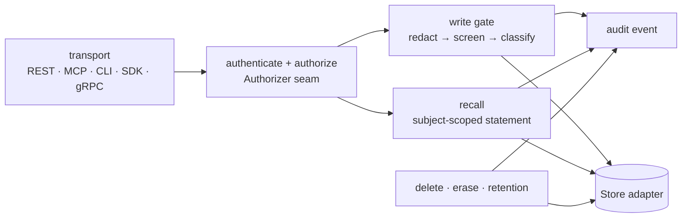

<!-- SPDX-License-Identifier: CC-BY-4.0 -->
# Security baseline (AP-10) — design

AP-10: *partitioning by subject, an access check on every call, audit, deletion across all
representations, PII redaction and the write gate apply in Lite exactly as in Scale.*
TR-CORE-05 adds that these code paths are shared and **cannot be disabled by configuration** in any
profile. This page says where each control lives, what it guarantees, how it is verified, what a
store or transport adapter must do, and what is still missing. Written in goal G03; implemented
across G06, G08, G15, G16 and G22.

## Where the baseline lives

Everything shaded is in `memhouse-core` and runs identically for every transport and store.
Transports only parse and serialise (AP-1, AP-2); stores only persist and query, under the
obligations below.

| Control | Code today | Guarantee | Verified by |
|---|---|---|---|
| Partitioning by subject | every `Store` method takes tenant and subject; `Engine` derives them from the request | no read or write crosses a subject or tenant | `subject_isolation`, `tenant_isolation`, `recall_plan_scoped`, `invariants` |
| Access check on every call | `identity::Authenticator` (keys, tokens) then `access::Authorizer` (`ScopeAuthorizer`) through `caller::Caller`, the only way transports reach the engine | no unauthenticated call; every operation decided, with tenant, scope and denied labels injected | `authentication`, `route_authorization`, `label_filter`, `propose_only`, `authz_latency` |
| Audit | `Store::audit` called by the engine for every write, revision, deletion, erasure, import, retention purge and enrichment batch; hash chain | every change is recorded, tamper-evident | `audit_chain`, `memhouse audit --verify`, `scripts/verify_audit.py` |
| Deletion across representations | `Store::delete`, `delete_subject`, `purge_episodic_older_than` | record, both vectors, derived facts, jobs, LLM cache, ledger row, in one transaction | `deletion`, `subject_erasure`, `enrich_deletion`, `retention_cascade` |
| PII redaction | `gate::screen` on every write path, before embedding | configured categories never reach storage, vectors or the LLM | `pii_redaction`, gate property tests |
| Write gate | `gate::screen` injection screen; quarantine status | instruction-like content is never recalled | `injection_persistence`, `false_quarantine`, `enrich_async_gate` |

## Design rules

1. **One enforcement point.** Every operation enters through an `Engine` method. A transport that
   calls a `Store` directly is a defect (checked in review and by the route-list test of G06).
2. **Authorize before anything else.** From G06 the `Authorizer` is called first in every `Engine`
   method with (principal, operation, tenant, subject, kinds, labels). A missing or failed decision
   denies (PR-5: fail closed on authorization).
3. **A baseline floor configuration can't lower.** From G06:
   - redaction of `secret` is always on; other categories can be added, not removed below the floor
     set by the active policy;
   - the injection screen is always on; `quarantine_injection = false` is rejected at start-up (a
     tenant may only choose stricter handling, such as rejecting instead of quarantining);
   - audit of writes and deletions is always on; `audit_reads` only adds reads;
   - the policy engine (G08) enforces the same floor through precedence (PR-1, POL-04).
4. **Stores carry obligations, not policy.** A store adapter must: filter every statement on tenant
   and subject (and labels inside the statement, TR-RQ-03); implement the deletion cascade in one
   transaction; keep the audit chain linear. The conformance kit (G15) tests each obligation, and
   the governance suite must pass 100% on every profile (PROF-08).
5. **Derived data inherits the source's governance.** Facts, summaries, caches and exports carry
   `source_ids` and are deleted, retained and audited with their sources.
6. **No content in audit, logs or traces** (PR-3): identifiers, hashes, counts and timings only.
7. **New paths need a check.** A goal that adds a write path, a representation or a store adds the
   governance check that proves the baseline holds for it.

## Gaps against this design (and where they close)

| Gap | Today | Goal |
|---|---|---|
| Access by role and attributes only | subject patterns, not relationships | G27 (ReBAC) |
| Operator paths (CLI, benchmark) bypass the authorizer | they hold the database credentials anyway | G22 (row-level security as a second line) |
| Explanation retention is a setting, not policy | `explanation_retention_days` | G08 (a policy default) |
| No second line of defence in the database | direct SQL bypasses everything | G22 (row-level security) |
| Baseline proven on Postgres only | one store | G15 (kits), G16 (Lite passes the same suite) |
