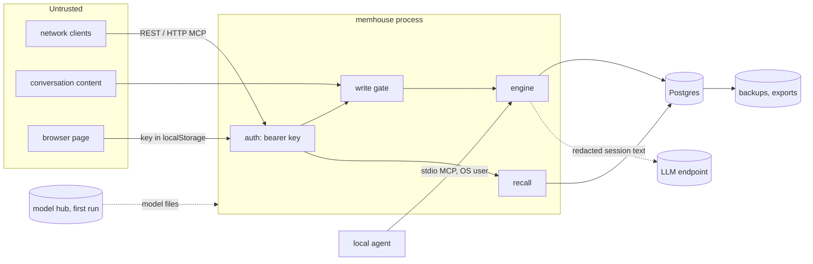

<!-- SPDX-License-Identifier: CC-BY-4.0 -->
# Threat model

STRIDE analysis of MemHouse as built (Standard shape, one binary on Postgres), written in goal G03.
Each threat lists today's control, the gap if any, and the goal that closes it. Review it in every
goal that adds an interface, a store or an outbound call.

## What we protect

| Asset | Why it matters |
|---|---|
| Memory content (conversation rounds, facts, preferences, commitments) | personal and business data, often regulated |
| Embeddings | derived from content; text can be partly reconstructed from them, so they are as sensitive as the text |
| Audit log and deletion ledger | evidence for compliance; tampering hides misuse |
| API keys, database credentials, LLM keys | full access to the above |
| Policy and configuration | loosening it silently removes protections |
| Exports, backups, LLM cache, embedding cache | copies of all of the above outside the main table |

## Who we defend against

| Actor | Capability |
|---|---|
| Network attacker | reaches the HTTP port; no key |
| Compromised or prompt-injected agent | holds a valid key; sends whatever an attacker put in its context |
| Malicious content author | gets text into conversations that are stored (memory poisoning) |
| Another tenant or subject | holds a valid key for its own data |
| Operator or insider with database access | reads or edits tables directly, bypassing the service |
| LLM provider used for enrichment | receives session text |
| Supply chain | a compromised crate, model file or build step |

## Trust boundaries

## Threats and controls

| # | STRIDE | Threat | Control today | Gap → goal |
|---|---|---|---|---|
| T1 | Spoofing | Unauthenticated calls to REST or HTTP MCP | every `/v1/*` route and `/mcp` require a bearer key, compared in constant time; no unauthenticated mode; server binds `127.0.0.1` by default | closed in G06: principals with their own keys and permissions, agent tokens of at most an hour, failed attempts audited (`authentication` check) |
| T2 | Spoofing | Key stolen from the config file or environment | config written with mode 0600; keys never logged | principals' keys are stored as hashes and rotate with a grace period (G06); bootstrap keys in the config are still plain text, so remove them after set-up; secrets policy in `docs/security/secrets.md` |
| T3 | Spoofing / Info disclosure | Memory Browser key theft through script injection | page escapes all memory text; **G03 fixed a stored XSS** where a crafted subject name could run script from the subject list, with a regression test (`browser_never_interpolates_data_into_inline_handlers`) | key kept in `localStorage`; no Content-Security-Policy; CORS allows any origin → **G20** (console with session login, CSP, origin allow-list) |
| T4 | Tampering | Memory poisoning: instructions stored as memories and later recalled into an agent's context | deterministic injection screen on every write path, including LLM-extracted facts; quarantined records never recalled (governance checks `injection_persistence`, `enrich_async_gate`) | pattern-based, so novel phrasings get through; no candidate review or per-source trust → **G10** (candidates, classification), **G22** (untrusted-source candidates, bulk purge by source), **G20** (quarantine console) |
| T5 | Tampering | Silent overwrite or rewrite of history | supersession keeps prior versions; hash-chained audit with an independent verifier | a database superuser can rewrite the whole chain → **G22** (head anchoring to WORM storage or a SIEM) |
| T6 | Tampering | Direct database edits bypass the gate | the service is the only writer by convention | no second line of defence → **G22** (row-level security keyed on tenant and subject) |
| T7 | Repudiation | An agent denies a write or a deletion | audit event per write, revision, deletion, erasure, import and retention purge, with actor | actor is the verified principal (G06); every recall keeps an explanation of what was returned and excluded (G07, 30 days by default); reads are in the audit log only with `audit_reads` |
| T8 | Info disclosure | One subject or tenant reads another's memories | every statement filters on tenant and subject; recall's plan reads only the subject's rows, checked by `recall_plan_scoped` (G01, tightened in G01 after the check found a whole-table read) | subject patterns, tenant and scope enforced by the authorizer (G06); relationships → **G27** |
| T9 | Info disclosure | PII and secrets stored, embedded or sent to an LLM | redaction before embedding, storage and enrichment (secrets, cards, SSNs, IBANs; optional email, phone, IP); `pii_redaction` check | pattern-based, misses names and free-text health data; `secret` redaction can't be configured off (G06 floor) → **G22** (redact / mask / reject per category) |
| T10 | Info disclosure | Enrichment sends conversation text to a third party | off by default; only redacted text, assistant replies truncated; any OpenAI-compatible endpoint, including local | no egress policy per tenant → **G29** (egress control, sovereign tenants) |
| T11 | Info disclosure | Deleted data survives in caches, derived facts or backups | deletion and retention cascade to cached vectors, derived facts, jobs and the LLM cache (`deletion`, `subject_erasure`, `enrich_deletion`, `retention_cascade`); deletion ledger | ledger replay after restore is a manual SQL procedure → **G22** (`memhouse restore`) |
| T12 | Info disclosure | Exports and backups leak | exports only through the CLI with database access | no encryption of exports or at the application layer → **G29** (envelope encryption, customer-managed keys) |
| T13 | Info disclosure | Logs or traces contain content | logs and spans carry identifiers and timings; provider errors keep only status, `type` and `code`, never the provider's message (which can quote the input); checked over every span and log event, provider failures included (`telemetry_no_content`) | the check covers MemHouse's own instrumentation; what a collector or another process adds to exported traces is outside it |
| T14 | Denial of service | Oversized or expensive requests | `max_content_chars`; request bodies limited by the framework; one SQL statement per recall probe | no rate limits, admission control or per-tenant quotas → **G25** (quotas), **G30** (admission control, surge mode) |
| T15 | Denial of service | Enrichment cost runaway | `max_cost_usd` per process; LLM cache; skip of short sessions | no per-tenant budget → **G25** |
| T16 | Elevation of privilege | Agent commits directly or widens its own access | agents only propose; commits by the engine or a reviewer; a direct-commit grant is explicit and audited (G06, `propose_only` check) | **G08** (policy precedence: behaviour can't loosen governance) |
| T17 | Elevation of privilege | Configuration turns a baseline control off (redaction, quarantine) | defaults are safe | closed in G06: start-up refuses a config without `secret` redaction or with the injection screen off |
| T18 | Supply chain | Malicious dependency or licence violation | `cargo-deny` (advisories, licences, crates.io only); lock file committed | no SBOM or signed builds → **G21**; reproducible builds → **G33** |
| T19 | Supply chain | Tampered embedding model files | downloaded once over HTTPS from the model hub | no pinned revision or checksum → **G16** (pin model revisions and verify hashes), **G35** (offline bundles) |
| T20 | Supply chain | Secrets committed to a repository | secret scanner in pre-commit and CI over tree and history (G02) | forge push protection arrives with publication → **G09** |
| T21 | Spoofing | Local stdio MCP used by another local user | runs as the invoking OS user with that user's config | shared machines rely on file permissions only; documented |
| T22 | Info disclosure | A remote embedding API receives every memory and query | off by default (local model); opt-in with `[embedding] provider = "openai"`; text is redacted by the gate before embedding; the key is read from a named variable and never logged; error messages quote at most 500 characters of the endpoint's reply | no egress policy per tenant, and query text is sent unredacted to the same endpoint → **G29** (egress control, sovereign mode refuses a non-local embedder) |

## Review triggers

Update this model when a goal adds: a network interface or transport (G05, G18, G30), a store or
profile (G16, G32, G33), an outbound call or connector (G23), identity or access logic (G06, G27,
G28, G29).
